## Overview

### Learning outcomes

- Inspect raw data and identify common data-quality problems.
- Handle missing values and encode categorical variables.
- Explore distributions, relationships and class balance using plots.
- Explain scaling and avoid data leakage during preprocessing.

## Summary

### Week 2 workflow: from raw CKD data

<div style="overflow-x: auto; padding: 10px 0;">
  <div style="display: flex; gap: 24px; min-width: max-content;">
    <!-- 01 Inspect -->
    <div style="background-color: #e8f5f5; border-radius: 24px; box-shadow: 0 2px 4px #00000033; padding: 24px 28px; min-width: 200px;">
      <div style="color:#008888; font-size:18px; font-weight:bold;">01</div>
      <div style="color:#1a2b42; font-size:17px; font-weight:bold; margin-top:8px;">Inspect</div>
    </div>
    <!-- 02 Clean values -->
    <div style="background-color: #e8f5f5; border-radius: 24px; box-shadow: 0 2px 4px #00000033; padding: 24px 28px; min-width: 200px;">
      <div style="color:#008888; font-size:18px; font-weight:bold;">02</div>
      <div style="color:#1a2b42; font-size:17px; font-weight:bold; margin-top:8px;">Clean values</div>
    </div>
    <!-- 03 Explore & visualize -->
    <div style="background-color: #e8f5f5; border-radius: 24px; box-shadow: 0 2px 4px #00000033; padding: 24px 28px; min-width: 200px;">
      <div style="color:#008888; font-size:18px; font-weight:bold;">03</div>
      <div style="color:#1a2b42; font-size:17px; font-weight:bold; margin-top:8px;">Explore & visualize</div>
    </div>
    <!-- 04 Split -->
    <div style="background-color: #e8f5f5; border-radius: 24px; box-shadow: 0 2px 4px #00000033; padding: 24px 28px; min-width: 200px;">
      <div style="color:#008888; font-size:18px; font-weight:bold;">04</div>
      <div style="color:#1a2b42; font-size:17px; font-weight:bold; margin-top:8px;">Split</div>
    </div>
  </div>
  <div style="display: flex; gap: 24px; min-width: max-content; margin-top:32px;">
    <!-- 05 Fit preprocessing on train -->
    <div style="background-color: #f2f6fa; border-radius: 24px; box-shadow: 0 2px 4px #00000033; padding: 24px 28px; min-width: 200px;">
      <div style="color:#008888; font-size:18px; font-weight:bold;">05</div>
      <div style="color:#1a2b42; font-size:17px; font-weight:bold; margin-top:8px; line-height:1.2;">Fit preprocessing<br>on train</div>
    </div>
    <!-- 06 Transform test -->
    <div style="background-color: #f2f6fa; border-radius: 24px; box-shadow: 0 2px 4px #00000033; padding: 24px 28px; min-width: 200px;">
      <div style="color:#008888; font-size:18px; font-weight:bold;">06</div>
      <div style="color:#1a2b42; font-size:17px; font-weight:bold; margin-top:8px;">Transform test</div>
    </div>
    <!-- 07 Ready for models -->
    <div style="background-color: #f2f6fa; border-radius: 24px; box-shadow: 0 2px 4px #00000033; padding: 24px 28px; min-width: 200px;">
      <div style="color:#008888; font-size:18px; font-weight:bold;">07</div>
      <div style="color:#1a2b42; font-size:17px; font-weight:bold; margin-top:8px;">Ready for models</div>
    </div>
  </div>
</div>

## Overview

### Why preprocessing matters

<div style="overflow-x: auto; padding: 10px 0;">
  <div style="display: flex; gap: 24px; min-width: max-content;">
    <!-- RAW DATA 卡片 -->
    <div style="background-color: #e8f5f5; border-radius: 40px; box-shadow: 0 2px 4px #00000033; padding: 32px; min-width: 300px;">
      <div style="color:#008888; font-size:21px; font-weight:bold; margin-bottom:24px;">RAW DATA</div>
      <div style="color:#1a2b42; font-size:16px; line-height:1.8;">
        <div>Missing observations</div>
        <div>Inconsistent categories</div>
        <div>Incorrect data types</div>
        <div>Different numerical scales</div>
      </div>
    </div>
    <!-- MODEL‑READY DATA 卡片 -->
    <div style="background-color: #f2f6fa; border-radius: 40px; box-shadow: 0 2px 4px #00000033; padding: 32px; min-width: 300px;">
      <div style="color:#008888; font-size:21px; font-weight:bold; margin-bottom:24px;">MODEL‑READY DATA</div>
      <div style="color:#1a2b42; font-size:16px; line-height:1.8;">
        <div>Consistent values</div>
        <div>Suitable numerical inputs</div>
        <div>Documented transformations</div>
        <div>Reliable evaluation</div>
      </div>
    </div>
  </div>
</div>

## Dataset

### Our running example: CKD dataset

> 400 patient records  •  26 columns  •  Binary target

- Task: predict CKD vs not CKD (classification).
- Examples of inputs: age, blood pressure, haemoglobin and clinical indicators.
- The original file contains missing values and inconsistent text entries.

### First inspect the data

<div style="overflow-x: auto; padding: 10px 0;">
  <div style="display: flex; gap: 24px; min-width: max-content;">
    <!-- What to check 卡片 -->
    <div style="background-color: #e8f5f5; border-radius: 40px; box-shadow: 0 2px 4px #00000033; padding: 32px; min-width: 300px;">
      <div style="color:#008888; font-size:21px; font-weight:bold; margin-bottom:24px;">What to check</div>
      <div style="color:#1a2b42; font-size:16px; line-height:1.8;">
        <div>Number of rows and columns</div>
        <div>Column names and data types</div>
        <div>Sample records</div>
        <div>Summary statistics</div>
      </div>
    </div>
    <!-- Useful pandas tools 卡片 -->
    <div style="background-color: #f2f6fa; border-radius: 40px; box-shadow: 0 2px 4px #00000033; padding: 32px; min-width: 300px;">
      <div style="color:#008888; font-size:21px; font-weight:bold; margin-bottom:24px;">Useful pandas tools</div>
      <div style="color:#1a2b42; font-size:16px; line-height:1.8;">
        <div>head() and tail()</div>
        <div>shape and info()</div>
        <div>describe()</div>
        <div>value_counts()</div>
      </div>
    </div>
  </div>
</div>

### CKD: the first inspection

```python
# to check the data dimensions in terms of rows by columns use the df.shape ()
df.shape
```
```bash
(400, 26)
```

### Spot data-quality problems

- Missing numerical observations (e.g., haemoglobin or sodium).
- Some numeric-looking columns are stored as text.
- Inconsistent categories: extra spaces, tabs or spelling variants.
- Identifier columns may not be useful predictors.

## Data Cleaning

```python
# replace incorrect values
df['dm'] replace(to_replace = ('Itno': 'no', 'Ityes': 'yes', 'yes': 'yes'}, inplace=True)
df['cad'] = df['cad']. replace(to_replace = 'Itno', value='no')
df['classification'] = df['classification'].replace(to_replace = ('ckd\t': 'ckd', 'notckd': 'not ckd'})
```
```python
#print the columns belwo to see their current values
cols = ['dm', 'cad', 'classification']
for col in cols:
    print(f"{col} has {df[col].unique()} values \n")
```
```bash
dm has ['yes' 'no' nan] values
cad has ['no' 'yes' nan] values
classification has ['ckd' 'not ckd'] values
```

## Missing Values

### Missing data: what does it mean

<div style="overflow-x: auto; padding: 10px 0;">
  <div style="display: flex; gap: 24px; min-width: max-content;">
    <!-- Examples 卡片 -->
    <div style="background-color: #e8f5f5; border-radius: 40px; box-shadow: 0 2px 4px #00000033; padding: 32px; min-width: 300px;">
      <div style="color:#008888; font-size:21px; font-weight:bold; margin-bottom:24px;">Examples</div>
      <div style="color:#1a2b42; font-size:16px; line-height:1.8;">
        <div>Age: missing</div>
        <div>Blood pressure: missing</div>
        <div>Red blood cells: missing</div>
      </div>
    </div>
    <!-- Why it matters 卡片 -->
    <div style="background-color: #f2f6fa; border-radius: 40px; box-shadow: 0 2px 4px #00000033; padding: 32px; min-width: 300px;">
      <div style="color:#008888; font-size:21px; font-weight:bold; margin-bottom:24px;">Why it matters</div>
      <div style="color:#1a2b42; font-size:16px; line-height:1.8;">
        <div>Fewer usable observations</div>
        <div>Biased descriptive summaries</div>
        <div>Some algorithms cannot accept NaN</div>
      </div>
    </div>
  </div>
</div>

### How much data is missing

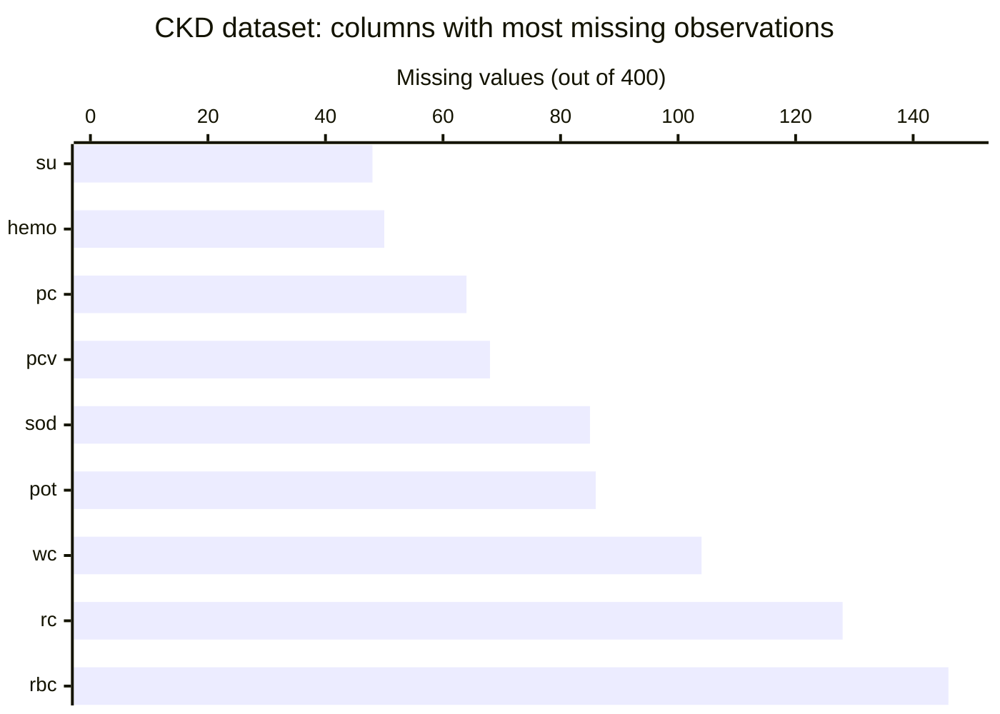

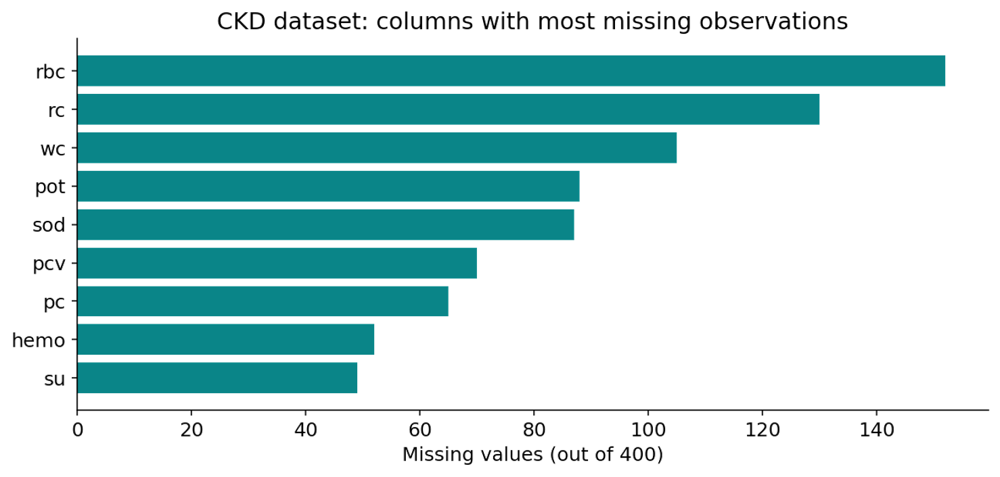

### Three common missing-data strategies

- Remove rows or columns: only when the loss is acceptable.
- Mean: simple numerical imputation, sensitive to outliers.
- Median: useful for skewed numerical data.
- Mode / most frequent: a common choice for categorical data.

### Mean versus median: a small example

<div style="overflow-x: auto; padding: 10px 0;">
  <div style="display: flex; gap: 24px; min-width: max-content;">
    <!-- Mean imputation 卡片 -->
    <div style="background-color: #e8f5f5; border-radius: 40px; box-shadow: 0 2px 4px #00000033; padding: 32px; min-width: 300px;">
      <div style="color:#008888; font-size:21px; font-weight:bold; margin-bottom:24px;">Mean imputation</div>
      <div style="color:#1a2b42; font-size:16px; line-height:1.8;">
        <div>Values: 10, 12, 13, 15, 100</div>
        <div>Mean = 30</div>
        <div>Affected by the outlier</div>
      </div>
    </div>
    <!-- Median imputation 卡片 -->
    <div style="background-color: #f2f6fa; border-radius: 40px; box-shadow: 0 2px 4px #00000033; padding: 32px; min-width: 300px;">
      <div style="color:#008888; font-size:21px; font-weight:bold; margin-bottom:24px;">Median imputation</div>
      <div style="color:#1a2b42; font-size:16px; line-height:1.8;">
        <div>Values: 10, 12, 13, 15, 100</div>
        <div>Median = 13</div>
        <div>More robust to the outlier</div>
      </div>
    </div>
  </div>
</div>

### Imputation: what belongs in Week 2

<div style="overflow-x: auto; padding: 10px 0;">
  <div style="display: flex; gap: 24px; min-width: max-content;">
    <!-- Core techniques 卡片 -->
    <div style="background-color: #e8f5f5; border-radius: 40px; box-shadow: 0 2px 4px #00000033; padding: 32px; min-width: 300px;">
      <div style="color:#008888; font-size:21px; font-weight:bold; margin-bottom:24px;">Core techniques</div>
      <div style="color:#1a2b42; font-size:16px; line-height:1.8;">
        <div>Mean / median for numeric</div>
        <div>Most frequent for categories</div>
        <div>Constant "Missing" when meaningful</div>
      </div>
    </div>
    <!-- Advanced methods (optional) 卡片 -->
    <div style="background-color: #f2f6fa; border-radius: 40px; box-shadow: 0 2px 4px #00000033; padding: 32px; min-width: 300px;">
      <div style="color:#008888; font-size:21px; font-weight:bold; margin-bottom:24px;">Advanced methods (optional)</div>
      <div style="color:#1a2b42; font-size:16px; line-height:1.8;">
        <div>KNN imputation</div>
        <div>Iterative imputation</div>
        <div>Model‑based estimates</div>
      </div>
    </div>
  </div>
</div>

### Imputation: a correct workflow

- Split into training and testing sets first.
- Learn imputation values from the training set only.
- Apply the learned transformation to both sets.
- Do not use test-set statistics to prepare training data.

## Encoding

### Categorical variables

<div style="overflow-x: auto; padding: 10px 0;">
  <div style="display: flex; gap: 24px; min-width: max-content;">
    <!-- Nominal (no order) 卡片 -->
    <div style="background-color: #e8f5f5; border-radius: 40px; box-shadow: 0 2px 4px #00000033; padding: 32px; min-width: 300px;">
      <div style="color:#008888; font-size:21px; font-weight:bold; margin-bottom:24px;">Nominal (no order)</div>
      <div style="color:#1a2b42; font-size:16px; line-height:1.8;">
        <div>CKD status: CKD / not CKD</div>
        <div>Appetite: good / poor</div>
        <div>Diabetes: yes / no</div>
      </div>
    </div>
    <!-- Ordinal (meaningful order) 卡片 -->
    <div style="background-color: #f2f6fa; border-radius: 40px; box-shadow: 0 2px 4px #00000033; padding: 32px; min-width: 300px;">
      <div style="color:#008888; font-size:21px; font-weight:bold; margin-bottom:24px;">Ordinal (meaningful order)</div>
      <div style="color:#1a2b42; font-size:16px; line-height:1.8;">
        <div>Low / medium / high</div>
        <div>Stage 1 / stage 2 / stage 3</div>
        <div style="margin-top:20px;">Choose encoding to match the meaning.</div>
      </div>
    </div>
  </div>
</div>

### Label and one-hot encoding

<div style="overflow-x: auto; padding: 10px 0;">
  <div style="display: flex; gap: 24px; min-width: max-content;">
    <!-- Binary / ordinal encoding 卡片 -->
    <div style="background-color: #e8f5f5; border-radius: 40px; box-shadow: 0 2px 4px #00000033; padding: 32px; min-width: 300px;">
      <div style="color:#008888; font-size:21px; font-weight:bold; margin-bottom:24px;">Binary / ordinal encoding</div>
      <div style="color:#1a2b42; font-size:16px; line-height:1.8;">
        <div>No → 0</div>
        <div>Yes → 1</div>
        <div style="margin-top:20px;">Ordinal codes only when order is real.</div>
      </div>
    </div>
    <!-- One‑hot encoding 卡片 -->
    <div style="background-color: #f2f6fa; border-radius: 40px; box-shadow: 0 2px 4px #00000033; padding: 32px; min-width: 300px;">
      <div style="color:#008888; font-size:21px; font-weight:bold; margin-bottom:24px;">One‑hot encoding</div>
      <div style="color:#1a2b42; font-size:16px; line-height:1.8;">
        <div>Good → [1, 0]</div>
        <div>Poor → [0, 1]</div>
        <div style="margin-top:20px;">Avoid imposing a false order on nominal values.</div>
      </div>
    </div>
  </div>
</div>

### Why does this matter for machine learning

Most machine learning algorithms require numerical inputs. Therefore, we need to convert categorical values into numbers, a process called encoding.

### Encoding example: CKD categories

> Original categories:   yes   |   no   |   “\tyes”   |   “\tno”

- Clean inconsistent strings first.
- Convert yes/no to 1/0, or use one-hot encoding when appropriate.
- Treat missing categories explicitly rather than silently dropping them.

## Exploratory Analysis

### EDA: ask questions before modeling

- How are numerical values distributed?
- Are there extreme values or unusual observations?
- Which variables move together?
- How do measurements differ between CKD and non-CKD groups?
- Is the target distribution balanced?

### Descriptive statistics

<div style="overflow-x: auto; padding: 10px 0;">
  <div style="display: flex; gap: 24px; min-width: max-content;">
    <!-- Center and spread 卡片 -->
    <div style="background-color: #e8f5f5; border-radius: 40px; box-shadow: 0 2px 4px #00000033; padding: 32px; width: 400px; word-wrap: break-word;">
      <div style="color:#008888; font-size:21px; font-weight:bold; margin-bottom:24px;">Center and spread</div>
      <div style="color:#1a2b42; font-size:16px; line-height:1.8;">
        <div>Mean / median</div>
        <div>Minimum / maximum</div>
        <div>Standard deviation</div>
      </div>
    </div>
    <!-- Data quality clues 卡片，宽度与左侧保持一致，文字自动换行 -->
    <div style="background-color: #f2f6fa; border-radius: 40px; box-shadow: 0 2px 4px #00000033; padding: 32px; width: 400px; word-wrap: break-word;">
      <div style="color:#008888; font-size:21px; font-weight:bold; margin-bottom:24px;">Data quality clues</div>
      <div style="color:#1a2b42; font-size:12px; line-height:1.6;">
        <div><strong>Unexpected ranges:</strong> Values outside a reasonable range. eg: A patient age of 250 years</div>
        <div style="margin-top:16px;"><strong>Strong skewness:</strong> Most values are concentrated on one side, with a long tail on the other. eg: Most patients have low creatinine levels, but a few have very high values.</div>
        <div style="margin-top:16px;"><strong>Extreme outliers:</strong> Values much higher or lower than most observations. eg: A blood pressure value of 500 mmHg</div>
        <br>
        <div style="margin-top:24px;">Different units: Features measured using different units or scales. eg: Age in years versus blood pressure in mmHg</div>
      </div>
    </div>
  </div>
</div>

## Visualization

### Histogram: numerical distribution

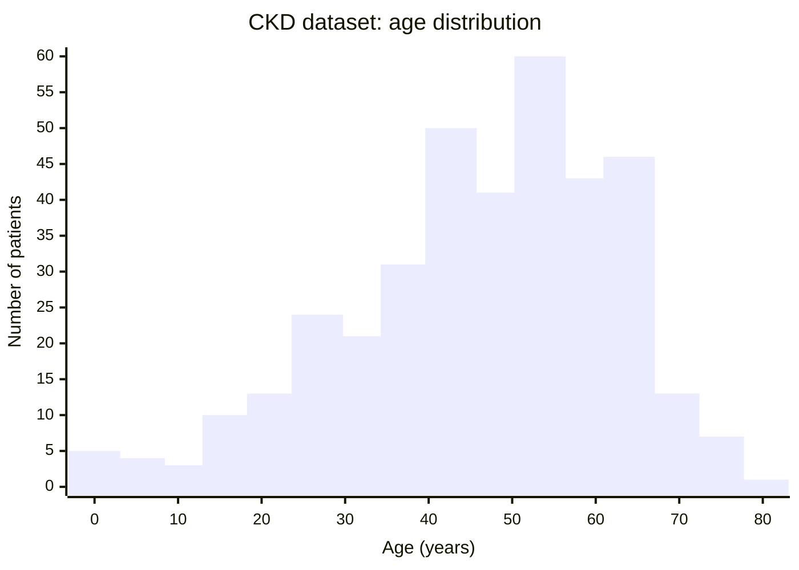

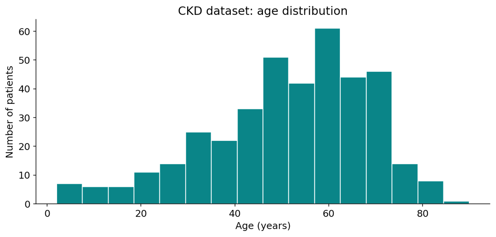

Use a histogram to understand shape, spread and possible skewness.

#### Conclusion

Most patients in the dataset are between approximately 40 and 75 years old, with the highest concentration around 55–65 years. The age distribution appears slightly left-skewed, with relatively few younger patients.

### Box plot: spread and outliers

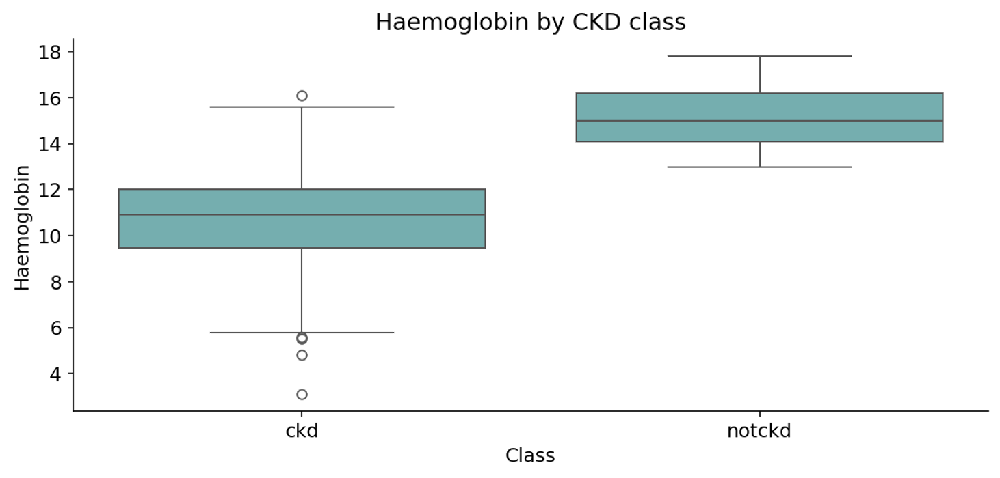

### Violin plot: distribution by class

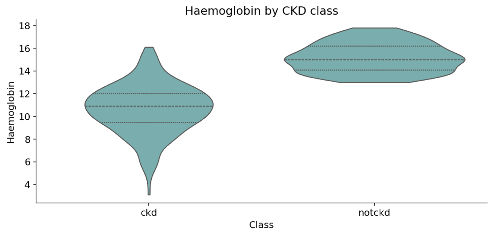

A violin plot shows distribution density as well as differences between groups.

### Which plot you should choose

<div style="display: flex; gap: 24px; overflow-x: auto; padding: 8px;">
  <!-- One variable 卡片 -->
  <div style="flex: 0 0 auto; background-color: #e8f5f4; border-radius: 32px; padding: 32px; white-space: nowrap; min-width: 300px;">
    <h2 style="color:#008080; margin-top:0; margin-bottom:28px; font-size:16px; font-weight: bold;">One variable</h2>
    <div style="font-size:14px; color:#1a2436; line-height:2.2;">
      <div>Histogram → distribution</div>
      <div>Box plot → spread and outliers</div>
      <div>Violin → density by group</div>
      <div>Count plot → category frequency</div>
    </div>
  </div>
  <!-- Two or more variables 卡片 -->
  <div style="flex: 0 0 auto; background-color: #f2f4f8; border-radius: 32px; padding: 32px; white-space: nowrap; min-width: 300px;">
    <h2 style="color:#008080; margin-top:0; margin-bottom:28px; font-size:16px; font-weight: bold;">Two or more variables</h2>
    <div style="font-size:14px; color:#1a2436; line-height:2.2;">
      <div>Scatter plot → numeric relationship</div>
      <div>Correlation heatmap → associations</div>
      <div>Pair plot → selected feature pairs</div>
      <div style="margin-top:24px;">Choose plots that answer a question.</div>
    </div>
  </div>
</div>

### Count plot: class distribution

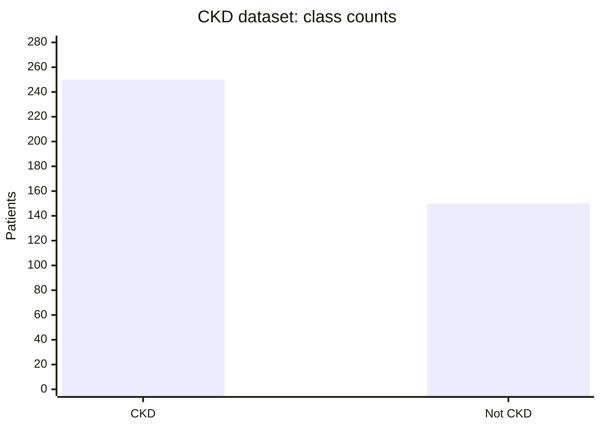

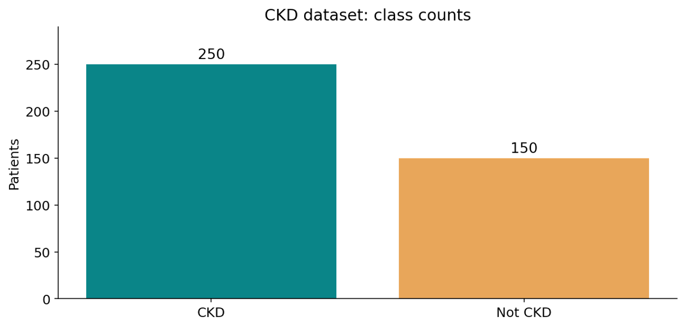

### Correlation: what does it show

- Correlation measures the direction and strength of association.
- Positive: two variables tend to increase together.
- Negative: one tends to decrease as the other increases.
- Correlation does not establish causation.

### Correlation heatmap: CKD measurements

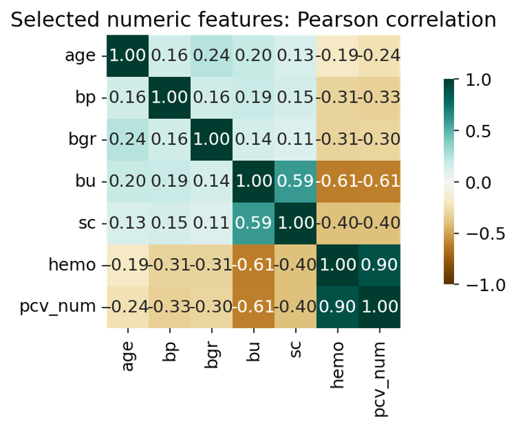

### Scatter plot: investigate a relationship

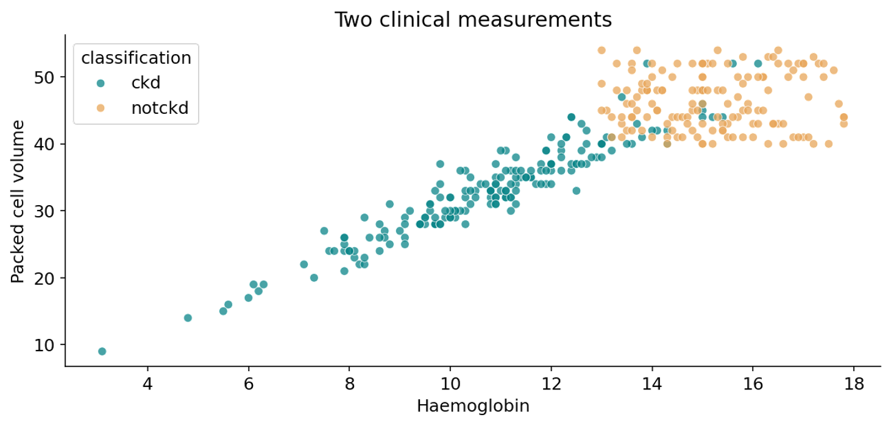

### Visualization examples

| 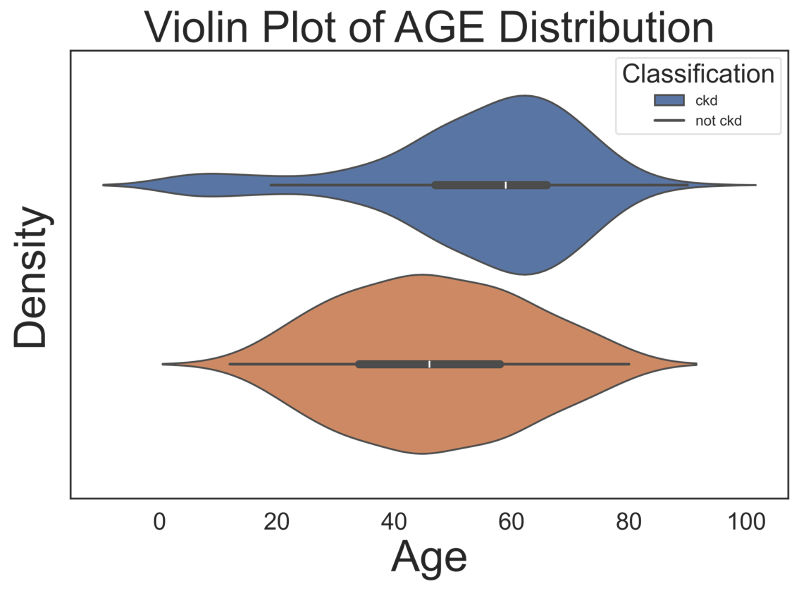 | 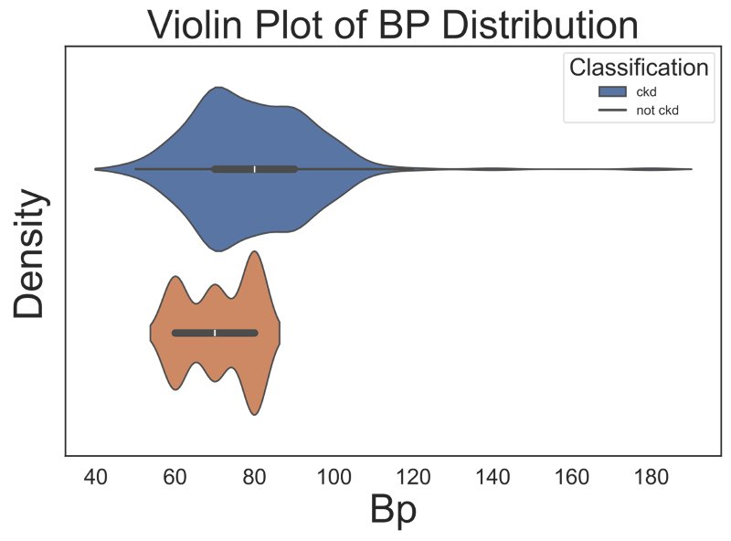 |
| ---------------------------------------- | ---------------------------------------- |

Selected original screenshots: KDE and violin-style plots. More advanced plots can be explored in the seminar.

## Class Balance

### Class imbalance: why it matters

- A model can favor the majority class when class frequencies differ.
- The CKD dataset contains 250 CKD and 150 non-CKD records.
- This difference is worth examining, but it does not automatically require SMOTE.
- Choose a remedy based on training results and evaluation metrics.

### Options for imbalanced classes

<div style="display: flex; gap: 24px; overflow-x: auto; padding: 8px;">
  <!-- Simple approaches 卡片 -->
  <div style="flex: 0 0 auto; background-color: #e8f5f4; border-radius: 32px; padding: 32px; white-space: nowrap; min-width: 300px;">
    <h2 style="color:#008080; margin-top:0; margin-bottom:28px; font-size:16px; font-weight: bold;">Simple approaches</h2>
    <div style="font-size:14px; color:#1a2436; line-height:2.2;">
      <div>Stratified train–test split</div>
      <div>Class weights (when supported)</div>
      <div>Evaluate precision, recall and F1</div>
    </div>
  </div>
  <!-- Resampling (when needed) 卡片 -->
  <div style="flex: 0 0 auto; background-color: #f2f4f8; border-radius: 32px; padding: 32px; white-space: nowrap; min-width: 300px;">
    <h2 style="color:#008080; margin-top:0; margin-bottom:28px; font-size:16px; font-weight: bold;">Resampling (when needed)</h2>
    <div style="font-size:14px; color:#1a2436; line-height:2.2;">
      <div>Random oversampling</div>
      <div>Random undersampling</div>
      <div>SMOTE: synthetic minority samples</div>
      <div>(Synthetic Minority Over‑sampling</div>
      <div>Technique)</div>
    </div>
  </div>
</div>

### SMOTE: concept, not advanced implementation

> SMOTE creates synthetic minority-class examples between nearby samples.

- It is not the same as copying rows.
- It may help in some tasks, but is not always appropriate.
- Do not apply SMOTE to the test set or before cross-validation splitting.
- SVMSMOTE is optional advanced material, not required for Week 2.

## Feature Scaling

### Why scaling matters

<div style="display: flex; gap: 24px; overflow-x: auto; padding: 8px;">
  <!-- Example: very different scales 卡片 -->
  <div style="flex: 0 0 auto; background-color: #e8f5f4; border-radius: 32px; padding: 32px; white-space: nowrap; min-width: 300px;">
    <h2 style="color:#008080; margin-top:0; margin-bottom:28px; font-size:16px; font-weight: bold;">Example: very different scales</h2>
    <div style="font-size:14px; color:#1a2436; line-height:2.2;">
      <div>Age: 7–90</div>
      <div>Blood pressure: tens / hundreds</div>
      <div>Blood glucose: often hundreds</div>
    </div>
  </div>
  <!-- Impact on learning 卡片 -->
  <div style="flex: 0 0 auto; background-color: #f2f4f8; border-radius: 32px; padding: 32px; white-space: nowrap; min-width: 300px;">
    <h2 style="color:#008080; margin-top:0; margin-bottom:28px; font-size:16px; font-weight: bold;">Impact on learning</h2>
    <div style="font-size:14px; color:#1a2436; line-height:2.2;">
      <div>Distance‑based models can be dominated<br>by larger numeric ranges.</div>
      <div>Scaling helps compare features fairly.</div>
    </div>
  </div>
</div>

### Normalization versus standardization

<div style="display: flex; gap: 24px; overflow-x: auto; padding: 8px;">
  <!-- Min–Max scaling 卡片 -->
  <div style="flex: 0 0 auto; background-color: #e8f5f4; border-radius: 32px; padding: 32px; white-space: nowrap; min-width: 300px;">
    <h2 style="color:#008080; margin-top:0; margin-bottom:28px; font-size:16px; font-weight: bold;">Min–Max scaling</h2>
    <div style="font-size:14px; color:#1a2436; line-height:2.2;">
      <div>Maps observed training values into a chosen</div>
      <div>range (often 0 to 1).</div>
      <div style="margin-top:24px;">x' = (x − min) / (max − min)</div>
    </div>
  </div>
  <!-- Standardization 卡片 -->
  <div style="flex: 0 0 auto; background-color: #f2f4f8; border-radius: 32px; padding: 32px; white-space: nowrap; min-width: 300px;">
    <h2 style="color:#008080; margin-top:0; margin-bottom:28px; font-size:16px; font-weight: bold;">Standardization</h2>
    <div style="font-size:14px; color:#1a2436; line-height:2.2;">
      <div>Centers by training mean and scales by</div>
      <div>training standard deviation.</div>
      <div style="margin-top:24px;">z = (x − μ) / σ</div>
    </div>
  </div>
</div>

### Numerical scaling example

<div style="display: flex; gap: 24px; overflow-x: auto; padding: 8px;">
  <!-- Min–Max 卡片 -->
  <div style="flex: 0 0 auto; background-color: #e8f5f4; border-radius: 32px; padding: 32px; white-space: nowrap; min-width: 300px;">
    <h2 style="color:#008080; margin-top:0; margin-bottom:28px; font-size:16px; font-weight: bold;">Min–Max</h2>
    <div style="font-size:14px; color:#1a2436; line-height:2.2;">
      <div>Training values: 10, 20, 30</div>
      <div>New value: 20</div>
      <div>(20 − 10) / (30 − 10) = 0.5</div>
    </div>
  </div>

  <!-- Standard score 卡片 -->
  <div style="flex: 0 0 auto; background-color: #f2f4f8; border-radius: 32px; padding: 32px; white-space: nowrap; min-width: 300px;">
    <h2 style="color:#008080; margin-top:0; margin-bottom:28px; font-size:16px; font-weight: bold;">Standard score</h2>
    <div style="font-size:14px; color:#1a2436; line-height:2.2;">
      <div>Training values: 10, 20, 30</div>
      <div>Mean = 20</div>
      <div>(20 − 20) / σ = 0</div>
    </div>
  </div>
</div>

## Best Practice

### Avoid data leakage

- Split the data before fitting imputers, encoders or scalers.
- Fit preprocessing transformations on training data only.
- Apply the fitted transformations to validation and test data.
- Within cross-validation, use a pipeline so each fold is processed correctly.

## Review

### Quick review: check your understanding

::: collapse
- Why might median imputation be preferable to mean?

  Median imputation is more robust against outliers and skewed data. The mean can be heavily biased by extreme values, while the median remains unaffected by outliers.

- What does a violin plot show that a box plot may not?

  A violin plot displays the probability density (distribution density) of the data, revealing where observations cluster. A box plot only presents quartiles and outliers without showing this density information.

- When would class balancing be necessary?

  Class balancing is necessary when there is substantial class imbalance, the model performs poorly on the minority class, and metrics such as recall or precision degrade. Minor differences in class sizes do not always require balancing.

- Why must preprocessing be fitted on training data only?

  Fitting preprocessing tools exclusively on training data avoids data leakage. Using test‑set statistics would produce overly optimistic evaluation results, and the model will perform poorly on real unseen new data.

:::

## Next Steps

### Prepare for the Week 2 seminar

- Load the CKD CSV and inspect data quality.
- Clean inconsistent values and handle missing observations.
- Create histograms, box/violin plots, count plots and a heatmap.
- Encode categorical features and compare scaling methods.
- Document decisions and explain your results.

Next: practical CKD data preprocessing and EDA

Source: [week2lectureckdpreprocessingedapptx.pptx](https://view.officeapps.live.com/op/view.aspx?src=https%3A%2F%2Fvle.zycdut.net%2Fsites%2Fstudent.zy.cdut.edu.cn%2Ffiles%2Fattachments%2Fweek2lectureckdpreprocessingedapptx.pptx&wdOrigin=BROWSELINK)
