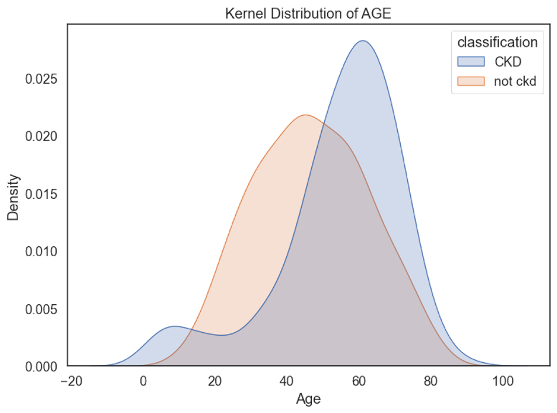
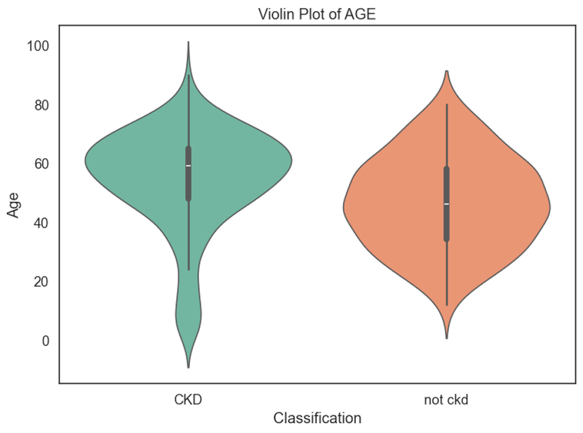

## What students will do today

1. Inspect<br>Load the CKD CSV and understand its structure.
2. Clean<br>Correct data types and inconsistent category labels.
3. Impute<br>Handle missing numerical and categorical values.
4. Encode<br>Convert categories using Ordinal Encoder.
5. Explore<br>Visualize numerical distributions using KDE and violin plots.

## From Raw Data To Visual Insights

### Our workflow


## Import the libraries

> The notebook begins by importing tools for data handling and visualization.

```python
# Necessary libraries to import
import pandas as pd
import numpy as np
import matplotlib.pyplot as plt
import seaborn as sns
import plotly.express as px
```

### Why these libraries?

pandas → DataFrames  
numpy → numerical values  
matplotlib → plotting  
seaborn → statistical plots  
plotly → interactive plots  

## Load the CKD dataset

> Read the CSV file into a pandas DataFrame named `df`.

```python
df = pd.read_csv('.../chronic_kidney_disease.csv')
df.head()
```

### Teaching point

The original notebook uses a local macOS path. Students should replace it with the location of their own CSV file.

## Inspect the data

1. `df.head()`<br>Display the first 5 records; `df.head(20)` shows 20.
2. `df.tail()`<br>Display the last 5 records; `df.tail(10)` shows 10.
3. `df.shape`<br>Find the number of rows and columns.
4. `df.describe()`<br>Summarize numeric columns (mean, quartiles, etc.).
5. `df.info()`<br>Check column types and non-null counts.

## Remove an unnecessary column

> The notebook drops the patient identifier before preprocessing.

```python
df.drop('id', axis = 1, inplace = True)
df.head()
```

### Explain

`id` identifies a record; it is not a clinical measurement.

`axis = 1` means column.  
`inplace = True` modifies `df`.  

## Convert text-like numbers

> The CKD columns `pcv`, `wc`, and `rc` are initially stored as object values.

```python
in object type to numerical type
df['pcv'] = pd.to_numeric(df['pcv'], errors = 'coerce')
df['wc'] = pd.to_numeric(df['wc'], errors = 'coerce')
df['rc'] = pd.to_numeric(df['rc'], errors = 'coerce')
```

### `errors = "coerce"`

Values that cannot be converted to numbers become `NaN`.

We can then handle these missing values using imputation.

## Separate feature types

> The notebook identifies object columns and numeric columns.

```python
# Extracting categorical and numerical columns
cat_cols = [col for col in df.columns if df[col].dtype == 'object']
num_cols = [col for col in df.columns if df[col].dtype != 'object']
```

### Important

classification is the target, not a predictor.

Some numeric-looking columns needed conversion first.

## Inspect categorical values

> Look for inconsistent labels before filling missing values.

```python
# looking at unique values in categorical columns
for col in cat_cols:
    print(f"{col} has {df[col].unique()} values\n")
```

### Examples

Values may contain tabs or leading spaces, such as "\tno" and " yes".

These are not the same strings as "no" and "yes".

## Correct inconsistent labels

> The notebook cleans `dm`, `cad`, and `classification`.

```python
# replace incorrect values
df['dm'].replace(to_replace = {'\tno':'no','\tyes':'yes',' yes':'yes'}, inplace = True)
df['cad'] = df['cad'].replace(to_replace = '\tno', value = 'no')
df['classification'] = df['classification'].replace(to_replace = {'ckd\t': 'ckd', 'notckd': 'not ckd'})
```

### Watch the target

The notebook changes "notckd" to "not ckd".

Later plotting code should recognize "not ckd" too.

## What is imputation

> Imputation replaces missing values instead of dropping entire records.

| Numerical features                                              | Categorical features                                                      |
| --------------------------------------------------------------- | ------------------------------------------------------------------------- |
| Use the median of each column.<br>Example: 10, 12, NaN, 20 → 12 | Use the text label "Missing".<br>Example: yes, NaN, no → yes, Missing, no |

## Extract numerical features

> Create `dfnum` by removing the categorical columns and the target.

```python
dfnum = df.drop(columns = ['rbc', 'pc', 'pcc', 'ba', 'htn', 'dm', 'cad', 'appet', 'pe', 'ane', 'classification'])
```

### Result

`dfnum` contains numerical features such as `age`, `bp`, `hemo`, `pcv`, `wc`, and `rc`.

## Numerical imputation: median

> `SimpleImputer` fills each missing numerical value with its column median.

```python
from sklearn.impute import SimpleImputer
imp = SimpleImputer(strategy = 'median')
dfnum2 = imp.fit_transform(dfnum)
```

### Line by line

`strategy = "median"` chooses the middle value.

`fit_transform` learns medians and fills missing entries.

## Convert imputed values to a DataFrame

> The notebook names the resulting DataFrame `dfnum3`.

```python
dfnum3 = pd.DataFrame(dfnum2, columns = ('age', 'bp', 'sg', 'al', 'su', 'bgr', 'bu', 'sc', 'sod', 'pot', 'hemo', 'pcv', 'wc', 'rc'))
dfnum3.head(5)
```

### Why DataFrame?

`fit_transform` returns an array.

DataFrame restores readable feature names for the next steps.

## Extract categorical features

> Create `dfcat` by removing numerical features and the target.

```python
dfcat = df.drop(columns = ['age', 'bp', 'sg', 'al', 'su', 'bgr', 'bu', 'sc', 'sod', 'pot', 'hemo', 'pcv', 'wc', 'rc', 'classification'])
```

### Result

`dfcat` contains 10 categorical features, including `rbc`, `pc`, `htn`, `dm`, `appet`, and `ane`.

## Categorical imputation: "Missing"

> Preserve missingness as a separate category.

```python
from sklearn.impute import SimpleImputer
imputer = SimpleImputer(strategy = 'constant', fill_value = 'Missing')
dfcat2 = imputer.fit_transform(dfcat)
```

### Why constant?

The notebook does not guess whether a patient belongs to "yes" or "no".

It uses "Missing" as a distinct value.

## Build `dfcat3`

> Convert the imputed categorical array back to a DataFrame.

```python
dfcat3 = pd.DataFrame(dfcat2,columns = ('rbc', 'pc', 'pcc', 'ba', 'htn', 'dm', 'cad', 'appet', 'pe', 'ane'))
dfcat3.head(5)
```

### Notebook variable

`dfcat3` contains categorical columns with their missing values filled.

## Encode categorical variables

> Machine learning methods commonly require numerical input.

```python
from sklearn.preprocessing import OrdinalEncoder
ordi = OrdinalEncoder()
dfcat4 = ordi.fit_transform(dfcat3)
```

### Interpret carefully

OrdinalEncoder assigns numeric codes to categories.

For nominal features, codes do NOT imply a meaningful ranking.

## Create the encoded DataFrame

> Keep the original feature names and row index.

```python
dfcat5 = pd.DataFrame(
    dfcat4,
    columns = dfcat3.columns,
    index = dfcat3.index
)
dfcat5.head()
```

### Why keep the index?

The original row index helps maintain correct alignment when combining DataFrames.

## Combine numerical + categorical features

> Use `pd.concat()` to merge the processed features side by side.

```python
x = pd.concat([dfnum3, dfcat5], axis = 1)
y = df['classification']
a = pd.concat([x, y], axis = 1)
a.head()
```

### Variable map

x → processed predictors  
y → CKD target  
a → predictors + target  

`axis=1` combines columns.

## From preprocessing to EDA

> The notebook now explores distributions for numerical measurements.

| KDE plots                                                                        | Violin plots                                                          |
| -------------------------------------------------------------------------------- | --------------------------------------------------------------------- |
| Smooth curves compare where feature values are concentrated for CKD and Not CKD. | Compare the spread and density of a numerical feature across classes. |

## Prepare plotting data

> Use `dfnum3` and add classification labels from `df`.

```python
plot_df = dfnum3.copy()
plot_df['classification'] = (
    df['classification']
    .replace({'ckd':'CKD',
              'notckd':'Not CKD',
              'not ckd':'Not CKD'})
    .to_numpy()
)
```

### Small fix

Your notebook cleans "notckd" to "not ckd" earlier.

This slide includes both forms so the plotted groups are labelled consistently.

## KDE: create one plot per feature

> Core loop from the notebook, shown without the file-saving lines.

```python
features_to_plot = dfnum3.columns
for feature in features_to_plot:
    plt.figure(figsize=(8, 6))
    sns.kdeplot(data=plot_df,
                x=feature,
                hue='classification',
                fill=True,
                common_norm=False)
    plt.title(f'Kernel Distribution of {feature.upper()}')
    plt.show()
```

### Read the graph

Each curve describes the distribution of one numeric feature within a patient class.

Overlap means the two groups share some values.

## KDE example from the notebook

> A saved output from the uploaded Jupyter Notebook.



### Student questions

Which class has the higher peak?

Do the distributions overlap?

Can this feature help distinguish the groups?

## Save KDE figures

> The notebook creates a folder and saves each figure as a PNG.

```python
output_dir = 'Kernel_Plots'
os.makedirs(output_dir, exist_ok = True)
plot_filename = f'Kernel_Plot_{feature}.png'
plot_path = os.path.join(output_dir, plot_filename)
plt.savefig(plot_path, dpi = 300)
```

### Path portability

Use a relative folder such as `Kernel_Plots`, or replace it with your own absolute folder path.

## Violin plot: compare patient groups

> Classification is on the x-axis; the numerical feature is on the y-axis.

```python
for feature in dfnum3.columns:
    plt.figure(figsize = (8, 6))
    sns.violinplot(data = plot_df,
                   x = 'classification',
                   y = feature,
                   hue = 'classification',
                   palette = 'Set2',
                   legend = False)
    plt.title(f'Violin Plot of {feature.upper()}')
    plt.show()
```

### Read the graph

Wider sections show where more observations are concentrated.

Compare shape, spread, and central region.

## Violin example from the notebook

> A saved output from the uploaded Jupyter Notebook.



### Student questions

Which group shows a wider spread?

Are the shapes similar?

Does the feature appear to differ between CKD and Not CKD?

## Save violin figures

> The notebook saves each violin plot to a folder.

```python
output_dir = 'Violin_Plots'
os.makedirs(output_dir, exist_ok = True)
plot_filename = f'Violin_Plot_{feature}.png'
plot_path = os.path.join(output_dir, plot_filename)
plt.savefig(plot_path, dpi = 300)
```

### Reminder

Save before `plt.show()`.

One figure is produced for each numerical feature.

## Exercise: Ridge Plot

> The notebook leaves the Ridge Plot cell empty as Task 1.

### Task 1: Write Python code to generate a Ridge Plot.

Use the preprocessed numerical data and compare CKD with Not CKD.  
Be ready to explain what the plot reveals.

## Recap: variables to remember

`df`: Original CKD DataFrame  
`dfnum3`: Imputed numerical features  
`dfcat3`: Imputed categorical features  
`dfcat5`: Ordinal-encoded categorical features  
`x`: Combined predictor features  
`y`: Classification target  
`a`: Features plus target  
`plot_df`: Numerical features plus labels for visualization  

## What comes next?

> These topics appear in the notebook as next-week subjects.

**Train-test split**: Separate model training from evaluation.  
**StandardScaler**: Scale features using statistics learned from training data.  
**Class imbalance**: Introduce SMOTE / SVM-SMOTE / Borderline-SMOTE.  
**Data leakage**: Apply learned preprocessing and resampling correctly.  

## Seminar takeaways

- Inspect your dataset before preprocessing.
- Fix inconsistent labels and numerical data types.
- Use median imputation for numerical features.
- Use a constant label for missing categorical features.
- Understand what OrdinalEncoder does—and its limitations.
- Interpret KDE and violin plots, not just generate them.

::: tip[温馨提示]

数据来源于第一周的 `chronic_kidney_disease.csv`。  
由于环境搭建教程中未安装 `seaborn` 和 `plotly` 库，此处需要额外安装。  
如果是根据我的非 conda 安装方式，只需要在激活虚拟环境后用 `pip` 安装即可。  
```bash
source ml_chc6089/bin/activate
pip install seaborn
pip install plotly
```
如果安装了 Anaconda，请在 Anaconda 中安装。

---
<br>
一些参数的补充解释：

```python
df.drop('id', axis = 1, inplace = True)
```
`axis = 0` 表示行, `axis = 1` 表示列。

```python
df['pcv'] = pd.to_numeric(df['pcv'], errors='coerce')
```
`errors='coerce'` 表示跳过错误的数据。

:::

Completed Interactive Python Notebook: <a href="/obu/level6/machine-learning/week2/machine-learning_week2_seminar.ipynb" download>machine-learning_week2_seminar.ipynb</a>

Source: [week2-seminar.zip](https://vle.zycdut.net/sites/student.zy.cdut.edu.cn/files/attachments/week2-seminar.zip)
