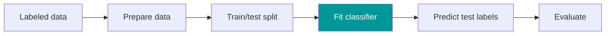
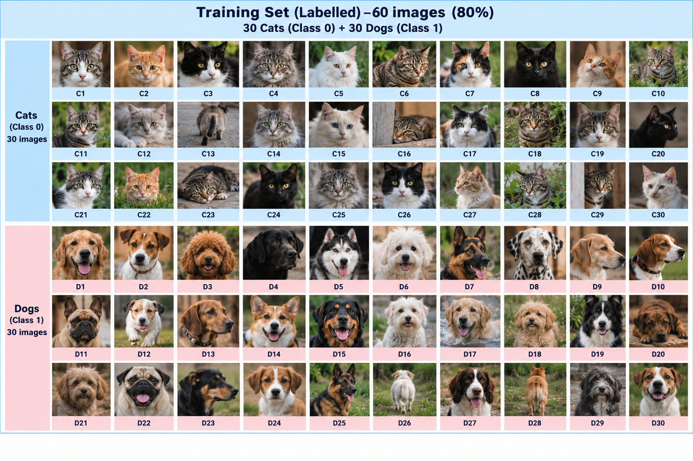
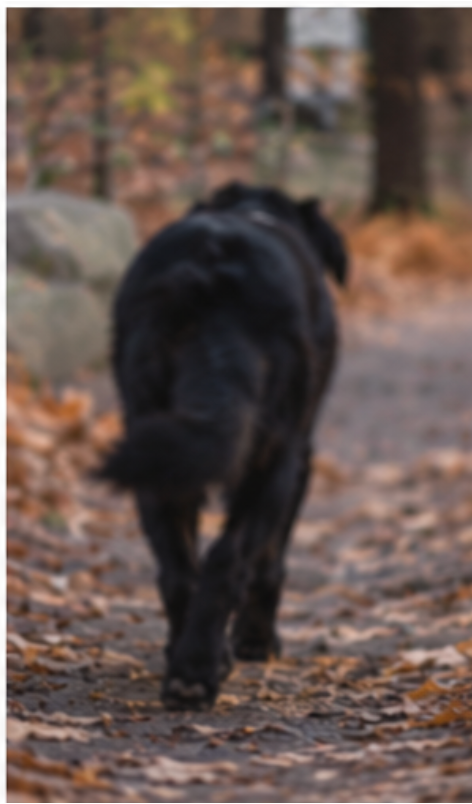
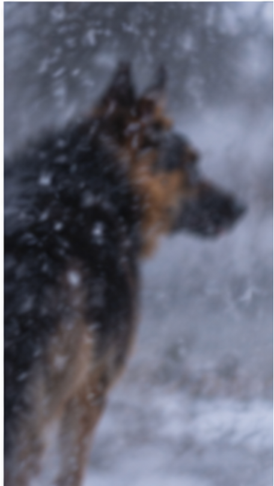
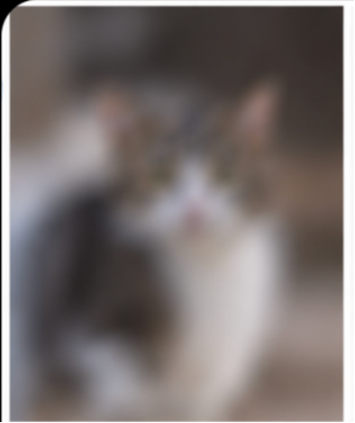
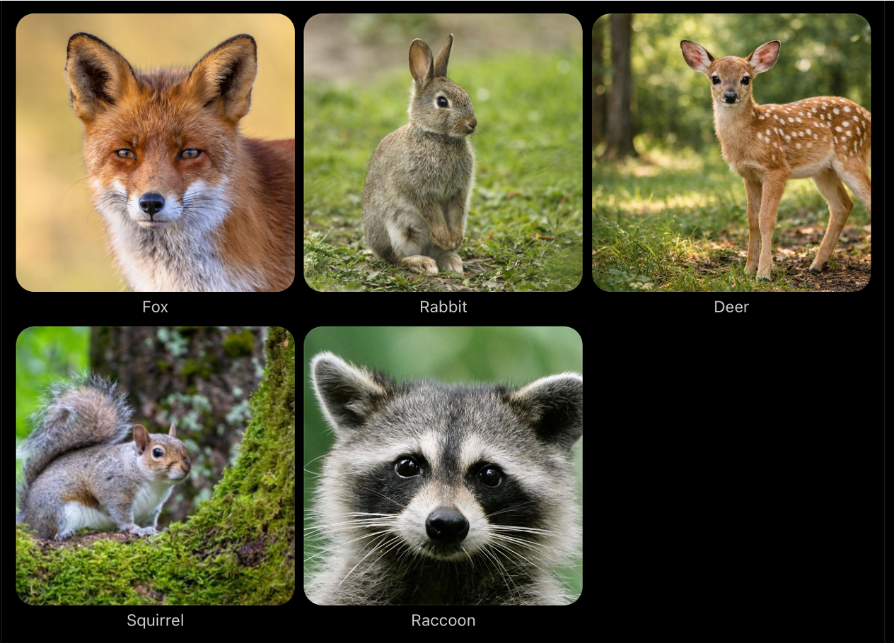
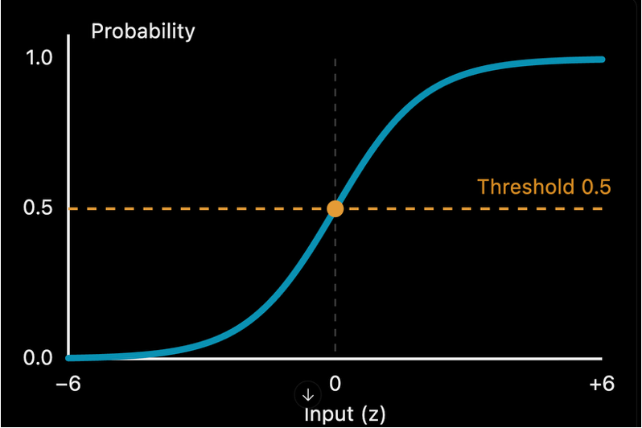
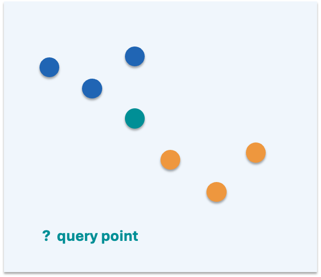

## Learning outcomes

- Explain supervised classification and the roles of features and labels.
- Illustrate a train–test split and the importance of unseen test data.
- Describe how Logistic Regression and KNN make predictions.
- Interpret a confusion matrix and calculate accuracy, precision, recall and F1-score.

## Where Week 3 fits

From prepared data to trustworthy model evaluation

- Week 1: Machine learning concepts and the ML workflow.
- Week 2: Data preprocessing and exploratory data analysis.
- Week 3: Train/test, classification models and evaluation.
- Week 4: Feature selection (LASSO, RFE and Boruta).

## The supervised classification workflow

The <mark>test</mark> set is reserved for the final assessment of generalisation.

## What is supervised learning?

  <!-- Left panel: Inputs X (features) -->
  

    <h2 style="color: #2468b8; margin-top:0; font-size: 2.0rem; font-weight: bold;">Inputs: X (features)</h2>
    
Measurable information about each example.

    
Animal image: visual characteristics.

    
Patient dataset: age, blood pressure, laboratory values.

  

  <!-- Right panel: Output y (label) -->
  

    <h2 style="color: #189c94; margin-top:0; font-size: 2.0rem; font-weight: bold;">Output: y (label)</h2>
    
Known target associated with each training example.

    
Animal image: cat or dog.

    
Patient dataset: CKD or not CKD.

  

## Quick check

<h3>Which is the target variable in a dataset predicting chronic kidney disease?</h3>

Think individually • Discuss with a partner • Explain your reasoning

## Why split a dataset

  <!-- Left panel: Training set -->
  

    <h2 style="color: #2468b8; margin-top:0; font-size: 2.0rem; font-weight: bold;">Training set</h2>
    
Examples used to learn relationships between X and y.

    
The algorithm may see their labels while fitting.

  

  <!-- Right panel: Test set -->
  

    <h2 style="color: #189c94; margin-top:0; font-size: 2.0rem; font-weight: bold;">Test set</h2>
    
Held-out examples used to estimate performance on new, unseen cases.

    
Do not fit the model using these examples.

  

### Example: an 80/20 train–test split

100 labelled observations

  

    80 training observations
  

  

    20 test
  

The 80/20 ratio is common, not mandatory. Choose a split appropriate to the data.

## Prediction before the demonstration

<h3>If you memorises every training photograph, will you necessarily recognise a new photograph of the same animal?</h3>

Think individually • Discuss with a partner • Explain your reasoning

## Activity: a student becomes the classifier

Interactive learning

- One volunteer to be the “model”; participation is optional.
- Show labelled examples from two familiar animal categories.
- Ask classmates to identify the visual clues that distinguish categories.
- Keep the test photographs hidden until prediction time.

## Demonstration: training vs unseen testing

  <!-- Left panel: TRAINING -->
  

    <h2 style="color: #2468b8; margin-top:0; font-size: 2.0rem; font-weight: bold;">TRAINING</h2>
    
Show labelled photographs CAT • DOG

    
Volunteer learns distinguishing patterns.

  

  <!-- Right panel: TESTING -->
  

    <h2 style="color: #189c94; margin-top:0; font-size: 2.0rem; font-weight: bold;">TESTING</h2>
    
Show NEW photographs Labels hidden

    
Volunteer predicts; classmates vote;  reveal answers.

  

### Test set

### Discussion

<h3>What if we show the model unfamiliar animals?</h3>

Think individually • Discuss with a partner • Explain your reasoning

### Discussion

<h3>Limitation of the model when it encounters unfamiliar data</h3>

Think individually • Discuss with a partner • Explain your reasoning

### Discussion

<h3>What did the Model(volunteer) learn: individual pictures or characteristics that transfer to new pictures?</h3>

Think individually • Discuss with a partner • Explain your reasoning

## Memorisation vs generalisation

  <!-- Left panel: Memorisation / overfitting -->
  

    <h2 style="color: #2468b8; margin-top:0; font-size: 2.0rem; font-weight: bold;">Memorisation / overfitting</h2>
    
Excellent performance on examples already seen.

    
May rely on irrelevant details, backgrounds or coincidences.

    
Can perform poorly on unseen examples.

    
Memorisation means remembering specific training examples instead of learning general patterns. A model might recognise photographs it has already seen but struggle with new photographs

  

  <!-- Right panel: Generalisation -->
  

    <h2 style="color: #189c94; margin-top:0; font-size: 2.0rem; font-weight: bold;">Generalisation</h2>
    
Learns useful patterns that transfer to new observations.

    
Performance remains reasonably strong on held-out test data.

    
The ability of a machine learning model to make accurate predictions on new, unseen data

  

## Memorisation vs generalisation vs overfitting

| Concept        | Description                                                         | Example                                                     |
| -------------- | ------------------------------------------------------------------- | ----------------------------------------------------------- |
| Memorisation   | Remembering specific examples                                       | Recognising the same cat photograph shown during training   |
| Generalisation | Applying learned patterns to new examples                           | Correctly recognising a different cat photograph            |
| Overfitting    | Fitting training data too closely and performing poorly on new data | Very high training accuracy but much lower testing accuracy |

## Think–pair–share

<h3>A model scores 99% on training data but 65% on test data. What might explain the gap?</h3>

Think individually • Discuss with a partner • Explain your reasoning

## Data leakage: why evaluation can be misleading

Leakage occurs when information unavailable at prediction time influences model development.

  <!-- Example 1 -->
  

    <h2 style="color:#2468b8; margin:0 0 2rem 0; font-size:1.5rem; font-weight:bold;">Example 1</h2>
    
Scaling fitted on all data

  

  <!-- Example 2 -->
  

    <h2 style="color:#2468b8; margin:0 0 2rem 0; font-size:1.5rem; font-weight:bold;">Example 2</h2>
    
SMOTE before splitting

  

  <!-- Example 3 -->
  

    <h2 style="color:#2468b8; margin:0 0 2rem 0; font-size:1.5rem; font-weight:bold;">Example 3</h2>
    
Selecting features using test labels

  

Safer sequence: split first → fit preprocessing on training data → transform test data.

## Train–test split: important considerations

- Shuffle observations when appropriate; respect time order for time-series data.
- For imbalanced classification, consider stratified splitting to preserve class proportions.
- Use a fixed random state for reproducible demonstrations.
- Keep the test set separate from training and model selection.

## Model training and prediction

  <!-- FIT -->
  

    <h2 style="color:#2468b8; margin:0 0 2rem 0; font-size:2rem; font-weight:bold;">FIT</h2>
    
The classifier learns from X_train and y_train.

  

  <!-- PREDICT -->
  

    <h2 style="color:#2468b8; margin:0 0 2rem 0; font-size:2rem; font-weight:bold;">PREDICT</h2>
    
The fitted classifier receives X_test.

  

  <!-- COMPARE -->
  

    <h2 style="color:#2468b8; margin:0 0 2rem 0; font-size:2rem; font-weight:bold;">COMPARE</h2>
    
Predicted labels are compared with y_test.

  

## Classification I: two different approaches

- Logistic Regression: learns a decision boundary and estimates class probabilities.
- K-Nearest Neighbors (KNN): predicts using nearby labelled examples.
- Both are supervised classifiers, but they make predictions differently.

## Logistic Regression: the intuition

| <b>Input features</b> |                                       | <b>Weighted score</b> |                                       | <b>Probability</b> |
| --------------------------------------------------------- | ------------------------------------- | --------------------------------------------------------- | ------------------------------------- | ------------------------------------------------------ |
| $X_1,X_2,\dots,X_n$                                       | → | $z = b + \sum w_i x_i$                                    | → | $P(y=1 \vert X)$                                       |

The sigmoid function converts a score into a value between 0 and 1.

## Logistic Regression: sigmoid function

$\sigma(z) = \frac{1}{1 + e^{-z}}$

P ≥ 0.5 → predict positive  
P < 0.5 → predict negative

Threshold can be adjusted.

## Logistic Regression: concept check

<h3>A classifier estimates P(CKD) = 0.82. With a 0.50 decision threshold, what label does it predict?</h3>Logistic Regression produces a probability, and the decision threshold converts that probability into a class label

Think individually • Discuss with a partner • Explain your reasoning

## KNN: classify by nearby examples

1. Choose K (number of neighbors).
2. Measure distances to labelled training examples.
3. Find the K closest examples.
4. Use majority vote for classification.

## KNN: choosing K

  <!-- Small K -->
  

    <h2 style="color: #2468b8; margin-top:0; font-size: 2.0rem; font-weight: bold;">Small K</h2>
    
Sensitive to local patterns and noise.

    
K = 1 may overfit.

    
Prediction can change when a single neighbor changes.

  

  <!-- Large K -->
  

    <h2 style="color: #189c94; margin-top:0; font-size: 2.0rem; font-weight: bold;">Large K</h2>
    
Smoother decision boundaries.

    
May overlook local patterns.

    
Very large K can underfit.

  

## KNN: majority vote

<h3>For K = 5, the nearest labels are [Cat, Dog, Cat, Cat, Dog].  What is the prediction?</h3>

Think individually • Discuss with a partner • Explain your reasoning

  <!-- 统一横向滚动容器：上下内容共用这个宽度 -->
  

    <!-- 第一排：5个卡片 -->
    

      <!-- Cat #1 -->
      

        
🐱

        
Cat

        
#1

      

      <!-- Dog #2 -->
      

        
🐶

        
Dog

        
#2

      

      <!-- Cat #3 -->
      

        
🐱

        
Cat

        
#3

      

      <!-- Cat #4 -->
      

        
🐱

        
Cat

        
#4

      

      <!-- Dog #5 -->
      

        
🐶

        
Dog

        
#5

      

    

    <!-- 第二排：与上排同总宽度，左右严格对半分 -->
    

      

        
3

        
Cats

      

      

        
2

        
Dogs

      

    

  

## Logistic Regression vs KNN

  <!-- Logistic Regression -->
  

    <h2 style="color:#2468b8; font-size:2.0rem; margin:0 0 32px 0; font-weight:bold;">Logistic Regression</h2>
    
Learns coefficients during training.

    
Often efficient at prediction.

    
Produces estimated class probabilities.

    
Typically a linear decision boundary.

  

  <!-- K-Nearest Neighbors -->
  

    <h2 style="color:#189c94; font-size:2.0rem; margin:0 0 32px 0; font-weight:bold;">K-Nearest Neighbors</h2>
    
Stores labelled examples.

    
Prediction uses distance and voting.

    
Sensitive to feature scale.

    
Can model nonlinear boundaries.

  

## Why scaling matters especially for KNN

Recall from Week 2; practical implementation belongs in the seminar

- KNN depends on distances between observations.
- A feature with a large numeric range may dominate Euclidean distance.
- StandardScaler can help place numeric features on comparable scales.
- Fit the scaler on training data only; apply the learned transform to the test data.

## From predictions to evaluation

| <b>Actual labels</b> |     | <b>Predicted labels</b> |
| -------------------------------------------------------- | --- | ----------------------------------------------------------- |
| 1, 0, 1, 1, 0, 0                                         |     | 1, 0, 0, 1, 1, 0                                            |

Count correct and incorrect predictions—then identify the TYPES of error.

## Confusion matrix: four possible outcomes

  

    <!-- TP True Positive -->
    

      
TP

      

        
TRUE POSITIVE

        
Correct positive

      

    

    <!-- FN False Negative -->
    

      
FN

      

        
FALSE NEGATIVE

        
Missed positive

      

    

    <!-- FP False Positive -->
    

      
FP

      

        
FALSE POSITIVE

        
False alarm

      

    

    <!-- TN True Negative -->
    

      
TN

      

        
TRUE NEGATIVE

        
Correct negative

      

    

  

## Worked example: confusion matrix (100 patients)

  

    <!-- 顶部空白占位 -->
    

    
Predicted CKD

    
Predicted not CKD

    <!-- 第一行 Actual CKD -->
    
Actual CKD

    

      
30

      
TP

    

    

      
10

      
FN

    

    <!-- 第二行 Actual not CKD -->
    
Actual not CKD

    

      
5

      
FP

    

    

      
55

      
TN

    

  

Positive class = CKD

### Accuracy: overall correctness

$$
\begin{align}
\text{Accuracy} &= \frac{\text{TP} + \text{TN}}{\text{TP} + \text{TN} + \text{FP} + \text{FN}} \\
      &= \frac{30 + 55}{100} \\
      &= 85\%
\end{align}
$$

Limitation: high accuracy can hide poor detection of a rare positive class.

### Precision: when the model predicts positive

$$
\begin{align}
\text{Precision} &= \frac{\text{TP}}{\text{TP} + \text{FP}} \\
      &= \frac{30}{30 + 5} \\
      &\approx 85.7\%
\end{align}
$$

Question: Of the patients predicted to have CKD, how many truly have CKD?

### Recall: how many actual positives were found?

$$
\begin{align}
\text{Recall} &= \frac{\text{TP}}{\text{TP} + \text{FN}} \\
      &= \frac{30}{30 + 10} \\
      &= 75\%
\end{align}
$$

Question: Of all patients who truly have CKD, how many did the model detect?

### F1-score: balancing precision and recall

$$
\begin{align}
\text{F1} &= \frac{2 \times (\text{Precision} \times \text{Recall})}{\text{Precision} + \text{Recall}} \\
      &= \frac{2 \times (0.857 \times 0.750)}{0.857 + 0.750} \\
      &\approx 80\%
\end{align}
$$

F1 is useful when both false positives and false negatives matter.

### Metric comparison: one example, four views

  

    <!-- Accuracy -->
    
Accuracy

    
85.0%

    
Overall correct predictions

    <!-- Precision -->
    
Precision

    
85.7%

    
Reliability of positive predictions

    <!-- Recall -->
    
Recall

    
75.0%

    
Coverage of actual positives

    <!-- F1-score -->
    
F1-score

    
80.0%

    
Balance of precision and recall

  

### Why accuracy alone can mislead

<h3>A dataset contains 95 healthy patients and 5 patients with a disease. A model predicts “healthy” for everyone. What is its accuracy—and its recall for disease?</h3>

Think individually • Discuss with a partner • Explain your reasoning

## Choosing the right metric

- Accuracy: useful when classes and error costs are reasonably balanced.
- Precision: important when false alarms are costly.
- Recall: important when missed positives are costly.
- F1-score: summarises the precision–recall trade-off.
- Always explain which class is considered “positive”.

## Final knowledge check

1. Why must test data remain unseen?
2. How does KNN decide a class?
3. What does a false negative mean?
4. When might recall matter more than accuracy?

## Week 3: key takeaways

- Split data to estimate generalisation on unseen observations.
- Fit preprocessing and models using training data only.
- Logistic Regression estimates probabilities; KNN uses neighbor voting.
- A confusion matrix separates correct predictions from different errors.
- Accuracy, precision, recall and F1-score answer different questions.

## Coming next: Week 4 — Feature Selection

### Which features should a model learn from?

  

    <!-- LASSO -->
    

      
LASSO

      
Coefficient shrinkage

    

    <!-- RFE -->
    

      
RFE

      
Recursive elimination

    

    <!-- Boruta -->
    

      
Boruta

      
Shadow-feature comparison

    

  

Bring questions from the Week 3 seminar and think about why irrelevant features may hurt model performance.

Source: [week3mllecture.pptx](https://view.officeapps.live.com/op/view.aspx?src=https%3A%2F%2Fvle.zycdut.net%2Fsites%2Fstudent.zy.cdut.edu.cn%2Ffiles%2Fattachments%2Fweek3mllecture.pptx&wdOrigin=BROWSELINK)
