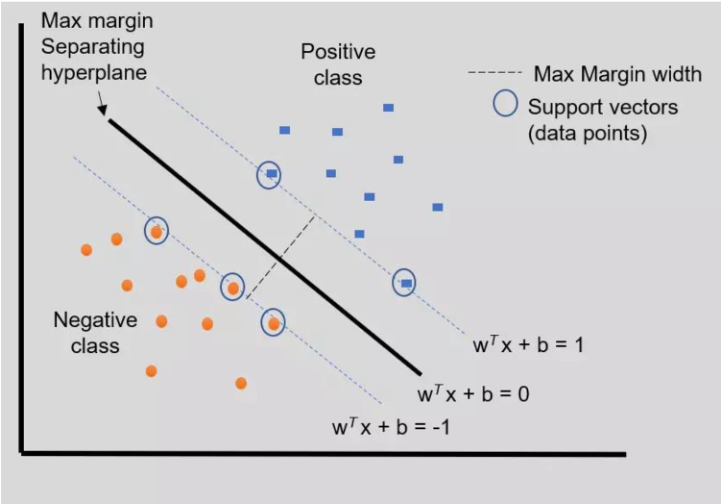
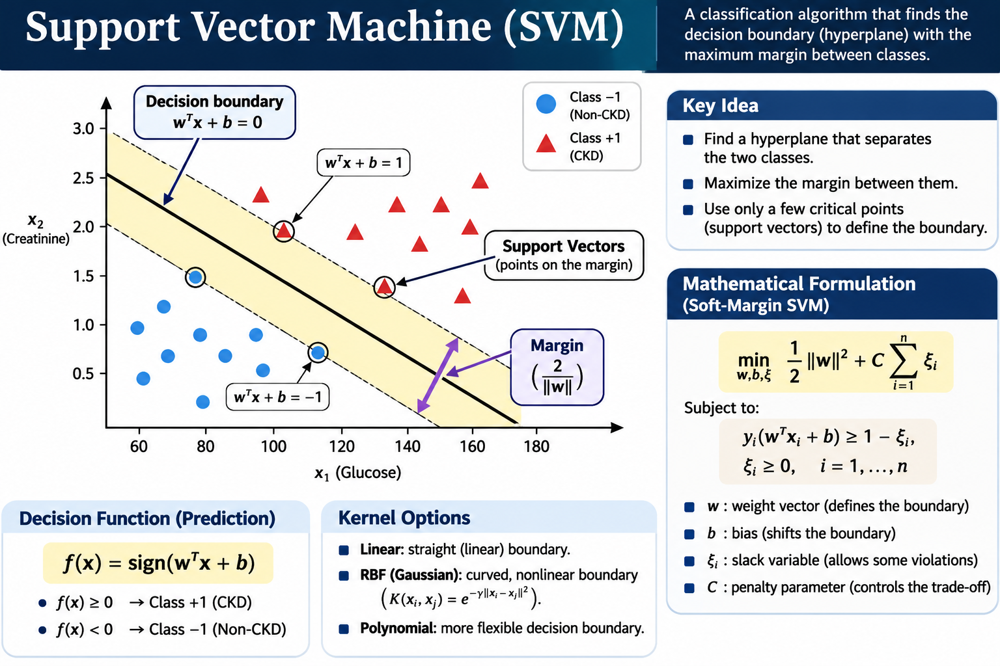
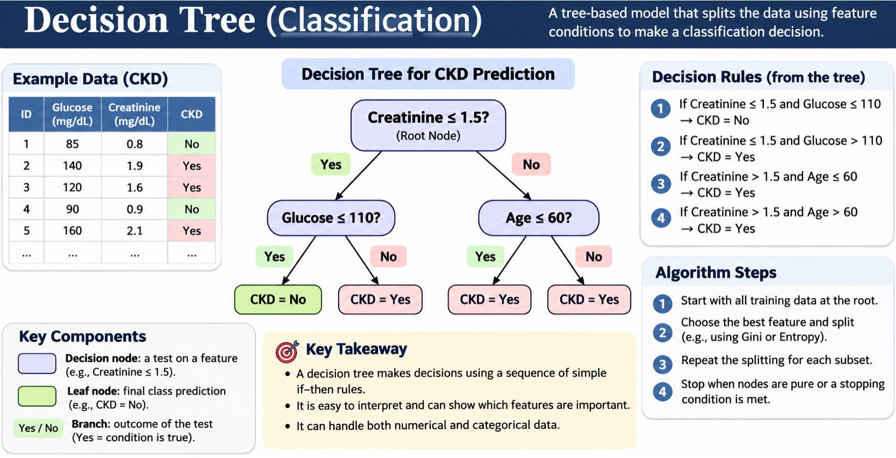
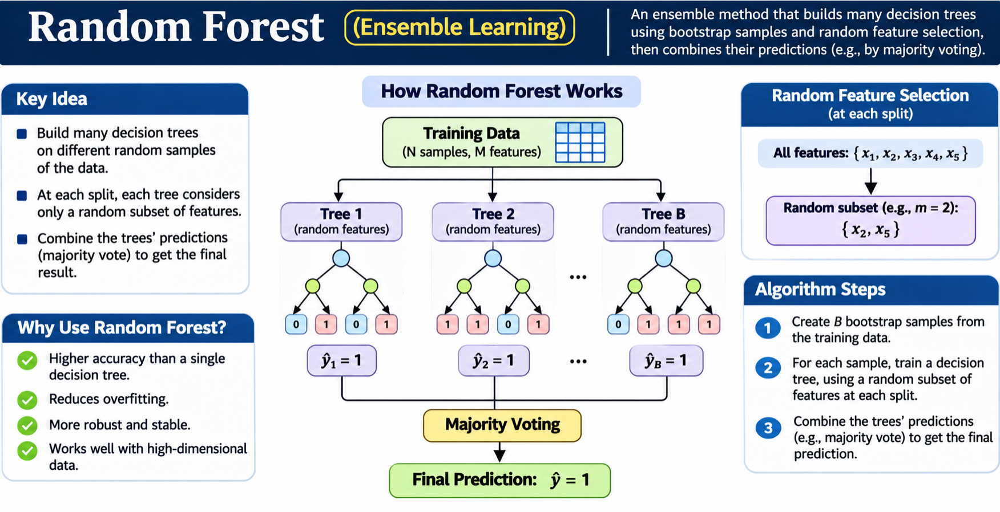
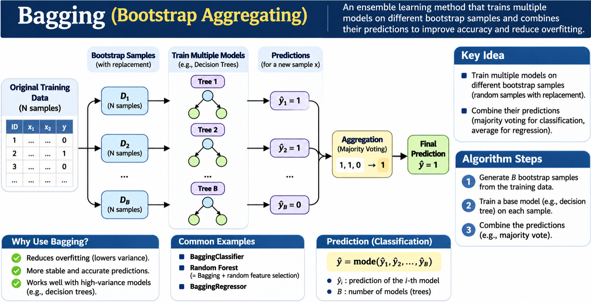
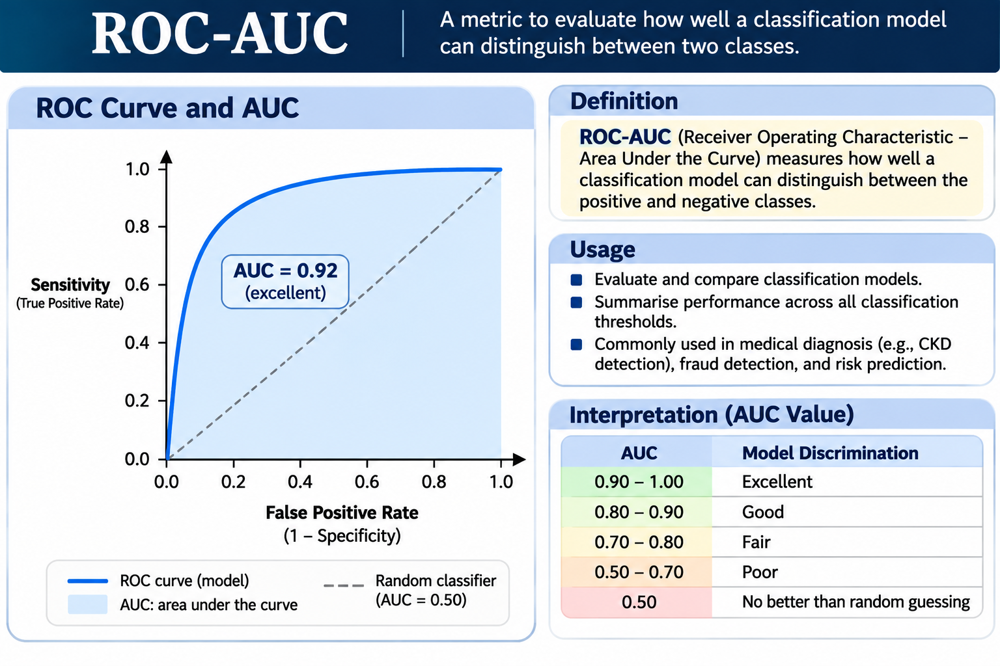

## Connect to Weeks 3 and 4

<div style="display: flex; gap: 12px; overflow-x: auto; padding: 8px;">
    <!-- Left Card -->
    <div style="flex: 1; min-width: 350px; border: 2px solid #e8edf3; border-left: 6px solid #3478d8; border-radius: 24px; padding: 24px;">
        <h2 style="margin-top: 0; font-size: 20px;">Already covered</h2>
        <ul style="font-size: 15px; line-height: 1.6; padding-left: 24px; margin: 0;">
            <li>CKD dataset and preprocessing</li>
            <li>Train/test split</li>
            <li>Logistic Regression and KNN</li>
            <li>Confusion matrix and basic metrics</li>
            <li>LASSO, RFECV and Boruta</li>
        </ul>
    </div>
    <!-- Right Card -->
    <div style="flex: 1; min-width: 350px; border: 2px solid #e8edf3; border-left: 6px solid #20b4ac; border-radius: 24px; padding: 24px;">
        <h2 style="margin-top: 0; font-size: 20px;">Today</h2>
        <ul style="font-size: 15px; line-height: 1.6; padding-left: 24px; margin: 0;">
            <li>New base classifiers</li>
            <li>Ensemble learning</li>
            <li>Stronger model evaluation</li>
            <li>Compare methods on the same held-out test set</li>
        </ul>
    </div>
</div>

## The classification pipeline

<div style="display: flex; align-items: center; gap: 8px; overflow-x: auto; padding: 8px;">
    <!-- Step 01 -->
    <div style="min-width: 280px; border: 2px solid #e8edf3; border-radius: 24px; padding: 24px; box-shadow: 0 2px 6px rgba(0,0,0,0.08);">
        <div style="font-size: 42px; color: #20b4ac; font-weight: bold;">01</div>
        <div style="font-size: 28px; font-weight: bold; margin-top:12px;">Training data</div>
    </div>
    <span style="font-size:40px; color:#3478d8; font-weight:bold;">➔</span>
    <!-- Step 02 -->
    <div style="min-width: 280px; border: 2px solid #e8edf3; border-radius: 24px; padding: 24px; box-shadow: 0 2px 6px rgba(0,0,0,0.08);">
        <div style="font-size: 42px; color: #20b4ac; font-weight: bold;">02</div>
        <div style="font-size: 28px; font-weight: bold; margin-top:12px;">Choose classifier</div>
    </div>
    <span style="font-size:40px; color:#3478d8; font-weight:bold;">➔</span>
    <!-- Step 03 -->
    <div style="min-width: 280px; border: 2px solid #e8edf3; border-radius: 24px; padding: 24px; box-shadow: 0 2px 6px rgba(0,0,0,0.08);">
        <div style="font-size: 42px; color: #20b4ac; font-weight: bold;">03</div>
        <div style="font-size: 28px; font-weight: bold; margin-top:12px;">Fit model</div>
    </div>
    <span style="font-size:40px; color:#3478d8; font-weight:bold;">➔</span>
    <!-- Step 04 -->
    <div style="min-width: 280px; border: 2px solid #e8edf3; border-radius: 24px; padding: 24px; box-shadow: 0 2px 6px rgba(0,0,0,0.08);">
        <div style="font-size: 42px; color: #20b4ac; font-weight: bold;">04</div>
        <div style="font-size: 28px; font-weight: bold; margin-top:12px;">Predict scores</div>
    </div>
    <span style="font-size:40px; color:#3478d8; font-weight:bold;">➔</span>
    <!-- Step 05 -->
    <div style="min-width: 280px; border: 2px solid #e8edf3; border-radius: 24px; padding: 24px; box-shadow: 0 2px 6px rgba(0,0,0,0.08);">
        <div style="font-size: 42px; color: #20b4ac; font-weight: bold;">05</div>
        <div style="font-size: 28px; font-weight: bold; margin-top:12px;">Evaluate</div>
    </div>
</div>

<center><span style="color: #57667A">Week 5: fit and compare. Week 6: cross-validate and tune.</span></center>

## Support Vector Machine (SVM): key idea

| Intuition                                                                                                                                                       | When to use                                                                                                                                                                                                                                                            |
| --------------------------------------------------------------------------------------------------------------------------------------------------------------- | ---------------------------------------------------------------------------------------------------------------------------------------------------------------------------------------------------------------------------------------------------------------------- |
| Find a decision boundary that separates <br>classes while maximising the margin to <br>the closest training points.<br> | • Medium-sized tabular datasets<br>• Many features<br>• Potentially nonlinear class boundaries<br>• When scaling is available<br>    • Effective for text classification, <br>    image recognition, and any problem <br>    where maximizing margin is important.<br> |

### SVM: a simple mathematical view

$$w^{T}x + b = 0$$

<center>The hyperplane is the decision boundary. The sign of wᵀx + b determines the predicted class.</center>

<div style="overflow-x: auto; padding: 8px;">
    <div style="border: 2px solid #e8edf3; border-left: 6px solid #20b4ac; border-radius: 24px; padding: 32px; min-width: 600px;">
        <h2 style="margin:0 0 24px 0; font-size: 24px;">Maximum margin</h2>
        <p style="margin:0; font-size: 22px;">For a linear hard-margin SVM, the margin width is 2 / ||w||. Support vectors are the closest points.</p>
    </div>
</div>



### SVM: training steps

1. Scale numerical features (SVM is sensitive to feature scale).
2. Select a kernel: linear or RBF (Radial Basis Function) are common starting points.
3. Fit SVC to training examples and labels.
4. Predict classes or decision scores for new observations.
5. Evaluate on held-out data.

#### SVM: strengths, limits and sklearn

**Strengths and limitations**  
✓ Flexible boundaries using kernels  
✓ Often strong in high dimensions  
✕ Sensitive to scaling  
✕ Can be slower on large datasets  
✕ Less directly interpretable  

```python
from sklearn.svm import SVC

# Initialize the model with default parameters
svm = SVC ()

# Train the model
svm.fit(X_train, y_train)

# Make predictions
y_pred = svm.predict(X_test)
```

### Pair discussion: linear or nonlinear

<div style="overflow-x: auto; padding: 8px;">
    <div style="min-width: 500px;">
        <!-- Top bar -->
        <div style="display: flex; justify-content: space-between; margin-bottom:16px;">
            <div style="background-color:#20b4ac; color:white; padding:8px 24px; border-radius:8px; font-weight:bold; font-size:20px;">PAIR DISCUSSION</div>
            <div style="background-color:#e9a838; color:white; padding:8px 24px; border-radius:8px; font-weight:bold; font-size:20px;">3 minutes</div>
        </div>
        <!-- Main content card -->
        <div style="border:2px solid #e8edf3; border-radius:24px; padding:32px;">
            <p style="font-size:20px; margin:0;">Two features separate patients into two groups, but the boundary is curved.</p>
            <br>
            <p style="font-size:20px; margin:0;">Would you try a linear SVM or an RBF SVM first? Explain why.</p>
        </div>
    </div>
</div>

## Decision Tree: key idea

<div style="display: flex; gap:16px; overflow-x: auto; padding:8px;">
    <!-- Left Card -->
    <div style="min-width: 400px; border:2px solid #e8edf3; border-left:6px solid #3478d8; border-radius:24px; padding:28px;">
        <h3 style="margin:0 0 20px 0; font-size:20px;">Intuition</h3>
        <p style="font-size:15px; line-height:1.5; margin:0 0 24px 0;">
            A decision tree builds a tree-like structure where data is split at each node based on the most important feature, using criteria like Gini impurity or information gain. The tree is built recursively until all data is classified or a stopping criterion is met.
        </p>
        <p style="font-size:15px; line-height:1.5; margin:0;">
            <strong>Key Idea:</strong> Decision trees are non-parametric and easy to interpret, as they mimic human decision-making.
        </p>
    </div>
    <!-- Right Card -->
    <div style="min-width: 400px; border:2px solid #e8edf3; border-left:6px solid #20b4ac; border-radius:24px; padding:28px;">
        <h3 style="margin:0 0 20px 0; font-size:20px;">When to use</h3>
        <p style="font-size:15px; line-height:1.5; margin:0;">
            Effective for both classification and regression tasks, such as loan approvals or medical diagnoses.
        </p>
    </div>
</div>

### Decision Tree: Gini impurity

$$\text{Gini} = 1 − \textstyle\sum p^2$$  
$$\text{where the proportion of samples is }p_i\text{ owing to class }i\text{ at node }t$$

<div style="overflow-x: auto; padding: 8px;">
    <div style="border: 2px solid #e8edf3; border-left: 6px solid #20b4ac; border-radius: 24px; padding: 32px; min-width: 500px;">
        <h2 style="margin:0 0 24px 0; font-size: 20px;">Numerical example</h2>
        <p style="font-size: 15px; margin:0;">Node with 80% CKD and 20% non-CKD: Gini = 1 − (0.8² + 0.2²) = 0.32.</p>
        <br>
        <p style="font-size: 15px; line-height:1.5; margin:0;">Gini tells us how mixed the classes are in a Decision Tree node. In this example, 80% of patients have CKD and 20% do not, so Gini equals 0.32. This means the node is not completely pure. Our goal is to split the data into smaller groups with lower Gini values, ideally reaching zero</p>
    </div>
</div>



### Decision Tree: steps and Python

<div style="overflow-x: auto; padding: 8px;">
    <div style="border: 2px solid #e8edf3; border-left: 6px solid #3478d8; border-radius: 24px; padding: 32px; min-width: 500px;">
        <h2 style="margin:0 0 24px 0; font-size: 20px;">How it works</h2>
        <ol>
            <li>Examine candidate feature splits.</li>
            <li>Select a split that reduces impurity.</li>
            <li>Repeat recursively in child nodes.</li>
            <li>Stop using constraints such as max_depth.</li>
            <li>Predict the majority class in a leaf.</li>
        </ol>
    </div>
</div>

#### Decision Tree (DT) using the default parameter

```python
from sklearn.tree import DecisionTreeClassifier

# Initialize the model with default parameters
decision_tree = DecisionTreeClassifier()

# Train the model
decision_tree.fit(X_train, y_train)

# Make predictions
y_pred = decision_tree.predict(X_test)
```

### Think–pair–share: explainability

<div style="overflow-x: auto; padding: 8px;">
    <div style="min-width: 500px;">
        <div style="display: flex; justify-content: space-between; margin-bottom:16px;">
            <div style="background-color:#20b4ac; color:white; padding:8px 24px; border-radius:8px; font-weight:bold; font-size:20px;">PAIR DISCUSSION</div>
            <div style="background-color:#e9a838; color:white; padding:8px 24px; border-radius:8px; font-weight:bold; font-size:20px;">3 minutes</div>
        </div>
        <div style="border:2px solid #e8edf3; border-radius:24px; padding:32px;">
            <p style="font-size:18px; margin:0;">A CKD model must be explained to a hospital team.</p>
            <br>
            <p style="font-size:18px; margin:0;">Which is easier to explain to non-technical staff: a Decision Tree or an RBF SVM? What might you sacrifice?</p>
        </div>
    </div>
</div>

## What is ensemble learning

- Combine predictions from multiple learners rather than rely on one model.
- The learners may be many versions of the same algorithm or different algorithms.
- Main families: bagging, boosting, voting and stacking.
- An ensemble is not automatically better: diversity, data quality and evaluation matter.

## Random Forest: many decorrelated trees

<div style="overflow-x: auto; padding: 8px;">
    <div style="display: flex; gap:16px;">
        <div style="min-width: 500px; flex:1; border:2px solid #e8edf3; border-left:6px solid #3478d8; border-radius:24px; padding:24px;">
            <h2 style="margin:0 0 20px 0; font-size:20px;">Key idea</h2>
            <p style="font-size:15px; line-height:1.4; margin:0 0 30px 0;">Random forest is an ensemble learning method that builds multiple decision trees on different subsets of data and averages their predictions. It reduces overfitting and improves the accuracy of predictions by aggregating the results of many trees.</p>
            <p style="font-size:15px; line-height:1.4; margin:0;"><strong>Key Idea:</strong> Combines multiple decision trees to make more robust predictions. Each tree is built on a random subset of features, ensuring diversity in the model.</p>
        </div>
        <div style="min-width: 500px; flex:1; border:2px solid #e8edf3; border-left:6px solid #20b4ac; border-radius:24px; padding:24px;">
            <h2 style="margin:0 0 20px 0; font-size:20px;">When to use</h2>
            <p style="font-size:15px; line-height:1.4; margin:0;">Useful for large datasets with high dimensionality, and when you want high accuracy without overfitting. Examples include disease prediction and credit scoring.</p>
        </div>
    </div>
</div>



### Random Forest: steps and sklearn

<div style="overflow-x: auto; padding: 8px;">
    <div style="border: 2px solid #e8edf3; border-left: 6px solid #3478d8; border-radius: 24px; padding: 32px; min-width: 500px;">
        <h2 style="margin:0 0 24px 0; font-size: 20px;">How it works</h2>
        <ol>
            <li>Draw bootstrap training samples.</li>
            <li>Grow many decision trees.</li>
            <li>Consider random subsets of features at splits.</li>
            <li>Combine tree predictions by voting.</li>
        </ol>
    </div>
</div>

#### Random Forest (RF) using the default parameter

```python
from sklearn.ensemble import RandomForestClassifier

# Initialize the model with default parameters
random_forest = RandomForestClassifier()

# Train the model
random_forest.fit(X_train, y_train)

# Make predictions
y_pred = random_forest.predict(X_test)
```

## Bagging: bootstrap aggregation

| Key idea and steps                                                                                                                                                                                   | Simple formula                                                                                                                                                                                                                                     |
| ---------------------------------------------------------------------------------------------------------------------------------------------------------------------------------------------------- | -------------------------------------------------------------------------------------------------------------------------------------------------------------------------------------------------------------------------------------------------- |
| <ol><li>Sample training rows with replacement.</li><li>Train separate models on bootstrap samples.</li><li>Combine their predictions.</li><li>Classification typically uses majority vote.</li></ol> | $\hat{y} = \mathrm{mode}(h_1(x), ..., h^B(x))$<br><br>Most useful for reducing variance in unstable learners such as deep decision trees.<br><br><br>It is effective when you need to reduce variance in high variance models like decision trees. |



### Bagging: bootstrap aggregation python code

```python
from sklearn.ensemble import BaggingClassifier
from sklearn.tree import DecisionTreeClassifier

# Initialize the Bagging model with a Decision Tree as the base estimator
bagging = BaggingClassifier(base_estimator = DecisionTreeClassifier())

# Train the model
bagging.fit(X_train, y_train)

# Make predictions
y_pred = bagging.predict(X_test)
```

## Boosting and AdaBoost: key idea

| Boosting                                                                                                                                                                                                                                                                                                                                                              | Boosting versus bagging                                                                                                                                                                                                                                                                                                                                            |
| --------------------------------------------------------------------------------------------------------------------------------------------------------------------------------------------------------------------------------------------------------------------------------------------------------------------------------------------------------------------- | ------------------------------------------------------------------------------------------------------------------------------------------------------------------------------------------------------------------------------------------------------------------------------------------------------------------------------------------------------------------ |
| AdaBoost combines multiple weak learners <br>(typically shallow decision trees) into a strong<br>learner. It works by focusing more on the<br>misclassified data points, giving them higher <br>weights in subsequent rounds.<br><br>Key Idea: Each learner is trained sequentially, <br>with each iteration focusing on the errors made <br>by the previous learner. | Bagging: learners are trained largely <br>independently on resampled data.<br><br>Boosting: learners are trained sequentially, <br>with later learners emphasising difficult cases.<br>Formula: $F(x)=sign(\sum_{t=1}^{T} \alpha_{t}h_{t}(x))$<br>**When to use:** When you want a strong model <br>from several weak models, like in classification task.<br><br> |

### AdaBoost: steps and sklearn

<div style="overflow-x: auto; padding: 8px;">
    <div style="border:2px solid #e8edf3; border-left:6px solid #3478d8; border-radius:24px; padding:24px; min-width:500px;">
        <h2 style="margin:0 0 20px 0; font-size:20px;">How it works</h2>
        <ol>
            <li>Begin with equal sample weights.</li>
            <li>Train a weak learner.</li>
            <li>Increase emphasis on misclassified cases.</li>
            <li>Repeat for subsequent learners.</li>
            <li>Combine learners using weighted votes.</li>
        </ol>
    </div>
</div>

#### Adaptive Boosting (AdaBoost) using the default parameter

```python
from sklearn.ensemble import AdaBoostClassifier

# Initialize the model with default parameters
ada boost = AdaBoostClassifier()

# Train the model
ada_boost.fit(X_train, y_train)

# Make predictions
y_pred = ada_boost.predict(X_test)
```

### Question poll

<div style="overflow-x: auto; padding:8px;">
    <div style="background-color:#e9a838; color:#ffffff; min-width:500px; border-radius:24px; text-align:center; padding:40px 20px; font-size:60px; font-weight:bold;">
        2 minutes
    </div>
</div>

## Voting ensembles: combine classifiers

|                                                                                                                                                                                                                                                                                                     |                                                                                                                                                                                                                                 |
| --------------------------------------------------------------------------------------------------------------------------------------------------------------------------------------------------------------------------------------------------------------------------------------------------- | ------------------------------------------------------------------------------------------------------------------------------------------------------------------------------------------------------------------------------- |
| A voting classifier aggregates predictions from <br>multiple models and selects the final <br>prediction based on majority voting <br>(for classification) or averages (for regression).<br><br>Key Idea: This ensemble method combines the <br>power of multiple algorithms to improve performance | Formula: $\hat{y} = mode \{y_1, y_2, \dots, y_n\}$<br><br>When to use: When you want to combine <br>several different algorithms to get more robust <br>results. It’s common in sentiment analysis and text classification.<br> |

### Voting: simple sklearn example

```python
from sklearn.ensemble import VotingClassifier
from sklearn.linear_model import LogisticRegression
from sklearn.svm import SVC
from sklearn.neighbors import KNeighborsClassifier

# Define base models
voting = VotingClassifier(estimators=[('1r', LogisticRegression()),
                        ('svc', SVC ()), ('knn', KNeighborsClassifier ())])

# Train the model
voting.fit(X_train, y_train)

# Make predictions
y_pred = voting.predict(X_test)
```

## Light Gradient Boosting Machine (LightGBM)

**LightGBM:** is a gradient boosting algorithm that grows trees leaf-wise instead of level-wise, leading to faster and more efficient learning.

**Key Idea:** Optimized for speed and memory usage, LightGBM is ideal for large datasets with high dimensionality.

Mathematical Formula:  
The objective function is:
$$\zeta(F) = \sum_{i=1}^{n} ƪ(y_i, F(x_i)) + \sum_{j=1}^{J} \Omega(T_j)$$
When to use: When dealing with large datasets that need quick processing and high accuracy, like in recommendation systems.

---

```python
from lightgbm import LGBMClassifier

# Initialize the model with default parameters
lightgbm = LGBMClassifier()

# Train the model
lightgbm.fit(X_train, y_train)

# Make predictions
y_pred = lightgbm.predict(X_test)
```

## CatBoost

**CatBoost:** is a gradient boosting algorithm designed to handle categorical features without the need for explicit one-hot encoding. It’s efficient and handles categorical variables natively.

**Key Idea:** Simplifies handling categorical data, leading to faster model building with high accuracy.

Mathematical Formula:  
The formula for the prediction y from a CatBoost model is:
$$
\hat{y} = F_M(x) = \sum_{m=1}^{M} \gamma_m h_m(x) + \gamma_0
$$
**When to use:** Perfect for tabular data with categorical variables, like in sales forecasting or click-through rate prediction.

---

```python
from catboost import CatboostClassifier

# Initialize the model with default parameters (silent mode)
catboost = CatBoostClassifier(verbose = 0)

# Train the model
catboost.fit(X_train, y_train)

# Make predictions
y_pred = catboost.predict(X_test)
```

##  eXtreme Gradient Boosting

XGBoost is a highly optimized version of gradient boosting. It adds regularization to reduce overfitting and improve accuracy, making it one of the most popular ML models for competitions.

**Key Idea:** The combination of gradient boosting and regularization makes it robust and highly accurate.

Mathematical Formula:  
The objective function for XGBoost is:
$$
\zeta(\theta) = \sum_{i=1}^{n} ƪ(y_i, \hat{y}_i) + \sum_{k=1}^{K} \Omega(f_k)
$$
**When to use:** Ideal for structured/tabular datasets in predictive modeling competitions, such as housing price prediction or customer churn analysis.

---

```python
from xgboost import XGBClassifier

# Initialize the model with default parameters
xgboost = XGBClassifier()

# Train the model
xboostfit(X_train, y_train)

# Make predictions
y_pred = xgboost.predict(X_test)
```

## Gradient Boosting Decision Tree (GBDT)

**GBDT** is an ensemble technique that builds trees sequentially, with each new tree trying to reduce the error made by the previous tree. It improves predictions by focusing on minimizing the gradient of the loss function.

**Key Idea:** A combination of weak learners that improve step-by-step, focusing on reducing errors.

Mathematical Formula:
The objective function is:
$$
\zeta = \sum_{i=1}^{n} ƪ\big(y_i, F_{m-1}(x_i) + \gamma_m h_m(x_i)\big)
$$
**When to use:** Suitable for regression and classification tasks, especially when high accuracy is required.

---

```python
from sklearn.ensemble import GradientBoostingClassifier

# Initialize the model with default parameters
gbdt = GradientBoostingClassifier()

# Train the model
gbdt.fit(X_train, y_train)

# Make predictions
y_pred = gbdt.predict(X_test)
```

## Extremely Randomized Trees

Similar to Random Forest, but Extra Trees choose split points randomly instead of searching for the best split, which leads to faster but less correlated trees.

**Key Idea:** Introduces more randomness to improve model generalization.
Mathematical Formula: The objective function for XGBoost is: 
$$
\zeta(\theta) = \sum_{i=1}^{n} ƪ(y_i, \hat{y}_i) + \sum_{k=1}^{K} \Omega(f_k)
$$
**When to use:** When you need a faster ensemble of decision trees and are working with large datasets.

---

```python
from sklearn.ensemble import ExtraTreesClassifier

# Initialize the model with default parameters
extra_trees = ExtraTreesClassifier()

# Train the model
extra_trees.fit(X_train, y_train)

# Make predictions
y_pred = extra_trees predict(X_test)
```

## Gaussian Naive Bayes (GNB)

GNB is a classification algorithm based on Bayes' Theorem with the assumption that the features are independent (Naive assumption) and follow a Gaussian (normal) distribution. It is commonly used for continuous data.
The probability of each class is calculated using Bayes' theorem:
$$
P(y=k|x) = \alpha \prod_{j=1}^{n} \frac{1}{\sqrt{2\pi \sigma_{jk}^2}} \exp\left(-\frac{(x_j - \mu_{jk})^2}{2\sigma_{jk}^2}\right)
$$
where $\mu_{jk}$ and $\sigma_{jk}$ are the mean and standard deviation of feature $j$ for class $k$. 

**When to use:**  
GNB is ideal for classification task and continuous data where features approximately follow a normal distribution.

---

```python
from sklearn.naive_bayes import GaussianNB

# Initialize the model with default parameters
gnb = GaussianNB()

# Train the model
gnb.fit(X_train, y_train)

# Make predictions
y_pred = gnb.predict(X_test)
```

## Stacking: learn how to combine models

| Key idea                                                                                                                                                                                                                                                                                                                                                   | Simple formula                                                                                                                                                                                               |
| ---------------------------------------------------------------------------------------------------------------------------------------------------------------------------------------------------------------------------------------------------------------------------------------------------------------------------------------------------------- | ------------------------------------------------------------------------------------------------------------------------------------------------------------------------------------------------------------ |
| Stacking is an ensemble technique that <br>combines predictions from multiple base models <br>and uses another model (meta-model) to make a <br>final prediction. The base models’ predictions <br>serve as inputs to the meta-model.<br><br>**Key Idea:** The combination of different models <br>leads to better generalization and overall performance. | $\hat{y} = g(h_1(x), h_2(x), \dots, h_n(x))$<br><br>**When to use:** When you want to leverage the <br>strengths of different models, commonly used in <br>machine learning competitions (e.g., Kaggle).<br> |

### Stacking: sklearn example

```python
from sklearn.ensemble import StackingClassifier
from sklearn.linear_model import LogisticRegression
from sklearn.svm import SVC

# Define base models
estimators = [('lr', LogisticRegression()), ('svc', SVC())]

# Initialize the Stacking model with default parameters
stacking = StackingClassifier(estimators = estimators, final_estimator = LogisticRegression())

# Train the model
stacking.fit(X_train, y_train)

# Make predictions
y_pred = stacking.predict(X_test)
```

## Compare ensemble families

|Method|Training idea|Combination|Main goal|
|---|---|---|---|
|Bagging|Parallel bootstrap learners|Vote / average|Reduce variance|
|Random Forest|Bagged trees + random features|Majority vote|Strong tree ensemble|
|AdaBoost|Sequential weighted learners|Weighted vote|Improve weak learners|
|Voting|Pretrained diverse model types|Vote / probability mean|Use model diversity|
|Stacking|Base models + meta-model|Learned combination|Learn model strengths|

## Group challenge: choose a classifier

<div style="overflow-x: auto; padding: 8px;">
    <div style="min-width: 500px;">
        <div style="display: flex; justify-content: space-between; margin-bottom:16px;">
            <div style="background-color:#20b4ac; color:white; padding:8px 24px; border-radius:8px; font-weight:bold; font-size:20px;">GROUP DISCUSSION</div>
            <div style="background-color:#e9a838; color:white; padding:8px 24px; border-radius:8px; font-weight:bold; font-size:20px;">4 minutes</div>
        </div>
        <div style="border:2px solid #e8edf3; border-radius:24px; padding:32px;">
            <p style="font-size:18px; margin:0;">Your team has 60 seconds to recommend one model for each case:</p>
            <br>
            <p style="font-size:18px; margin:0;">A. A simple explanation for a clinician.</p>
            <p style="font-size:18px; margin:0;">B. A strong baseline for tabular data.</p>
            <p style="font-size:18px; margin:0;">C. A combination of Logistic Regression, KNN and SVM.</p>
        </div>
    </div>
</div>

## Confusion matrix: define the outcomes

<div style="overflow-x: auto; padding: 8px;">
    <div style="display: flex; gap:16px;">
        <div style="min-width: 400px; flex:1; border:2px solid #e8edf3; border-left:6px solid #3478d8; border-radius:24px; padding:24px;">
            <h2 style="margin:0 0 20px 0; font-size:20px;">Actual CKD</h2>
            <p style="font-size:15px; line-height:1.4; margin:0;">True Positive (TP): CKD correctly detected.</p>
            <br>
            <p style="font-size:15px; line-height:1.4; margin:0;">False Negative (FN): CKD patient missed.</p>
        </div>
        <div style="min-width: 450px; flex:1; border:2px solid #e8edf3; border-left:6px solid #20b4ac; border-radius:24px; padding:24px;">
            <h2 style="margin:0 0 20px 0; font-size:20px;">Actual non-CKD</h2>
            <p style="font-size:15px; line-height:1.4; margin:0;">False Positive (FP): healthy patient flagged as CKD.</p>
            <br>
            <p style="font-size:15px; line-height:1.4; margin:0;">True Negative (TN): healthy patient correctly identified.</p>
        </div>
    </div>
</div>

### Accuracy, sensitivity and specificity

<div style="overflow-x: auto; padding: 4px;">
    <div style="border: 1px solid #d0d7e3; border-radius: 16px; margin-bottom:12px; padding:16px; border-left:6px solid #2374d9;">
        <h3 style="margin:0 0 12px 0; font-size:20px; font-weight:bold;">Accuracy</h3>
        <div style="font-size:15px; margin-bottom:8px;">(TP + TN) / (TP + TN + FP + FN)</div>
        <div style="font-size:15px;">Overall proportion correct.</div>
    </div>
    <div style="border: 1px solid #d0d7e3; border-radius: 16px; margin-bottom:12px; padding:16px; border-left:6px solid #02b398;">
        <h3 style="margin:0 0 12px 0; font-size:20px; font-weight:bold;">Sensitivity (Recall / TPR)</h3>
        <div style="font-size:15px; margin-bottom:8px;">TP / (TP + FN)</div>
        <div style="font-size:15px;">How many actual CKD cases were detected?</div>
    </div>
    <div style="border: 1px solid #d0d7e3; border-radius: 16px; padding:16px; border-left:6px solid #2374d9;">
        <h3 style="margin:0 0 12px 0; font-size:20px; font-weight:bold;">Specificity (TNR)</h3>
        <div style="font-size:15px; margin-bottom:8px;">TN / (TN + FP)</div>
        <div style="font-size:15px;">How many actual non-CKD cases were identified?</div>
    </div>
</div>

### Precision, F1-score and balanced accuracy

<div style="overflow-x: auto; padding: 4px;">
    <div style="border: 1px solid #d0d7e3; border-radius: 16px; margin-bottom:12px; padding:16px; border-left:6px solid #2374d9;">
        <h3 style="margin:0 0 12px 0; font-size:20px; font-weight:bold;">Precision</h3>
        <div style="font-size:15px; margin-bottom:8px;">TP / (TP + FP)</div>
        <div style="font-size:15px;">Of predicted CKD cases, how many truly have CKD?</div>
    </div>
    <div style="border: 1px solid #d0d7e3; border-radius: 16px; margin-bottom:12px; padding:16px; border-left:6px solid #2374d9;">
        <h3 style="margin:0 0 12px 0; font-size:20px; font-weight:bold;">F1-score</h3>
        <div style="font-size:15px; margin-bottom:8px;">2 × Precision × Recall / (Precision + Recall)</div>
        <div style="font-size:15px;">Harmonic mean of precision and recall.</div>
    </div>
    <div style="border: 1px solid #d0d7e3; border-radius: 16px; padding:16px; border-left:6px solid #02b398;">
        <h3 style="margin:0 0 12px 0; font-size:20px; font-weight:bold;">Balanced accuracy</h3>
        <div style="font-size:15px; margin-bottom:8px;">(Sensitivity + Specificity) / 2</div>
        <div style="font-size:15px;">Gives equal weight to both classes.</div>
    </div>
</div>

### Worked example: 100 CKD screening cases

<div style="overflow-x: auto; padding: 8px;">
    <div style="display: flex; gap:16px;">
        <div style="min-width: 300px; flex:1; border:2px solid #e8edf3; border-left:6px solid #3478d8; border-radius:24px; padding:24px;">
            <h2 style="margin:0 0 20px 0; font-size:20px;">Confusion matrix counts</h2>
            <p style="font-size:15px; line-height:1.4; margin:0;">TP = 36<br>FN = 4<br>FP = 12<br>TN = 48</p>
            <br>
            <p style="font-size:15px; line-height:1.4; margin:0;">Actual CKD = 40<br>Actual non-CKD = 60</p>
        </div>
        <div style="min-width: 300px; flex:1; border:2px solid #e8edf3; border-left:6px solid #20b4ac; border-radius:24px; padding:24px;">
            <h2 style="margin:0 0 20px 0; font-size:20px;">Calculate the metrics</h2>
            <p style="font-size:15px; line-height:1.4; margin:0;">Accuracy = 84 / 100 = 84%<br>Sensitivity = 36 / 40 = 90%<br>Specificity = 48 / 60 = 80%<br>Precision = 36 / 48 = 75%<br>F1 ≈ 81.8%</p>
        </div>
    </div>
</div>

## Group challenge: choose a classifier

<div style="overflow-x: auto; padding: 8px;">
    <div style="min-width: 500px;">
        <div style="display: flex; justify-content: space-between; margin-bottom:16px;">
            <div style="background-color:#20b4ac; color:white; padding:8px 24px; border-radius:8px; font-weight:bold; font-size:20px;">GROUP DISCUSSION</div>
            <div style="background-color:#e9a838; color:white; padding:8px 24px; border-radius:8px; font-weight:bold; font-size:20px;">4 minutes</div>
        </div>
        <div style="border:2px solid #e8edf3; border-radius:24px; padding:32px;">
            <p style="font-size:18px; margin:0;">Your team has 60 seconds to recommend one model for each case:</p>
            <br>
            <p style="font-size:18px; margin:0;">A. A simple explanation for a clinician.</p>
            <p style="font-size:18px; margin:0;">B. A strong baseline for tabular data.</p>
            <p style="font-size:18px; margin:0;">C. A combination of Logistic Regression, KNN and SVM.</p>
        </div>
    </div>
</div>

## Why accuracy can be misleading

<div style="overflow-x: auto; padding: 4px; display: flex; gap:12px;">
    <div style="flex: 0 0 48%; min-width: 350px; border: 1px solid #d0d7e3; border-radius: 24px; padding:20px; border-left:6px solid #2374d9;">
        <h3 style="margin:0 0 16px 0; font-size:20px; font-weight:bold;">Highly imbalanced example</h3>
        <div style="font-size:15px; line-height:1.6;">
            <div>Out of 1,000 patients:</div>
            <ul style="margin:8px 0 8px 1.5em; padding:0;">
                <li>990 do not have CKD</li>
                <li>10 have CKD</li>
            </ul>
            <div style="margin-top:15px;">A model predicts everyone is healthy.</div>
            <div style="margin-top:15px;">Accuracy = 99%.</div>
        </div>
    </div>
    <div style="flex: 0 0 48%; min-width: 350px; border: 1px solid #d0d7e3; border-radius: 24px; padding:20px; border-left:6px solid #02b398;">
        <h3 style="margin:0 0 16px 0; font-size:20px; font-weight:bold;">But what is sensitivity?</h3>
        <div style="font-size:15px; line-height:1.6;">
            <div>TP = 0; FN = 10</div>
            <div style="margin-top:16px;">Sensitivity = 0 / 10 = 0%</div>
            <div style="margin-top:24px;">The model misses every CKD patient despite 99% accuracy.</div>
        </div>
    </div>
</div>

## ROC curve: sensitivity versus false positive rate

$$TPR = \frac{TP}{TP + FN} \hspace{3em} FPR = \frac{FP}{FP + TN}$$

<center><span>ROC plots sensitivity (TPR) against 1 − specificity (FPR) over many thresholds.</span></center>



### AUC: area under the ROC curve

<div style="overflow-x: auto; padding: 4px; display: flex; gap:12px;">
    <div style="flex: 0 0 48%; min-width: 350px; border: 1px solid #d0d7e3; border-radius: 24px; padding:20px; border-left:6px solid #2374d9;">
        <h3 style="margin:0 0 16px 0; font-size:20px; font-weight:bold;">Interpretation</h3>
        <div style="font-size:15px; line-height:1.6;">
            <div>AUC ≈ 0.5: random ranking.</div>
            <div style="margin-top:8px;">AUC ≈ 1.0: perfect discrimination.</div>
            <div style="margin-top:24px;">
                AUC is also the probability that a randomly chosen positive case receives a higher score than a randomly chosen negative case (with ties handled appropriately).
            </div>
        </div>
    </div>
    <div style="flex: 0 0 48%; min-width: 350px; border: 1px solid #d0d7e3; border-radius: 24px; padding:20px; border-left:6px solid #02b398;">
        <h3 style="margin:0 0 16px 0; font-size:20px; font-weight:bold;">Important cautions</h3>
        <ul style="margin:0; padding-left:1.5em; font-size:15px; line-height:1.6;">
            <li>AUC is not accuracy.</li>
            <li>AUC does not choose a clinical threshold.</li>
            <li>AUC does not guarantee calibrated probabilities.</li>
            <li>For severe imbalance, inspect precision–recall curves too.</li>
        </ul>
    </div>
</div>

## Exit ticket: check understanding

1. What is the difference between bagging and boosting?
2. Why is Random Forest usually more stable than one deep tree?
3. Which metric directly measures the proportion of CKD cases detected?
4. Why do ROC–AUC calculations require prediction scores?
5. What will GridSearchCV help us do next week?

Source: [week5classificationensemblesmetrics.pptx](https://view.officeapps.live.com/op/view.aspx?src=https%3A%2F%2Fvle.zycdut.net%2Fsites%2Fstudent.zy.cdut.edu.cn%2Ffiles%2Fattachments%2Fweek5classificationensemblesmetrics.pptx&wdOrigin=BROWSELINK)
