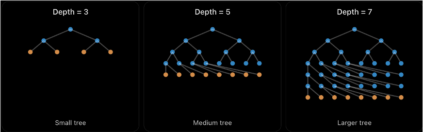
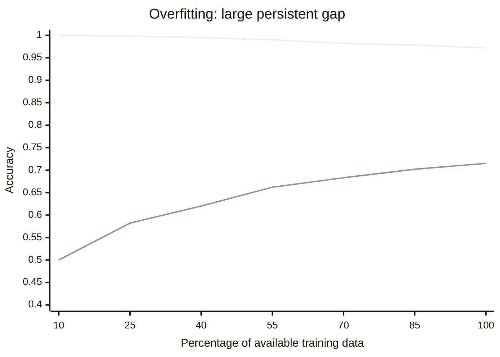
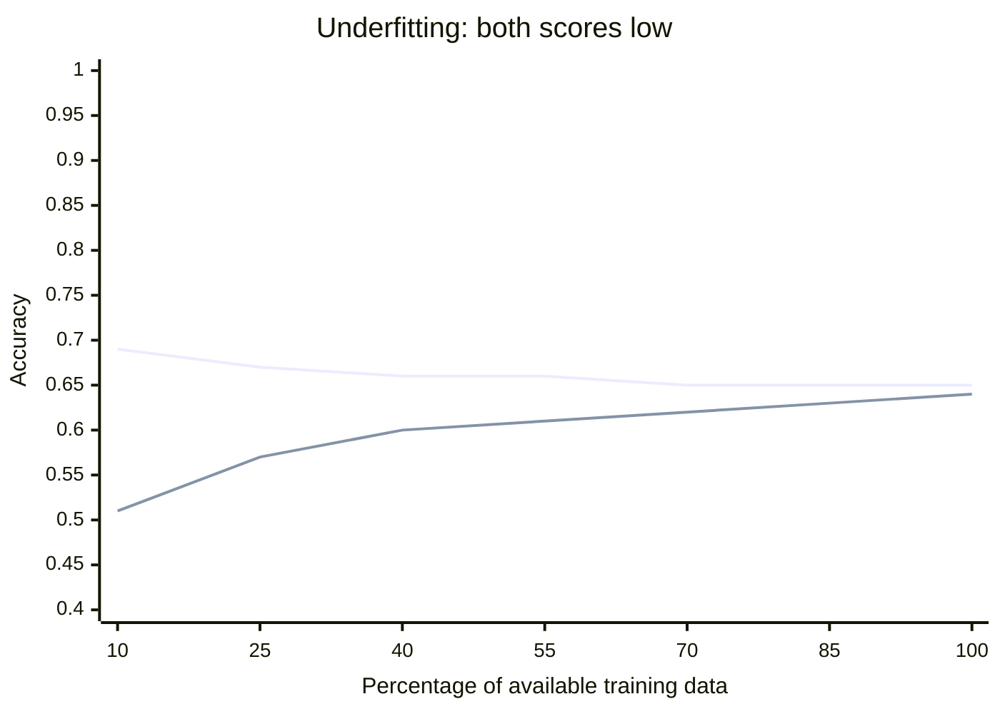
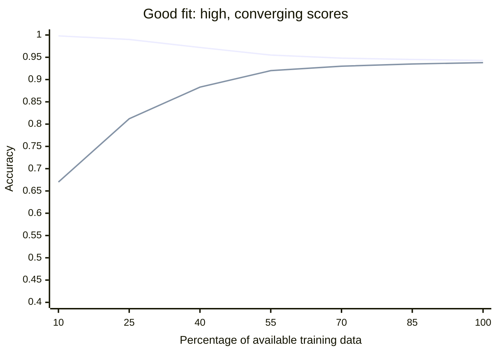

## Introduction

### Learning outcomes

- Understand the role of hyperparameters in model performance.
- Use GridSearchCV to test combinations of hyperparameters.
- Explain how k-fold cross-validation evaluates each combination.
- Compare default and tuned models using held-out data.
- Interpret learning curves to diagnose underfitting and overfitting.

### Where Week 6 fits

<div style="display: flex; gap: 24px; overflow-x: auto; padding: 8px;">
  <div style="flex: 0 0 calc(50% - 12px); min-width: 350px; background-color: #f7f9fc; border-left: 6px solid #0096aa; border-radius: 20px; padding: 28px 24px; box-sizing: border-box;">
    <h2 style="margin: 0 0 24px 0; font-size: 20px; color: #1a2b42; font-weight: 700;">Week 5: Train and evaluate</h2>
    <p style="margin: 0; font-size: 15px; color: #2c3e50; line-height: 1.6;">Classification algorithms, ensembles, accuracy, sensitivity, specificity, F1 and ROC-AUC.</p>
  </div>
  <div style="flex: 0 0 calc(50% - 12px); min-width: 350px; background-color: #f7f9fc; border-left: 6px solid #0096aa; border-radius: 20px; padding: 28px 24px; box-sizing: border-box;">
    <h2 style="margin: 0 0 24px 0; font-size: 20px; color: #1a2b42; font-weight: 700;">Week 6: Tune and diagnose</h2>
    <p style="margin: 0; font-size: 15px; color: #2c3e50; line-height: 1.6;">Find better settings using cross-validation. Use learning curves to identify generalisation problems.</p>
  </div>
</div>

## GridSearchCV

### What is GridSearchCV

GridSearchCV is a powerful method used to tune hyperparameters of machine learning models by performing an exhaustive search over a predefined grid of hyperparameter values. It helps in finding the best combination of hyperparameters that gives the highest model performance (often based on cross-validation).

<div style="display: flex; gap: 24px; overflow-x: auto; padding: 8px;">
  <div style="flex: 0 0 calc(33.33% - 16px); min-width: 300px; background-color: #f7f9fc; border-left: 6px solid #007890; border-radius: 20px; padding: 28px 24px; box-sizing: border-box;">
    <h2 style="margin: 0 0 24px 0; font-size: 20px; color: #1a2b42; font-weight: 700;">Grid</h2>
    <p style="margin: 0; font-size: 15px; color: #2c3e50; line-height: 1.5;">A set of possible hyperparameter values that we want to test.</p>
  </div>
  <div style="flex: 0 0 calc(33.33% - 16px); min-width: 350px; background-color: #f7f9fc; border-left: 6px solid #0096aa; border-radius: 20px; padding: 28px 24px; box-sizing: border-box;">
    <h2 style="margin: 0 0 24px 0; font-size: 20px; color: #1a2b42; font-weight: 700;">Search</h2>
    <p style="margin: 0; font-size: 15px; color: #2c3e50; line-height: 1.5;">The process of testing every possible combination of those values.</p>
  </div>
  <div style="flex: 0 0 calc(33.33% - 16px); min-width: 480px; background-color: #f7f9fc; border-left: 6px solid #f28522; border-radius: 20px; padding: 28px 24px; box-sizing: border-box;">
    <h2 style="margin: 0 0 24px 0; font-size: 20px; color: #1a2b42; font-weight: 700;">CV</h2>
    <p style="margin: 0; font-size: 15px; color: #2c3e50; line-height: 1.5;">(Cross-Validation): A method used to evaluate each combination by splitting the training data into several folds.</p>
  </div>
</div>

### Parameters vs hyperparameters

<div style="display: flex; gap: 24px; overflow-x: auto; padding: 8px;">
  <div style="flex: 0 0 calc(50% - 12px); min-width: 350px; background-color: #f7f9fc; border-left: 6px solid #0096aa; border-radius: 20px; padding: 28px 24px; box-sizing: border-box;">
    <h2 style="margin: 0 0 24px 0; font-size: 20px; color: #1a2b42; font-weight: 700;">Model parameters</h2>
    <p style="margin: 0; font-size: 15px; color: #2c3e50; line-height: 1.6;">Learned from data during fitting. Example: coefficients in Logistic Regression.</p>
  </div>
  <div style="flex: 0 0 calc(50% - 12px); min-width: 350px; background-color: #f7f9fc; border-left: 6px solid #0096aa; border-radius: 20px; padding: 28px 24px; box-sizing: border-box;">
    <h2 style="margin: 0 0 24px 0; font-size: 20px; color: #1a2b42; font-weight: 700;">Hyperparameters</h2>
    <p style="margin: 0; font-size: 15px; color: #2c3e50; line-height: 1.6;">Chosen before fitting. Example: number of neighbours (KNN) or maximum tree depth.</p>
  </div>
</div>

<span style="color: #0B6584">Why tune them?</span>

- <span style="color: #0B6584">Correctly tuned hyperparameters can significantly improve model performance.</span>
- <span style="color: #0B6584">Hyperparameter tuning changes how the model learns, not the dataset labels.</span>

### Why tune hyperparameters?

- Default values are convenient starting points, not necessarily ideal for every dataset.
- Some settings make the model too simple, leading to underfitting.
- Other settings make the model overly flexible, leading to overfitting.
- Tuning searches for settings that perform well on validation folds.

### Parameter grid: a simple example

A dictionary where keys are hyperparameter names and values are lists of possible values. GridSearchCV tests all possible combinations of these hyperparameters.

```python
param_grid = {
    'max_depth': [3, 5, 7],
    'criterion': ['gini', 'entropy']	
}
```

<span style="color: #0B6584">3 depth choices × 2 criteria = 6 parameter <br>combinations.</span>

<div style="display: flex; gap: 24px; overflow-x: auto; padding: 8px;">
  <div style="flex: 0 0 520px; min-width: 600px; background-color: #f7f9fc; border-radius: 20px; padding: 32px 28px; box-sizing: border-box;">
    <h2 style="margin: 0 0 32px 0; font-size: 25px; color: #1a2b42; font-weight: 700;">What do the values mean?</h2>
    <div style="margin-bottom:28px;">
      <h3 style="margin:0 0 12px 0; font-size:20px; color:#007890; font-weight:700;">max_depth</h3>
      <p style="margin:0; font-size:15px; color:#2c3e50; line-height:1.5;">Limits how many levels the Decision Tree may grow.</p>
    </div>
    <div>
      <h3 style="margin:0 0 12px 0; font-size:20px; color:#007890; font-weight:700;">criterion</h3>
      <p style="margin:0; font-size:15px; color:#2c3e50; line-height:1.5;">Chooses the impurity measure for selecting splits. (how to split the data)</p>
    </div>
  </div>
</div>



Increasing the depth can help a model learn more detail, but it can also increase the risk of overfitting.

### How many models does the search fit

<center><h4><span style="color: #0B6584">6 combinations × 5 folds = 30 cross-validation fits</span></h4></center>

<div style="display: flex; gap: 24px; overflow-x: auto; padding: 8px;">
  <div style="flex: 0 0 calc(50% - 12px); min-width: 350px; background-color: #f7f9fc; border-left: 6px solid #0096aa; border-radius: 20px; padding: 28px 24px; box-sizing: border-box;">
    <h2 style="margin: 0 0 24px 0; font-size: 20px; color: #1a2b42; font-weight: 700;">Six combinations</h2>
    <p style="margin: 0; font-size: 15px; color: #2c3e50; line-height: 1.6;">For each depth, try Gini and entropy.</p>
  </div>
  <div style="flex: 0 0 calc(50% - 12px); min-width: 420px; background-color: #f7f9fc; border-left: 6px solid #f28522; border-radius: 20px; padding: 28px 24px; box-sizing: border-box;">
    <h2 style="margin: 0 0 24px 0; font-size: 20px; color: #1a2b42; font-weight: 700;">Five validation folds</h2>
    <p style="margin: 0; font-size: 15px; color: #2c3e50; line-height: 1.6;">Each combination trains five times on different folds.</p>
  </div>
</div>

<span style="color: #0B6584"><b>With refit=True (default), GridSearchCV fits the best setting once more on all supplied training data.</b></span>

### 5-fold cross-validation

- How it works: In k-fold cross-validation, the data is split into k subsets. The model is trained on k-1 subsets and validated on the remaining subset. This is repeated k times, each time with a different validation set, and the average performance is taken.
- Purpose: Cross-validation ensures that the model's performance is not biased by a single split of the data.

<div style="overflow-x: auto; padding:8px;">
<table style="border-collapse: collapse; font-family: sans-serif;">
  <tr>
    <td style="padding:8px;"><div style="width:160px; background:#ee8f2b; color:#fff; text-align:center; padding:16px 8px; border-radius:8px; font-weight:bold; font-size:20px;">VALIDATE</div></td>
    <td style="padding:8px;"><div style="width:160px; background:#0f647c; color:#fff; text-align:center; padding:16px 8px; border-radius:8px; font-weight:bold; font-size:20px;">TRAIN</div></td>
    <td style="padding:8px;"><div style="width:160px; background:#0f647c; color:#fff; text-align:center; padding:16px 8px; border-radius:8px; font-weight:bold; font-size:20px;">TRAIN</div></td>
    <td style="padding:8px;"><div style="width:160px; background:#0f647c; color:#fff; text-align:center; padding:16px 8px; border-radius:8px; font-weight:bold; font-size:20px;">TRAIN</div></td>
    <td style="padding:8px;"><div style="width:160px; background:#0f647c; color:#fff; text-align:center; padding:16px 8px; border-radius:8px; font-weight:bold; font-size:20px;">TRAIN</div></td>
    <td style="padding:8px; vertical-align: middle; font-size:20px; font-weight:bold;">Fold&nbsp;1</td>
  </tr>
  <tr>
    <td style="padding:8px;"><div style="width:160px; background:#0f647c; color:#fff; text-align:center; padding:16px 8px; border-radius:8px; font-weight:bold; font-size:20px;">TRAIN</div></td>
    <td style="padding:8px;"><div style="width:160px; background:#ee8f2b; color:#fff; text-align:center; padding:16px 8px; border-radius:8px; font-weight:bold; font-size:20px;">VALIDATE</div></td>
    <td style="padding:8px;"><div style="width:160px; background:#0f647c; color:#fff; text-align:center; padding:16px 8px; border-radius:8px; font-weight:bold; font-size:20px;">TRAIN</div></td>
    <td style="padding:8px;"><div style="width:160px; background:#0f647c; color:#fff; text-align:center; padding:16px 8px; border-radius:8px; font-weight:bold; font-size:20px;">TRAIN</div></td>
    <td style="padding:8px;"><div style="width:160px; background:#0f647c; color:#fff; text-align:center; padding:16px 8px; border-radius:8px; font-weight:bold; font-size:20px;">TRAIN</div></td>
    <td style="padding:8px; vertical-align: middle; font-size:20px; font-weight:bold;">Fold&nbsp;2</td>
  </tr>
  <tr>
    <td style="padding:8px;"><div style="width:160px; background:#0f647c; color:#fff; text-align:center; padding:16px 8px; border-radius:8px; font-weight:bold; font-size:20px;">TRAIN</div></td>
    <td style="padding:8px;"><div style="width:160px; background:#0f647c; color:#fff; text-align:center; padding:16px 8px; border-radius:8px; font-weight:bold; font-size:20px;">TRAIN</div></td>
    <td style="padding:8px;"><div style="width:160px; background:#ee8f2b; color:#fff; text-align:center; padding:16px 8px; border-radius:8px; font-weight:bold; font-size:20px;">VALIDATE</div></td>
    <td style="padding:8px;"><div style="width:160px; background:#0f647c; color:#fff; text-align:center; padding:16px 8px; border-radius:8px; font-weight:bold; font-size:20px;">TRAIN</div></td>
    <td style="padding:8px;"><div style="width:160px; background:#0f647c; color:#fff; text-align:center; padding:16px 8px; border-radius:8px; font-weight:bold; font-size:20px;">TRAIN</div></td>
    <td style="padding:8px; vertical-align: middle; font-size:20px; font-weight:bold;">Fold&nbsp;3</td>
  </tr>
  <tr>
    <td style="padding:8px;"><div style="width:160px; background:#0f647c; color:#fff; text-align:center; padding:16px 8px; border-radius:8px; font-weight:bold; font-size:20px;">TRAIN</div></td>
    <td style="padding:8px;"><div style="width:160px; background:#0f647c; color:#fff; text-align:center; padding:16px 8px; border-radius:8px; font-weight:bold; font-size:20px;">TRAIN</div></td>
    <td style="padding:8px;"><div style="width:160px; background:#0f647c; color:#fff; text-align:center; padding:16px 8px; border-radius:8px; font-weight:bold; font-size:20px;">TRAIN</div></td>
    <td style="padding:8px;"><div style="width:160px; background:#ee8f2b; color:#fff; text-align:center; padding:16px 8px; border-radius:8px; font-weight:bold; font-size:20px;">VALIDATE</div></td>
    <td style="padding:8px;"><div style="width:160px; background:#0f647c; color:#fff; text-align:center; padding:16px 8px; border-radius:8px; font-weight:bold; font-size:20px;">TRAIN</div></td>
    <td style="padding:8px; vertical-align: middle; font-size:20px; font-weight:bold;">Fold&nbsp;4</td>
  </tr>
  <tr>
    <td style="padding:8px;"><div style="width:160px; background:#0f647c; color:#fff; text-align:center; padding:16px 8px; border-radius:8px; font-weight:bold; font-size:20px;">TRAIN</div></td>
    <td style="padding:8px;"><div style="width:160px; background:#0f647c; color:#fff; text-align:center; padding:16px 8px; border-radius:8px; font-weight:bold; font-size:20px;">TRAIN</div></td>
    <td style="padding:8px;"><div style="width:160px; background:#0f647c; color:#fff; text-align:center; padding:16px 8px; border-radius:8px; font-weight:bold; font-size:20px;">TRAIN</div></td>
    <td style="padding:8px;"><div style="width:160px; background:#0f647c; color:#fff; text-align:center; padding:16px 8px; border-radius:8px; font-weight:bold; font-size:20px;">TRAIN</div></td>
    <td style="padding:8px;"><div style="width:160px; background:#ee8f2b; color:#fff; text-align:center; padding:16px 8px; border-radius:8px; font-weight:bold; font-size:20px;">VALIDATE</div></td>
    <td style="padding:8px; vertical-align: middle; font-size:20px; font-weight:bold;">Fold&nbsp;5</td>
  </tr>
  <tr>
    <td colspan="6" style="text-align:center; font-size:20px; font-weight:bold; padding-top:16px;">Average the five validation scores to assess the parameter combination.</td>
  </tr>
</table>
</div>

### Four steps in GridSearchCV

<div style="overflow-x: auto; padding: 8px;">
<div style="display: grid; grid-template-columns: 1fr 1fr; gap: 24px; min-width: 900px;">
  <div style="background-color: #f6f9fc; border-radius: 20px; padding: 32px; box-shadow: 0 2px 6px #00000033;">
    <div style="display: flex; align-items: flex-start; gap: 16px;">
      <span style="font-size: 25px; font-weight: 700; color: #00a0aa;">01</span>
      <div>
        <div style="font-size: 20px; font-weight: 700; color: #182b40; margin-bottom: 24px;">Define the parameter grid</div>
        <div style="font-size: 15px; color: #182b40;">Choose the names and candidate values.</div>
      </div>
    </div>
  </div>
  <div style="background-color: #f6f9fc; border-radius: 20px; padding: 32px; box-shadow: 0 2px 6px #00000033;">
    <div style="display: flex; align-items: flex-start; gap: 16px;">
      <span style="font-size: 25px; font-weight: 700; color: #00a0aa;">02</span>
      <div>
        <div style="font-size: 20px; font-weight: 700; color: #182b40; margin-bottom: 24px;">Run cross-validation</div>
        <div style="font-size: 15px; color: #182b40;">Train and validate each combination.</div>
      </div>
    </div>
  </div>
  <div style="background-color: #f6f9fc; border-radius: 20px; padding: 32px; box-shadow: 0 2px 6px #00000033;">
    <div style="display: flex; align-items: flex-start; gap: 16px;">
      <span style="font-size: 25px; font-weight: 700; color: #00a0aa;">03</span>
      <div>
        <div style="font-size: 20px; font-weight: 700; color: #182b40; margin-bottom: 24px;">Compare mean CV scores</div>
        <div style="font-size: 15px; color: #182b40;">Use accuracy, recall, F1 or another metric.</div>
      </div>
    </div>
  </div>
  <div style="background-color: #f6f9fc; border-radius: 20px; padding: 32px; box-shadow: 0 2px 6px #00000033;">
    <div style="display: flex; align-items: flex-start; gap: 16px;">
      <span style="font-size: 25px; font-weight: 700; color: #00a0aa;">04</span>
      <div>
        <div style="font-size: 20px; font-weight: 700; color: #182b40; margin-bottom: 24px;">Refit the winner</div>
        <div style="font-size: 15px; color: #182b40;">Train the best combination on all training data.</div>
      </div>
    </div>
  </div>
</div>
</div>

### GridSearchCV: complete first example

```python
from sklearn.tree import DecisionTreeClassifier
from sklearn.model_selection import GridSearchCV

param_grid = {
    'max_depth': [3, 5, 7],
    'criterion': ['gini', 'entropy']
}
dt = DecisionTreeClassifier(random_state=42)

search = GridSearchCV(dt, param_grid,
                      cv=5, scoring='accuracy')
search.fit(x_train, y_train)

print(search.best_params_)
print(search.best_score_)
```

<div style="overflow-x: auto; padding:8px;">
<div style="background-color:#f6f9fc; border-radius:24px; padding:40px; min-width:500px; box-shadow:0 2px 6px #00000033;">
  <div style="font-size:25px; font-weight:700; color:#182b40; margin-bottom:40px;">Read the code</div>
  <div style="margin-bottom:32px;">
    <div style="font-size:20px; font-weight:700; color:#008390; margin-bottom:12px;">estimator</div>
    <div style="font-size:15px; color:#182b40;">dt: the algorithm we want to tune.</div>
  </div>
  <div style="margin-bottom:32px;">
    <div style="font-size:20px; font-weight:700; color:#008390; margin-bottom:12px;">param_grid</div>
    <div style="font-size:15px; color:#182b40;">The combinations to examine.</div>
  </div>
  <div style="margin-bottom:32px;">
    <div style="font-size:20px; font-weight:700; color:#008390; margin-bottom:12px;">cv=5</div>
    <div style="font-size:15px; color:#182b40;">Five-fold cross-validation.</div>
  </div>
  <div>
    <div style="font-size:20px; font-weight:700; color:#008390; margin-bottom:12px;">scoring='accuracy'</div>
    <div style="font-size:15px; color:#182b40;">Score used to rank combinations.</div>
  </div>
</div>
</div>

### What GridSearchCV returns

```python
search.best_params_
# The winning hyperparameter combination

search.best_score_
# Mean cross-validation score for that combination

search.best_estimator_
# Best model, refitted on all training data

search.predict(x_test)
# Predictions on the held-out test data
```

<div style="overflow-x: auto; padding:8px;">
<div style="background-color:#f6f9fc; border-radius:24px; padding:40px; min-width:500px; box-shadow:0 2px 6px #00000033;">
  <div style="font-size:25px; font-weight:700; color:#182b40; margin-bottom:40px;">Important distinction</div>
  <div style="margin-bottom:32px;">
    <div style="font-size:20px; font-weight:700; color:#008390; margin-bottom:12px;">Validation score</div>
    <div style="font-size:15px; color:#182b40;">The validation score measures how well a model performs on validation data during training and hyperparameter tuning.</div>
  </div>
  <div style="margin-bottom:32px;">
    <div style="font-size:20px; font-weight:700; color:#008390; margin-bottom:12px;">Test score</div>
    <div style="font-size:15px; color:#182b40;">The test score measures how well the selected model performs on the separate test dataset, which was not used during training or hyperparameter selection.</div>
  </div>
</div>
</div>

### Default model versus tuned model

```python
# Default model
default_dt = DecisionTreeClassifier()
default_dt.fit(x_train, y_train)

# Tuned model
search = GridSearchCV(
    DecisionTreeClassifier(), param_grid,
    cv=5, scoring='accuracy'
)
search.fit(x_train, y_train)

tuned_dt = search.best_estimator_
```

<div style="overflow-x: auto; padding:8px;">
<div style="background-color:#f6f9fc; border-radius:24px; padding:40px; min-width:500px; box-shadow:0 2px 6px #00000033;">
  <div style="font-size:25px; font-weight:700; color:#182b40; margin-bottom:40px;">Fair comparison</div>
  <div style="margin-bottom:32px;">
    <div style="font-size:20px; font-weight:700; color:#008390; margin-bottom:12px;">Same training data</div>
    <div style="font-size:15px; color:#182b40;">Both methods should use the same training split.</div>
  </div>
  <div style="margin-bottom:32px;">
    <div style="font-size:20px; font-weight:700; color:#008390; margin-bottom:12px;">Same untouched test set</div>
    <div style="font-size:15px; color:#182b40;">Compare performance only after tuning.</div>
  </div>
  <div style="margin-bottom:32px;">
    <div style="font-size:20px; font-weight:700; color:#008390; margin-bottom:12px;">Not a guarantee</div>
    <div style="font-size:15px; color:#182b40;">Tuning may help, have no effect, or lower test scores.</div>
  </div>
</div>
</div>

## Classifier Code Examples

### 01. Logistic Regression (LR)

```python
# Default estimator / configuration
model = LogisticRegression(max_iter=1000)


param_grid = {
    'C': [0.1, 1, 10, 100],
    'solver': ['lbfgs', 'liblinear']
}

search = GridSearchCV(model, param_grid,
                      cv=5, scoring='accuracy')
search.fit(x_train, y_train)
print(search.best_params_)
```

<div style="overflow-x: auto; padding:8px;">
<div style="background-color:#f6f9fc; border-radius:24px; padding:40px; min-width:500px; box-shadow:0 2px 6px #00000033;">
  <div style="font-size:25px; font-weight:700; color:#182b40; margin-bottom:40px;">Tuned parameters</div>
  <div style="margin-bottom:32px;">
    <div style="font-size:20px; font-weight:700; color:#008390; margin-bottom:12px;">C</div>
    <div style="font-size:15px; color:#182b40;">Inverse regularisation strength. Smaller C = stronger regularisation.</div>
  </div>
  <div style="margin-bottom:32px;">
    <div style="font-size:20px; font-weight:700; color:#008390; margin-bottom:12px;">solver</div>
    <div style="font-size:15px; color:#182b40;">An optimisation algorithm that efficiently finds model coefficients.</div>
  </div>
</div>
</div>

### 02. Support Vector Machine (SVM)

```python
# Default estimator / configuration
model = SVC()

param_grid = {
    'C': [0.1, 1, 10],
    'kernel': ['linear', 'rbf']
}

search = GridSearchCV(model, param_grid,
                      cv=5, scoring='accuracy')
search.fit(x_train, y_train)
print(search.best_params_)
```

<div style="overflow-x: auto; padding:8px;">
<div style="background-color:#f6f9fc; border-radius:24px; padding:40px; min-width:500px; box-shadow:0 2px 6px #00000033;">
  <div style="font-size:25px; font-weight:700; color:#182b40; margin-bottom:40px;">Tuned parameters</div>
  <div style="margin-bottom:32px;">
    <div style="font-size:20px; font-weight:700; color:#008390; margin-bottom:12px;">C</div>
    <div style="font-size:15px; color:#182b40;">Penalty for margin violations. Smaller C gives stronger regularisation.</div>
  </div>
  <div style="margin-bottom:32px;">
    <div style="font-size:20px; font-weight:700; color:#008390; margin-bottom:12px;">kernel</div>
    <div style="font-size:15px; color:#182b40;">Type of decision boundary: linear or nonlinear.</div>
  </div>
</div>
</div>

### 03. K-Nearest Neighbours (KNN)

```python
# Default estimator / configuration
model = KNeighborsClassifier()

param_grid = {
    'n_neighbors': [3, 5, 7],
    'weights': ['uniform', 'distance']
}

search = GridSearchCV(model, param_grid,
                      cv=5, scoring='accuracy')
search.fit(x_train, y_train)
print(search.best_params_)
```

<div style="overflow-x: auto; padding:8px;">
<div style="background-color:#f6f9fc; border-radius:24px; padding:40px; min-width:500px; box-shadow:0 2px 6px #00000033;">
  <div style="font-size:25px; font-weight:700; color:#182b40; margin-bottom:40px;">Tuned parameters</div>
  <div style="margin-bottom:32px;">
    <div style="font-size:20px; font-weight:700; color:#008390; margin-bottom:12px;">n_neighbors</div>
    <div style="font-size:15px; color:#182b40;">How many nearby training points vote.</div>
  </div>
  <div style="margin-bottom:32px;">
    <div style="font-size:20px; font-weight:700; color:#008390; margin-bottom:12px;">weights</div>
    <div style="font-size:15px; color:#182b40;">determines how much influence each neighbour has when making a prediction.</div>
    <br>
    <div style="font-size:15px; color:#182b40;">Example: If K = 5:</div>
    <div style="font-size:15px; color:#182b40;">
        <ul>
            <li>uniform: All 5 neighbours have equal importance.</li>
            <li>distance: The nearest neighbours have greater influence on the final prediction.</li>
        </ul>
    </div>
    <div style="font-size:15px; color:#182b40;">GridSearchCV tests both methods and selects the one with the best average validation score.</div>
  </div>
</div>
</div>

### 04. Decision Tree (DT)

```python
# Default estimator / configuration
model = DecisionTreeClassifier()

param_grid = {
    'max_depth': [3, 5, 7],
    'criterion': ['gini', 'entropy']
}

search = GridSearchCV(model, param_grid,
                      cv=5, scoring='accuracy')
search.fit(x_train, y_train)
print(search.best_params_)
```

<div style="overflow-x: auto; padding:8px;">
<div style="background-color:#f6f9fc; border-radius:24px; padding:40px; min-width:500px; box-shadow:0 2px 6px #00000033;">
  <div style="font-size:25px; font-weight:700; color:#182b40; margin-bottom:40px;">Tuned parameters</div>
  <div style="margin-bottom:32px;">
    <div style="font-size:20px; font-weight:700; color:#008390; margin-bottom:12px;">max_depth</div>
    <div style="font-size:15px; color:#182b40;">Maximum number of levels; controls model complexity.</div>
  </div>
  <div style="margin-bottom:32px;">
    <div style="font-size:20px; font-weight:700; color:#008390; margin-bottom:12px;">criterion</div>
    <div style="font-size:15px; color:#182b40;">Impurity measure used to choose each split.</div>
  </div>
</div>
</div>

### 05. Random Forest (RF)

```python
# Default estimator / configuration
model = RandomForestClassifier()

param_grid = {
    'n_estimators': [50, 100, 200],
    'max_depth': [5, 10, 15]
}

search = GridSearchCV(model, param_grid,
                      cv=5, scoring='accuracy')
search.fit(x_train, y_train)
print(search.best_params_)
```

<div style="overflow-x: auto; padding:8px;">
<div style="background-color:#f6f9fc; border-radius:24px; padding:40px; min-width:500px; box-shadow:0 2px 6px #00000033;">
  <div style="font-size:25px; font-weight:700; color:#182b40; margin-bottom:40px;">Tuned parameters</div>
  <div style="margin-bottom:32px;">
    <div style="font-size:20px; font-weight:700; color:#008390; margin-bottom:12px;">n_estimators</div>
    <div style="font-size:15px; color:#182b40;">Number of trees in the forest.</div>
  </div>
  <div style="margin-bottom:32px;">
    <div style="font-size:20px; font-weight:700; color:#008390; margin-bottom:12px;">max_depth</div>
    <div style="font-size:15px; color:#182b40;">Maximum depth allowed for each tree.</div>
  </div>
</div>
</div>

### 06. AdaBoost

```python
# Default estimator / configuration
model = AdaBoostClassifier()

param_grid = {
    'n_estimators': [50, 100, 200],
    'learning_rate': [0.01, 0.1, 1]
}

search = GridSearchCV(model, param_grid,
                      cv=5, scoring='accuracy')
search.fit(x_train, y_train)
print(search.best_params_)
```

<div style="overflow-x: auto; padding:8px;">
<div style="background-color:#f6f9fc; border-radius:24px; padding:40px; min-width:500px; box-shadow:0 2px 6px #00000033;">
  <div style="font-size:25px; font-weight:700; color:#182b40; margin-bottom:40px;">Tuned parameters</div>
  <div style="margin-bottom:32px;">
    <div style="font-size:20px; font-weight:700; color:#008390; margin-bottom:12px;">n_estimators</div>
    <div style="font-size:15px; color:#182b40;">Maximum number of boosting rounds.</div>
  </div>
  <div style="margin-bottom:32px;">
    <div style="font-size:20px; font-weight:700; color:#008390; margin-bottom:12px;">learning_rate</div>
    <div style="font-size:15px; color:#182b40;">This controls how strongly each new weak learner contributes to the final prediction.</div>
  </div>
    <div style="margin-bottom:32px;">
    <div style="font-size:20px; font-weight:700; color:#008390; margin-bottom:12px;">How do they work together?</div>
    <div style="font-size:15px; color:#182b40;">
        <ul>
            <li>Small learning rate + more rounds: Gradual learning, often requiring more learners.</li>
            <li>Large learning rate + fewer rounds: Faster adjustments, but potentially less stable.</li>
        </ul>
    </div>
  </div>
</div>
</div>

### 07. Stacking

```python
# Default estimator / configuration
model = StackingClassifier(
    estimators=[('lr', LogisticRegression()),
                ('svc', SVC())],
    final_estimator=DecisionTreeClassifier())


param_grid = {
    'final_estimator__max_depth': [3, 5, 7]
}

search = GridSearchCV(model, param_grid,
                      cv=5, scoring='accuracy')
search.fit(x_train, y_train)
print(search.best_params_)
```

<div style="overflow-x: auto; padding:8px;">
<div style="background-color:#f6f9fc; border-radius:24px; padding:40px; min-width:500px; box-shadow:0 2px 6px #00000033;">
  <div style="font-size:25px; font-weight:700; color:#182b40; margin-bottom:40px;">Tuned parameters</div>
  <div style="margin-bottom:32px;">
    <div style="font-size:20px; font-weight:700; color:#008390; margin-bottom:12px;">final_estimator__max_depth</div>
    <div style="font-size:15px; color:#182b40;">Maximum depth of the meta-model Decision Tree.</div>
  </div>
</div>
</div>

### 08. Voting Classifier

```python
# Default estimator / configuration
model = VotingClassifier(
    estimators=[('lr', LogisticRegression()),
                ('svc', SVC()),
                ('knn', KNeighborsClassifier())])


param_grid = {
    'svc__C': [0.1, 1, 10],
    'knn__n_neighbors': [3, 5, 7]
}

search = GridSearchCV(model, param_grid,
                      cv=5, scoring='accuracy')
search.fit(x_train, y_train)
print(search.best_params_)
```

<div style="overflow-x: auto; padding:8px;">
<div style="background-color:#f6f9fc; border-radius:24px; padding:40px; min-width:500px; box-shadow:0 2px 6px #00000033;">
  <div style="font-size:25px; font-weight:700; color:#182b40; margin-bottom:40px;">Tuned parameters</div>
  <div style="margin-bottom:32px;">
    <div style="font-size:20px; font-weight:700; color:#008390; margin-bottom:12px;">svc__C</div>
    <div style="font-size:15px; color:#182b40;">Tunes the SVM component inside Voting.</div>
  </div>
  <div style="margin-bottom:32px;">
    <div style="font-size:20px; font-weight:700; color:#008390; margin-bottom:12px;">knn__n_neighbors</div>
    <div style="font-size:15px; color:#182b40;">Tunes the KNN component inside Voting.</div>
  </div>
</div>
</div>

### 09. LightGBM

```python
# Default estimator / configuration
model = LGBMClassifier(verbose=-1)


param_grid = {
    'n_estimators': [50, 100, 200],
    'learning_rate': [0.01, 0.1, 0.5]
}

search = GridSearchCV(model, param_grid,
                      cv=5, scoring='accuracy')
search.fit(x_train, y_train)
print(search.best_params_)
```

<div style="overflow-x: auto; padding:8px;">
<div style="background-color:#f6f9fc; border-radius:24px; padding:40px; min-width:500px; box-shadow:0 2px 6px #00000033;">
  <div style="font-size:25px; font-weight:700; color:#182b40; margin-bottom:40px;">Tuned parameters</div>
  <div style="margin-bottom:32px;">
    <div style="font-size:20px; font-weight:700; color:#008390; margin-bottom:12px;">n_estimators</div>
    <div style="font-size:15px; color:#182b40;">Number of boosting trees.</div>
  </div>
  <div style="margin-bottom:32px;">
    <div style="font-size:20px; font-weight:700; color:#008390; margin-bottom:12px;">learning_rate</div>
    <div style="font-size:15px; color:#182b40;">Step size for each boosting update.</div>
  </div>
</div>
</div>

> [!TIP]
> `verbose` 取值及对应意义：  
> - `-1`: 完全静默，**不打印任何训练信息**（最常用在批量跑实验、交叉验证，避免刷屏）  
> - `0`: 只打印警告和错误，不打印迭代日志  
> - `1`: 每一轮都打印（默认很多版本不是 1）  
> - `N>1`: 每间隔 `N` 轮打印一次日志，比如 `verbose=10`：每 10 轮输出一次指标  

### 10. CatBoost

```python
# Default estimator / configuration
model = CatBoostClassifier(verbose=False)


param_grid = {
    'iterations': [100, 200],
    'learning_rate': [0.01, 0.1],
    'depth': [3, 5, 7]
}

search = GridSearchCV(model, param_grid,
                      cv=5, scoring='accuracy')
search.fit(x_train, y_train)
print(search.best_params_)
```

<div style="overflow-x: auto; padding:8px;">
<div style="background-color:#f6f9fc; border-radius:24px; padding:40px; min-width:500px; box-shadow:0 2px 6px #00000033;">
  <div style="font-size:25px; font-weight:700; color:#182b40; margin-bottom:40px;">Tuned parameters</div>
  <div style="margin-bottom:32px;">
    <div style="font-size:20px; font-weight:700; color:#008390; margin-bottom:12px;">iterations</div>
    <div style="font-size:15px; color:#182b40;">Number of boosting iterations.</div>
  </div>
  <div style="margin-bottom:32px;">
    <div style="font-size:20px; font-weight:700; color:#008390; margin-bottom:12px;">learning_rate</div>
    <div style="font-size:15px; color:#182b40;">Strength of each boosting update.</div>
  </div>
    <div style="margin-bottom:32px;">
    <div style="font-size:20px; font-weight:700; color:#008390; margin-bottom:12px;">depth</div>
    <div style="font-size:15px; color:#182b40;">Depth of each tree.</div>
  </div>
</div>
</div>

### 11. XGBoost

```python
# Default estimator / configuration
model = XGBClassifier()


param_grid = {
    'n_estimators': [50, 100, 200],
    'learning_rate': [0.01, 0.1, 0.5],
    'max_depth': [3, 5, 7]
}

search = GridSearchCV(model, param_grid,
                      cv=5, scoring='accuracy')
search.fit(x_train, y_train)
print(search.best_params_)
```

<div style="overflow-x: auto; padding:8px;">
<div style="background-color:#f6f9fc; border-radius:24px; padding:40px; min-width:500px; box-shadow:0 2px 6px #00000033;">
  <div style="font-size:25px; font-weight:700; color:#182b40; margin-bottom:40px;">Tuned parameters</div>
  <div style="margin-bottom:32px;">
    <div style="font-size:20px; font-weight:700; color:#008390; margin-bottom:12px;">n_estimators</div>
    <div style="font-size:15px; color:#182b40;">Number of boosting trees.</div>
  </div>
  <div style="margin-bottom:32px;">
    <div style="font-size:20px; font-weight:700; color:#008390; margin-bottom:12px;">learning_rate</div>
    <div style="font-size:15px; color:#182b40;">Size of the boosting update.</div>
  </div>
    <div style="margin-bottom:32px;">
    <div style="font-size:20px; font-weight:700; color:#008390; margin-bottom:12px;">max_depth</div>
    <div style="font-size:15px; color:#182b40;">Tree depth; larger values may overfit.</div>
  </div>
</div>
</div>

### 12. Bagging

```python
# Default estimator / configuration
model = BaggingClassifier(estimator=DecisionTreeClassifier())


param_grid = {
    'n_estimators': [10, 50, 100],
    'max_samples': [0.5, 0.7, 1.0]
}

search = GridSearchCV(model, param_grid,
                      cv=5, scoring='accuracy')
search.fit(x_train, y_train)
print(search.best_params_)
```

<div style="overflow-x: auto; padding:8px;">
<div style="background-color:#f6f9fc; border-radius:24px; padding:40px; min-width:500px; box-shadow:0 2px 6px #00000033;">
  <div style="font-size:25px; font-weight:700; color:#182b40; margin-bottom:40px;">Tuned parameters</div>
  <div style="margin-bottom:32px;">
    <div style="font-size:20px; font-weight:700; color:#008390; margin-bottom:12px;">n_estimators</div>
    <div style="font-size:15px; color:#182b40;">Number of bootstrap-trained base estimators.</div>
  </div>
  <div style="margin-bottom:32px;">
    <div style="font-size:20px; font-weight:700; color:#008390; margin-bottom:12px;">max_samples</div>
    <div style="font-size:15px; color:#182b40;">Fraction of training rows sampled for each estimator.</div>
  </div>
</div>
</div>

### 13. Gradient Boosting (GBDT)

```python
# Default estimator / configuration
model = GradientBoostingClassifier()


param_grid = {
    'n_estimators': [50, 100, 200],
    'learning_rate': [0.01, 0.1, 0.5],
    'max_depth': [3, 5, 7]
}

search = GridSearchCV(model, param_grid,
                      cv=5, scoring='accuracy')
search.fit(x_train, y_train)
print(search.best_params_)
```

<div style="overflow-x: auto; padding:8px;">
<div style="background-color:#f6f9fc; border-radius:24px; padding:40px; min-width:500px; box-shadow:0 2px 6px #00000033;">
  <div style="font-size:25px; font-weight:700; color:#182b40; margin-bottom:40px;">Tuned parameters</div>
  <div style="margin-bottom:32px;">
    <div style="font-size:20px; font-weight:700; color:#008390; margin-bottom:12px;">n_estimators</div>
    <div style="font-size:15px; color:#182b40;">Number of boosting stages.</div>
  </div>
  <div style="margin-bottom:32px;">
    <div style="font-size:20px; font-weight:700; color:#008390; margin-bottom:12px;">learning_rate</div>
    <div style="font-size:15px; color:#182b40;">Contribution of each stage.</div>
  </div>
    <div style="margin-bottom:32px;">
    <div style="font-size:20px; font-weight:700; color:#008390; margin-bottom:12px;">max_depth</div>
    <div style="font-size:15px; color:#182b40;">Complexity of each regression tree.</div>
  </div>
</div>
</div>

### 14. Extra Trees

```python
# Default estimator / configuration
model = ExtraTreesClassifier()


param_grid = {
    'n_estimators': [50, 100, 200],
    'max_depth': [5, 10, 15]
}

search = GridSearchCV(model, param_grid,
                      cv=5, scoring='accuracy')
search.fit(x_train, y_train)
print(search.best_params_)
```

<div style="overflow-x: auto; padding:8px;">
<div style="background-color:#f6f9fc; border-radius:24px; padding:40px; min-width:500px; box-shadow:0 2px 6px #00000033;">
  <div style="font-size:25px; font-weight:700; color:#182b40; margin-bottom:40px;">Tuned parameters</div>
  <div style="margin-bottom:32px;">
    <div style="font-size:20px; font-weight:700; color:#008390; margin-bottom:12px;">n_estimators</div>
    <div style="font-size:15px; color:#182b40;">Number of randomised trees.</div>
  </div>
    <div style="margin-bottom:32px;">
    <div style="font-size:20px; font-weight:700; color:#008390; margin-bottom:12px;">max_depth</div>
    <div style="font-size:15px; color:#182b40;">Maximum tree depth.</div>
  </div>
</div>
</div>

### 15. Gaussian Naive Bayes (GNB)

```python
# Default estimator / configuration
model = GaussianNB()


param_grid = {
    'var_smoothing': [1e-9, 1e-8, 1e-7]
}

search = GridSearchCV(model, param_grid,
                      cv=5, scoring='accuracy')
search.fit(x_train, y_train)
print(search.best_params_)
```

<div style="overflow-x: auto; padding:8px;">
<div style="background-color:#f6f9fc; border-radius:24px; padding:40px; min-width:500px; box-shadow:0 2px 6px #00000033;">
  <div style="font-size:25px; font-weight:700; color:#182b40; margin-bottom:40px;">Tuned parameters</div>
  <div style="margin-bottom:32px;">
    <div style="font-size:20px; font-weight:700; color:#008390; margin-bottom:12px;">var_smoothing</div>
    <div style="font-size:15px; color:#182b40;">
        <ul>
            <li>Numerical stabilisation added to feature variances.</li>
            <li>Helps prevent numerical problems when calculating probabilities.</li>
            <li>It adds a small amount to the estimated feature variances to make calculations more stable.</li>
        </ul>
    </div>
  </div>
</div>
</div>

### Parameter patterns across algorithms

<div style="overflow-x: auto; padding: 8px;">
<div style="display: flex; flex-direction: column; gap:12px; min-width:1200px;">
  <div style="background-color: #f6f9fc; border-radius: 16px; box-shadow: 0 2px 6px #00000033; display: grid; grid-template-columns: 1fr 1fr 1fr;">
    <div style="padding: 24px; font-size: 20px; font-weight:700; color:#008390;">C</div>
    <div style="padding: 24px; font-size: 20px; color:#182b40;">SVM, Logistic Regression</div>
    <div style="padding: 24px; font-size: 20px; color:#182b40;">Regularisation / penalties</div>
  </div>
  <div style="background-color: #f6f9fc; border-radius: 16px; box-shadow: 0 2px 6px #00000033; display: grid; grid-template-columns: 1fr 1fr 1fr;">
    <div style="padding: 24px; font-size: 20px; font-weight:700; color:#008390;">n_neighbors</div>
    <div style="padding: 24px; font-size: 20px; color:#182b40;">KNN</div>
    <div style="padding: 24px; font-size: 20px; color:#182b40;">Size of local neighbourhood</div>
  </div>
  <div style="background-color: #f6f9fc; border-radius: 16px; box-shadow: 0 2px 6px #00000033; display: grid; grid-template-columns: 1fr 1fr 1fr;">
    <div style="padding: 24px; font-size: 20px; font-weight:700; color:#008390;">max_depth / depth</div>
    <div style="padding: 24px; font-size: 20px; color:#182b40;">Decision Tree, forests, boosting</div>
    <div style="padding: 24px; font-size: 20px; color:#182b40;">Tree complexity</div>
  </div>
  <div style="background-color: #f6f9fc; border-radius: 16px; box-shadow: 0 2px 6px #00000033; display: grid; grid-template-columns: 1fr 1fr 1fr;">
    <div style="padding: 24px; font-size: 20px; font-weight:700; color:#008390;">n_estimators / iterations</div>
    <div style="padding: 24px; font-size: 20px; color:#182b40;">Ensembles</div>
    <div style="padding: 24px; font-size: 20px; color:#182b40;">Number of trees or boosting rounds</div>
  </div>
  <div style="background-color: #f6f9fc; border-radius: 16px; box-shadow: 0 2px 6px #00000033; display: grid; grid-template-columns: 1fr 1fr 1fr;">
    <div style="padding: 24px; font-size: 20px; font-weight:700; color:#008390;">learning_rate</div>
    <div style="padding: 24px; font-size: 20px; color:#182b40;">Boosting algorithms</div>
    <div style="padding: 24px; font-size: 20px; color:#182b40;">Strength of each update</div>
  </div>
  <div style="background-color: #f6f9fc; border-radius: 16px; box-shadow: 0 2px 6px #00000033; display: grid; grid-template-columns: 1fr 1fr 1fr;">
    <div style="padding: 24px; font-size: 20px; font-weight:700; color:#008390;">criterion</div>
    <div style="padding: 24px; font-size: 20px; color:#182b40;">Decision Tree</div>
    <div style="padding: 24px; font-size: 20px; color:#182b40;">Impurity used to select splits</div>
  </div>
</div>
</div>

## Choosing & Validating Models

### Advantages of GridSearchCV

- **Systematic search**<br>Every combination in the specified grid is evaluated.
- **Cross-validation**<br>Scores depend less on one arbitrary validation split.
- **Reproducible workflow**<br>Record the grid, random state, metric and CV procedure.
- **Integrated model selection**<br>Access best_params_, best_score_ and best_estimator_.

### Limitations of GridSearchCV

- **Computational cost**<br>Grid size grows rapidly as more hyperparameters are added.
- **Grid limitations**<br>It cannot discover values that were never supplied.
- **No guaranteed improvement**<br>The best CV configuration need not beat defaults on test data.
- **Possible overfitting to validation**<br>Repeatedly selecting among many settings can overfit the CV procedure.

### Alternative: RandomizedSearchCV

```python
from sklearn.model_selection import RandomizedSearchCV

random_search = RandomizedSearchCV(
    estimator=RandomForestClassifier(),
    param_distributions={
        'n_estimators': [50, 100, 200, 300],
        'max_depth': [5, 10, 15, None]
    },
    n_iter=6,
    cv=5,
    scoring='accuracy',
    random_state=42
)
random_search.fit(x_train, y_train)
```

#### How it differs

**n_estimators:** \[50, 100, 200, 300\], four choices for the number of trees.  
**max_depth:** \[5, 10, 15, None\], four choices for maximum tree depth. None means no maximum depth limit.  
**n_iter=6:** Randomly selects only 6 combinations to test.  
**cv=5:** Evaluates each selected combination using 5-fold cross-validation.  
**scoring='accuracy':** Uses accuracy to compare combinations.  
**random_state=42:** Makes the random selection reproducible.  

|                     | GridSearchCV   | RandomizedSearchCV |
| ------------------- | -------------- | ------------------ |
| Combinations tested | All 16 (4 × 4) | Only 6             |
| With cv=5           | 80 fits        | 30 fits            |
| Speed               | Usually slower | Usually faster     |

GridSearchCV tests every combination, while RandomizedSearchCV randomly selects a limited number of combinations. RandomizedSearchCV saves time, but may miss the best combination.

### Avoid data leakage during tuning

- Do not scale, impute, select features or oversample using information from validation folds.
- Fit preprocessing steps on each training fold, then transform that fold’s validation data.
- SVMSMOTE must operate inside the training folds, not on the entire dataset before CV.
- Keep the final test set untouched until the model and hyperparameters are selected.

### Leakage-safe GridSearchCV with SVMSMOTE

```python
from imblearn.pipeline import Pipeline
from imblearn.over_sampling import SVMSMOTE
from sklearn.preprocessing import StandardScaler
from sklearn.model_selection import GridSearchCV
from sklearn.svm import SVC

pipe = Pipeline([
    ('scaler', StandardScaler()),
    ('smote', SVMSMOTE(random_state=42)),
    ('svm', SVC())
])
grid = {'svm__C': [0.1, 1, 10],
        'svm__kernel': ['linear', 'rbf']}
search = GridSearchCV(pipe, grid, cv=5,
                      scoring='accuracy')
search.fit(X_train_raw, y_train_raw)
```

<div style="overflow-x: auto; padding:8px;">
<div style="background-color:#f6f9fc; border-radius:24px; padding:40px; min-width:500px; box-shadow:0 2px 6px #00000033;">
  <div style="font-size:25px; font-weight:700; color:#182b40; margin-bottom:40px;">Why this is correct</div>
  <div style="margin-bottom:32px;">
    <div style="font-size:20px; font-weight:700; color:#008390; margin-bottom:12px;">Pipeline</div>
    <div style="font-size:15px; color:#182b40;">Preprocessing is repeated separately inside each fold.</div>
  </div>
  <div style="margin-bottom:32px;">
    <div style="font-size:20px; font-weight:700; color:#008390; margin-bottom:12px;">Double underscore</div>
    <div style="font-size:15px; color:#182b40;">svm__C means parameter C of the nested SVM step.</div>
  </div>
    <div style="margin-bottom:32px;">
    <div style="font-size:20px; font-weight:700; color:#008390; margin-bottom:12px;">Train only</div>
    <div style="font-size:15px; color:#182b40;">Use original training observations, before oversampling.</div>
  </div>
</div>
</div>

### Default vs tuned: evaluate fairly

```python
from sklearn.metrics import accuracy_score, f1_score


pred_default = default_dt.predict(x_test)
pred_tuned = search.best_estimator_.predict(x_test)

print("Default accuracy:",
      accuracy_score(y_test, pred_default))
print("Tuned accuracy:",
      accuracy_score(y_test, pred_tuned))

print("Tuned F1:",
      f1_score(y_test, pred_tuned))
```

<div style="overflow-x: auto; padding:8px;">
<div style="background-color:#f6f9fc; border-radius:24px; padding:40px; min-width:500px; box-shadow:0 2px 6px #00000033;">
  <div style="font-size:25px; font-weight:700; color:#182b40; margin-bottom:40px;">Interpretation</div>
  <div style="margin-bottom:32px;">
    <div style="font-size:20px; font-weight:700; color:#008390; margin-bottom:12px;">Compare both</div>
    <div style="font-size:15px; color:#182b40;">Same held-out test observations.</div>
  </div>
  <div style="margin-bottom:32px;">
    <div style="font-size:20px; font-weight:700; color:#008390; margin-bottom:12px;">Look beyond accuracy</div>
    <div style="font-size:15px; color:#182b40;">Also evaluate sensitivity, specificity, F1 and ROC-AUC.</div>
  </div>
    <div style="margin-bottom:32px;">
    <div style="font-size:20px; font-weight:700; color:#008390; margin-bottom:12px;">Check model compatibility</div>
    <div style="font-size:15px; color:#182b40;">This snippet assumes search was fitted for the Decision Tree.</div>
  </div>
</div>
</div>

## Learning Curves

### What is a learning curve

A learning curve shows how model performance changes when the model is trained using progressively more data.

<div style="overflow-x: auto; padding: 8px;">
<div style="display: grid; grid-template-columns: 1fr 1fr; gap: 24px; min-width: 900px;">
  <div style="background-color: #f6f9fc; border-radius: 20px; box-shadow: 0 2px 6px #00000033; padding: 20px; border-left: 12px solid #008390;">
    <div style="font-size: 20px; font-weight:700; color:#182b40; margin-bottom: 15px;">Training score</div>
    <div style="font-size: 15px; color:#182b40;">Performance on the examples used to fit the model.</div>
  </div>
  <div style="background-color: #f6f9fc; border-radius: 20px; box-shadow: 0 2px 6px #00000033; padding: 20px; border-left: 12px solid #f28c28;">
    <div style="font-size: 20px; font-weight:700; color:#182b40; margin-bottom: 15px;">Validation score</div>
    <div style="font-size: 15px; color:#182b40;">Performance on data not used for fitting in that fold.</div>
  </div>
</div>
</div>

<span style="color: #0B6584">Horizontal axis: training size. Vertical axis: the chosen metric, such as accuracy.</span>

### Components of a learning curve


<div style="overflow-x: auto; padding:8px;">
<div style="background-color:#f6f9fc; border-radius:24px; padding:40px; min-width:500px; box-shadow:0 2px 6px #00000033;">
  <div style="font-size:25px; font-weight:700; color:#182b40; margin-bottom:40px;">How to read it</div>
  <div style="margin-bottom:32px;">
    <div style="font-size:20px; font-weight:700; color:#008390; margin-bottom:12px;">Blue training curve</div>
    <div style="font-size:15px; color:#182b40;">Score on the observations used to train.</div>
  </div>
  <div style="margin-bottom:32px;">
    <div style="font-size:20px; font-weight:700; color:#008390; margin-bottom:12px;">Orange validation curve</div>
    <div style="font-size:15px; color:#182b40;">Score on held-out validation folds.</div>
  </div>
  <div style="margin-bottom:32px;">
    <div style="font-size:20px; font-weight:700; color:#008390; margin-bottom:12px;">Gap between curves</div>
    <div style="font-size:15px; color:#182b40;">A large gap can indicate overfitting.</div>
  </div>
  <div>
    <div style="font-size:20px; font-weight:700; color:#008390; margin-bottom:12px;">End of the curves</div>
    <div style="font-size:15px; color:#182b40;">Focus on whether the scores are high and stable.</div>
  </div>
</div>
</div>

### Overfitting: training high, validation low

- Training score is high, but validation score is low.
- The model is too complex and captures noise in the training data.
- Solution: Use regularization, collect more data, or simplify the model.



<small>Illustrative graph, not a CKD model result</small>

<div style="overflow-x: auto; padding:8px;">
<div style="background-color:#f6f9fc; border-radius:24px; padding:40px; min-width:500px; box-shadow:0 2px 6px #00000033;">
  <div style="font-size:25px; font-weight:700; color:#182b40; margin-bottom:40px;">Diagnosis</div>
  <div style="margin-bottom:32px;">
    <div style="font-size:20px; font-weight:700; color:#008390; margin-bottom:12px;">Pattern</div>
    <div style="font-size:15px; color:#182b40;">Training score remains high but validation is much lower.</div>
  </div>
  <div style="margin-bottom:32px;">
    <div style="font-size:20px; font-weight:700; color:#008390; margin-bottom:12px;">Meaning</div>
    <div style="font-size:15px; color:#182b40;">The model may be fitting noise or details specific to training examples.</div>
  </div>
    <div style="margin-bottom:32px;">
    <div style="font-size:20px; font-weight:700; color:#008390; margin-bottom:12px;">What can help</div>
    <div style="font-size:15px; color:#182b40;">Regularisation, simpler model, more data, leakage checks.</div>
  </div>
</div>
</div>

### Underfitting: both scores low

- Training and validation scores are both low.
- The model is too simple to capture the underlying patterns of the data.
- Solution: Try a more complex model or add relevant features.



<small>Illustrative graph, not a CKD model result</small>

<div style="overflow-x: auto; padding:8px;">
<div style="background-color:#f6f9fc; border-radius:24px; padding:40px; min-width:500px; box-shadow:0 2px 6px #00000033;">
  <div style="font-size:25px; font-weight:700; color:#182b40; margin-bottom:40px;">Diagnosis</div>
  <div style="margin-bottom:32px;">
    <div style="font-size:20px; font-weight:700; color:#008390; margin-bottom:12px;">Pattern</div>
    <div style="font-size:15px; color:#182b40;">Training and validation scores are both low and close.</div>
  </div>
  <div style="margin-bottom:32px;">
    <div style="font-size:20px; font-weight:700; color:#008390; margin-bottom:12px;">Meaning</div>
    <div style="font-size:15px; color:#182b40;">Model capacity or available features may be insufficient.</div>
  </div>
    <div style="margin-bottom:32px;">
    <div style="font-size:20px; font-weight:700; color:#008390; margin-bottom:12px;">What can help</div>
    <div style="font-size:15px; color:#182b40;">More expressive model, useful features, less regularisation.</div>
  </div>
</div>
</div>

### Good fit: high and close scores



<small>Illustrative graph, not a CKD model result</small>

<div style="overflow-x: auto; padding:8px;">
<div style="background-color:#f6f9fc; border-radius:24px; padding:40px; min-width:500px; box-shadow:0 2px 6px #00000033;">
  <div style="font-size:25px; font-weight:700; color:#182b40; margin-bottom:40px;">Diagnosis</div>
  <div style="margin-bottom:32px;">
    <div style="font-size:20px; font-weight:700; color:#008390; margin-bottom:12px;">Pattern</div>
    <div style="font-size:15px; color:#182b40;">Training and validation scores are both strong and converge.</div>
  </div>
  <div style="margin-bottom:32px;">
    <div style="font-size:20px; font-weight:700; color:#008390; margin-bottom:12px;">Meaning</div>
    <div style="font-size:15px; color:#182b40;">Promising generalisation on validation folds.</div>
  </div>
    <div style="margin-bottom:32px;">
    <div style="font-size:20px; font-weight:700; color:#008390; margin-bottom:12px;">Caution</div>
    <div style="font-size:15px; color:#182b40;">Still evaluate once on an untouched test set.</div>
  </div>
</div>
</div>

### How learning curves help decisions

<div style="overflow-x: auto; padding: 8px;">
<div style="display: grid; grid-template-columns: 1fr 1fr; gap: 24px; min-width:1000px;">
  <div style="background-color: #f6f9fc; border-radius:20px; box-shadow:0 2px 6px #00000033; padding:20px; border-left:12px solid #d64848;">
    <div style="font-size:20px; font-weight:700; color:#182b40; margin-bottom:15px;">Large training–validation gap</div>
    <div style="font-size:15px; color:#182b40;">Collecting more data may help; also check model complexity and leakage.</div>
  </div>
  <div style="background-color: #f6f9fc; border-radius:20px; box-shadow:0 2px 6px #00000033; padding:20px; border-left:12px solid #f28c28;">
    <div style="font-size:20px; font-weight:700; color:#182b40; margin-bottom:15px;">Both scores consistently low</div>
    <div style="font-size:15px; color:#182b40;">Try a more flexible model, better representations or more relevant features.</div>
  </div>
  <div style="grid-column: 1 / -1; background-color: #f6f9fc; border-radius:20px; box-shadow:0 2px 6px #00000033; padding:20px; border-left:12px solid #239966;">
    <div style="font-size:20px; font-weight:700; color:#182b40; margin-bottom:15px;">Both scores high and close</div>
    <div style="font-size:15px; color:#182b40;">The model may generalise well. Confirm with the held-out test set.</div>
  </div>
</div>
</div>

### Python: plot a learning curve

```python
from sklearn.model_selection import learning_curve
import numpy as np
import matplotlib.pyplot as plt

sizes, train_scores, val_scores = learning_curve(
    DecisionTreeClassifier(max_depth=5),
    x_train, y_train,
    cv=5, scoring='accuracy',
    train_sizes=np.linspace(0.1, 1.0, 8)
)
plt.plot(sizes, train_scores.mean(axis=1),
         'o-', label='Training score')
plt.plot(sizes, val_scores.mean(axis=1),
         'o-', label='CV score')
plt.xlabel('Training examples')
plt.ylabel('Accuracy')
plt.legend()
plt.show()
```

<div style="overflow-x: auto; padding:8px;">
<div style="background-color:#f6f9fc; border-radius:24px; padding:40px; min-width:500px; box-shadow:0 2px 6px #00000033;">
  <div style="font-size:25px; font-weight:700; color:#182b40; margin-bottom:40px;">Key inputs and outputs</div>
  <div style="margin-bottom:32px;">
    <div style="font-size:20px; font-weight:700; color:#008390; margin-bottom:12px;">estimator</div>
    <div style="font-size:15px; color:#182b40;">Algorithm being examined.</div>
  </div>
  <div style="margin-bottom:32px;">
    <div style="font-size:20px; font-weight:700; color:#008390; margin-bottom:12px;">train_sizes</div>
    <div style="font-size:15px; color:#182b40;">Fractions or counts of training examples.</div>
  </div>
  <div style="margin-bottom:32px;">
    <div style="font-size:20px; font-weight:700; color:#008390; margin-bottom:12px;">cv=5</div>
    <div style="font-size:15px; color:#182b40;">Five-fold validation.</div>
  </div>
  <div>
    <div style="font-size:20px; font-weight:700; color:#008390; margin-bottom:12px;">Returned arrays</div>
    <div style="font-size:15px; color:#182b40;">Scores for each training size and fold.</div>
  </div>
</div>
</div>

### Learning curve: code explained

- **train_sizes**<br>Start with small subsets, then fit on more training examples.
- **train_scores**<br>Performance on the training portion of each fold.
- **val_scores**<br>Performance on the corresponding held-out validation fold.
- **mean(axis=1)**<br>Averages across CV folds for each training size.
- **Why plot both?**<br>The relative levels and gap reveal learning behaviour.

## Seminar

### Week 6 seminar: suggested workflow

1. Load the CKD training and test data.
2. Choose one default model and record its test metrics.
3. Define a small, interpretable parameter grid.
4. Use GridSearchCV on training data only.
5. Compare default and tuned models on the same test set.
6. Plot learning curves and discuss the gap.

<span style="color: #C34F48">For valid CV, start from the training data before SVMSMOTE; use a pipeline to resample inside each fold.</span>

## Conclusion

### Key takeaways

- GridSearchCV checks every supplied hyperparameter combination using cross-validation.
- The best CV configuration is not guaranteed to win on the held-out test set.
- Parameter tuning can affect the model’s complexity and generalisation.
- Learning curves reveal underfitting, overfitting and promising fit.
- Avoid leakage by fitting preprocessing and resampling within each CV fold.

> GridSearchCV  •  Cross-validation  •  Learning curves

Source: [week6gridsearchcvlearningcurveslecture.pptx](https://view.officeapps.live.com/op/view.aspx?src=https%3A%2F%2Fvle.zycdut.net%2Fsites%2Fstudent.zy.cdut.edu.cn%2Ffiles%2Fattachments%2Fweek6gridsearchcvlearningcurveslecture.pptx&wdOrigin=BROWSELINK)
