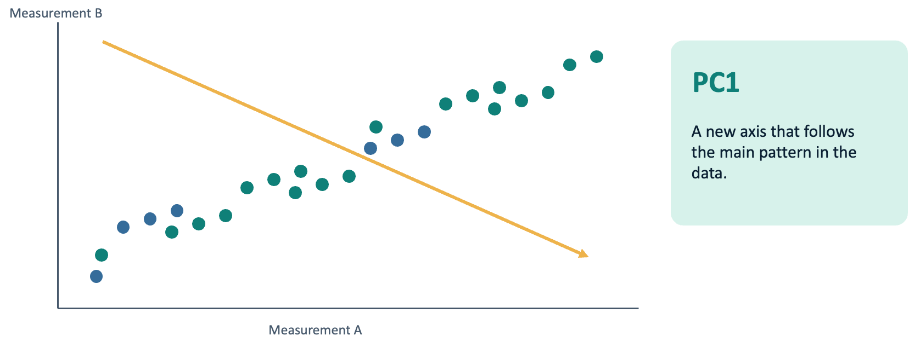
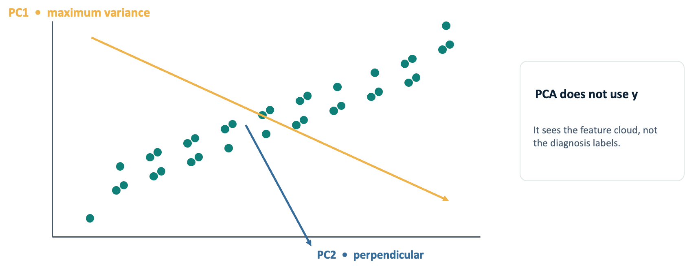
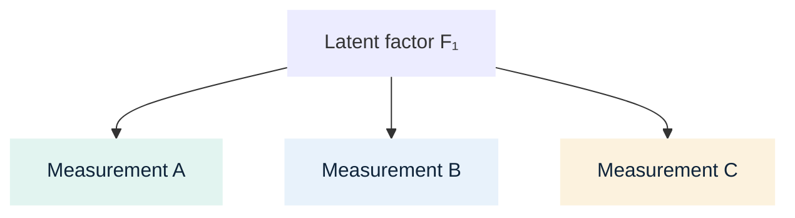
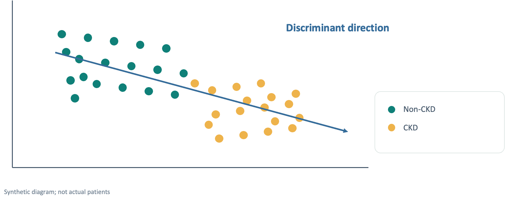

## Introduction to Dimensionality Reduction Techniques

Dimensionality reduction techniques aim to reduce the number of features (dimensions) while retaining as much information as possible.

Why it matters:

- Simplifies models: Reducing dimensions helps create simpler, more interpretable models.
- Speeds up computation: Fewer dimensions result in faster training and evaluation times.
- Prevents Overfitting: Reducing the feature space can improve the model's ability to generalize to new data. 

When to use:

- When you have high-dimensional data (many features) that could be summarized or compressed.

## Orientation

### A practical roadmap for today

Three techniques, one central question: what information should we keep?

  

    <!-- PCA Card -->
    

      <h2 style="margin:0 0 16px 0; color: #1a2b42;">01 PCA</h2>
      
Keep the directions where the data vary the most.

      
Unsupervised feature extraction.

    

    <!-- Factor Analysis Card -->
    

      <h2 style="margin:0 0 16px 0; color: #1a2b42;">02 Factor Analysis</h2>
      
Find hidden factors that may explain correlations among observed features.

      
Unsupervised latent-variable model.

    

    <!-- LDA Card -->
    

      <h2 style="margin:0 0 16px 0; color: #1a2b42;">03 LDA</h2>
      
Find a direction that separates known classes.

      
Supervised feature extraction.

    

  

    
<b>End goal: compare all features with reduced features using the SAME classifier and fair validation.</b>

## Warm-Up

### A dataset with 24 columns. Do we need all 24

Our familiar Chronic Kidney Disease classification example.

  

    <!-- Left part: 24 original CKD predictors -->
    

      
24

      
original CKD predictors

    

    <!-- Green arrow -->
    

      

    

    <!-- Right stacked three boxes -->
    

      
PCA: components

      
FA: hidden factors

      
LDA: class-discriminating direction

    

  

    
<b>Key question: can we reduce complexity without losing useful predictive information?</b>

## Learning Outcomes

### By the end of the lecture, you can…

- Distinguish feature selection from feature extraction.
- Explain how PCA, Factor Analysis and LDA differ.
- Interpret PCA explained variance and component loadings.
- Use dimensionality reduction without data leakage.
- Compare model performance before and after reduction.

## Fundamentals

### Dimensionality reduction in one sentence

Represent a dataset with fewer variables while retaining information useful for the task.

  

    <!-- Top dark banner -->
    

      Original features
      →
      fewer features or components
    

    <!-- Two bottom cards side by side -->
    

      <!-- Why use it -->
      

        <h2 style="margin:0 0 20px 0; color: #12283d;">Why use it?</h2>
        
Lower computational cost, cleaner visualisations, potentially less noise.

      

      <!-- What is the risk -->
      

        <h2 style="margin:0 0 20px 0; color: #12283d;">What is the risk?</h2>
        
Important information can be lost. Accuracy is not guaranteed to increase.

      

    

  

### Why do many features become difficult

Three reasons to consider reduction.

  

    <!-- Overlap -->
    

      <h2 style="margin:0 0 20px 0; color: #12283d;">Overlap</h2>
      
Two measurements may capture similar underlying information.

      
Example: haemoglobin and haematocrit can be related.

    

    <!-- Noise -->
    

      <h2 style="margin:0 0 20px 0; color: #12283d;">Noise</h2>
      
Some features may contain variation that does not help predict the outcome.

    

    <!-- Complexity -->
    

      <h2 style="margin:0 0 20px 0; color: #12283d;">Complexity</h2>
      
More dimensions can make distances less informative and some models slower.

    

  

    
<b>More features ≠ more useful information.</b>

### Correlated features: a visual intuition

Two variables often change together. One combined direction may summarise them.

## Connection to week 4

### Feature selection vs feature extraction

The two approaches both reduce dimensions, but they do different things.

  

    <!-- Feature Selection -->
    

      <h2 style="margin:0 0 24px 0; color:#28a799;">FEATURE SELECTION</h2>
      
Keep original columns

      

        age
        bp
        sg
        hemo
        sc
        pcv
      

        
      
Lasso / Boruta / RFECV

    

    <!-- Feature Extraction -->
    

      <h2 style="margin:0 0 24px 0; color:#346899;">FEATURE EXTRACTION</h2>
      
Create new variables

      

        Component 1
        Component 2
        Component 3
      

      
PCA / FA / LDA

    

  

## Fundamentals

### Three methods, three learning signals

The methods do not optimise the same objective.

| Method          | What it tries to preserve | Target labels | Typical use                |
| --------------- | ------------------------- | ------------- | -------------------------- |
| PCA             | Overall variance          | Not used      | Compression; visualisation |
| Factor Analysis | Shared covariance         | Not used      | Latent structure           |
| LDA             | Class separation          | Required      | Supervised projection      |

## Reliable Experiments

### Avoid data leakage before reducing dimensions

Fit every learned transformation on training data only.

  

    <!-- Step 1 -->
    

      
TRAIN / TEST SPLIT

      
first

    

    →
    <!-- Step 2 -->
    

      
PREPROCESS

      
fit in train fold

    

    →
    <!-- Step 3 -->
    

      
REDUCE

      
fit in train fold

    

    →
    <!-- Step 4 -->
    

      
CLASSIFIER

      
fit in train fold

    

    →
    <!-- Step 5 (highlight) -->
    

      
EVALUATE

      
test held out

    

  

    
<b>Use a Pipeline so cross-validation refits preprocessing and reduction inside each training fold.</b>

## Section 01 / Unsupervised

### Principal Component Analysis

Find new directions that capture the largest variation in the dataset.

### Principal Component Analysis (PCA)

PCA is a dimensionality reduction technique that transforms features into a new set of linearly uncorrelated components (called principal components).

How it works:

- PCA identifies the directions (components) along which the variance in the data is maximized. 
- Each principal component is a combination of the original features, capturing the most variance. 

Key Benefits:

- Reduces the dimensionality of large datasets while retaining most of the variance. 
- Makes data easier to visualize and interpret. 

When to use:  
In datasets with many correlated features, to reduce the dataset while retaining the majority of its variance. 

### PCA rotates the view of the data

The first component follows the largest spread; the second is perpendicular.

### Principal components are new features

  

    <!-- 顶部深色公式栏 -->
    

      <h2 style="color:#ffffff; margin:0; white-space:nowrap;">
PC1 &nbsp;=&nbsp; a1 × age &nbsp;+&nbsp; a2 × bp &nbsp;+&nbsp; a3 × hemo &nbsp;+&nbsp; ...
</h2>
    

    <!-- 下方三卡片行 -->
    

      <!-- PC1 -->
      

        <h2 style="color:#1a2b3c; margin:0 0 12px 0;">PC1</h2>
        
Largest possible variance of any linear projection.

      

      <!-- PC2 -->
      

        <h2 style="color:#1a2b3c; margin:0 0 12px 0;">PC2</h2>
        
Next-largest variance; uncorrelated with PC1.

      

      <!-- PC3,PC4... -->
      

        <h2 style="color:#1a2b3c; margin:0 0 12px 0;">PC3, PC4, ...</h2>
        
Additional directions explain progressively smaller variance.

      

    

  

The coefficients a1, a2 and so on are learned by PCA and called loadings or weights, depending on context. PCA creates new features by combining original features with different weights. PC1 captures the most variation, followed by PC2, PC3, and so on.

### PCA in four simple operations

  

    <!-- Step 1 -->
    

      1
      <h2 style="color:#1a2b3c; margin:0 0 24px 0;">Prepare</h2>
      
Impute and scale numerical features

    

    <!-- Step 2 -->
    

      2
      <h2 style="color:#1a2b3c; margin:0 0 24px 0;">Find axes</h2>
      
Calculate principal directions directions

    

    <!-- Step 3 -->
    

      3
      <h2 style="color:#1a2b3c; margin:0 0 24px 0;">Rank</h2>
      
Order by explained variance

    

    <!-- Step 4 -->
    

      4
      <h2 style="color:#1a2b3c; margin:0 0 24px 0;">Transform</h2>
      
Project data onto first k components

    

  

#### Explained variance: what does 95% mean

The selected components retain 95% of variance in the fitted feature representation.

  

    <!-- 左侧条形图区域 -->
    

      

        PC1
        

        32%
      

      

        PC2
        

        20%
      

      

        PC3
        

        15%
      

      

        PC4
        

        11%
      

      

        PC5
        

        7%
      

      

        PC6
        

        5%
      

      

        PC7
        

        4%
      

      

        PC8
        

        3%
      

      

        PC9
        

        3%
      

    

    <!-- 右侧深色卡片 -->
    

      
95%

      
illustrative threshold

    

  

These bar values are illustrative. The explained variance ratio tells what fraction of total fitted-feature variance each component captures. A 95% threshold selects the smallest number of PCs whose cumulative ratio reaches at least 0.95. This does not mean that the resulting classifier has 95% accuracy, that 95% of diagnoses are preserved, or that the method keeps 95% of causal information.

A lower variance threshold means fewer components and more information loss. A higher threshold preserves more variation but requires more components.

## Section 02 / Unsupervised

### Factor Analysis

Find hidden factors that explain correlations among observed variables.

### Factor Analysis (FA)

Factor Analysis is used to model the covariance structure between features and identify hidden factors that explain this structure.

How it works:

- Features are grouped together into a smaller number of "factors," which represent common trends or patterns.

Key Benefits:

- Reduces the dimensionality of data by focusing on key factors driving correlations between features.
- Identifies underlying structures in the dataset.

When to use:  
When you suspect that some of your features are highly correlated and can be grouped into factors.

### A hidden factor behind several measurements

Shared influences  +  feature-specific variation

### The FA model in plain language

Every observed feature contains shared structure and some unique variation.

  

    <!-- 顶部深色标题栏 -->
    

      <h2 style="color: #ffffff; margin: 0;">Observed measurements = factor loadings × hidden factors + unique noise</h2>
    

    <!-- 下方三卡片行 -->
    

      <!-- Factor scores 左侧绿边 -->
      

        <h3 style="color: #1a2b3c; margin: 0 0 20px 0;">Factor scores</h3>
        
Estimated hidden-factor values for each patient.

      

      <!-- Factor loadings 中间蓝边 -->
      

        <h3 style="color: #1a2b3c; margin: 0 0 20px 0;">Factor loadings</h3>
        
How strongly each observed feature relates to a factor.

      

      <!-- Uniqueness 右侧黄边 -->
      

        <h3 style="color: #1a2b3c; margin: 0 0 20px 0;">Uniqueness</h3>
        
Feature-specific variation not explained by common factors.

      

    

  

Factor Analysis looks for hidden factors shared by several features. Factor loadings describe how strongly the features relate to those factors, factor scores estimate their values for each patient, and uniqueness represents what the factors cannot explain.

Factor loadings are learned from the relationships between features. Factor scores are then estimated for each patient using their feature values. We do not manually assign these numbers; Factor Analysis calculates them.

### How many factors should we keep

- Start from the scientific question: how many plausible latent factors?
- Inspect factor loadings and whether they make sense.
- Compare model fit or downstream validation performance.
- Report the chosen number of factors and its justification.

Unlike PCA, where we can choose a 95% explained-variance threshold, FA usually requires us to decide the number of factors by examining their meaning, model fit, or validation performance.

### Reading factor loadings

A factor is meaningful only if its high-loading features form an interpretable pattern.

|Feature|Factor 1|Factor 2|
|---|---|---|
|hemo|0.71|0.09|
|pcv|0.66|0.02|
|rc|0.58|-0.06|
|sc|-0.07|0.63|
|bu|-0.04|0.59|
|bp|0.12|0.16|

Not every feature must be strongly related to a hidden factor. Blood pressure has low loadings on both factors, so neither explains much of its variation.

## Section 03 / Supervised

### Linear Discriminant Analysis

Find a projection that best separates the known classes.

### Linear Discriminant Analysis (LDA)

LDA is a supervised dimensionality reduction technique that finds the linear combinations of features that best separate different classes.

How it works:

- LDA creates new axes (linear combinations of features) that maximize the distance between class means while minimizing variance within classes. 
- It reduces the number of dimensions while maximizing class separability. 

Key Benefits:

- Ideal for classification problems where you want to reduce dimensionality while improving class separation. 

When to use:  
In classification problems with high-dimensional data and when class separability is crucial.

### LDA searches for class separation

Unlike PCA, it uses the CKD / non-CKD labels during training.

LDA finds a line where patients from different classes become as separated as possible when we project their data points onto it. Each patient then gets a new numerical value representing their position along that line.

### LDA balances two competing objectives

We want classes to be far apart and each class relatively compact.

  

    <!-- 左卡片 绿左边框 -->
    

      <h2 style="color:#1a2b3c; margin:0 0 20px 0;">Increase between-class separation</h2>
      
Make the projected CKD and non-CKD group centres more distinct.

    

    <!-- 右卡片 蓝左边框 -->
    

      <h2 style="color:#1a2b3c; margin:0 0 20px 0;">Reduce within-class spread</h2>
      
Avoid a projection where each group spreads widely and overlaps.

    

  

LDA tries to find a direction where patients from different classes are far apart, while patients from the same class stay close together. This makes the classes easier to distinguish.

Important: LDA does not physically move patients closer together. It selects a projection direction that maximizes the separation between class centres relative to the variation within each class.

### Critical rule: two classes mean one LDA component

Maximum transformed dimensions = number of classes − 1.

  

    <!-- 顶部深色标题栏 -->
    

      <h2 style="color: #ffffff; margin: 0;">2 classes − 1 = 1 discriminant component</h2>
    

    <!-- 下方两卡片行 -->
    

      <!-- CKD dataset 绿左边框 -->
      

        <h3 style="color:#1a2b3c; margin:0 0 20px 0;">CKD dataset</h3>
        
CKD / non-CKD → at most 1 LDA component.

      

      <!-- Three-class example 蓝左边框 -->
      

        <h3 style="color:#1a2b3c; margin:0 0 20px 0;">Three-class example</h3>
        
3 classes → at most 2 LDA components.

      

    

  

### PCA vs LDA: what is the key difference? <mark>for CKD dataset</mark>

|Aspect|PCA|LDA|
|---|---|---|
|Learning type|Unsupervised|Supervised|
|Uses y labels?|No|Yes|
|Best direction|Highest variance|Best class separation|
|For binary CKD|Several PCs possible|At most 1 LD|
|Main risk|Discard class signal|Overfit / assumptions|

### Why LDA must stay inside cross-validation

  

    <!-- 左侧 INCORRECT 浅红卡片 -->
    

      <h2 style="color: #b84444; margin: 0 0 36px 0;">INCORRECT</h2>
      
Fit LDA on the full dataset, then split or cross-validate.

    

    <!-- 右侧 CORRECT 浅绿卡片 -->
    

      <h2 style="color: #188074; margin: 0 0 36px 0;">CORRECT</h2>
      
Put LDA inside the Pipeline; fit it within each training fold.

    

  

    
<b>The test labels should never influence feature extraction.</b>

## Putting It Together

### One-page comparison

A compact reference slide for the three techniques.

|                    | PCA                  | FA                | LDA                    |
| ------------------ | -------------------- | ----------------- | ---------------------- |
| Supervision        | Unsupervised         | Unsupervised      | Supervised             |
| What is learned    | Principal directions | Latent factors    | Discriminant axes      |
| Optimises / models | Total variance       | Shared covariance | Class separation       |
| Binary CKD limit   | Up to features       | Up to features    | 1 dimension            |
| Good starting use  | Compression          | Latent structure  | Class-based projection |

## Evaluation

### Compare against the all-features baseline

Keep everything constant except the dimensionality-reduction method.

  

    <!-- 左上深色卡片 -->
    

      <h2 style="color:#ffffff; margin:0 0 20px 0;">All features</h2>
      
No reduction

    

    <!-- 右上白色卡片 -->
    

      <h2 style="color:#1a2b3c; margin:0 0 20px 0;">PCA</h2>
      
95% variance

    

    <!-- 左下白色卡片 -->
    

      <h2 style="color:#1a2b3c; margin:0 0 20px 0;">FA</h2>
      
5 factors (illustrative)

    

    <!-- 右下白色卡片 -->
    

      <h2 style="color:#1a2b3c; margin:0 0 20px 0;">LDA</h2>
      
1 direction (binary)

    

  

### What should the comparison report

Accuracy alone is not enough for a clinical classification example.

|Metric|Question it answers|
|---|---|
|Validation accuracy|Does performance hold across training folds?|
|Test accuracy|How many unseen test patients were correct?|
|CKD recall|How many true CKD cases were detected?|
|Specificity|How many non-CKD patients were identified?|
|F1 / ROC-AUC|How does discrimination behave overall?|
|Training time|Did reduction reduce computational cost?|

## Critical Thinking

### When dimensionality reduction hurts

Not every reduction is a success.

  

    <!-- 左侧 Lost signal，红左边框 -->
    

      <h2 style="color:#1a2b3c; margin:0 0 20px 0;">Lost signal</h2>
      
A removed direction may contain disease-related information.

      
CKD example: PCA might discard a direction containing useful information for identifying kidney disease because it explains only a small amount of variance.

    

    <!-- 中间 Model mismatch，橙左边框 -->
    

      <h2 style="color:#1a2b3c; margin:0 0 20px 0;">Model mismatch</h2>
      
FA assumptions or PCA’s variance objective may not suit a dataset.

      
CKD example: Factor Analysis (FA) assumes that hidden factors explain relationships between features. If those assumptions do not fit our data, the extracted factors may not be useful.

    

    <!-- 右侧 Too few components，蓝左边框 -->
    

      <h2 style="color:#1a2b3c; margin:0 0 20px 0;">Too few components</h2>
      
An aggressively small representation can underfit.

      
CKD example: Reducing 24 features to just 1 component might remove important information, making it difficult for the classifier to distinguish CKD from non-CKD patients.

    

  

Dimensionality reduction is not always beneficial. If we remove useful information, choose an unsuitable method, or keep too few components, our model's performance may decrease. That is why we should compare classification performance before and after dimensionality reduction.

## Takeaways

### Five points to remember

The method matters, but experimental design matters more.

- Feature selection keeps columns; feature extraction makes new ones.
- PCA captures variance.
- Factor Analysis models shared latent structure.
- LDA uses class labels to maximise separation.
- Fit reduction inside cross-validation and compare a baseline.

  

    
Next: implement PCA / FA / LDA and explain what the results actually mean.

  

Source: [week7dimensionalityreductionlecture.pptx](https://view.officeapps.live.com/op/view.aspx?src=https%3A%2F%2Fvle.zycdut.net%2Fsites%2Fstudent.zy.cdut.edu.cn%2Ffiles%2Fattachments%2Fweek7dimensionalityreductionlecture.pptx&wdOrigin=BROWSELINK)
