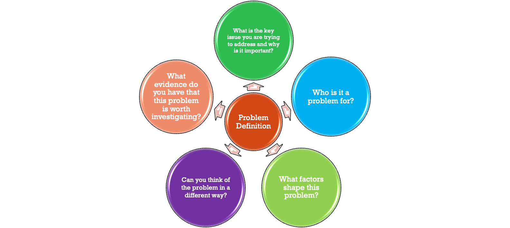
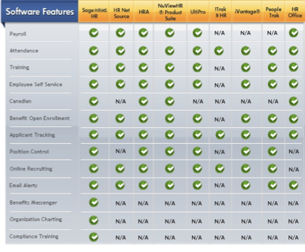
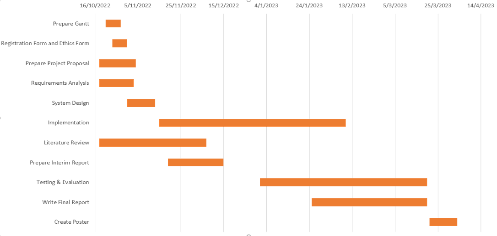

## Lecture Outline

- Review of Lecture 1
- Project Module Grading
- Project Proposal
- Project Management
- Ethics
- Questions Time
- Concluding Remarks

## Recap of Lecture 1

- An individually supervised project to investigate a chosen problem to form an extended study of a topic selected from a suitable area of the student’s program of study and that involves the solution of a practical problem.
- Effective project management will ensure your success in the module. Pay attention to weekly reports submission
- Project timelines:
    - **Semester One**
        - Project Proposal and Ethics Form (Week 6)
        - Progress Report (Week 12)
    - **Semester Two**
        - Final Report - 10000 words
        - Presentation - poster, video, and demo
        - Tech Show – a showcase for the best projects

## Awards for Best Projects

- TECH SHOW: Various prizes will be given out to deserving students
- CDUT EXHIBITION: Top projects might participate in CDUT final undergraduate students’ project exhibition.

## Project Module Grading

- Final Report Component - (90%)
    - Professional Conduct (Module Engagement - attendance & in-class presentations & Project Portfolio Repository) - 10%
    - Professional Conduct (Supervision, Proposal & Progress Report) - 10%
    - Final Report (Dissertation) - 70%
- Oral Presentation Component - (10%)

## Proposal Requirements  See Handbook Appendix A

- <b>Length = 1000 – 1500 words. Numbered sections</b>
- **Introduction**
    - Background; Aim; Objectives; Project Overview
- **Background Review**
    - Summary of existing approaches and literature
- **Methodology**
    - Approach; Technology; Version management plan
- **Project management**
    - Activities; Schedule; Data management plan; Deliverables
- **Bibliography**

## Proposal Marking Rubric  (See Handbook Appendix A)

- The criteria to be awarded a Grade A

  <table>
    <tr>
      <td><b>Introduction</b></td>
      <td>Excellent introduction which outlines the background, aims and objectives of the project in a clear, concise and comprehensive manner. Well-described product vision and rationale.</td>
    </tr>
    <tr>
      <td><b>Background Review</b></td>
      <td>Excellent knowledge of existing approaches and current literature, with strong analysis of relevant sources.</td>
    </tr>
    <tr>
      <td><b>Methodology</b></td>
      <td>Excellent plan for R&D methodology, with appropriate technology and version control. Adheres to a recognised model.</td>
    </tr>
    <tr>
      <td><b>Project Management</b></td>
      <td>Excellent project plan, showing key activities and deadlines. Concise list of deliverables, corresponding closely to objectives. Well-organised data management plan.</td>
    </tr>
    <tr>
      <td><b>Written Presentation</b></td>
      <td>Excellent, concise written presentation and referencing style. Clear & logical presentation.</td>
    </tr>
    <tr>
      <td style="color: rgb(0, 132, 160)"><b>Ethics Form</b></td>
      <td style="color: rgb(0, 132, 160)">Compulsory: submit E1 (and E2 if needed).</td>
    </tr>
  </table>

## Section 1: Introduction

<b>Background; Aim; Objectives; Product/Research Overview (Scope / Audience)</b>  
**1.1 Background**  
- Your project must address a question/problem that generates a small piece of new knowledge/solution.
- In this section, you should explain who will benefit from your findings and how they will benefit. This is the motivation for your project.
- Introduce the topic (cite sources).
- Explain why the topic is interesting or relevant – engage the reader!
- Define your terms, citing sources, e.g., the definition of Artificial Intelligence
- Introduce abbreviations as you go, e.g., Computer Science (CS) – do not assume that the reader has prior knowledge
- Give an outline: “The rest of this report is structured as follows…” Use Section numbers e.g., 1, 1.1, and cross-reference them whenever appropriate.

### Problem definition

### Aim and Objectives

- You should have a single overall aim or research question and multiple <b><u>measurable</u></b> objectives.  
Example:  
PROJECT TOPIC: Chinese Stock Market Prediction using Deep Learning  
- <b>1.2 Aim</b>: *Evaluate and implement deep learning models to predict the Chinese stock market index*.
- <b>1.3 Objectives</b>: The objectives are as follows:
    1. Complete a background review of the existing stock market prediction techniques.
    2. Develop multiple suitable artificial neural network models.
    3. Identify and collect suitable data for analysis and evaluation.
    4. Evaluate the models using appropriate statistical techniques.
    5. Present the work to a mixed audience.

### 1.4 Project Overview

Adopt the appropriate theme/content depending on your project topic.  
- Software Development Projects (Eg. Web-based course selection system)
    - 1.4.1. Scope (What will it do? How will it work?)
    - 1.4.2. Audience (Who is it for?)
- Research-oriented Projects (Eg. Flower detection using deep Learning)
    - 1.4.1. Scope (What is the purpose of the study? How significant is the study?)
    - 1.4.2. Audience (Who will benefit from the findings?)

## Section 2: Background Review

Summarizing Existing Approaches  
- Explore state-of-the-art to show that you know what exists currently.
- You could create a table showing the <b>comparison of features</b> of existing software to help define what will be original about your approach.
- Be systematic in your search, whether you are looking for similar software, literature (research articles), etc.
- Always cite your sources (more on citations in subsequent weeks)

### Comparison of Software Features

### Reviewing Related Literature

How to do Literature Review  
- The five basic steps toward a literature review are shown below.
- You need to search the literature actively, not passively.
- You can use Annotated Bibliography to develop your Literature Review.

|Step No.|Task|Output|
|---|---|---|
|1|Choose your topic|Title|
|2|Identify databases & sources|List of databases|
|3|Search & refine|Potential papers & sources|
|4|Read and analyse|Annotated bibliography|
|5|Write Review|Literature Review|

### Systematic Searching

- Always define your search protocol precisely, and document it. It is an iterative process that you repeat and refine.  
Example:  
- Select databases, depending on the purpose, for example:
    - Mobile apps: app stores, e.g., iTunes, Apple App store
    - Web apps: search engines, e.g., Baidu, Bing
    - Literature: library databases, e.g., IEEE, ACM
    - Datasets: legitimate sources, e.g., ONS, John Hopkins
- Choose search terms/keywords – write them down
- Define limits – e.g., dates, citations, reviews, pages, software versions, any other metrics
- Review and refine your search

## Annotated Bibliography

The annotated bibliography is not a literature review, it is a step towards it, to help you conduct a purposeful search.

  <table>
    <tr>
      <td colspan="2"><b>Full reference</b></td>
    </tr>
    <tr>
      <td rowspan="2"><b>Summary</b> What it is about?</td>
      <td>The author’s purpose, aim or question</td>
    </tr>
    <tr>
      <td>What sort of text is it? General? Specific?</td>
    </tr>
    <tr>
      <td rowspan="2"><b>Evaluation</b> What were the results?</td>
      <td>Main argument, central idea, findings or conclusions</td>
    </tr>
    <tr>
      <td>Particular strengths, from your point of view</td>
    </tr>
    <tr>
      <td rowspan="2"><b>Reflection</b> How might I use it?</td>
      <td>How useful is it? Will you use it? How?</td>
    </tr>
    <tr>
      <td>Any weaknesses or limitations?</td>
    </tr>
  </table>

## Example of Annotated Bibliography

  <table>
    <thead>
      <tr>
        <th>Reference</th>
        <th colspan="3">Comments</th>
      </tr>
      <tr>
        <th></th>
        <th>Summary</th>
        <th>Evaluation: Key Findings</th>
        <th>Reflection / Notes</th>
      </tr>
    </thead>
    <tbody>
      <tr>
        <td>Skrøvseth, S. O., Årsand, E., Godtliebsen,F., & Hartvigsen,G. (2012). Mobile phone-based pattern recognition and data analysis for patients with type 1 diabetes. Diabetes technology & therapeutics, 14(12), 1098-1104.</td>
        <td>To identify which data analysis methods could realistically be used and could provide meaningful feedback to the user</td>
        <td>Participants who recorded data completely, were older but pattern recognition to predict BG levels was poor</td>
        <td>A mobile diary application "Few touch application" was developed for people with T1DM, this facilitates recording of insulin, diet and options to comment on these and a screen to visualise blood glucose, insulin dosing and dietary intake in relation to one another. Instruction to adapt application to needs but to measure BG tds, record insulin injections, dietary intake, physical activity and sx of any other diseases or discomfort....</td>
      </tr>
      <tr>
        <td>Henriques,T., Munshi, M. N., Segal, A. R., Costa, M. D., & Goldberger, A. L. (2014). "Glucose-at-a-Glance" New Method to Visualize the Dynamics of Continuous Glucose Monitoring Data. Journal of Diabetes Science and Technology, 8(2),299-306.</td>
        <td>Tool to visualize long-term and short-term variability of CGM signals.</td>
        <td>Extension of Poincare maps. Based on vis. technique - density delay maps, plot value of variable at time t vs. time t+1. Extends by using colour scheme to display levels of density zones with absence of stable baseline. Authors think first time such maps used to summarize CGM data.</td>
        <td>(For some other references to this kind of vis technique with different medical data sets, see https://physionet.org/physiotools/dddmaps/) Paper presents analysis of data from diabetic and non-diabetic patients. Maps for diabetic patients show wider variability (wider elliptical shape) colour shows non-diabetic patients often show sustained periods of stable levels, diabetic show enlarged zones with absence of stable baseline. Authors argue it is complementary to HbA1c values. Patients with similar HbA1c values may have very different variability patterns."Clinical implications of this graphically depicted instability remain to be determined."</td>
      </tr>
      <tr>
        <td>••••</td>
        <td>••••</td>
        <td>••••</td>
        <td>••••</td>
      </tr>
    </tbody>
  </table>

### Literature Review Final Presentation

- The contents of the annotated bibligraphy can be used to craft the final output of the literature review.
- The final literature review must be presented as paragraphs with appropriate citations. Whenever appropriate, a table can be adopted.

## Section 3: Methodology

This section can be concise, e.g. you can use lists and tables.  
Software Development Project eg. web application projects:  
- 3.1 Approach: description of the research and development methodology, e.g.:
    - Software development model, e.g. Agile, Waterfall
    - Requirement gathering and specification method
    - Test and evaluation process, or experiment design, if applicable
Research Oriented Projects eg. machine learning projects:  
3.1 Approach:  
- Describe the core machine learning model to be employed. Briefly describe the mathematical basis, the algorithm details and the optimization strategy if applicable.
- Describe the datasets and data processing techniques to be used where relevant.

---

This section can be concise, e.g. you can use lists and tables.  
- 3.2 Technology: Implementation tools & resources, e.g.
    - Hardware: computer systems and platforms etc
    - Software: platform, IDE, web hosting, etc
- 3.3 Version management plan: State your plan and the appropriate resources that would be used to manage the several versions of your projects, e.g.
    - Git repository
    - Shared Baidu cloud service link
- *Repositories <i>must be shared with</i> Assessors and <i>not edited</i> after Semester 2 (Week 8).*

## Section 4: Project Management

- You must show a careful plan about how you will go about achieving the objectives of the project.
- It must include the methods you plan to use, such as:
    - Surveys
    - Quantitative or qualitative analysis
    - Software development methodology
    - Testing regime
    - Time management, i.e. Gantt of activities/milestones
- Example structure (See Appendix A): Activities; Schedule; Data management; Deliverables

### Activities

4.1 Activities  
- List activities needed to meet each objective, e.g.
    - Ob1 To research the current state of the art.
- Some relevant activities might be:
    - A1.1 Conduct a systematic search of similar software
    - A1.2 Create a feature comparison table
    - A1.3 Complete a literature search
    - A1.4 Perform a literature review
    - A1.5 Conduct a user survey
- But you do not have to include all these steps: plan your time; activities like A1.5 could be time-consuming.

### Schedule

4.2 Schedule  
- Gantt or PERT chart: include deadlines, tasks, deliverables, e.g., Literature search and annotated bibliography – 2 weeks
    - Literature review – 2 weeks
    - Requirements gathering – 3 weeks
    - Requirements modeling – 3 weeks
    - Design – 4 weeks
    - Implementation – 6 weeks
    - Testing – 2 weeks
    - Evaluation – 2 weeks
    - Report completion, video demo, poster – 6 weeks
    - <b><u>Total effort – 30 weeks</u></b>
- See the basic Excel sheet example on the student's website.
- *NB: This is for illustration only. You are probably more likely to use an <i>Agile approach</i> involving sprint plans, reviews, etc.*

#### Schedule: Excel Gantt Chart Example

- Tasks and milestones, chart of activities with time allocation, development goal deadlines (e.g. sprints), deliverable deadlines.

### Data Management Plan

4.3 Data Management Plan

- Plan for documentation, e.g., Baidu Cloud services folder/other sites with subfolders:
    - Weekly meeting logs: progress, next steps, supervisor comments
    - Requirements or user stories; sprint plans/reviews etc
    - Testing documentation.
    - Reports: proposal, interim, final
    - Ethics forms
    - Literature
    - Useful Links, e.g., to Endnote/Mendeley or Git Repos
- Create a folder structure, even if some parts are empty, to start
- _This section may just be a list of the folder's contents and/or hyperlinks._ _**Keep it concise**_*.*

## Ethics

- Comply with all the Government and University rules on data collection and usage.
- The principles of informed consent apply in all circumstances regardless of who is providing the data (i.e., participants should be informed why the data is being collected and what it will be used for so that they can decide whether to contribute or not). The GDPR requirements also need to be met (i.e., participants need to know who is collecting and processing the data, and participants need to explicitly opt-in to the data collection).
- The Ethics Form must be filled and submitted in Week 5. <b>Submit E1 (and E2 if needed)</b>

## Anonymous surveys

- Sometimes you may wish to conduct a survey, for example, of peers or clients, to help determine requirements.
- Even if it is an anonymous online survey, to comply with GDPR, there have to be explicit ‘opt-in’ statements that the participant has to tick, e.g.
    - “I agree to take part in the survey”
    - “I agree that the data provided can be used for the purpose stated”
- There should also be an information sheet or section that the participant is required to read

## Written Presentation: Academic Language

<b>Precision</b>  
- Do not use "a lot of people" when you can say "500 people“

<b>Objectivity</b>  
- Avoid opinion and first person (I/myself)
- State facts and argue, support with references
- “In my opinion, this result implies …” → irrelevant
- “Because of \[x\] this result implies ...” → argument

| Written Presentation | Excellent, concise written presentation and referencing style. Clear & logical presentation. |
| -------------------- | -------------------------------------------------------------------------------------------- |

## Written Presentation: Formal Language

| Informal | Formal      |     | Informal        | Formal       |
| -------- | ----------- | --- | --------------- | ------------ |
| seem     | appear      |     | keep            | retain       |
| help     | assist      |     | mainly          | principally  |
| shorten  | decrease    |     | again and again | repeatedly   |
| show     | demonstrate |     | next            | subsequently |
| want     | desire      |     | so              | therefore    |
| tell     | inform      |     | chance          | opportunity  |
| get      | obtain      |     | enough          | sufficient   |
| need     | require     |     | wrong           | incorrect    |

## Written Presentation: Write in Simple Words

- Academia is full of technical words and jargon.
- This can make it hard to communicate the proper meaning.
- It provides excuses for sloppy and circular reasoning.
    - &lt;big word&gt; is important because &lt;another big word&gt;
- Thinking science in simple words …
    - Explain to a child
    - … requires proper understanding of relevance and meaning
- A very worthwhile exercise!
    - No chance to hide in jargon
- **Split long sentences**

## Written Presentation: Tables and Figures

- Pictures are enormously helpful.
- Graphs, figures, and tables must be labelled, suitably captioned and explicitly referred to in-text.
- Create original pictures if possible, but if it is occasionally unavoidable to use external ones, cite the source in the caption.

## Checklist for Weeks 1 - 4

1. Choose your topic
2. Set up a schedule to meet your supervisor every week
3. Conduct background research (search competitors; literature search, read around the subject)
4. Plan your project (aim, objectives, activities, deliverables)
5. Create a schedule for the plan (i.e., Gantt chart)
6. Define the Methodology (and version management)
7. Organize your data (project logs, literature, etc.)
8. Submit Ethics forms
9. Submit Proposal

## Next Steps

1. Download week 2 resources.
2. Finalize your topic choice.
3. **Contact and meet your supervisor.**
4. Plan your time (Design a Gantt Chart for your project work)
5. Keep organized notes of everything: e.g., papers you find, list of links, notes on why you kept things.

## Concluding Remarks

- The bibliography will be explained next week
- Getting Help: send your questions to your supervisors or me.
- Start writing your Project Proposal.
- Enjoy your project!

Source: [lecture-2-projectschc-6096.pptx](https://view.officeapps.live.com/op/view.aspx?src=https%3A%2F%2Fvle.zycdut.net%2Fsites%2Fstudent.zy.cdut.edu.cn%2Ffiles%2Fattachments%2Flecture-2-projectschc-6096_3.pptx&wdOrigin=BROWSELINK)
