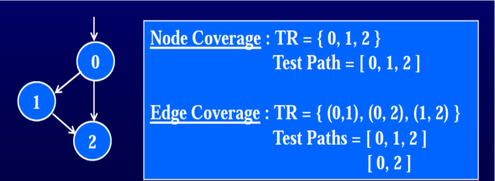
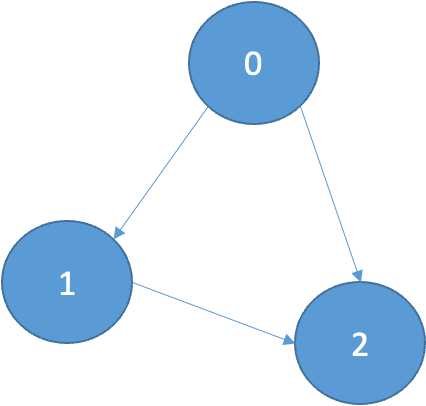
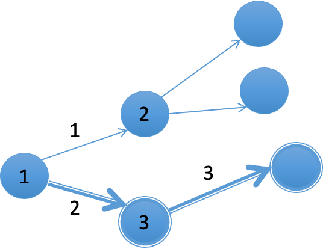

## Node and Edge Coverage 1

**Edge coverage is slightly stronger than node coverage**

NC and EC are only different when there is an edge and another subpath between a pair of nodes

TR: Test Requirements

## Matrix Generation

| Directed Graph                           |     | Matrix Generation                                                                                                                                                                                                          |
| ---------------------------------------- | --- | -------------------------------------------------------------------------------------------------------------------------------------------------------------------------------------------------------------------------- |
|  | →   | $$\begin{array}{c c} & \begin{array}{ccc}0 & 1 & 2\end{array} \\[3pt] \begin{array}{c}0\\1\\2\end{array} & \hspace{2mu} \left[\begin{array}{ccc} 0 & 1 & 1 \\ 0 & 0 & 1 \\ 0 & 0 & 0 \end{array}\right] \end{array}$$ |

## Calculation

- Node coverage: percentage of nodes executed during testing;
- Edge coverage: percentage of edges executed during testing;

## Manchester University Portal

- Nodes: 
    1. manchester.ac.uk//homepage
    2. Study here popup
    3. Coursefinder – Undergraduate 
    4. …
- Edges:
    1. Study here button
    2. Undergraduate + Keyword + Go
    3. Entry in …

Source: [coursework-task-4.pptx](https://view.officeapps.live.com/op/view.aspx?src=https%3A%2F%2Fvle.zycdut.net%2Fsites%2Fstudent.zy.cdut.edu.cn%2Ffiles%2Fattachments%2Fcoursework-task-4_5.pptx&wdOrigin=BROWSELINK)
