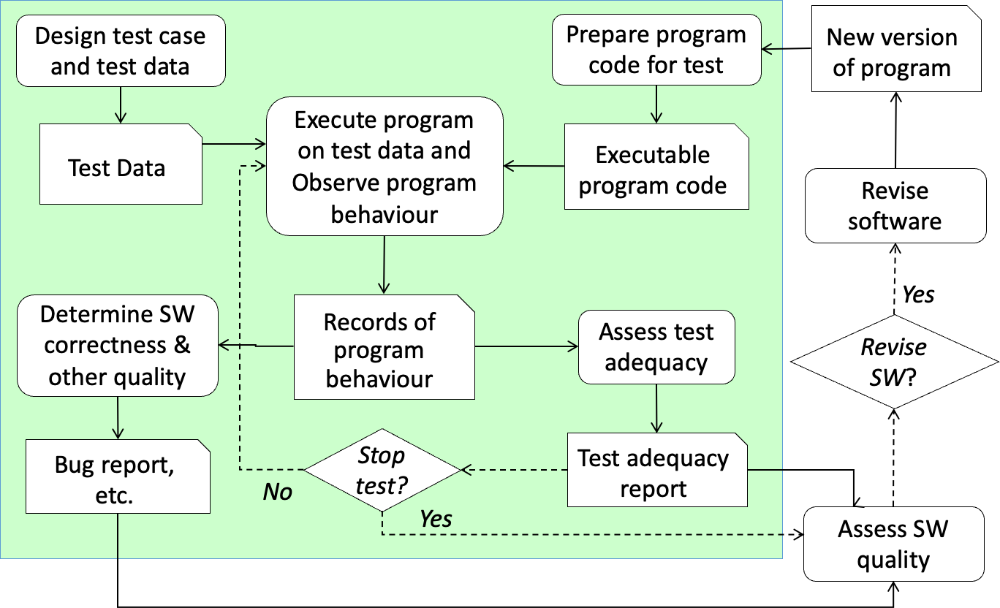
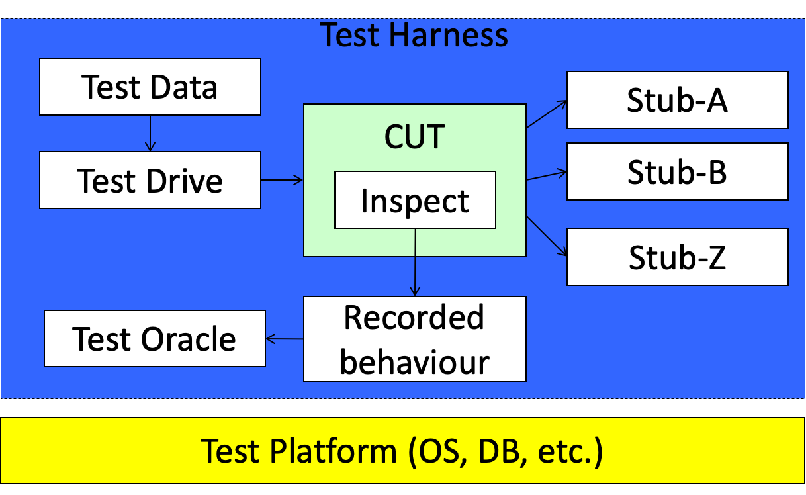
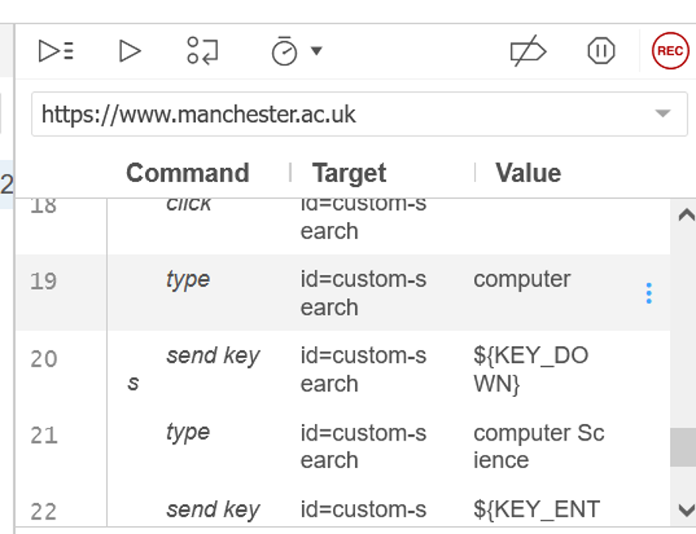
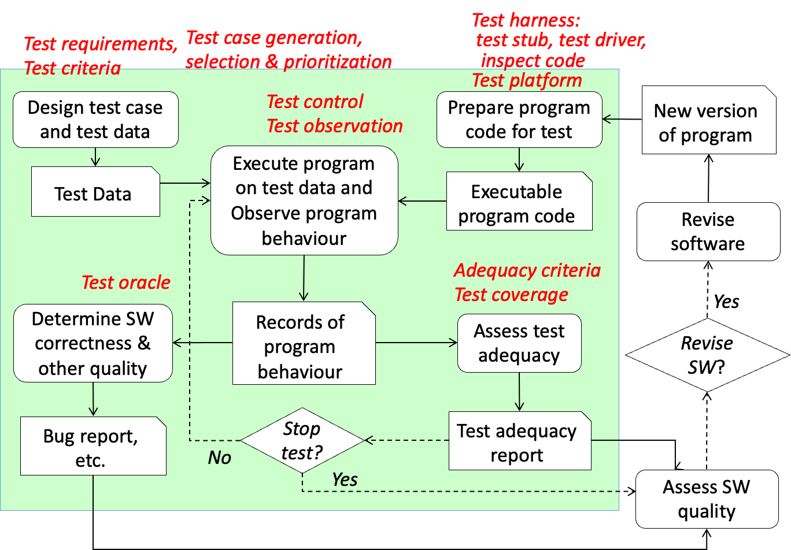

## Agenda

- Short review for Week one contents
- Understanding some basic concepts of software testing, including the notions of 
    - Test cases and test data
    - Test case generation, selection and prioritization 
    - Test harness
    - Test requirements, test criteria and test adequacy
- Developing practical skill of functional testing
    - Risk based functional testing and prioritizing test requirements 
    - Deriving test cases from use case models and user stories

## Short review

Short review for the Week 1 lecture and seminar  
Thinking for Key words

### Short review-Introduction to SAT

- Software quality models
    - McCall’s Model、ISO 9126 Model.etc
- Software development process models
    - Waterfall model、The V model, etc.
- Categories of SAT techniques and methods
    - Generic methods and techniques 
    - Lifecycle stage/process model specific techniques
    - Quality attribute specific techniques
    - Product type specific techniques

## Process of Software Testing



## Test Cases and Test Data

| Test Case                                                                                                                                                                                                                                                                                                                                                                                                                       | Test Data                                                                                                                                                                                                                                                                                                                                                                                                                                                                                                                                     |
| ------------------------------------------------------------------------------------------------------------------------------------------------------------------------------------------------------------------------------------------------------------------------------------------------------------------------------------------------------------------------------------------------------------------------------- | --------------------------------------------------------------------------------------------------------------------------------------------------------------------------------------------------------------------------------------------------------------------------------------------------------------------------------------------------------------------------------------------------------------------------------------------------------------------------------------------------------------------------------------------- |
| - An abstract situation in which a test is to be executed<br>- Examples: <br>    - <span style="color: red">A student</span> uses Oxford Brookes University’s web site to search for <span style="color: red">a course</span> for study<br>    - <span style="color: red">A motorist</span> uses Google Map to find the route from <span style="color: red">home</span> to <span style="color: red">a tourist attraction</span> | - A set of specific data to input into a SUT together with the expected output or behaviour from the software in order to test the SW<br>- Examples:<br>    - <span style="color: red">John</span> uses Oxford Brookes University’s website to search for the <span style="color: red">undergraduate course on computer science of 2015 entry</span><br>    - <span style="color: red">John</span> uses Google Map to find the route from <span style="color: red">10 Downing Street</span> to <span style="color: red">London Bridge</span>. |

> A test data instantiates a test case by providing specific data of the situation.

> 考试关键词：abstract situation，specific data

## Design Test Cases/Data

- Test case/data generation
    - To derive test cases/data from software requirements specification, program code, quality requirements, and intended usage of the system, etc. 
- Test case/data selection
    - To select a subset of test cases/data from an existing set of test cases, which could be previously generated, recorded from previous executions of the system or similar systems, etc. 
- Test case/data prioritization 
    - To give priorities to the test cases/data in a test suite 
        - Classifying test cases/data into a number of different priorities
        - Listing test cases/data sequentially from highest priority to the lowest

## Forms of Test Cases/Data

- Input/Output Pair
    - Each test case/data is a pair of input and expected output
- Interaction Sequence
    - Each test case/data is a sequences of input/output pairs that describes the interaction between the system and its caller
- Interaction Tree (Adaptive [+Adaptive] test cases)
    - Each test case/data is a tree where branches indicate different possible ways the test can progress forward depending on the outcomes of the previous step(s) in the testing

[+Adaptive]:
  Particularly useful to test non-deterministic software

## Test Harness

*[CUT]: Code Under Test
*[SUT]: Software Under Test
*[AUT]: Application Under Test

Test harness is the software code written to enable a piece of code under test (CUT) to be executed. 
- The common components of a test harness
    - ***Test driver***: The code to call the CUT. It also supplies test data and receives test results. 
    - ***Component stub***: A piece of code use in testing that replace a real software component that the CUT calls
    - ***Inspection code***: The code inserted into the CUT to enable observation of its behaviour during testing
    - ***Test oracle***: The code to check if the observed behaviour is correct
- Implementation of test harness
    - Specially written for a testing task
    - Automated testing tools, e.g. test automation frameworks

---

```java
// Driver
public static void main (String []args) {
    Attendance a = new Attendance();
    a. query();
}
// Module to be tested
public void query () {
    int value = this.Stub1();
    System.out println ("My value is" + value);
}
// Stub
public int stub1(){
    int output=3;
    System.out.println("my stub value is" + output) ;
    return output;
}
```

## Test Environment

Test platform is the software and hardware platform on which the test is executed.



## Test Adequacy Criteria

A test adequacy criterion is a rule that determines whether a test is done adequately so that a general conclusion on the quality of the software can be drawn confidently based on the observations made during testing. 
- **As a stop rule:**<br>Used during testing process to determine when enough testing has been done and thus the testing can stop.
- **As a design rule:**<br>Used during test design to determine the test cases/data
- **As a metric:**<br>To measure to what extent the test has been done adequately

### Some Well-Known Adequacy Criteria

- Statement coverage
    - Every statement in the CUT must be executed at least once during testing
- Branch coverage
    - Every control transfer branch in the CUT must be executed at least once during testing
- Mutation testing
    - Every *mutant* [+mutant] of the CUT must be *killed* [+killed] by testing 
- Hyperlink path coverage
    - Every path of hyperlinks in a hypertext system (such as a website) must be traversed during test

[+mutant]:
  The CUT with one fault inserted
[+killed]:
  The fault is detected

## Test Plan

A test plan should address the following issues:
- The general testing goals and strategy: quality standard and quality policy, etc. 
- The overall testing process
- The organizational issues: who are responsibilities for which tasks in the testing
- The methods that are to be used to perform various testing tasks
- The schedule, i.e. the milestone and durations for each test task

> - Test plan is often the first test document for a project  
> - Requirements phase is ideal for the preparation of a test plan

## Functional Testing

Functional testing aims at verifying and/or validating the correctness of the functions of a software system or its components. 
- System level functional testing
    - Against functional requirements
- Component/Unit level functional testing
    - Against the component/unit specification of functionality in the design of the component/unit

### Risk Based Functional Testing

- The basic ideas
    - Functions may have different weights in a system
    - Test resources should be allocated to the functions accordingly
- The process
    1. List all functions to be tested
    2. Analyze the risk associated with each function
        - Possible errors 
        - The frequency of the use case to be used
        - Consequences of any occurrence of an error
    3. Give priorities to the functions
        - The more serious the consequence or the heavier loss, the higher priority
        - The more frequently used, the higher priority

### Example: Use Case Model of a Clinic IMS


#### Analysis of Risks

<center>The Clinic Example</center>

<table>
  <thead>
    <tr>
      <th>Function</th>
      <th>Possible errors</th>
      <th>Consequences</th>
      <th>Priority</th>
    </tr>
  </thead>
  <tbody>
    <tr>
      <td rowspan="2">Make appointment</td>
      <td>Double booking</td>
      <td>Patient inconvenience</td>
      <td>Medium</td>
    </tr>
    <tr>
      <td>No booking on available time</td>
      <td>Inefficiency for doctors</td>
      <td>Medium</td>
    </tr>
    <tr>
      <td>Cancel app.</td>
      <td>…</td>
      <td>…</td>
      <td>Low</td>
    </tr>
    <tr>
      <td>Manage app.</td>
      <td>…</td>
      <td>…</td>
      <td>Medium</td>
    </tr>
    <tr>
      <td>Request med.</td>
      <td>…</td>
      <td>…</td>
      <td>High</td>
    </tr>
    <tr>
      <td rowspan="2">Check patient record</td>
      <td rowspan="2">Wrong record displayed</td>
      <td>Cause anxiety</td>
      <td rowspan="2">Very High</td>
    </tr>
    <tr>
      <td>Error in treatment</td>
    </tr>
    <tr>
      <td>Check patient record</td>
      <td>Displayed other patient’s record</td>
      <td>Leak private information</td>
      <td>High</td>
    </tr>
    <tr>
      <td rowspan="2">Update patient record</td>
      <td>Loss of record</td>
      <td>Cause anxiety</td>
      <td>Very High</td>
    </tr>
    <tr>
      <td>Wrong record stored</td>
      <td>Error in treatment</td>
      <td>Very high</td>
    </tr>
  </tbody>
</table>

### Design Test Cases

- List test cases
    - For each function (use case), list all the scenarios
    - For each scenario, use generic scenario description to form a test case
- Give priority to each test case
    - Consider the priority of the function;
    - Furthermore take into account the following aspects:
        - Frequency of the scenarios occurrence
        - Risks: possible errors and their consequences for the scenario
- Identify input, output and stored data for each test case
    - Check the description of scenario
    - Find the input/output variables and the data to be stored in the system

#### Example: The Clinic IMS

Use Case: Make Appointment

| Actor                                                              | System                                                                                       |
| ------------------------------------------------------------------ | -------------------------------------------------------------------------------------------- |
| 1) Patient enters their own name and their preferred doctor’s name | 2) After confirming this is a registered patient, displays dates the doctor is in the clinic |
| 3) Selects date                                                    | 4) Displays available appointment                                                            |
| 5) Selects preferred time                                          | 6) Confirms appointment and displays information about parking, etc                          |
| 7) Confirms acceptance of appointment                              |                                                                                              |

- Input: 
    - Patient name, preferred doctor’s name, date, time, confirmation
- Output: 
    - available dates of a doctor, available times
- Stored information: 
    - available dates of a doctor, available times

### Selection of Test Data

- Generate a test data from each concrete scenario
    - Identify the values in the concrete scenario for each variable of the corresponding generic scenario
    - Set the environment variables as the values of the concrete scenario 
    - List values for input variables
    - List expected values for output variables

#### Example: The Clinic IMS

Concrete Scenario Description: Making appointment

| Actor                                                               | System                                                                                                             |
| ------------------------------------------------------------------- | ------------------------------------------------------------------------------------------------------------------ |
| 1) Patient John enters their name and his preferred doctor’s Walker | 2) Confirm John is a registered patient, displays days the doctor is in the clinic, which is Monday and Wednesday. |
| 3) John selects Monday                                              | 4) Displays available appointments, which is 10:30am, 12:00am, and 3:00pm.                                         |
| 5) John selects 10:30am                                             | 6) Confirms appointment and displays information about parking etc                                                 |
| 7) John confirms the acceptance of appointment                      |                                                                                                                    |

### Derivation of Test Data

**The Clinic Example**
Test data derived from the concrete scenario

<table>
  <thead>
    <tr>
      <th></th>
      <th>Variable</th>
      <th>Test Data 1</th>
    </tr>
  </thead>
  <tbody>
    <tr>
      <td rowspan="5">Input</td>
      <td>patient name</td>
      <td>John</td>
    </tr>
    <tr>
      <td>doctor’s name</td>
      <td>Walker</td>
    </tr>
    <tr>
      <td>date</td>
      <td>Monday</td>
    </tr>
    <tr>
      <td>time</td>
      <td>10:30</td>
    </tr>
    <tr>
      <td>confirmation</td>
      <td>TRUE</td>
    </tr>
    <tr>
      <td>Stored info.</td>
      <td>available dates and times</td>
      <td>Monday (10:30, 12:00, 15:00),<br>Wednesday (10:30, 12:00, 15:00)</td>
    </tr>
    <tr>
      <td>Expected Output</td>
      <td>available dates and times</td>
      <td>Monday (10:30, 12:00, 15:00),<br>Wednesday (10:30, 12:00, 15:00)</td>
    </tr>
    <tr>
      <td>Stored info.<br>(Afterwards)</td>
      <td>available dates and times</td>
      <td>Monday (12:00, 15:00),<br>Wednesday (10:30, 12:00, 15:00)</td>
    </tr>
  </tbody>
</table>

## User Stories in BDD

A user story represents a required functionality to a software system
- Structure: 
    - A brief narrative description 
        - A general statement of the required function 
        - Similar to use case’s brief description
        - Example: “A trader is alerted of the status of stock market on a specified share.”
    - A collection of scenarios:  
        - Each scenario represents a concrete example of the behaviour of the system

> User story 和 Scenarios 不在考试中出现，在 Coursework 中体现

### Scenarios of a User Story

- Each scenario comprises of a number of “steps” that the required system will execute ***sequentially***. 
- Example: 
    - **Given** a stock and a threshold of 15.0
    - **When** the stock is traded at a price of 5.0
    - **Then** the alert status should be OFF

### JBehave Syntax of User Stories

- Title of the Story

> Grammar of the language is in the file on Moodle:  
> `JBehave Story Language Syntax in EBNF.docx`

- Narrative: 
    - ***In order to***: give the purpose of the story
    - ***As a***: give the type of user 
    - ***I want to***: describe the function wanted
- Lifecycle: 
    - ***Before***: Give the steps to be executed before each scenario 
    - ***After***: Give the steps to be executed after each scenario depends on the outcomes
        - ***ANY***: Given a step that is executed after each scenario regardless of outcome
        - ***SUCCESS***: Given a step that is executed after each successful scenario
        - ***FAILURE***:  Given a step that is executed after each failed scenario
- Scenarios: list of scenarios

### JBehave Syntax of Scenarios

- A scenario is a collection of executable “steps” of the following types
    - Pre-condition: 
        - Starting with the keyword “***Given***” 
        - A statement on what is assumed when the function is invoked
        - The <span style="color: blue">pre-condition</span> of the subsequent steps
    - Trigger event or Guard condition: 
        - Starting with the keyword “***When***” 
        - A statement on the triggering event that the function is invoked, or
        - A statement on the <span style="color: blue">guard condition</span> for the function to be invoked or the the action to take place
    - Post-condition: 
        - Starting with the keyword “***Then***” 
        - A statement on what to be expected after the actions takes place, or 
        - The <span style="color: blue">post-condition</span> on the state of the system

#### Example 1: Scenarios of alerting the trader


Scenario:  trader is not alerted below threshold
 
<span style="color: blue">Given</span> a stock of symbol STK1 and a threshold of 10.0
<span style="color: blue">When</span> the stock is traded at 5.0
<span style="color: blue">Then</span> the alert status should be OFF
 
Scenario:  trader is alerted above threshold
 
<span style="color: blue">Given</span> a stock of symbol STK1 and a threshold of 10.0
<span style="color: blue">When</span> the stock is traded at 11.0
<span style="color: blue">Then</span> the alert status should be ON	

### Deriving Test Cases & Test Scripts

- Test cases can be easily derived from scenarios in JBehave user stories
    - Each scenario corresponding to one test case
- Test scripts for Selenium IDE can then be easily derived from scenario descriptions
    - Given steps
        - URL to Open
        - Assert statement for the right page
    - When steps
        - Action command of Selenium IDE
    - Then steps
        - Assert command
        - Verify command

#### Example 2: Use Manchester Website

**Search BSc Course in Computer Science**
- **Narrative**: 
- ***In order to*** find out the entry requirements for Manchester
- University’s BSc course in Computer Science
    - ***As a*** applicant student
    - ***I want to*** search for the course on Manchester University web site
- **Lifecycle**:
- ***Before***: Open Manchester University’s homepage on the browser
    - ***After***:
        - **Outcome**: ***SUCCESS***: Bookmark the webpage
    - **Outcome**: ***FAILURE***:  Save the screen snapshot of the window

---

- **Scenarios**:  
	- **Scenario 1**: Use search engine to find Computer Science course for year 2023 entry
		- **Given** that the homepage of Manchester University is open in browser
             - When click on “Study”
		- **When** select the course level “Undergraduate”
             - When click on “Course”
		- **When** select the year of entry “2023” 
		- **When** enter “Computer Science” to “Search by keywords”
		- **When** click on GO button
		- **Then** webpage shows search result
		- **Then** webpage on browser contains text “Computer Science”
        - **Then** webpage on browser contains text “2023”
        - **Then** webpage on browser contains text “Course”
		- **Then** webpage on browser contains text “undergraduate”
        - **Then** webpage on browser contains text “Study”

#### Example: Selenium IDE Test Case for the Search CS Course Scenario



## Summary 1: Concepts of SW Testing



## Summary 2: Functional Testing

- Risk based functional testing
    - Analyzing the risk of functions and allocating test resources accordingly
- Model-based functional testing
    - Deriving test cases and test data from use case descriptions
    - Deriving test cases and test data from activity diagrams
- Functional testing in Behavior Drive Development
    - Writing user story in JBehave syntax
    - Deriving test cases from user stories
    - Deriving test scripts from scenarios

## Homework

- Review the slides of SAT week 2 lecture
- Preparation for week 2 practice 

Source: [chc6072-lecture2.pptx](https://view.officeapps.live.com/op/view.aspx?src=https%3A%2F%2Fvle.zycdut.net%2Fsites%2Fstudent.zy.cdut.edu.cn%2Ffiles%2Fattachments%2Fchc6072-lecture2_3.pptx&wdOrigin=BROWSELINK)
