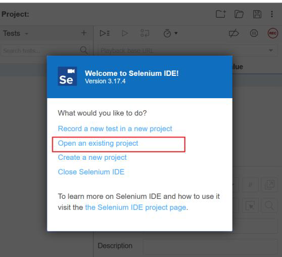
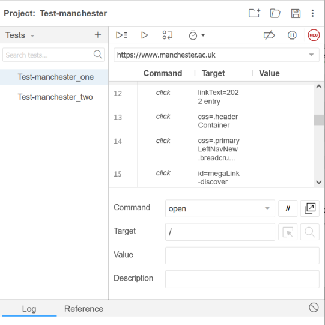
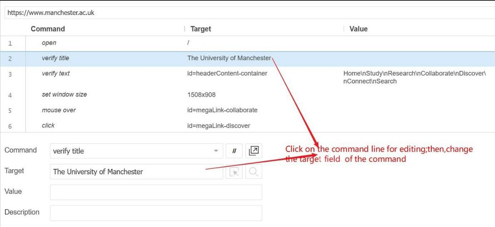
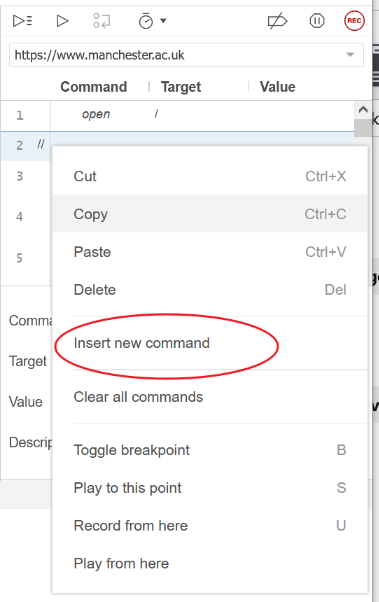
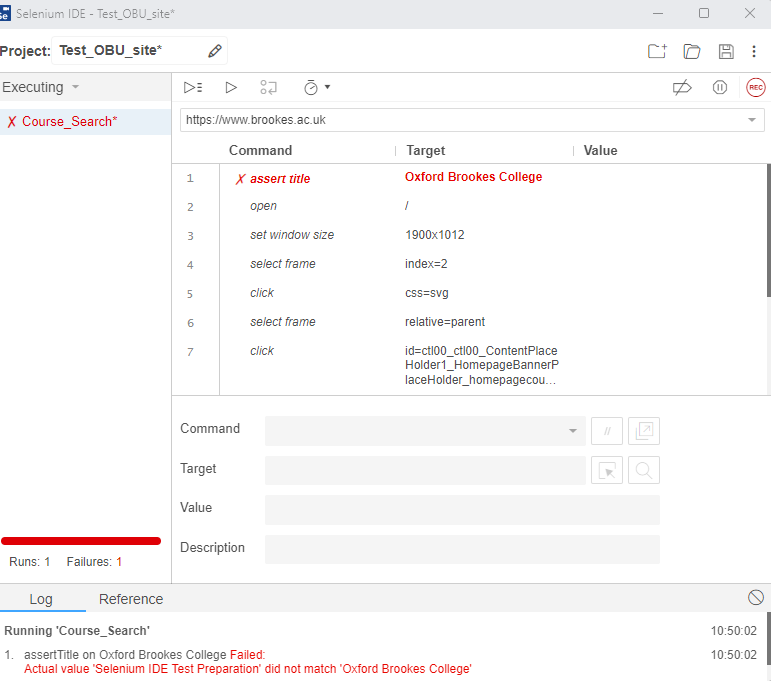
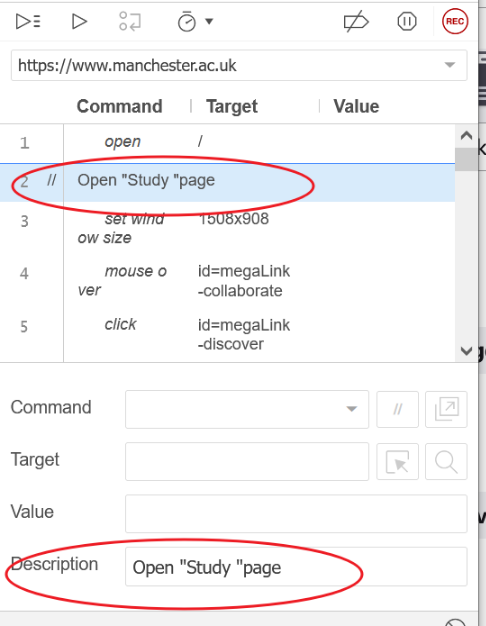
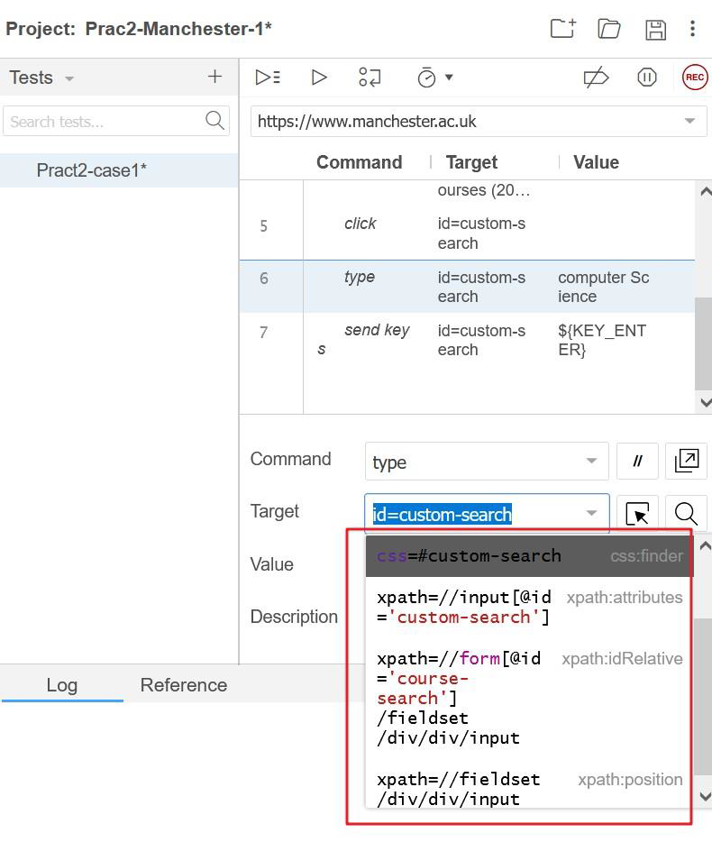
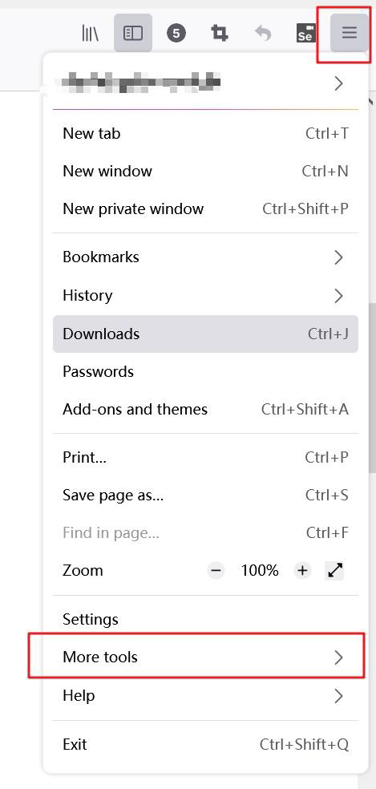
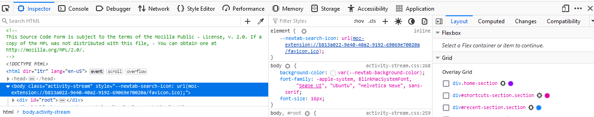
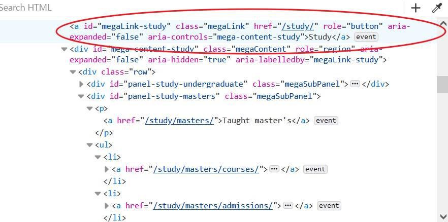

## Introduction

In the previous practical class, we learned how to record a manual test process and save it as a test script into a file, and how to save a set of test cases as a test suite. In this practical class, we will learn the uses of **Selenium IDE** to edit test. We will also learn how to find the web element locator for use in test scripts.

At the practical class, follow the instructions below step by step.

## Task 1: Using Selenium IDE to Edit Test Scripts

Now, let’s load one test case that have been saved before and then edit it to make it more resistant to changes.
1) Load an existing project in your computer and load the test script to Selenium IDE.
- Open Firefox web browser.
- Click on the Selenium button on Firefox window. The Selenium IDE window should pop up.
- In the File menu, select “Open an existing project” menu item; see screen snapshot below
- Select the test case file and then click on “Open” button at the lower left corner. The test suite/test case will be loaded to the Selenium IDE window. You should have the following test script.

2) Change the content of a command This can be done by simply clicking on the command line and then clicking on the target field of the command, to edit the content; see the picture below.

3) Insert a new command.

- Right-click on any command within the Edit panel then select “**Insert new command**”;
- A blank new command line will be inserted into the test script.

**NOTE: We can insert a new command after the existing command to check whether the web page is correct. This can be done when in a recording mode by inserting an “assert command”.**

4) Insert Description for your scripts In order to make the script easier to understand, we usually need to add some description. Firstly you should insert a new command before your scripts and then input the content in the description box. See screen snapshot below.

It is important to describe your test script when you have many scripts.

## Task 2: Get the Right Web Element Locator

An element in a web page is called a web element. Selenium enables a web element to be accessed via a number of different ways. Each of these ways is called an element locator. Finding the right web element locator for a web element is crucial in writing a test script because it is necessary for an action to be applied on the right element and to check if an element is correct when verify the web page.

There are a few different ways to get the right element locators for a web element in addition to manually work out the locator by reading the html file. Here, we demonstrate two approaches. The first is to use the Selenium IDE tool’s select locator facility. The second is to use another Web Developer tool, which is a much more powerful tool and easier to use. It is very popular among professional web application developers and testers.

### 3.1 Use Selenium IDE’s locator select facility

Suppose that we are writing a test case for testing how to browse Manchester University’s website and navigate through hyperlinks to find information about BSc Computer Science course for year 2023 entry.

The first instruction of the test script is therefore to open the Manchester University’s homepage. Assume the base URL of the test script is the URL of the home page. Thus, the command is simply

> Open /

where the target locator is “/”.

Once open the homepage, we click on the “<i>Study</i>” tab, wait for the drop down to display, then choose the button “<i>Courses</i>” and type the specifical course you want to search. Thus, the command is “**Type**”, but the question is what should be the locator of the elements. Using record and replay facility of Selenium IDE, we will get an instruction as follows.

The command is “<i>type</i>”

The parameter “<i>target id=custom-search</i>” “<i>Value=computer Science</i>” in the above command is called the web element locator, or simply locator. It is an expression to indicate which element on the web page the instruction is applied to.

For several reasons we may want to use different element locators in different situations. For example, some locators are more obvious about what the link we are actually following, such as the above. Sometime, a locator may be unnecessarily too sensitive to the changes to the web page when information or structure of the page is modified. Using a different locator may be more resilient to changes to a webpage. Selenium IDE provides a number of different ways to write web element locators.

Therefore, you can choose from a number of equivalent location strategies, including XPath, relative XPath, CSS path, DOM, etc.

To use different locator of a web element, the first approach is to use the **Locator Selection** facility provided by Selenium IDE. Click on the **Target** field of the command, a popup list of equivalent locators will display and you can choose one that suits you. See screen snapshot below.

The second way is to use the **Select** facility as follows.
- Click the **Select** button on the right of the Target field.
- Focus to the Browser window.
- Move the cursor to the element that you want to locate. It will be highlighted; see screen snapshot below.
- 
- Click on the element that you want to use as the target of the action, i.e. the button labelled as “<i>Postgraduate research &gt;&gt;</i>”.
- Move back to the Selenium IDE window. You can see a locator of the element is now in the target field. Again, you can choose from a number of locators with different locating strategies. Choose the best one that fits for your purpose of testing.

*Note: The <b>Find</b> button on the right of the Target field help you to find the web element on the page that the locator points to, and reports an error in the information panel if the locator cannot map to a web element on the page.*

The **Web Element Select** facility works well with static web elements, but it has limited power to deal with dynamic elements, such as those in generated by Ajax or involve JavaScript.

### 3.2 Use Web Developer tools to find locators.
Web developer tool is a kind of tool that come with the browser. It allows programmer to find and view element locators for all kinds of web elements in various locating strategies. It is very useful when you write a test script. The following is a step-by-step instruction on how to use the tool.
1) Open Web Developer Tool. Open your browser and click the menu button, select the bar “More tool” and you can find the “Web Developer Tool”

2) Use Web Developer Tools to find the element locator.

- Select the icon circled in red.
- Hover over the several sections of the web page using your mouse.
- The elements details would be displayed.

- The part of XML/HTML file of the web page will be highlighted in blue; see screen snapshot.

There are many more other functions of the tool that are very helpful for web development and testing. For example, it can check type errors in the web page. But, here we only need to use these two.

## Task 3: Write user story in JBehave language

The following are some narrative descriptions of user stories for the website of the Oxford Brookes University. For each of these user stories, write the corresponding scenarios in JBehave syntax to describe the various uses of the website as currently supported. And, then for each scenario write a Selenium test script.
- Find accommodation at Manchester University
- **Narrative**:
    - **In order to** be able to study at Manchester University
    - **As an** applicant to start university in September 2023
    - **I want to** find information about university accommodation

Source: [pract2-chc6072.pdf](https://vle.zycdut.net/sites/student.zy.cdut.edu.cn/files/attachments/pract2-chc6072_1.pdf)
