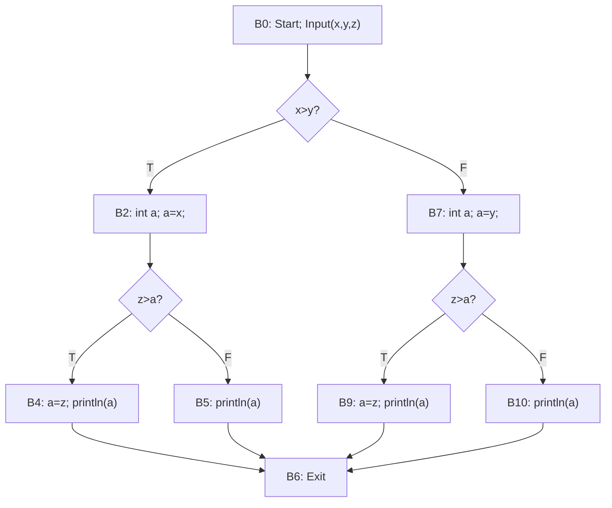
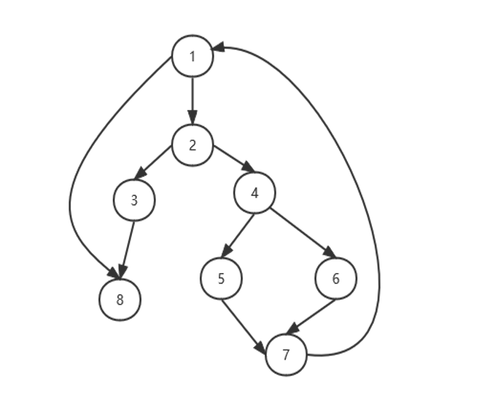
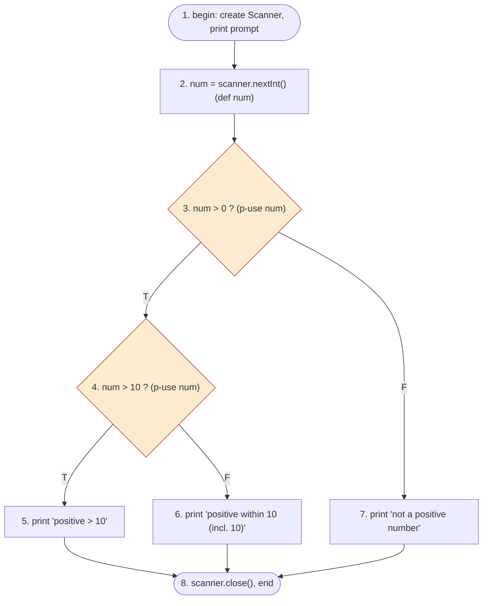
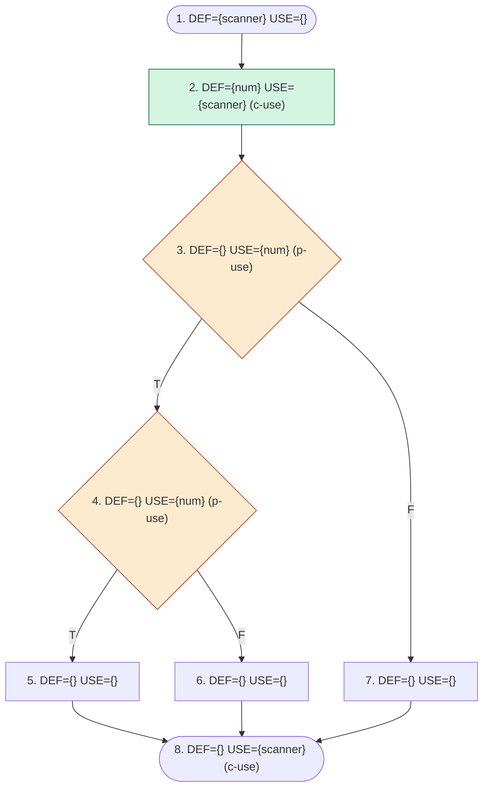
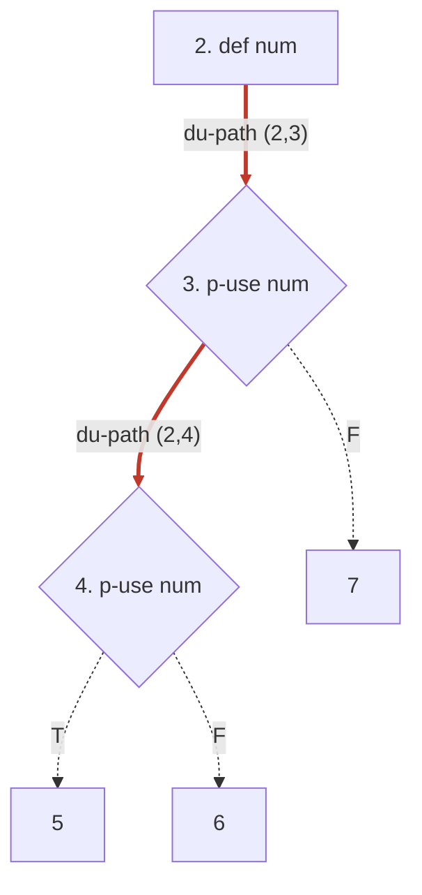

Draw a flow graph model for the following piece of Java program code

```java
public class test {
    public static void fun(){
	    Input(x,y,z);
        if (x>y) {
            int a;
            a = x;
            if (z>a) {
                a = z;
                System.out.println(a);
            }
            else {
                System.out.println(a);
            }
        }
        else {
            int a;
            a = y;
            if (z>a) {
                a = z;
                System.out.println(a);
            }
            else {
                System.out.println(a);
            }
        }
    }
```

Reference Answer



---

The following is a flow graph model, and use two different methods to calculate cyclomatic complexity of the graph and write Independent complete Paths.



Reference Answer:  
$e-n+2=10-8+2=4$  
$p+1=3+1=4$  
predicate nodes: 1, 2, 4

---

```java
import java.util.Scanner;

public class NumberCheck {
    public static void main (String[] args) {
        Scanner scanner = new Scanner(System.in);
        System.out.print("Please enter an integer: ");
        int num = scanner.nextInt();
        if (num > 0) {
            if (num > 10) {
                System.out.println("This is a positive number greater than 10");
            } else {
                System.out.println("This is a positive number within 10 (including 10)");
        } else {
            System.out println ("This is not a positive number");
        }
        scanner.close ();
    }
}
```

1. Please draw the corresponding control flow diagram.

Reference Answer:



2. According the above flow graph model, please design a set of test cases satisfy the Statement coverage criterion, Branch coverage criterion.

Reference Answer:

|用例|输入 num|预期输出|覆盖说明|
|---|---|---|---|
|TC1|20|"positive number greater than 10"|DU-path 2-3、2-3-4；def-use (2,3)、(2,4)|
|TC2|10|"positive number within 10 (including 10)"|谓词 4 的 F 分支，scanner 的 DU-path 1-2-3-4-6-8|
|TC3|−8|"not a positive number"|谓词 3 的 F 分支，scanner 的 DU-path 1-2-3-7-8|

3. Please draw the corresponding data flow diagram and design the test data to satisfy  Definition/Use/DU-path coverage.

Reference Answer:

数据流图（DFG，标注 def/use 集合）：



DU-path: 



Source: [exercise.docx](https://view.officeapps.live.com/op/view.aspx?src=https%3A%2F%2Fvle.zycdut.net%2Fsites%2Fstudent.zy.cdut.edu.cn%2Ffiles%2Fattachments%2Fexercise_14.docx&wdOrigin=BROWSELINK)
