## Agenda

- Short review Lecture 2-Basic concepts of Software Testing and Functional Testing Techniques
- Concepts and principles of software testing
    - Structural models of software systems
    - Concept of test adequacy 
    - Subsumption relations between adequacy criteria
- Techniques of control flow software testing
    - Developing control flow models of software systems
    - Deriving test cases and test data from control flow models
    - Measuring test adequacy according to control flow coverage metrics

## Short review

Short review for the Week 2 lecture

Please think for Key words

## Short review-Lecture 2

- Understanding some basic concepts of software testing, including test cases /test data .etc
- Risk based functional testing
    - Analysis the risk of functions and allocating test resources accordingly
- Model-based functional testing
    - Deriving test cases and test data from use case descriptions
    - Deriving test cases and test data from activity diagrams
- Functional testing in JBehaviour Drive Development
    - Writing user story in JBehave syntax
    - Deriving test cases from user stories
    - Deriving test scripts from scenarios

## Basic Ideas of Structural Testing

【结构化测试的定义】

- Use of structural information about the software under test to perform key activities of software testing
    - Deriving test cases and test data
    - Measuring test adequacy
- Principle:
    - An adequate test must thoroughly cover the structure of the software under test, because if an element in the system is not tested, there is no evidence to say that the element is correct.

## Structural Information of SW

Structural information of a system is about 
- what are the elements in the system, and 
- how these elements are related to each other in the system. 

<table>
  <thead>
    <tr>
      <th>Type of Elements</th>
      <th>Relationships between Elements</th>
    </tr>
  </thead>
  <tbody>
    <tr>
      <td rowspan="2">Statement</td>
      <td>Control flow</td>
    </tr>
    <tr>
      <td>Data flow</td>
    </tr>
    <tr>
      <td>Procedure/Method</td>
      <td>Procedure call/method invocation</td>
    </tr>
    <tr>
      <td rowspan="3">Class</td>
      <td>Association</td>
    </tr>
    <tr>
      <td>Inheritance</td>
    </tr>
    <tr>
      <td>Whole-part (composite, aggregate)</td>
    </tr>
    <tr>
      <td>Hypertext page</td>
      <td>Hyperlink</td>
    </tr>
  </tbody>
</table>

> [!TIP]
> Composition（组合）关系是一个类，不可以脱离另一个而存在，Aggregation（聚合）关系是两个类可以单独存在。例如，翅膀不可以脱离鸟存在，翅膀是鸟的一个器官；键盘和鼠标等可以脱离电脑存在。

### Examples of SW Structural Models

- ***Call Graph***: how procedures/methods call each other
- ***Control flow graph***: how statements in program code are executed as control passes between them 
- ***Hyperlink Graph***: how hypertext pages (such as web pages) are linked to each other via hyperlinks
- ***GUI State Transition Diagrams***: Graphical user interface state changes during human-computer interactions

## Call Graph

- ***Call Graph*** is a model of software structure about how procedures/methods call each other
- ***Nodes***: Procedures/methods
- ***Edges***: calls from one procedure/method to another

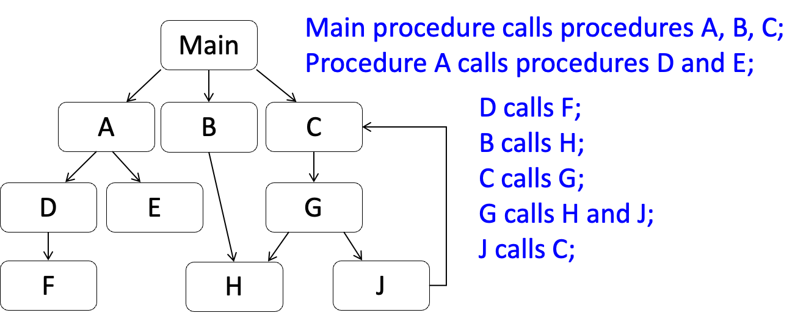

### Testing based on Call Graph

Definition: 
- A node X is covered, if there is a test execution in which the procedure X is called at least once.
- An edge from node X to node Y is covered, if there is a test execution in which the procedure X calls procedure Y. 
- A path X1 → X2 → … → Xn is covered, if there is a test execution in which procedure X1 calls procedure X2, procedure X2 calls X3, …, Xn-1 calls Xn. 

> A *path* is a sequence of nodes which are linked one to the next by edges.

### 【重点】Call Graph Coverage Criteria

- Node coverage:
    - A test set T satisfies the ***call graph node coverage criterion***, if very feasible node in the call graph G is covered by the test set T
- Edge coverage:
    - A test set satisfies the ***call graph edge coverage criterion***, if very feasible edge in the call graph G is covered by the test set T
- Simple path coverage:
    - A test set satisfies the ***call graph simple path coverage criterion***, if very feasible simple path in the call graph G is covered by the test set T

> <i>No edge occurs more than once in the path</i>

- Elementary path coverage
    - A test set satisfies the ***call graph elementary path coverage criterion***, if very feasible elementary path in the call graph G is covered by the test set T

> <i>No node occurs more than once in the path</i>

## Hypertext Link Graph

- ***Hypertext link graph*** is a model of the structure of hypertext systems 
    - Nodes: Hypertext pages (or frames)
    - Edges: Hyperlinks between pages
- Node coverage
    - To check every page of a website
- Edge coverage
    - To check every hyperlink 
- Path coverage
    - To check the navigation from one page to another through a successive sequence of hyperlinks

### Hyperlink Graph of Web-based applications

- Rules about nodes: Each web page is a node
    - For webpages that have frames, if the contents of the frame changes after clicking on a hyperlink, it should be regarded as a new node.
    - A popup (such as Confirmation, Prompt, Alert) that is displayed on the screen after clicking on a hyperlink or bottom should be regarded as a new node. 
    - Dynamically generated pages of similar nature, such as the pages that display search results for particular search keywords, is represented as one node (super node). 
- Rules about edges: Each hyperlink is an edge. 
    - Each button on a popup should be represented by a different edge. 
    - Each item in a drop-down menu or option choice should be regarded as one edge. 
    - If there are a large number of dynamically generated similar links (for example, if you have 400 Facebook friends, and each friend has a hyperlink on the page link to the friend’s Facebook page), this group of links should be represented as one edge (super edge). 

### Example: Manchester University Portal

- Nodes: 
    1. manchester.ac.uk/homepage
    2. Study here popup
    3. Coursefinder – Undergraduate 
    4. …
- Edges:
    1. Study here button
    2. Undergraduate + Keyword + Go
    3. Entry in …

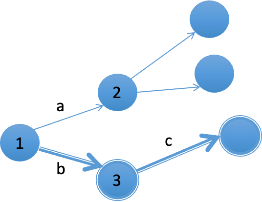

## 【重点】Flow Graph

Definition:
- A *flow graph* is a <mark>directed</mark> graph *G* = <*Node*, *Edge*>, 
    - Node is a <mark>finite</mark> set of nodes 
    - Edge is a <mark>finite</mark> set of directed edges between nodes
- Graph G must satisfy the following constraints
    - There is a unique entry node, which has no inward edge, and a unique exit node, which has no outward edges
    - Every node in a graph <mark>must</mark> be on a path from the entry node to the exit node

### Flow Graph Model of Program

- Nodes:  
    - Each node represents a linear sequence of computations 

> <i>No jump into the middle of the code</i>  
> <i>No jump from the middle of the code</i>

- Edges:
    - Each edge represents the transfer of control from one node to another 
    - Some edges are associated with a predicate that represents the condition of the control transfer

> <i>It must be true for control to be transferred during execution.</i>

- Execution of program
    - Complete path: a path from the entry node to the exit node
    - Each execution of the program follows a complete path

### Example: Flow Graph

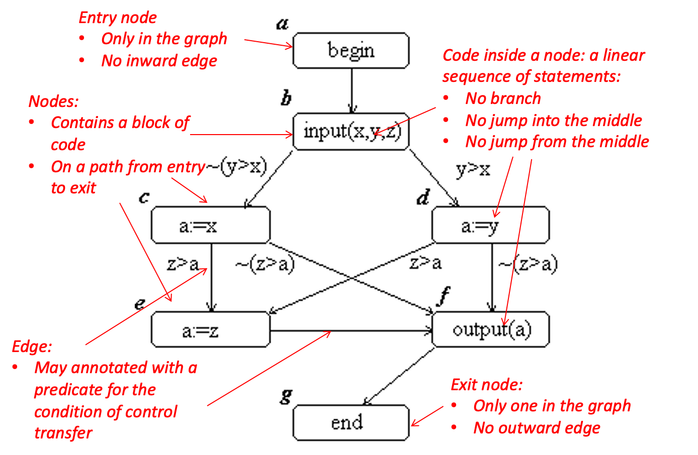

### Rules to Derive Flow Graph Models From Program Code (1)

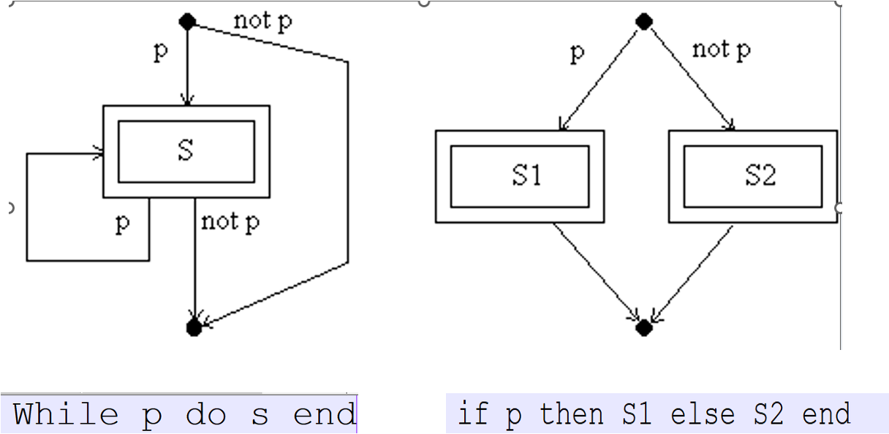

### Rules to Derive Flow Graph Models From Program Code (2)

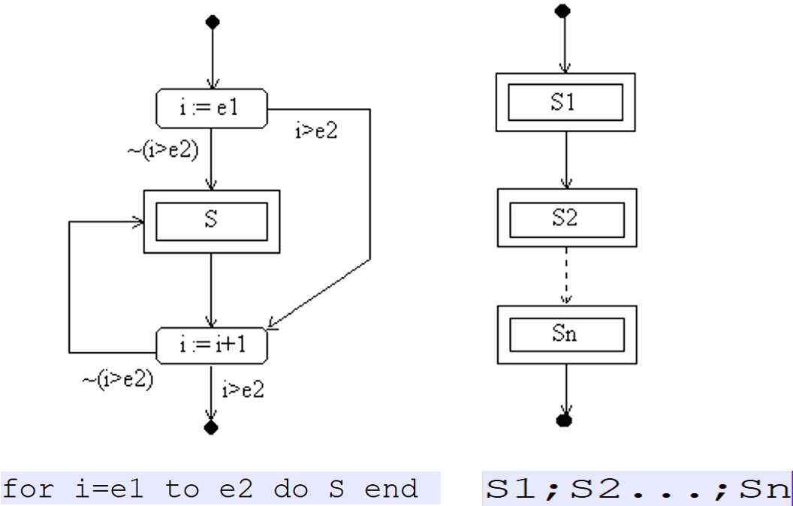

## Feasibility

In general, an element in a flow graph is ***feasible***, if there is an input on which the element will be executed. 
- Examples: 
    - A node is feasible, if there is an input on which the the code of the node will be executed
    - An edge is feasible, if there is an input on which the control transits through the edge between the nodes during execution
    - A path is feasible, if there is an input on which the program will execute through the path

## Loops and Cycles

The loops in a program are reflected in the flow graph as cycles 
- A path is called a *cycle*, if its start node and end node are the same and the length of the path is greater than 1. 
- A path is said to be *cycle-free*, if it does not contain a cycle as a subpath
- A *subpath* of path p = (n1, n2, ..., nt) is a consecutive sub-sequence (nu, nu+1, ..., nv) of p, where 1 ≤ u ≤ v ≤ t.

## Control Flow Adequacy Criteria

- Statement Coverage Definition: A set P of complete paths satisfies statement coverage criterion, if and only if for all feasible nodes n in the flow graph, there is at least one path p in P such that the node n is on the path p. 

> <i>The set P represents: A set of test cases</i>

> <i>This means dead code is required to test. It is not coverable anyway.</i>

> <i>Two test executions on different test data that follow the same path is regarded as duplicate, and only counts as one path.</i>

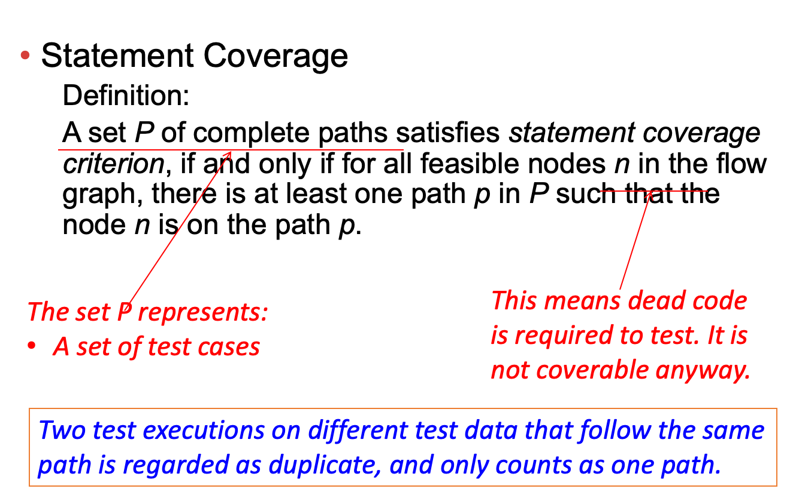

### Example

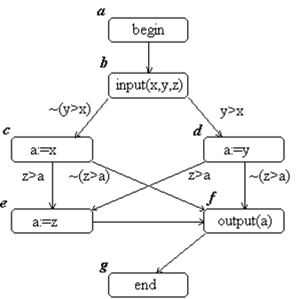

## Branch Coverage Criterion

Definition:  
A set *P* of complete paths satisfies *branch coverage criterion*, if and only if for all feasible edges *e* in the flow graph, there is at least one path *p* in *P* such that *p* contains the edge *e*.

> <i>Statement coverage is very weak that it even allows some control transfers untested.</i>

## The “Subsumes” Relation

Motivation:
- Branch coverage is stronger than statement coverage because if all feasible edges in a flow graph are covered, all feasible nodes are necessarily covered. 
Definition:
- An adequacy criterion A subsumes adequacy criteria B, if for all software SW, a test T of SW is adequate according to A implies that T is also adequate according to criterion B. 
Example:
- Branch coverage subsumes statement coverage 

> <i>Every test set that is adequate according to branch coverage must also be adequate according to statement coverage.</i>

## Path Coverage Criteria

- All path coverage
    - A set P of complete paths satisfies path coverage criterion, if and only if all feasible complete paths in the flow graph belong to P.

> <i>It is not always achievable!</i>

- Simple path coverage
    - A set P of complete paths satisfies simple path coverage criterion, if and only if for each feasible simple complete path q, there is at least one path p in P, such that p covers q.
- Elementary path coverage
    - A set P of paths satisfies elementary path coverage criterion, if and only if for every feasible complete elementary paths q, there is at least one path p in P, such that p covers q.

### Example

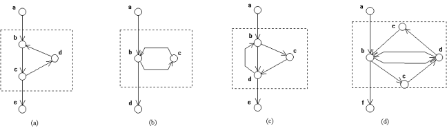

(a): There is neither a simple path nor an elementary path which covers node d

(b): The simple path (a, b, c, b, d) executes the loop body once.  
There is no elementary path which exercises the loop body.

(c):  There is no elementary paths which can cover the edge (d, b).

(d): The simple path (a, b, c, d, b, d, e, b, f) can be considered as exercising the loop body twice.

## Testing Loops in Code

- Loop Count criterion (also known as *Ct criterion*)
    - Each loop body executed zero times, once, twice, and so on, up to a certain number *K* of times
- Definition
    - *Elementary cycle*: an elementary path except that the start node and the end node of the path is the same node. 
    - *Simple cycle*: a cycle which does not contain any edge twice. 
    - *K-degree cycles*: a cycle tat is the concatenation of *k* cycles c1, c2, ..., ck that have the same start nodes and end nodes.

## Cyclomatic Criterion \[McCabe 1976\]

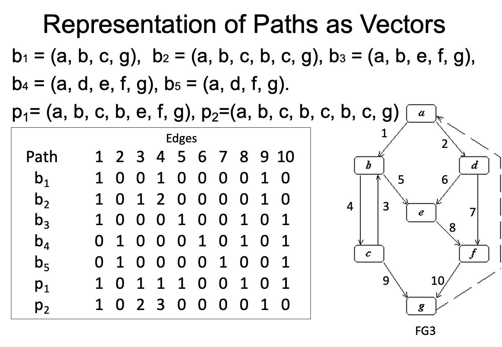

### Cyclomatic Number

Given a directed graph $G$, $n$ the number of nodes in $G$, $e$ the number of edges.  
**Theorem**  
- In a strongly connected graph, all base sets of paths contains $e-n+1$ independent paths. This number is called the ***cyclomatic number*** and denoted by $v(G)$. 
**Corollary**  
- In a flow graph, there are $e-n+2$ independent complete paths that can form a base set. This number is called the ***cyclomatic complexity*** of the flow graph. 
**Example**  
- The flow graph FG3 has e=10, n=7. So, it has 
$$e-n+2 = 10-7+2 = 5$$
independent complete paths that can form a base set. 

> [!TIP]
> 重要公式：$e-n+2$  
> $p+1$（p为predicate node，即判定节点）

#### Example

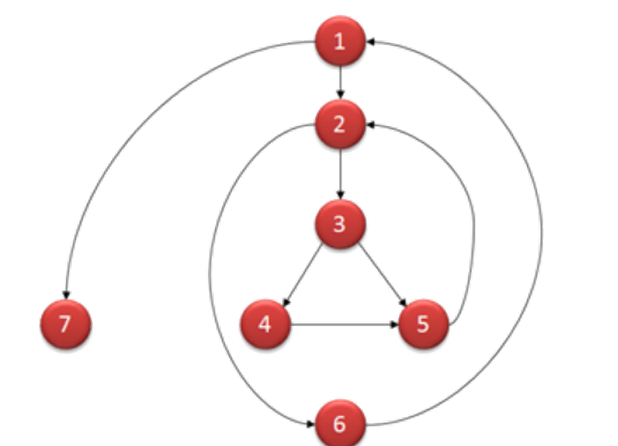

## Cyclomatic Adequacy Criterion

- Definition: (McCabe, 1976)
    - A set P of complete paths satisfies *cyclomatic adequacy criterion* for testing a flow graph G, if and only if P contains at least one set of v(G) independent paths.
- Subsumption relations:
    - Cyclomatic adequacy criterion subsumes node coverage and branch coverage criteria

## Summary

- Models of software structures
    - Call graph
    - GUI state transition diagram
    - Hypertext link graph
    - Program code flow graph
- Test adequacy criteria defined based on structural models
- Subsumption relations between adequacy criteria

## Summary of Subsumption Relations

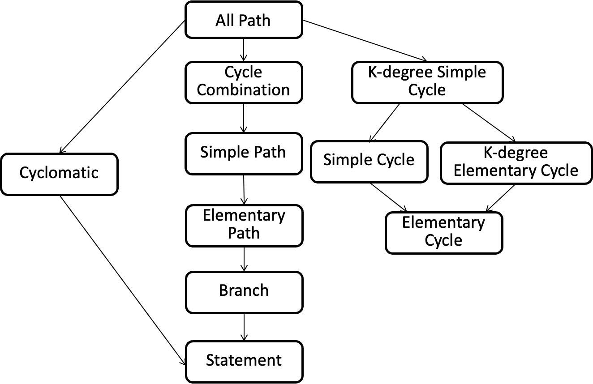

## Homework

- Coursework: start to do Coursework
- Review the slides of SAT week3 Lecture

Source: [chc6072-lecture3.pptx](https://view.officeapps.live.com/op/view.aspx?src=https%3A%2F%2Fvle.zycdut.net%2Fsites%2Fstudent.zy.cdut.edu.cn%2Ffiles%2Fattachments%2Fchc6072-lecture3_5.pptx&wdOrigin=BROWSELINK)
