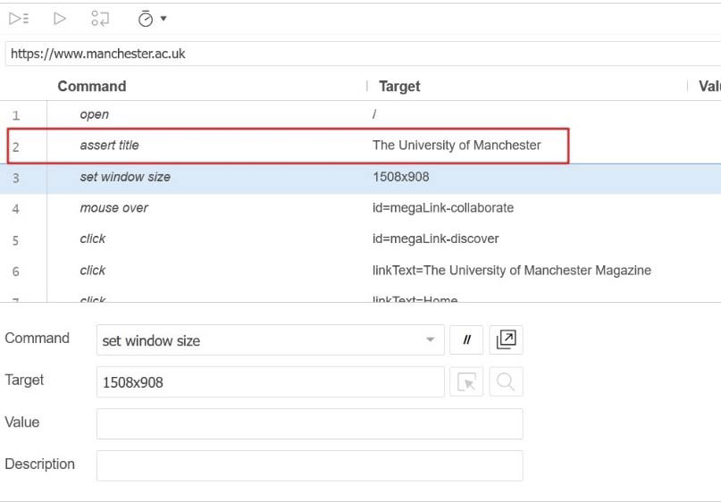
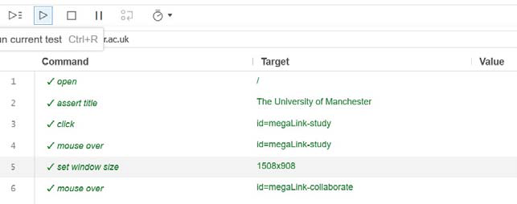
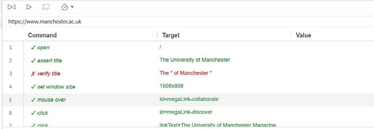
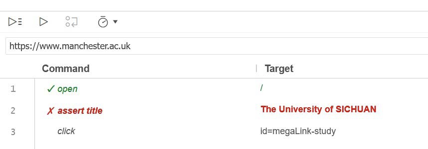

## Introduction

In this practical exercise with Selenium IDE, we will learn how to use Selenium IDE commands to check if a webpage is correct automatically.

## Task 1: Use Assert Commands

Assert commands are useful to write test scripts that automatically check if a webpage is correct. AssertTitle is one of the assert commands that Selenium IDE provides. If the execution of an assert command fails, the test execution aborts and reports that the test case has failed.

**(1) Insert "Assert title" command by Context Menu of Selenium IDE**
- Right-click on any location within the resulting page
- Select “Selenium IDE” and “Assert”

- Select “Title” and you can insert the command

(2) Run test scripts containing assert title commands
- Go to Selenium IDE window, and save the scripts;
- Run test scripts containing assert title commands
- Go to the Firefox browser window and check it;

When you execute the test script, Selenium IDE will check if the title of the webpage matches the string of characters given in the assertTitle command. Therefore, when changes are made in a webpage, it can tell if there is an error in the html file that links to a wrong page (that is of a different title).

There is a need of more different assert commands because it is not sufficient to guarantee the page is correct by just checking the title of a page. For example, Some different pages have the same title. Therefore, you also need to check on other elements of the page. Selenium IDE provides a large number of assert-commands. Their meanings can be found in the Selenium IDE window (see Screen snapshot below), and Selenium IDE documentation.

The following are some examples of assert commands. Try to use them in your test scripts.

- assertBodyText
- assertConfirmationPresent
- assertCookie
- assertCookiePresent
- assertElementPresent
- assertHtmlSource
- assertLocation
- assertNotEditable
- assertOrdered
- assertPrompt
- assertSelectedId
- assertSelectOptions
- assertSelectedIndex
- assertSelectedLabel
- assertText
- assertTitle
- assertValue
- assertWhetherThisFrameMatchFrameExpression
- assertWhetherThisWindowMatchWindowExpression
- assertXpathCount

## Task 2: Use Verify Commands

As stated above, the failure of an assert command will cause the test case to abort. Thus, the remaining commands of the test script will not be executed. In many cases, an error on a webpage is not so crucial and the remaining test steps can be carried out in order to discover as many errors as possible. This can be achieved by using “***verify***” commands.

When the execution of a verify command fails, it will report an error and the test is regarded as a failure. However, different from the assert commands, it will allow the remaining test scripts to be executed without aborting the test execution.

(1) Add verify commands to test script

A common pattern of using assert and verify commands in Selenium IDE is first to assert the page is indeed what is expected and then to use a set of verify commands to check if all the required information/elements are present. The following is such an example.
- Open the Selenium IDE window, which should show the test script that you have just recorded.
- Insert a new command after the assertTitle The University of Manchester command.
- Enter the command verifyTitle into the command field
- Enter the string glob: * `The * of Manchester *` into the value field
- The test script should look like this:

(2) Observe the differences between assert and verify commands

In order to understand the differences between assert and verify commands, follow the steps below.
- Change the assertTitle command to “<i>assertTitle The University of SICHUAN</i>”
- Re-execute the test script, and observe the outcomes. The following execution log will be displayed in the Selenium IDE window. Note that the remaining commands are not executed after the failed assert command.

- Now, change the assertTitle command back to the correct version.
- Change the next command

“<i>verifyTitle The University of Manchester</i>”
  
- Execute the test script and observe the outcome

Note that, although a failure occurred in the execution of the test script, the test execution continued until the end of the script.

Selenium IDE provides a large number of verify-commands. Every assert command there is a corresponding verify command.

Source: [pract3-chc6072.pdf](https://vle.zycdut.net/sites/student.zy.cdut.edu.cn/files/attachments/pract3-chc6072_1.pdf)
