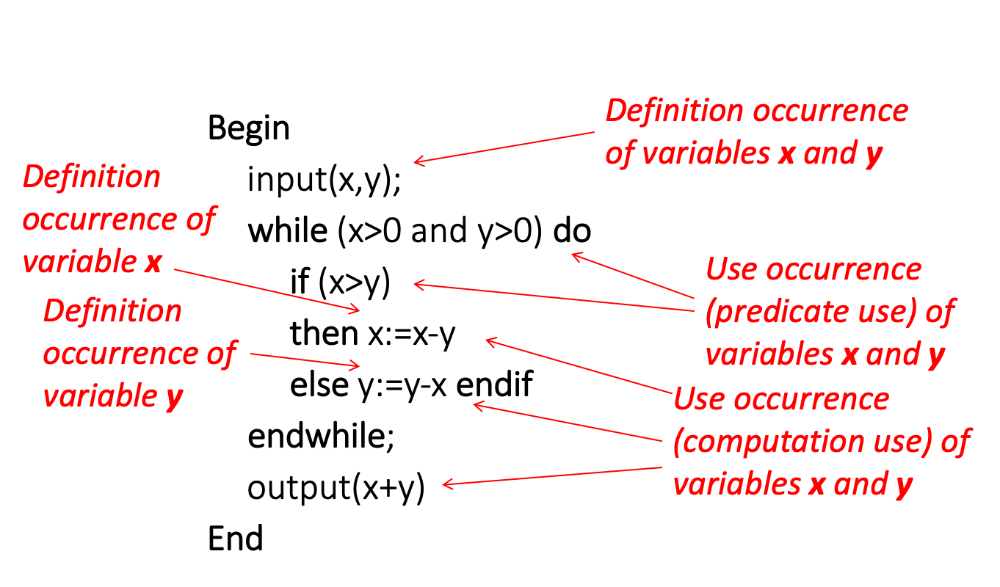
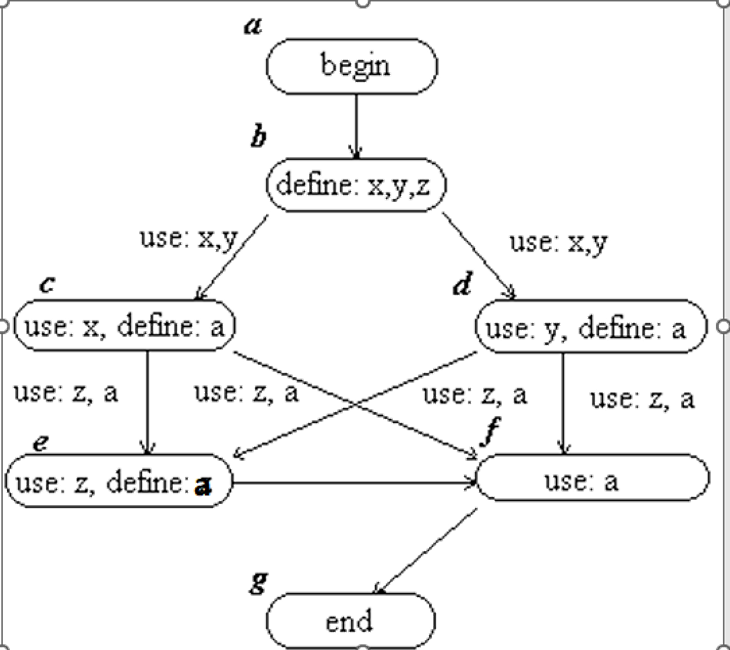
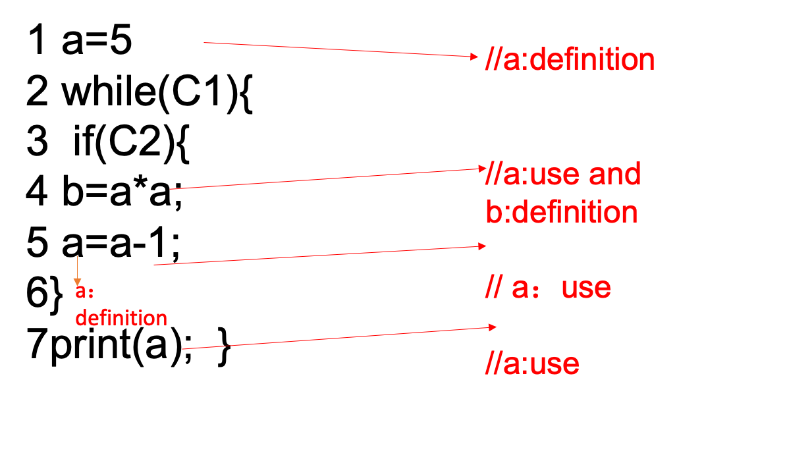
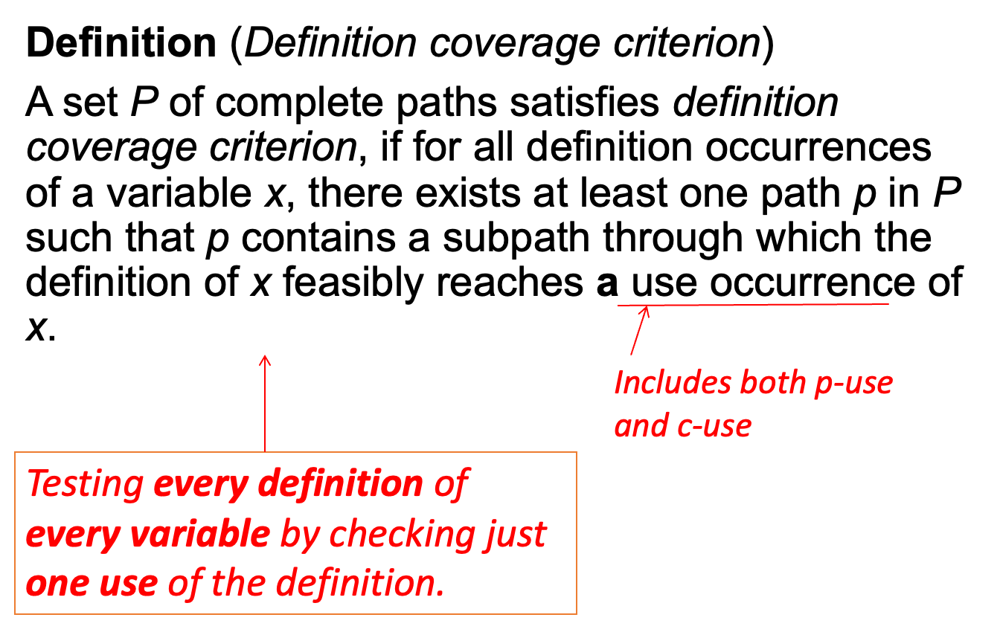
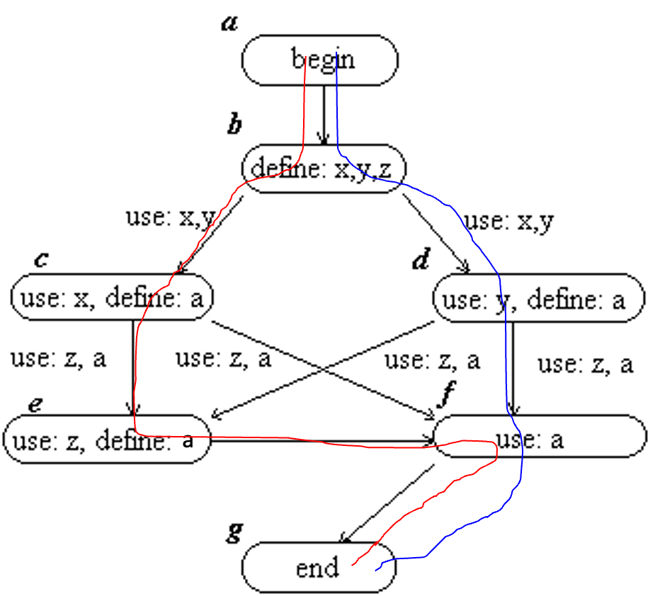
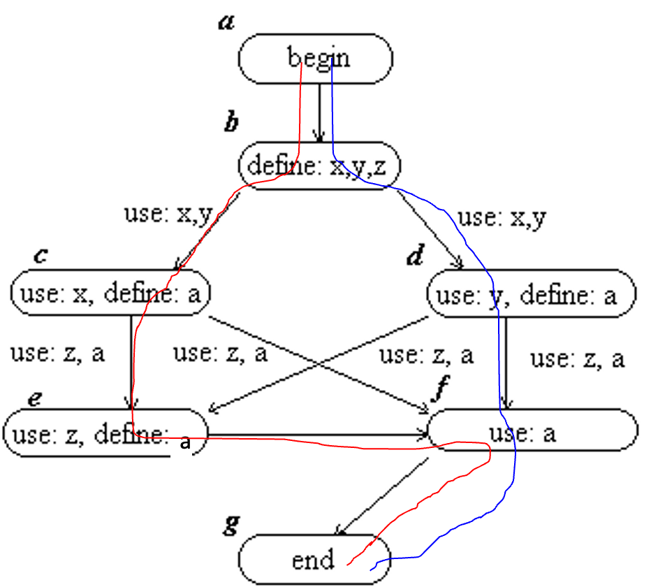
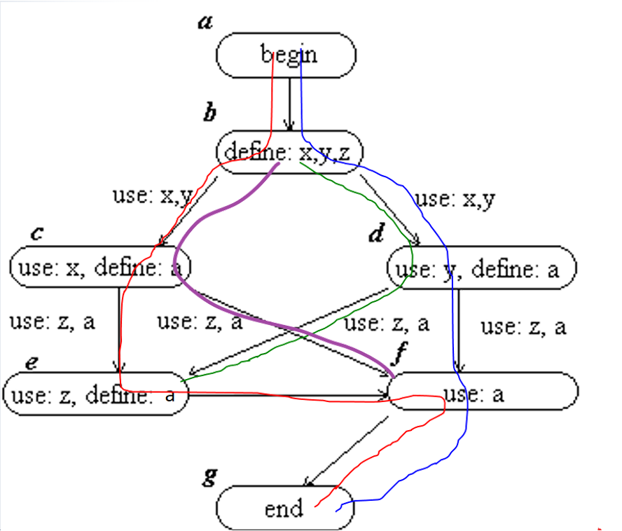

## This Week’s Learning Outcomes

- Developing skills in advanced testing techniques
    - Data flow model of computer program
    - Data flow test adequacy criteria
- Understanding of principles and theory of software testing
    - Subsumption relations between data flow test adequacy
    - Measurement of testing methods’ fault detection ability
    - Relationship between subsumption relation and fault detection ability

## Review: Structural Testing

- Structural Models of software systems:
    - Call graph
    - GUI state transition diagram
    - Hypertext link graph
    - Program code flow graph
- Principle:
    - An adequate test must thoroughly cover the structure of the software under test 
    - Definitions of adequacy criteria based on structural models
    - Subsumption relations between adequacy criteria
- Usages of test adequacy criteria:
    - Deriving test cases and test data
    - Measuring test adequacy

## Basic Ideas of Data Flow Testing
【定义题】
- Data flow testing concerned with the correctness of processing data in the program:
    - Is the code using the right data? -- *the ways that values are associated with variables*
    - Is the data processed correctly? -- *the ways that these associations affect the execution of the program*
- The approach is to check the paths that show how the data flow in the program
    - Data flow information are introduced into the flow graph model
    - The paths to be tested are defined in terms of such data flow information

### Data Flow Testing

- Why do we need to study data flow testing?

Goal: Try to ensure that values are computed and used correctly

- 【考点】What problems can data flow testing solve?
1. Variables are defined but not used;
2. Variables are used, but undefined;
3. Variables are defined multiple times before they are used;
4. The variable is released before it is used;

### Data Flow Information

- Variable occurrences in a program are classified into
    - <b><i>definition occurrence</i></b>:
        - where a value is bound to the variable, i.e. defined
    - <b><i>use occurrence</i></b>: 
        - where the value of the variable is referred to, i.e. used
        - <b><i>predicate use</i></b>: (p-use)
            - where the value of a variable is used to decide whether a predicate is true for selecting an execution path
        - <b><i>computation use</i></b>: (c-use)
            - where the value of a variable is used to compute a value for defining other variables, or as an output value

#### Example

The following program computes the greatest common divisor of two natural numbers using Euclid's algorithm

##### Example: DG1

##### Example DG3

## Data Flow Concepts

- <b><i>Definition-clear path</i></b> with respect to a variable x:
    - a path that for all nodes in the path there is no definition occurrence of the variable x. 
- A definition of variable *x* at node *u* <b><i>reaches</i></b> the computational use occurrence of x at node v through the path p: 
- Variable x has a definition at u
- Variable x has a computational use at v
    - Def x at u <i>reaches</i> x c-use at v.
- p = (u, w1, w2,..., wn, v) is a path from u to v 
- (w1, w2, ..., wn) is definition-clear with respect to x
- A definition of variable x at u <b><i>reaches</i></b> a predicate use of x on the edge (wn,v) through path p:
    - Variable x has a definition at u
    - p=(u, w1, w2,..., wn, v) is a path from u to v, 
    - (w1, w2,..., wn) is definition-clear with respect to x, 
    - Variable x has a predicate use occurrence on the edge from wn to v, 
- If the path p in the above definitions are feasible, we say a definition <b><i>feasibly</i></b> reaches a use of the definition.

## Testing Definition-Use Associations

**Definition** (*Definition coverage criterion*)  
A set P of complete paths satisfies *definition coverage criterion*, if for all definition occurrences of a variable *x*, there exists at least one path *p* in *P* such that *p* contains a subpath through which the definition of *x* feasibly reaches **a** use occurrence (<i>Includes both p-use and c-use</i>) of *x*. 

> <i>Testing <b>every definition</b> of <b>every variable</b> by checking just <b>one use</b> of the definition.</i>

#### Example

The set {p1, p2} satisfies the definition coverage criteria.
- p1 = (a, b, c, e, f, g) 
- p2 = (a, b, d, f, g)

## Use Coverage

**Definition** (*Use coverage criterion*)
A set *P* of complete paths satisfies *use coverage criterion*, if for all definition occurrences of a variable *x*, and **all** use occurrences of *x* that the definition feasibly reaches, there is at least one path *p* in *P* such that *p* contains a subpath through which that definition feasibly reaches the use. 

> Each variable's all definition → use relationships are executed at least once.

#### Example

The set {p1, p2} satisfies the use coverage criteria.
- p1 = (a, b, c, e, f, g) 
- p2 = (a, b, d, f, g)

## DU-Path Coverage Criterion

**Definition** (*Definition-use path coverage*) 
A set *P* of complete paths satisfies *DU path coverage criterion*, if for all definitions of a variable *x*, and **all** feasible paths *q* through which that definition reaches a use of *x*, and *q* is cycle-free or contains only simple cycles, there is at least one path *p* in *P* such that *q* is a subpath of *p*.

> <i>Testing <b>every definition</b> of <b>every variable</b> by checking <b>every use</b> of the definition through <b>every feasible path from the definition to the use</b>.</i>

### Example: DU Path Coverage

The set {p1, p2,p3, p4}  satisfy the DU path coverage criteria.
- p1 = (a, b, c, e, f, g)
- p2 = (a, b, d, f, g)
- p3 = (a, b, c, f, g)
- p4 = (a, b, d, e, f, g)

## Summary

| Criterion                    | Core Objective (What to Cover)                                                                      | Key Feature (What It Doesn’t Care About)                                                      |
| ---------------------------- | --------------------------------------------------------------------------------------------------- | --------------------------------------------------------------------------------------------- |
| Definition Coverage          | Each variable’s **all definition sites** are executed at least once.                                | Doesn’t care whether the variable is used after definition—only cares about if it is defined. |
| Use Coverage                 | Each variable’s **all definition → use relationships** are executed at least once.                  | Doesn’t care which path is taken from definition to use—only cares about if it’s used.        |
| Definition-Use Path Coverage | Each **path from every definition site to every use site** of a variable is executed at least once. | Requires coverage of all possible definition→use paths—it has the strictest requirements.     |

### Subsumption Relations

- All du path coverage criterion subsumes all uses coverage criterion
- All uses coverage criterion subsumes all definition coverage criterion

## Testing Interactions Between Variables

An effective way to test the correctness of the data assigned to a variable is to check the process that the data are propagated. \[Ntafos, 1984\]

## Interaction Chain

A k-du <b>interaction chain</b> is a sequence of nodes \[n1, n2, ..., nk\], k>1, such that For each *i* in (1, 2, …, k-1), 
- There is a path pi that from node ni to ni+1
- On node ni, there is a definition of a variable xi. 
- On node ni+1, there is c-use of xi to define variable xi+1. 
- The definition of xi on node ni reaches the c-use of xi on node ni+1 through path pi. 

> <i>The variables and the nodes do not need to be distinct.</i>

> The concatenation of p1, p2, ..., pk is called an <i>interaction path</i> for the k-du-interaction chain.

### Interaction Chain Coverage Criterion

**Definition** (*k-du-interaction chain coverage criterion*)

Let k>0 be a given natural number. A set *P* of complete paths satisfies *k-du-interaction chain coverage criterion*, if and only if for all feasible *j*-du-interaction chains *L*, 1<*j*≤*k*, there is at least one path *p* in *P* such that *p* contains a subpath which is an interaction path for *L*.

> <i>It requires to cover all du-interaction chains whose length is less than or equal to k.</i>

### Subsumption Relations

- For all *k*>1, *k*-du-interaction chain coverage criterion subsumes (*k*-1)-du-interaction chain coverage criterion. 
- For all *k*>1, *k*-du-interaction chain coverage subsumes use coverage.

> <i>Use coverage criterion is actually the 1-du-interaction coverage criterion.</i>

## Ordered Context

Let n be a node in a flow graph that uses variables x1, ..., xm
Let \[n1, n2, ..., nm\] be a sequence of nodes, such that for each i,
- there is a definition of xi on node ni.
- there exists a path pi from node ni to node ni+1,
- the path pi^pi+1^...^pm is definition clear with respect to xi.
The sequence \[n1, n2, ..., nm] of nodes is called an <b>ordered context</b> for node n
The path p = p1^p2^...^pm is called an ordered context path for node n with respect to the ordered context \[n1, n2, ..., nm]. 

## Illustration of Ordered Context

### Why subsumption relation is important

If adequacy criterion *A* subsumes *B*, *A* is a stronger test method than *B*. 
Using *A* means:
1. We need to spend more resource to test the software than using *B*
2. We can gain more confidence in the software that passes testing than using *B*

> Unfortunately, Weyuker and Frankl (1993) proved that statement 2 above is not always true.

## Uses of Adequacy Criteria

- As a design rule: <i>Prior testing scenario</i>
    - The testers are informed to achieve adequacy according to a given criterion 
    - The test cases are generated or selected accordingly
- As a stop rule: <i>Posterior testing scenario</i>
    - The testers are not informed which adequacy criterion to achieve when designing test cases
    - The test cases are designed using another method, e.g. at random, or using another type of technique, such as functional testing method, etc. 

> <i>Weyuker-Frankl counterexample is in prior testing scenario.</i>

## Theorems About Subsumption Relation

Theorem:  
In posterior testing scenario, if adequacy criterion *A* subsumes *B*, then we have that:
- Using *A* in testing has better fault detection ability than using *B* in both measures of the *probability of detecting at least one fault and the expected number of faults to be detected*.
- Using *A* in testing means require more testing resource than using *B* (assume that each test case requires the same amount of resource).

> Zhu, H., A formal analysis of the subsume relation between software test adequacy criteria, IEEE Transactions on Software Engineering, Vol. 22, No. 4, April 1996, pp248~255.

## Summary

- Data flow graph
    - Definition occurrences of variables
    - Use occurrences of variables: p-uses, c-uses
- Data flow testing methods
    - Def-use association testing
        - Definition coverage, Use coverage, DU path coverage
    - Interaction chain testing
    - Context testing
- Measurements of fault detection ability
- Implications of the comparison of testing methods by subsumption relation 
    - Fault detection ability
    - Test cost

## Summary of Subsumption Relations

Source: [chc6072-lecture4.pptx](https://view.officeapps.live.com/op/view.aspx?src=https%3A%2F%2Fvle.zycdut.net%2Fsites%2Fstudent.zy.cdut.edu.cn%2Ffiles%2Fattachments%2Fchc6072-lecture4_4.pptx&wdOrigin=BROWSELINK)
