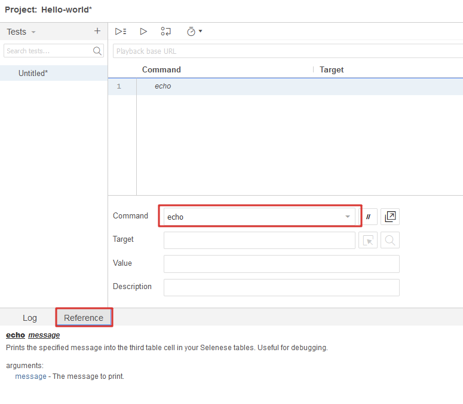
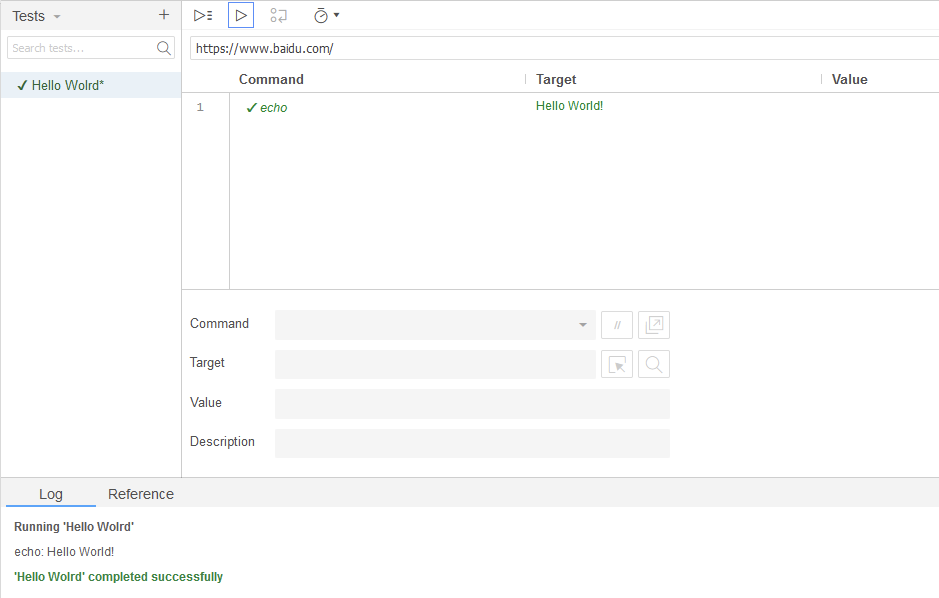
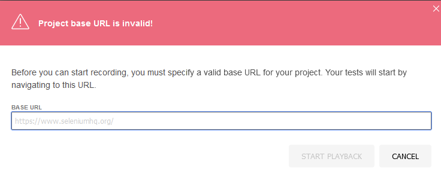
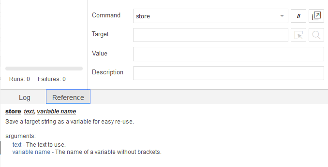
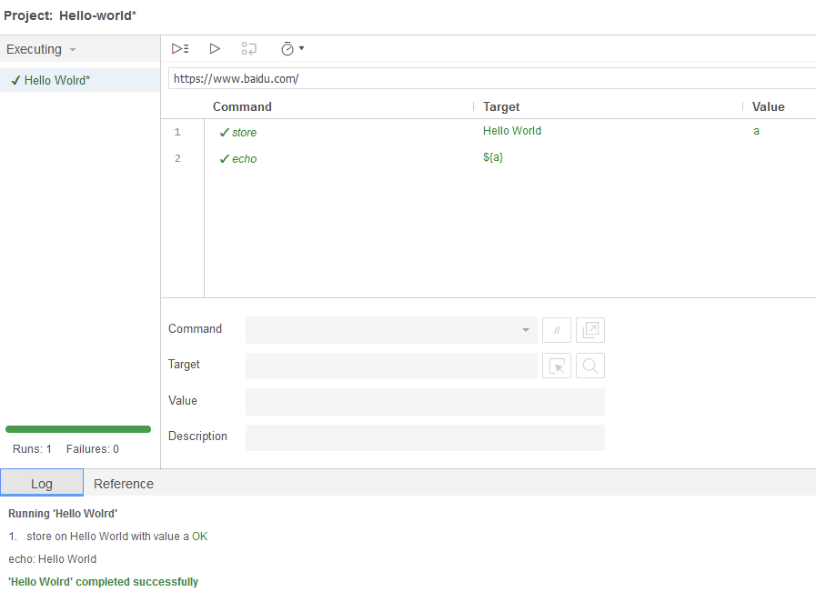
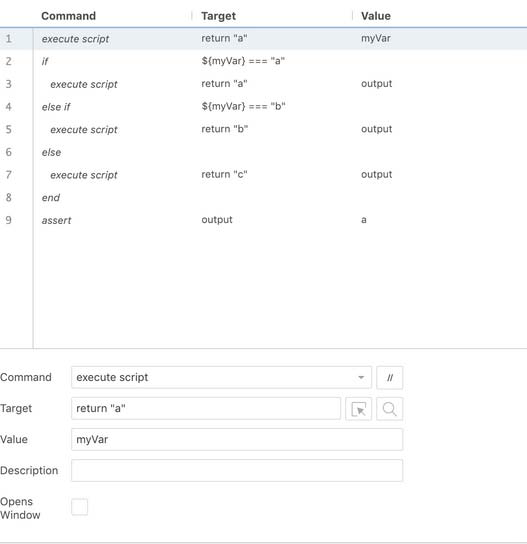
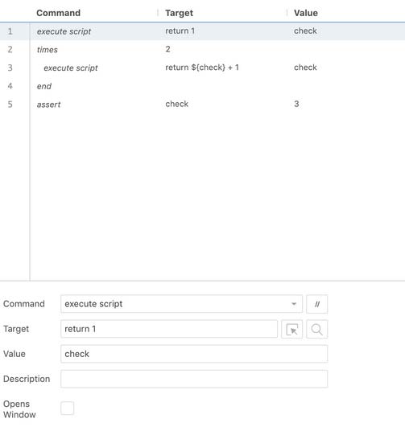
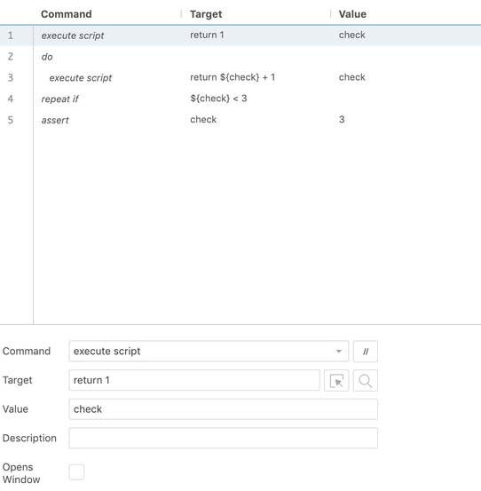
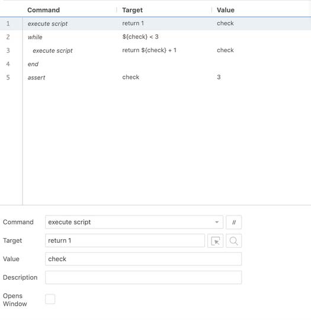

## Introduction

In this practical exercise with Selenium IDE, we will learn how to use **Selenium IDE** to write “`hello world`” and to learn control flow commands.

## Task 1: Use `Echo` command

We usually print out “hello world” on screen when we start to learn a new language. Today we will use Selenium IDE to print "Hello world". During the process, we need to use Echo command. In Selenium IDE, we can firstly take look at the reference of “Echo” command.

According to the reference of echo command, We can easily find that the it has only one parameter. So we can type ”Hello world” into the target box. And then we execute the script and see the result in the Log panel.

Note: If your selenium IDE pop up a new window like this (The below picture).Please type your anyBase URL website you want.

Next we will learn how to print the value of a variable. We also need to use store command to achieve this task and store hello world in a variable and print the variable. Please check the reference for store command and achieve it by yourself. The bellowing picture is about the reference of Store command.

**Note: When you use Echo command to print a variable, please add ${} in front.**

## Task 2: Use Control Flow Commands

Selenium IDE comes with commands that enable you to add conditional logic and looping to your tests.

This enables you to execute commands (or a set of commands) only when certain conditions in your application are met, or execute command(s) repeatedly based on pre-defined criteria.

You can use the execute script or execute async script commands to run a snippet of JavaScript at any point during your test and store the result in a variable. These variables can be used in a control flow command. You can also use JavaScript expressions directly in the control flow commands.

Control Flow commands work by specifying opening and closing commands to denote a set (or block) of commands.

Here are each of the available control flow commands accompanied by their companion and/or closing commands.
- **If, else if ,else , end**
- **times**
- **do, repeat if**
- **while, end**

a) **Conditional Branching**: Conditional branching enables you to change the behavior in your test.

b) **Looping**  
**Times**: With times you can specify a number of iterations you would like to perform a set of commands. The number goes into the target input field of the times command.
To close the times command block be sure to use the end command.

**DO**: You start this loop with the do command, followed by the command(s) that you want executed, and end with the repeat if command. repeat if takes a JavaScript expression you would like to evaluate in the target input field.  
The commands after the do will be executed first and then the expression in the repeat if will be evaluated. If the expression returns true then the test will jump back to the do command and repeat the sequence.

**While**: With while you provide a JavaScript expression you would like to evaluate in the target input field. If it evaluates to true the command block that follows will execute until it reaches the end command.Once done the test will jump back to the while command and repeat the same sequence over (checking first to see if the condition evaluates to true or false).  
To close the while command block use the end command.

Source: [pract4-chc6072.pdf](https://vle.zycdut.net/sites/student.zy.cdut.edu.cn/files/attachments/pract4-chc6072_0.pdf)
