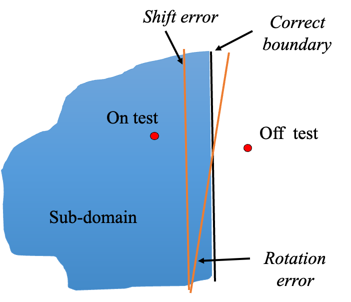
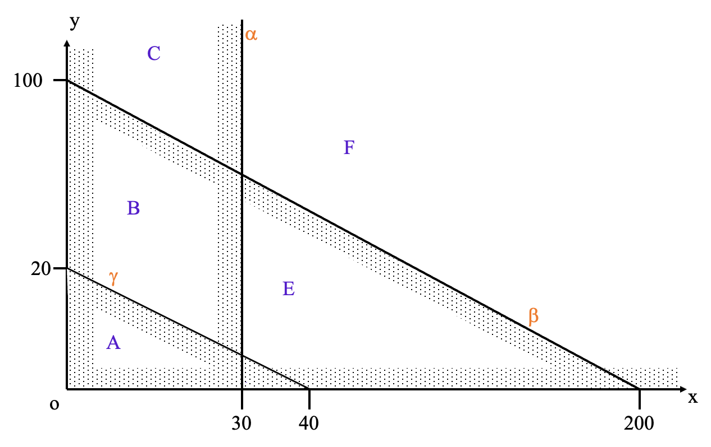
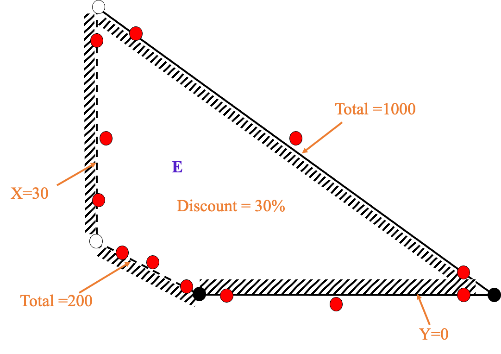
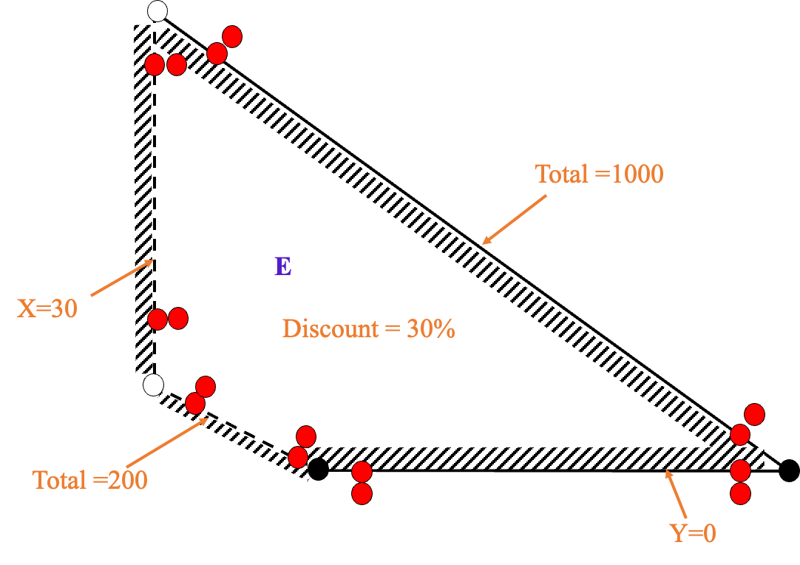
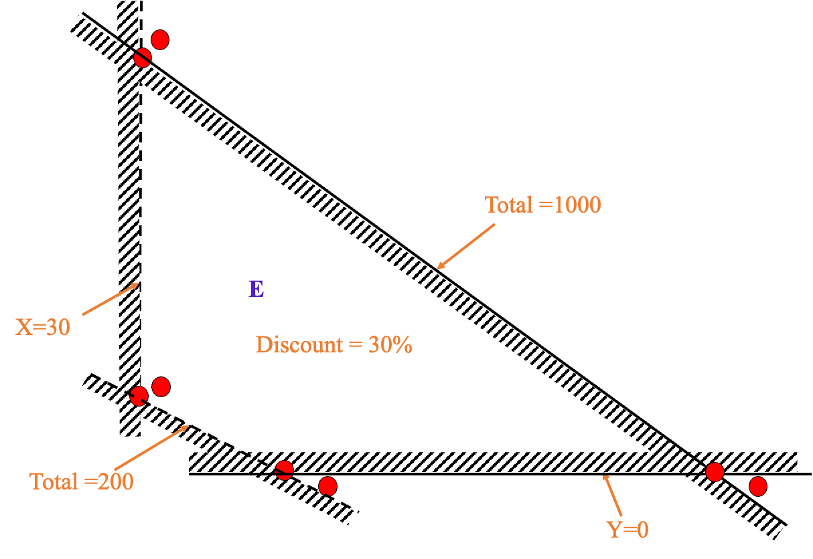
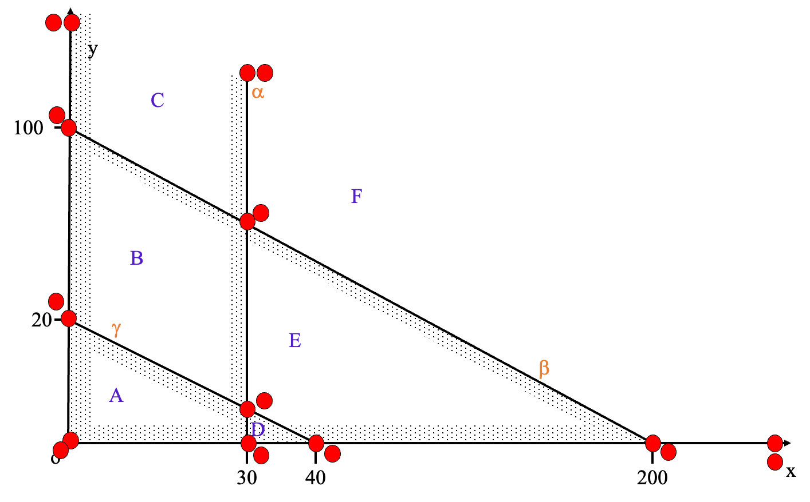

## This Week’s Learning Outcomes

- Software testing techniques 
    - Insert faults into program and perform error-seeding testing
    - Apply mutation operators to model faulty programs and perform mutation analysis
    - Partitioning input space according to specification or implementation
    - Applying domain analysis techniques
- Principles and theories of software testing
    - Hypothesis underlying mutation testing method
    - Subsumption relation between mutation testing and structural testing
    - Error detection ability of domain analysis methods

## Review: Structural Testing

- Principle:
    - An adequate test must thoroughly cover the structure of the software under test 
- Method:
    - Test adequacy criteria are defined based on structural models to drive test cases and/or to measure test adequacy
- Theory:
    - Subsumption relations between adequacy criteria 
    - Fault detection ability is related to the used test criterion
    - Cost is also related to the used test criterion
    - Balance between quality and cost can be achieved by using a right criterion

## Fault-Based SW Testing Methods

<center><h3>Basic Ideas of Fault-based Testing</h3></center>

- Test cases are selected in order to detect a set of known (or potential) faults 
- Test adequacy are measured according to the test set’s ability to detect a set of known or potential faults
- Using statistical inferences, one can estimate the number of faults remaining in the sw.

> <span style="color: red"><i>Fault-based testing assesses the system's ability to detect, tolerate, and recover from these issues by intentionally introducing faults, errors, or anomalies.</span></i>

## Fault-Based Testing

***Why do we need to study Fault-Based Testing?***

> [!TIP]
> - Narrow down your error search as much as possible
> - Achieve higher test efficiency and reduce test costs


### Monte-Carlo Method

- How many fishes are there in a pond?
    - Catch a few fishes in the pond, say 10.
    - Mark the fishes and return them to the pond.
    - Catch a few fish again the next day, say 12.
    - Count how many of the fishes of the second catch are marked, say 3.
    - Can you estimate the total number of fishes in the pond?

$$
\begin{aligned}
\text{Probability of catch a marked fish} &= \frac{\text{number of marked fishes}}{\text{total number of fishes}} \\
&= \frac{\text{number of marked fishes in the second catch}}{\text{number of fishes in the second catch}} \\
\frac{10}{\text{Total}} &= \frac{3}{12}
\end{aligned}
$$

There are about 40[+40] fishes in the pond.

[+40]: maximum likelihood

## Error-Seeding

- Artificial faults are planted into the program under test
    - in some suitable random fashion
    - unknown to the tester
    - representative [+representative] of the inherent faults in the program
- The software is tested such that
    - the inherent faults and seeded faults discovered are counted separately
        - Let $r$ be the ratio of the number of seeded faults found to the total number of seeded faults.
        - Let $f$ is the number of inherent faults found by testing
- The number of inherent faults in the program is predicted to be $\frac{f}{r}$
- The ratio r also used to measure software test adequacy

[+representative]: *in terms of the difficulty to detect*

## Analysis of The Error-Seeding Technique

| Aspect                                                    | Error-seeding’s solution                                 |
| --------------------------------------------------------- | -------------------------------------------------------- |
| Means of planting the faults into the software under test | Manually planted                                         |
| Means of determining whether a fault is detected          | Not explicitly defined<br>Relies on engineering judgment |
| Means of measuring test adequacy from the test result     | Defined                                                  |

- Advantages:
    - Software quality can be estimated based on test result
- Drawbacks:
    - Possible errors:
        - Representativeness of seeded faults
        - One test case may find multiple faults
    - Manual operation

## Mutation Testing

- Generation of mutants
    - Construction of a collection of alternative programs (called <span style="color: #000090"><b><i>mutants</i></b></span>) (that each differs from the original program in one place) by applying a set of operators (called <span style="color: #000090"><b><i>mutation operators</i></b></span>)  
- Each mutant is then executed on each test case in the test set T 
    - If there is at least one test case in T on which the original program P and a mutant program produce different responses: <span style="color: #000090"><b>the mutant is <i>dead</i></b></span>, or <span style="color: #000090"><b><i>killed</i> by the test case</b></span>
    - If on all test cases in T, the original and the mutant produces same result: <span style="color: #000090"><b>the mutant remains <i>alive</i></b></span>

### Live Mutants

【考点】A mutant may remain alive for one of two reasons:
- The test data is inadequate.
    - Test data cannot detect the fault 
- The mutant is equivalent to the original program.
    - Equivalent mutants should be discarded

### Mutation Score

**Definition**  
The mutation adequacy of a set of test data is measured by a numerical score calculated according to the following equation:
$$\text{Mutation Score} = \frac{D}{M-E}$$
where
- *D* is the number of dead mutants, 
- *M* is the total number of mutants, 
- *E* is the number of equivalent mutants. (The number of mutants that remain undetected by the tests due to equivalent mutations.)

> When E=0 (All mutants are detected) the mutation score approaches 1, it indicates that the test can effectively detect erroneous mutations within the program, thereby indicating higher program robustness and test coverage.

### Mutation Operators

- A mutation operator is a syntactic transformation which produces a mutant when applied to the program under test. 
    - Each operator applies to a certain type of syntactic structure in the program
    - It replaces a fragment of program code with a “*non-equivalent*” one
    - It models a type of faults that may be in the program
- Example
    - Replace the expression "<span style="color: blue">a&gt;b</span>" with "<span style="color: blue">a&lt;b</span>" , or "<span style="color: blue">a=b</span>", or "<span style="color: blue">a≤b</span>", or "<span style="color: blue">a≥b</span>", or "<span style="color: blue">a≠b</span>" 

#### Example 1 of Mutant

Original Program:

```
Procedure Greatest-Common-Divisor;
	var x, y: integer;
	begin
		input (x, y);
		while (x>0 and y>0) do
			if (x>y)
			then x:= x-y
			else y:= y-x
			endif
		endwhile;
		output (x+y);
end
```

Mutant:

``` {6}
Procedure Greatest-Common-Divisor;
	var x, y: integer;
	begin
		input (x, y);
		while (x>0 and y>0) do
			if (x<y)
			then x:= x-y
			else y:= y-x
			endif
		endwhile;
		output (x+y);
end
```

#### Example 2 of Mutant

| Original Program                                                                                              | Mutant one                                                                                                     | Mutant two                                                                                                    |
| ------------------------------------------------------------------------------------------------------------- | -------------------------------------------------------------------------------------------------------------- | ------------------------------------------------------------------------------------------------------------- |
| `begin`<br>`int x, y;`<br>`input (x,y);`<br>`if (x<y)`<br>`output (x+y)`<br>`else`<br>`output (x*y)`<br>`end` | `begin`<br>`int x, y;`<br>`input (x,y);`<br>`if (x<=y)`<br>`output (x+y)`<br>`else`<br>`output (x*y)`<br>`end` | `begin`<br>`int x, y;`<br>`input (x,y);`<br>`if (x<y)`<br>`output (x+y)`<br>`else`<br>`output (x/y)`<br>`end` |

<center><span style="color: red"><i>Where does Mutation operator apply?</i></span></center>

### Types of Mutation Operators


| Type                               | Goal                                                                                                               | Mutation Operators                                                                                                                                                                                                                 |
| ---------------------------------- | ------------------------------------------------------------------------------------------------------------------ | ---------------------------------------------------------------------------------------------------------------------------------------------------------------------------------------------------------------------------------- |
| Coincidental Correctness Analysis  | Guard against coincidental correctness                                                                             | •Change data references;<br>•Change operators in expressions                                                                                                                                                                       |
| Domain Analysis                    | Exercise different data domains                                                                                    | •Change constants and sub-expressions by small amounts;                                                                                                                                                                            |
| Predicate Analysis                 | Exercise predicate boundaries                                                                                      | •Alter predicate and DO loop limit sub-expressions by small amounts;<br>•Insert absolute values into predicate sub-expressions;<br>•Alter relational operators.                                                                    |
| Statement Analysis                 | Ensure that every branch is taken and every statement is necessary                                                 | •Replace statement with CONTINUE<br>•Replace logical and relational with true or false<br>•Check labels on arithmetic IF statements for usage<br>•Replace DO statements with FOR statements                                        |
| Class Encapsulation Analysis       | Ensure declarations in a class correctly use encapsulation facilities                                              | •Change the access modifiers (i.e. private, protected, public, and unspecified) of the attributes and methods in class declarations                                                                                                |
| Inheritance relationship Analysis  | Ensure the inheritance relationships are correctly defined.                                                        | •Delete or insert overriding methods and hiding variables<br>•Change the calling position of overriding methods<br>•Rename overriding methods<br>•Delete and insert keyword ‘Super’<br>•Delete and insert parent constructor calls |
| Polymorphism Analysis              | Exercise all possible dynamic type bindings to ensure the correctness of polymorphic behavior of object references | •Change the instantiation type of an object reference to a child or parent class<br>•Delete, insert or change type cast operator<br>•Delete overloading method declarations<br>•Change the parameters of overloading method calls  |
| Language Specific Feature Analysis | Ensure language specific features are used properly                                                                | For example, for test Java specific features:<br>•Delete and insert This keyword<br>•Delete and insert Static keyword<br>•Delete member variable initialization                                                                    |
| Interface Analysis                 | Ensure interfaces between software components are correct                                                          | •Change function calls, parameters or global variables<br>•Change other connections between two modules, such as messages, a pair at a time                                                                                        |

### Analysis of The Mutation Testing Technique

| Aspect                                                    | Mutation testing’s solution                                                                                                  |
| --------------------------------------------------------- | ---------------------------------------------------------------------------------------------------------------------------- |
| Means of planting the faults into the software under test | •Designing mutation operators to model various types of faults<br>•Systematically applying mutation operators to the program |
| Means of determining whether a fault is detected          | The mutant produces a different output from the original program                                                             |
| Means of measuring test adequacy from the test result     | $\text{Mutation Score} = \frac{D}{M-E}$                                                                                      |

- Advantages: Fully automatic; Systematic injection of faults.
- Drawbacks: High cost of testing: O(n<sup>2</sup>) number of mutants

## Error-Based Testing

- <span style="color: red">Basic idea</span><br>To check program on error-prone cases to ensure such errors are not repeated
- <span style="color: red">Known common errors</span>
    - Boundary error:<br>Incorrect division of the input space into sub-domains 
    - Functional error:<br>Incorrect expression of computation (the function) for a sub-domain of the input space
    - Commission error:<br>Do things that are unnecessary
    - Omission error:<br>Failed to do something that should have been done

> <span style="color: red"><i>Error-based testing focuses on verifying if the system's functionality and behavior under normal conditions are correct.</i></span>

## Concepts

- Error
    - Human mistake made in the development and operation of the system
    - These errors may stem from misunderstandings, negligence, mistakes in operation, or misunderstanding of system requirements.
- Fault
    - The defects in the system 
    - They are actual problems within the system, potentially stemming from design errors, programming mistakes, or issues during implementation.
- Failure 
    - The behaviour of a faulty system during execution that does not meet the expectation
    - Caused by faults in the system

## Software defects

A software defect is any undesired or unacceptable deviation existing within software (documents, data, programs) that leads to quality issues in the software. It is classified as a software defect if it meets any one of the following five criteria:
 
1. The software fails to meet the functionalities specified in the software specification document.
2. The software exceeds the scope outlined in the software specification document.
3. The software does not achieve the objectives stated in the software specification document.
4. Errors occur during the execution of the software.
5. Software testers find the software challenging to understand, user-unfriendly, or running at a slow pace.

## Common Boundary Errors

- Shift error
    - The implemented boundary is a parallel shift from the correct boundary
- Rotation error
    - The implemented boundary is a rotation of the correct boundary

**Terminology**  
*Dimension of input space*:  
- The number of input variables

*On test*:  
- The input data within the subdomain under test

*Off test*:  
- The input data outside the subdomain under test



## Boundary Analysis

The purpose:  
- To test if the boundary implemented by the software is correct

The method:  
- Select test cases on the borders and near the borders

The basic assumptions:  
- The software computes different function on points inside the sub-domain from the points outside the sub-domain
- Domain is divided into sub-domains by borders, which are simple, such as straight lines and planes
- Boundary errors are simple, such as shift errors and rotation errors 

### Example: DISCOUNT INVOICE

A company produces two goods, X and Y, with prices £5 for each X purchased and £10 for each Y purchased. An order consists of a request for a certain number of X's and a certain number of Y's.  
The cost of the purchase is the sum of the costs of the individual demands for the two products discounted as explained below.  

- If the total is greater than £200 a discount of 5% is given,
- if the total is greater than £1000 a discount of 20% is given.

Also the company wishes to encourage sales of X and give a further discount of 10% of the total cost, if more than thirty X's are ordered.  
Non-integer final costs are rounded down to give an integer value.  

### Process of Domain Analysis

- Identification of function
    - The function to be tested is the computation of the total amount of invoice for any given order
- Identification of domain
    - The input space consists of two inputs:
        - x: the number of product X ordered
        - y: the number of product Y ordered
    - Both inputs are natural numbers {0, 1, 2, …}
- Identification of codomain
    - The output is also a natural number that represents the amount of money in the unit of pounds. 
- Analysis of functions
    - Work out the relationship between the input and output<br>If too complicated, then divide it!

### Partitioning Input Space: Method 1

<center><h4>Partitioning Based on Specification</h4></center>
- When the inputs x and y have the property that $x \le 30$ and $5 \times x + 10 \times y \le 200$, the output should be $5 \times x + 10 \times y$. 
    - Sub-function 1: 
        - Sub-Domain: $A = \{(x, y) | x \le 30, 5 \times x + 10 \times y \le 200\}$
        - Relationship:  $\text{sum} = 5 \times x + 10 \times y$
- When the inputs x and y have the property that $x \times 30$ and $1000 > 5 \times x + 10 \times y > 200$, the output should be $\lfloor (5 \times x + 10 \times y) \times 95\% \rfloor$. 
    - Sub-function 2: 
        - Sub-Domain: $A = \{(x, y) | x \le 30, 5 \times x + 10 \times y > 200\}$
        - Relationship:  $\text{sum} = \lfloor(5 \times x + 10 \times y) \times 95\% \rfloor$
    - …

## Sub-Domains

$\textcolor{orange}{\alpha}$, $\textcolor{orange}{\beta}$, $\textcolor{orange}{\gamma}$: borders between sub-domains  
<span style="color: purple">A</span>, <span style="color: purple">B</span>, …, <span style="color: purple">F</span>: sub-domains



## Partitioning Input Space: Method 2

### Partitioning According to Implementation

```
Program DISCOUNT_INVOICE (x, y: Int)
	Var discount1, discount2, sum: int;
	input (x,y);
	if x <= 30
		then discount2:= 100
		else discount2:=90
	endif;
	sum:= 5*x + 10 * y;
	if sum <= 200
		then discount1:= 100
		elseif sum <= 1000
		then discount1:= 95
		else discount1:= 80
	endif;
	output(round (sum * discount1 * discount2, 10000))
end
```

### Flow Graph of the Program


### Paths and Path Conditions

| Path                       | Path Condition                    |
| -------------------------- | --------------------------------- |
| (b, a1, a2, a4, a5, a8, e) | x ≤ 30, (5*x + 10*y) ≤ 200        |
| (b, a1, a2, a4, a6, a8, e) | x ≤ 30, 200 < (5*x + 10*y) ≤ 1000 |
| (b, a1, a2, a4, a7, a8, e) | x ≤ 30, 1000 < (5*x + 10*y)       |
| (b, a1, a3, a4, a5, a8, e) | 30<x, (5*x + 10*y) ≤ 200          |
| (b, a1, a3, a4, a6, a8, e) | 30<x, 200 < (5*x + 10*y) ≤ 1000   |
| (b, a1, a3, a4, a7, a8, e) | 30<x, 1000 < (5*x + 10*y)         |

### Sub-Domains

$\textcolor{orange}{\alpha}$, $\textcolor{orange}{\beta}$, $\textcolor{orange}{\gamma}$: borders between sub-domains  
<span style="color: purple">A</span>, <span style="color: purple">B</span>, …, <span style="color: purple">F</span>: sub-domains


### Boundary Analysis Methods

**Definition 1** (N-Border / 1-Nearby)  
Let {D<sub>1</sub>, D<sub>2</sub>, ..., D<sub>n</sub>} be the set of sub-domains, which has *N* input variables.  
A set *T* of test cases is said to be adequate according to the *N-Border / 1-Nearby* test criterion, if for each sub-domain D<sub>i</sub>, *i*=1, 2, ..., n, and each border *B* of D<sub>i</sub>, there are at least *N* test cases on the border *B* and at least one test case which is near (or just off) the border *B*. If the border is in the domain D<sub>i</sub>, the test case near the border should be an off test point; otherwise, the test case near the border should be an on test point. 

### Example: Test Cases for sub-domain E

<p style="text-align: right;">Adequate according to N/1 criterion</p>  



> N / 1 criterion is effective to detect shift errors, but less effective to detect rotation errors

### N-Border / N-Nearby Criterion

**Definition 2** (N-border / N-nearby)  
Let {D<sub>1</sub>, D<sub>2</sub>, ..., D<sub>n</sub>} be the set of sub-domains of software S, which has *N* input variables.  
A set *T* of test cases is said to adequate according to the *N-Border / N-Nearby test criterion*, if for each sub-domain D<sub>i</sub>, i=1, 2, ..., n, and each border B of D<sub>i</sub>, there are at least N test cases on the border *B* and at least *N* test cases near (just off) the border *B*. If the border *B* is in the domain D<sub>i</sub>, the *N* test cases near the border should be off test points; otherwise they should be on test points. 

### Example: N-Border/N-Nearby Test Cases

<p style="text-align: right;">Adequate according to N/N criterion</p>  



> N-Border /N-Nearby criterion is effective to detect both shift errors and rotation errors

### Vertex Coverage Criterion

**Definition**  
Let {D<sub>1</sub>, D<sub>2</sub>, ..., D<sub>n</sub>} be the set of sub-domains of software S. A set *T* of test cases is said to be adequate according to *vertex coverage test criterion*, if for each sub-domain D<sub>i</sub>, *i*=1,2,...,n, *T* contains the vertices of D<sub>i</sub> and for each vertex *v* of D<sub>i</sub> there is a test case near (just off) the vertex *v*. If a vertex *v* of D<sub>i</sub> is in the sub-domain D<sub>i</sub>, then the test case near v should be an off test point; otherwise it should be an on point. 

> - A vertex is the point where two or more borders meet.  
> - When a border extends at one end infinitely without meets any other border, a test case should be selected at the far end as the vertex point.

### Example: Vertex Coverage Test Cases

<p style="text-align: right;">Adequate according to Vertex Coverage criterion</p>  



### Example: Vertex Coverage

$\textcolor{orange}{\alpha}$, $\textcolor{orange}{\beta}$, $\textcolor{orange}{\gamma}$: borders between sub-domains  
<span style="color: purple">A</span>, <span style="color: purple">B</span>, …, <span style="color: purple">F</span>: sub-domains



### Subsumption Relationship

- Vertex criterion subsumes N-Border / 1-Nearby criterion.
- N-Border / N-Nearby criterion subsumes N-Border / 1-Nearby criterion.
- N-Border / N-Nearby criterion does not subsume vertex criterion.

## Software defects

A software defect is any undesired or unacceptable deviation existing within software (documents, data, programs) that leads to quality issues in the software. It is classified as a software defect if it meets any one of the following five criteria:
 
1. The software fails to meet the functionalities specified in the software specification document.
2. The software exceeds the scope outlined in the software specification document.
3. The software does not achieve the objectives stated in the software specification document.
4. Errors occur during the execution of the software.
5. Software testers find the software challenging to understand, user-unfriendly, or running at a slow pace.

## Analysis of Error-based Testing

Strength  
- Capable of detecting certain common errors in software development
- Easy to combine specification-based and program-based testing together
- Easy to apply

Weakness  
- Assumptions are not always true in real applications
- Assumptions cannot be easily checked for a given application
- Labour intensive

Applicability  
- Applicable to numerical applications
- Applicable to both specification-based and program-based testing

## Summary

- Testing techniques 
    - Fault-based Testing: Error-seeding, Mutation testing
    - Error-based testing: Domain analysis
        - Partitioning input space according to specification or implementation
        - Selecting test cases/data on borders and near borders
- Principles and theory of software testing
    - Subsumption relation between mutation testing and structural testing
    - Error detection ability of domain analysis methods
    - Test results are directly linked to software correctness and reliability

Source: [chc6072-lecture5.pptx](https://view.officeapps.live.com/op/view.aspx?src=https%3A%2F%2Fvle.zycdut.net%2Fsites%2Fstudent.zy.cdut.edu.cn%2Ffiles%2Fattachments%2Fchc6072-lecture5_5.pptx&wdOrigin=BROWSELINK)
