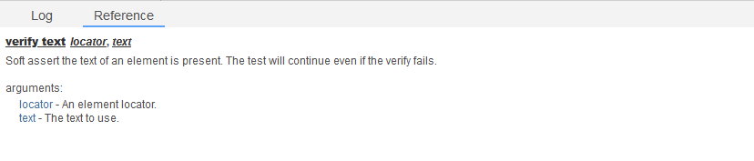
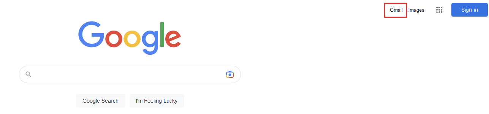
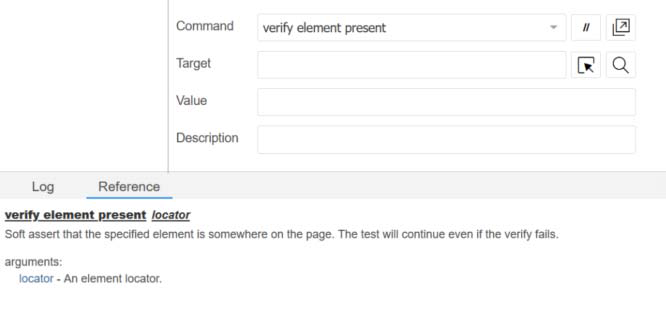
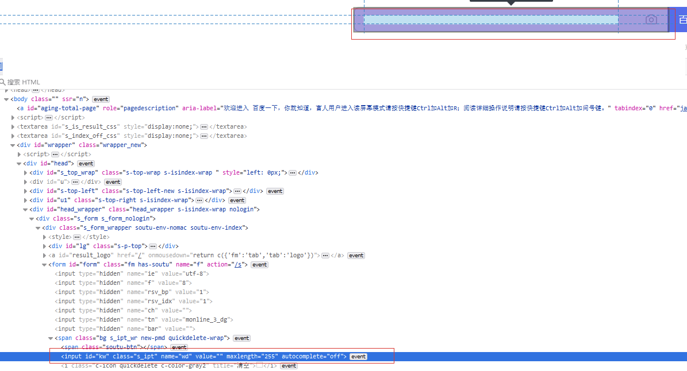
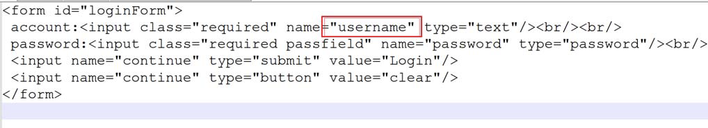
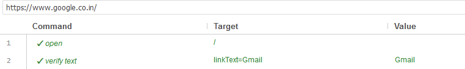
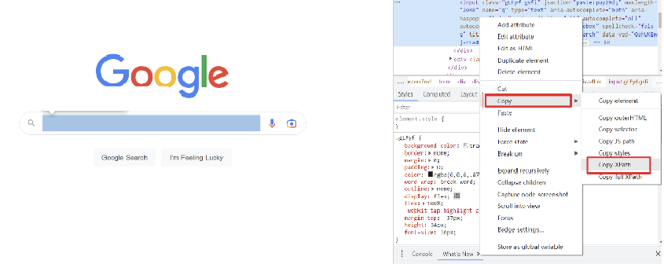
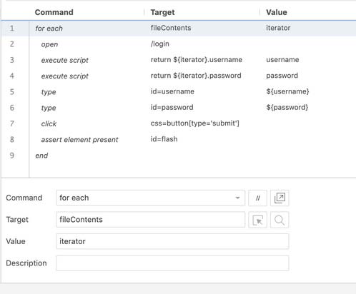
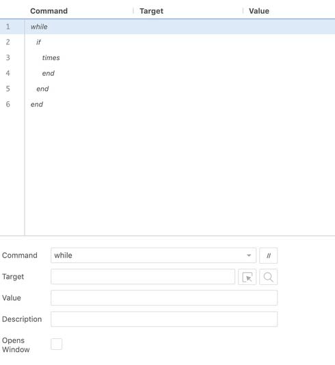

## Introduction

In this practical class, we will introduce several common locator to get the web element. Finding the right web element locator for a web element is crucial in writing a test script because it is necessary for an action to be applied on the right element and to check if an element is correct when verify the web page. And then we will study several common Selenese commands to help you learn.

## Task 1: Some usual Commands

There are lots of Commands in Selenium IDE, you can get the resource through https://www.selenium.dev/selenium-ide/docs/en/api/commands. All Selenese commands can be divided into three broad categories: Action, Accessors, Assertions. In the Action category command, there are several commands including Click, Mouse over and so on; In the Accessor commands, which include store, store title and other commands; In the Assertion category commands, there are assert, verify and other commands. And now we will study several usual commands including echo, open, click, verify title, verify text and verify element present commands. In the last couple of seminar class, we studied echo, open, click and verify title commands. So we only study the other two commands: verify text and verify element present commands.

1. Verify text Command

When you want to use a new command, you should firstly study the reference about this command (the below picture).

There are two arguments for this Command including locator and text, so firstly you should find the element locator, and type text you wanted to check. We will a google example to check function of this command.

We want to check whether the Gmail text is on the webpage, so we will use verify text command.

2. Verify element present

There is only one argument for verify element present command, please see the below picture.

For this command, we just check whether the element is somewhere on the page. The test will continue even if the verify fails.

## Task 2: Web Element Locator syntax

An element in a web page is called a **web element**. Selenium enables a web element to be accessed via a number of different ways. Each of these ways is called an **element locator**. Finding the right web element locator for a web element is crucial in writing a test script because it is necessary for an action to be applied on the right element and to check if an element is correct when verify the web page.

1. ID Locator

2. Name Locator

3. LinkText Locator

4. CSS Locator

For Css locator, there are many ways to locate the element. Here, we only studied four ways to locate the element by css locator.

- Tag and ID locator, Syntax: `css=tag#id` (e.g. `css=form#loginForm`)
- Tag and class locator, Syntax: `css=tag.class` (e.g. `css=input.required`)
- Tag and attribute locator, Syntax: `css=tag[attribute=value]` (e.g. `css=input[name=“password”]`)
- Tag and class and attribute locator, Syntax: `css=tag.class[attribute=value]` (e.g. `css=input.required[name=“username”]`)

5. XPath Locator

You can use ***Web Developer* tools to locate the webpage elements and copy the XPath Locator**.

**(Notes: The copied XPath is a absolute path which is not suitable sometimes. If we add more element, the origin Xpath may be fault. So we need transfer the absolute path to relative path)**

## Task 3: More control flow command

**Foreach:**

Saving the best for last, we have the ability to iterate over a collection (e.g., a JS array) and reference each item in that collection while we do it.

In the `target` field you specify the name of the variable that contains the array you want to iterate over. In the `value` field you specify the name for the iterator variable you'd like to use. For each entry in the array, the commands that follow will be executed. During each iteration the contents of the current entry will be accessible through the iterator variable.

**Nesting Commands:**

You can nest control flow commands as necessary (e.g., an `if` block can go inside of a `while` block, and vice versa).

## Summary

In this practical class, we have learned some common commands, use different ways to locate webpage element. For css locator, we studied four methods to locate the element, such as Tag and ID locator, Tag and class locator, Tag and attribute locator and Tag and class and attribute locator. We also studied other control flow commands.

By studying from week one to week five, we have learned how to use Selenium IDE to record and playback, how to edit test scripts, how to get the right Web Element Locator, and how to write control flow command and some common selenese commands and so on.

Source: [chc6072-seminar-5.pdf](https://vle.zycdut.net/sites/student.zy.cdut.edu.cn/files/attachments/chc6072-seminar-5_0.pdf)
