## Introduction

In this practical exercise, we will learn how to export test script in Selenium IDE and how to use **Selenium’s WebDriver** to perform automated testing. In order to use the Selenium WebDriver, we will learn how to install and set up standalone Selenium server and various browser specific drivers.  
Selenium IDE provides a facility to convert Selenese test scripts into test code in various programming languages and automated test frameworks. In this practical class, we will learn how to convert Selenese test scripts into JUnit test code. The generated test scripts will be used in Practical 6.

## Task 1: Export Test script

You can export either a test or suite of tests to WebDriver code by right-clicking on a test or a suite, selecting Export, choosing your target language, and clicking Export. 

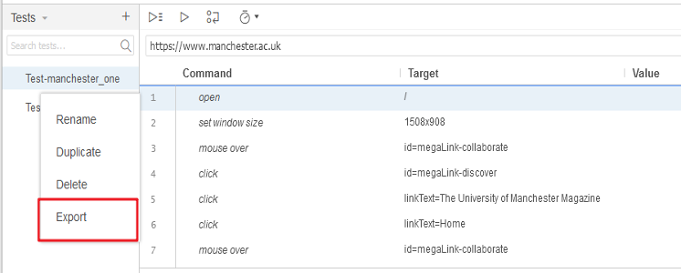
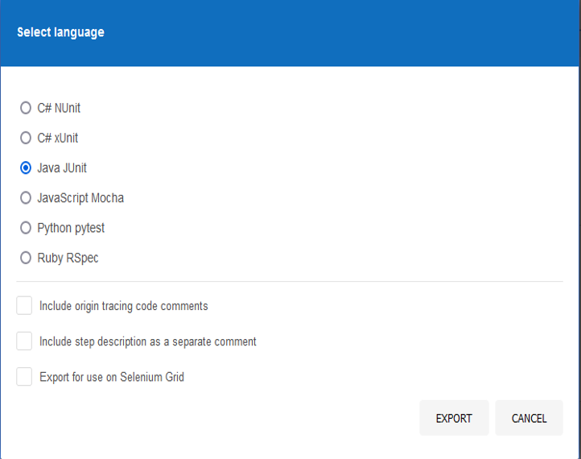

This will save a file containing the exported code for your target language to your browser's download directory.

### Supported Exports

Currently, export to the following languages and test frameworks is supported.
- C# xUnit
- C# NUnit
- Java JUnit
- JavaScript Mocha
- Python pytest
- Ruby RSpec

## Task 2: Installation and Setup using Java Jar files

:::steps{title=""}

1. Download and Install Java on your PC. (Most Students already have Java installed on their PCs)
   
   Visit this link to download appropriate Java files:  
   https://www.oracle.com/java/technologies/downloads/
   
2. Download and Install any Java-related IDE such as Eclipse IDE, IntelliJ IDEA etc. (Most Students already have a Java-related IDE on their PCs)
   
   You can download IntelliJ IDEA by following this link:  
   https://www.jetbrains.com/help/idea/installation-guide.html

3. Downloading and installing Selenium Server for Java:
   
   a) Visit the official website: https://www.selenium.dev/downloads/ 
   b) Download the latest stable version as depicted in the picture below.
   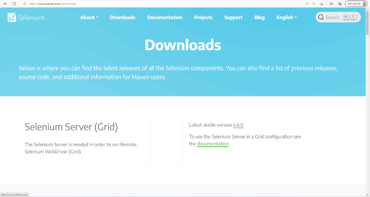
   c) Create a folder on your PC and copy the downloaded selenium server into it.

4. Download and set up browser specific WebDriver. Here we will install the firefox driver:

   <u><b>Installing Firefox Driver</b></u>
   - Check your Mozilla browser version. 
   - Go to the web page at URL: https://github.com/mozilla/geckodriver/ Ensure that you are downloading the right version of geckoDriver that would be compatible with your browser.  Please see below screen snapshot
   
   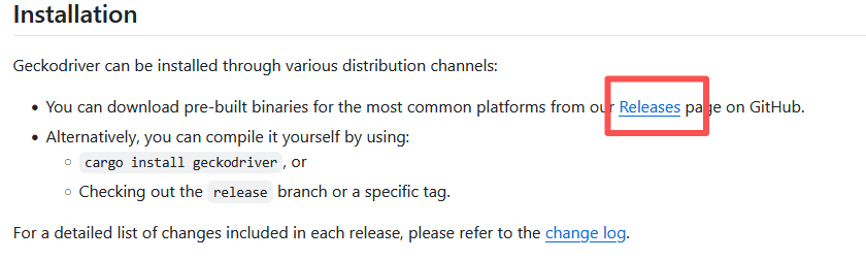
   
   - Select the right version of geckodriver for your operating system. For Example, for a 64-bit windows OS, select “**geckodriver-v0.32.0-win64.zip**” See the  picture below.
   
   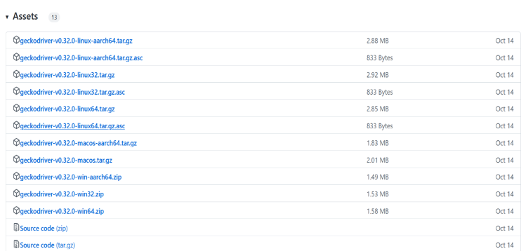
   
   - Unzip the geckoDriver file into the folder where you have stored the selenium server.
   
   **Installing the WebDriver for other Browsers: https://developer.microsoft.com/en-us/microsoft-edge/tools/webdriver/**  
   Note: Do not click or double click on the **geckodriver.exe**, **ChormeDriver.exe** or **SeleniumServer.jar**. If you accidentally clicked or double clicked on them, the server may be executed at background. You need to shut them down.

5. Integration of Selenium Server and WebDriver into IDE

   - Create a test project with IntelliJ IDEA
       - Open IntelliJ IDEA. Create a new Java project with a name, say “**BaidutwoTest**”.
           - Click on the **file** menu, select **new**. The following popup window will show.
   
   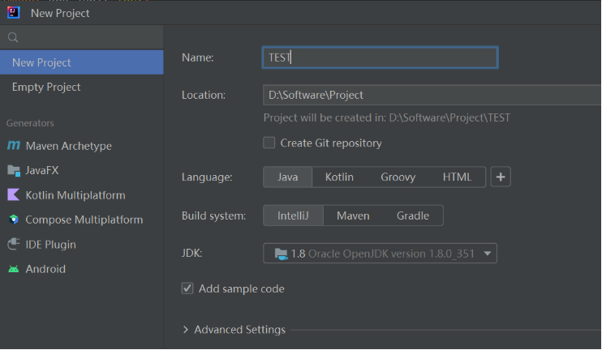
   
   - Import the Selenium Driver Server library.
       - Click the **File** menu, select “**Project Structure**”. Next, under the **Project Settings** column, select **Modules**. Also, select **Dependencies**. Next, Click on the “+” **symbol**, Click on **JARs or Directories**, and **navigate into the folder where your selenium server is stored**. Click **Apply** and **OK** buttons to successfully add the selenium server library. (See the picture below)
   
   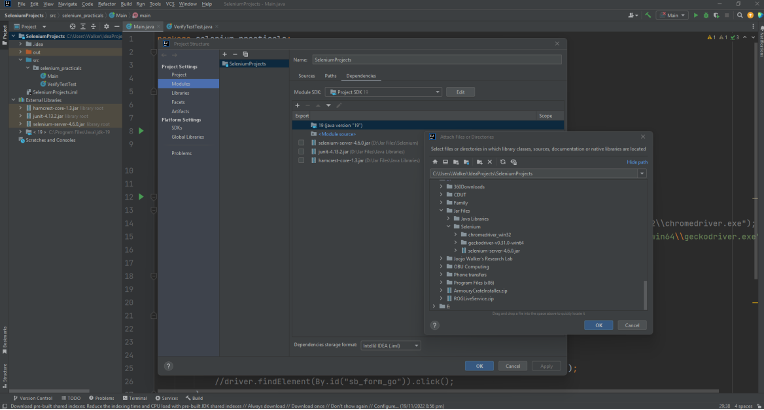
   
:::

## Task 3: Write your First Test Script in Selenium WebDriver

- Write the test code

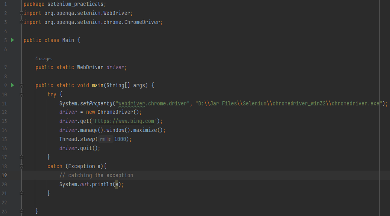

- Execute test code
    - In the IntelliJ IDEA window, click the run button
    - Now, you should see the browser opening and carrying out the testing task according to your specified test script. 

## Installation and Setup of Selenium WebDriver using the Java Maven Build tool

:::steps{title=""}

1. Create a new Project in your IntelliJ IDE. Provide a name for your project. Select Java as the Language and Maven as the Build system. Click on the Create button to complete the process. See the picture below.
   
   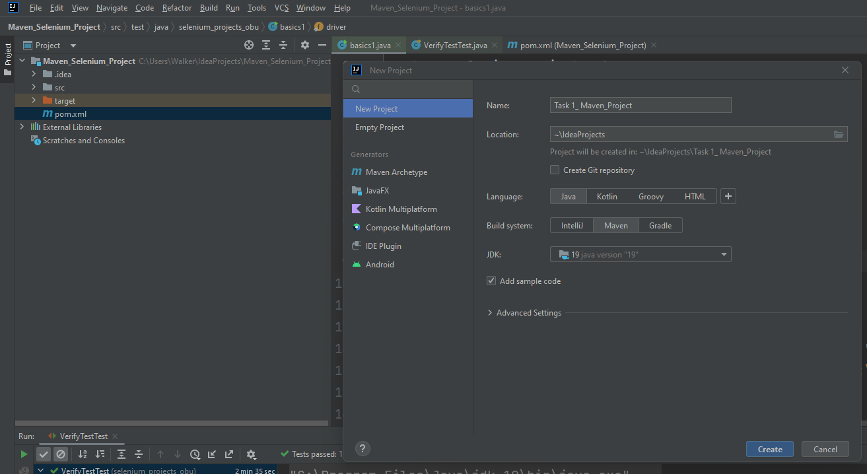

2. To install selenium libraries for Java using the Maven build tool, specify the dependency in the project’s pom.xml file. Visit the official website of Selenium to copy the required dependency. Here is the link: <br>https://www.selenium.dev/documentation/webdriver/getting_started/install_library/ <br>See the picture below to view what you should be copying.
   
   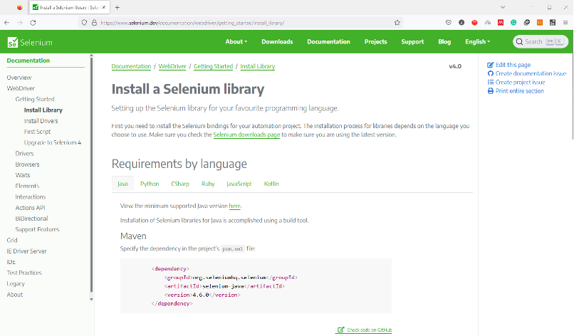

3. Include the dependency in your project within the dependencies tags. Refer to the picture below for an example:
   
   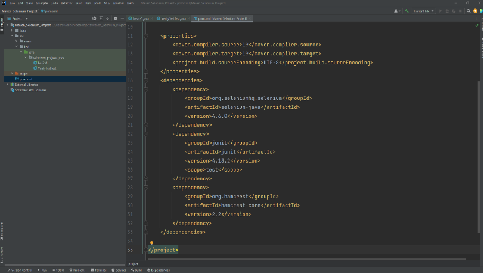
   
4. Navigate to the “java” folder within the “src” folder. Create a java package and then a java class for your task.
   
   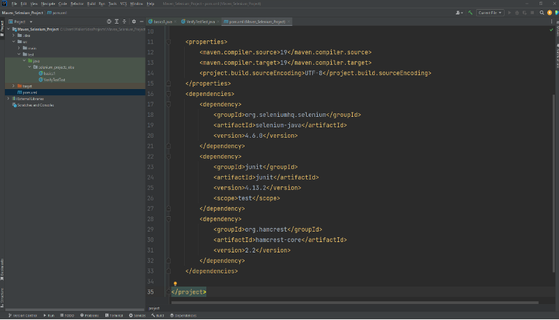
   
5. Write your test script using this Maven Build System. Execute your code.
   
   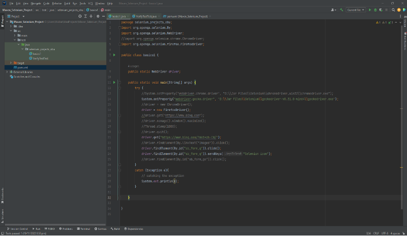

:::

> [!TIP]
> 下附 Selenium IDE 导出的 Java 代码运行所需的 `pom.xml` 

```xml
<?xml version="1.0" encoding="UTF-8"?>
<project xmlns="http://maven.apache.org/POM/4.0.0"
         xmlns:xsi="http://www.w3.org/2001/XMLSchema-instance"
         xsi:schemaLocation="http://maven.apache.org/POM/4.0.0 http://maven.apache.org/xsd/maven-4.0.0.xsd">
    <modelVersion>4.0.0</modelVersion>

    <groupId>dev.selenium</groupId>
    <artifactId>selenium-examples</artifactId>
    <version>1.0.0</version>

    <properties>
        <surefire.parallel>1</surefire.parallel>
        <maven.compiler.source>17</maven.compiler.source>
        <maven.compiler.target>17</maven.compiler.target>
        <project.build.sourceEncoding>UTF-8</project.build.sourceEncoding>
        <selenium.version>4.52.0</selenium.version>
    </properties>

    <repositories>
        <repository>
            <name>Central Portal Snapshots</name>
            <id>central-portal-snapshots</id>
            <url>https://central.sonatype.com/repository/maven-snapshots/</url>
            <releases>
                <enabled>false</enabled>
            </releases>
            <snapshots>
                <enabled>true</enabled>
            </snapshots>
        </repository>
    </repositories>

    <dependencies>
        <dependency>
            <groupId>org.seleniumhq.selenium</groupId>
            <artifactId>selenium-java</artifactId>
            <version>${selenium.version}</version>
        </dependency>
        <dependency>
            <groupId>org.seleniumhq.selenium</groupId>
            <artifactId>selenium-grid</artifactId>
            <version>${selenium.version}</version>
        </dependency>
        <dependency>
            <groupId>org.junit.jupiter</groupId>
            <artifactId>junit-jupiter-engine</artifactId>
            <version>6.1.3</version>
            <scope>test</scope>
        </dependency>
        <dependency>
            <groupId>com.titusfortner</groupId>
            <artifactId>selenium-logger</artifactId>
            <version>2.4.0</version>
            <scope>test</scope>
        </dependency>
        <!-- Source: https://mvnrepository.com/artifact/junit/junit -->
        <dependency>
            <groupId>junit</groupId>
            <artifactId>junit</artifactId>
            <version>4.13.2</version>
            <scope>test</scope>
        </dependency>
    </dependencies>

    <build>
        <plugins>
            <plugin>
                <groupId>org.apache.maven.plugins</groupId>
                <artifactId>maven-surefire-plugin</artifactId>
                <version>3.6.1</version>
                <configuration>
                    <properties>
                        <configurationParameters>
                            junit.jupiter.execution.parallel.enabled = true
                            junit.jupiter.execution.parallel.mode.default = concurrent
                            junit.jupiter.execution.parallel.config.strategy = fixed
                            junit.jupiter.execution.parallel.config.fixed.parallelism = ${surefire.parallel}
                            junit.jupiter.execution.parallel.config.fixed.max-pool-size = ${surefire.parallel}
                        </configurationParameters>
                    </properties>
                    <rerunFailingTestsCount>3</rerunFailingTestsCount>
                </configuration>
            </plugin>
        </plugins>
    </build>
</project>
```

Source: [chc6072-pract6.docx](https://view.officeapps.live.com/op/view.aspx?src=https%3A%2F%2Fvle.zycdut.net%2Fsites%2Fstudent.zy.cdut.edu.cn%2Ffiles%2Fattachments%2Fchc6072-pract6_2.docx&wdOrigin=BROWSELINK)
