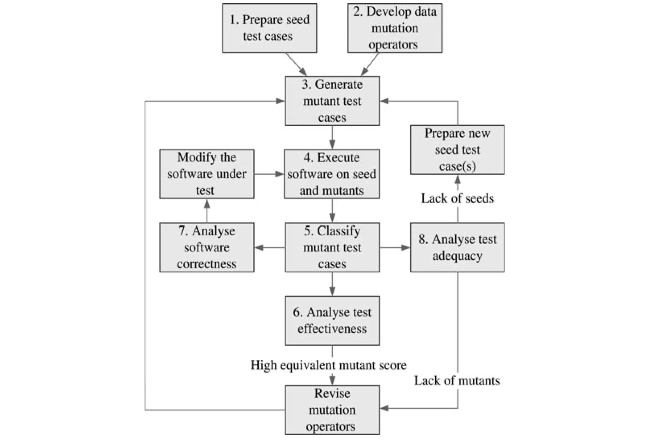
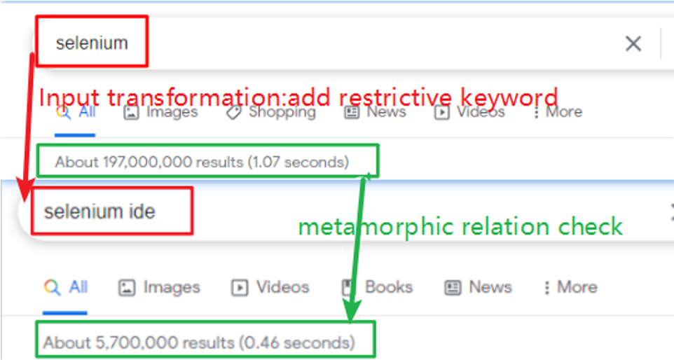
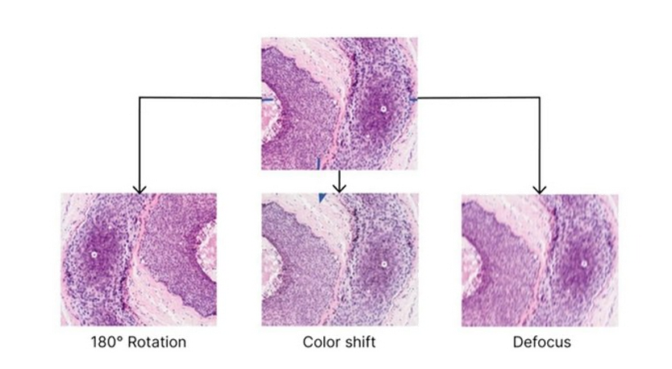
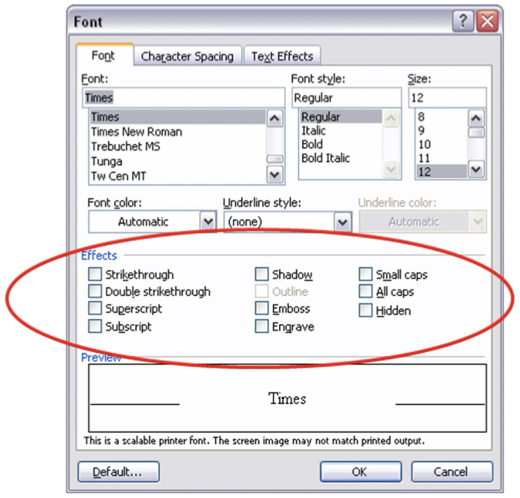
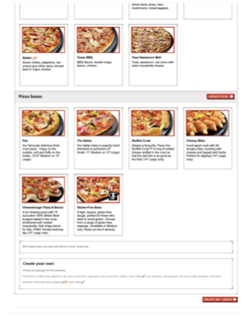
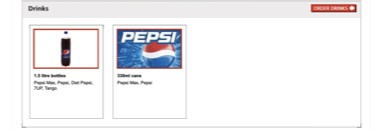

## This Week’s Learning Outcomes

- The theory and techniques of data centric software testing methods:
    - Random testing
    - Data mutation testing
    - Metamorphic testing
    - Combinatorial testing

## Random Testing / Statistical Testing

- Basic idea
    - Select test cases/data (usually only the input) at random in the input space
- Two types of random testing according to the probability distribution for random sampling
    - Representative random testing
        - The random sampling of the input according to the probability distribution that represents the user’s input in the operation of the system
        - Software reliability can be estimated
    - Non-representative random testing
        - The probability distribution is irrelevant to the user’s input 

## RT’s Fault Detection Ability

- Let $\theta$ the *failure* rate of the software (i.e. the probability that the software fails in operation)
- Fault detection ability: the expect number of failures in $n$ tests is $n\theta$
- Reliability estimation
    - If a random test on $n$ test cases fails on $f$ test cases, the failure rate is $\theta=\frac{f}{n}$ as the maximum likelihood.

> **Condition**: *the test cases are sampled in the same probability distribution of the input*

## Partition Testing’s Fault Detection Ability

- Assumptions:
    - The input space is divided into $k>0$ disjoint sub-domains $D_1, D_2, …, D_k$ of size $d_1, d_2, …, d_k$, respectively. 
    - In sub-domain $D_i$, there are $m_i$ input points that causes failure, $i=1,2,…, k$. 
    - $n_i$ test cases are selected at random in sub-domain $D_i, i=1,2,…, k$. 
- Fault detection ability: The expected number of failures: $\sum_{i=1}^{k} n_i \theta_i$

## Data Mutation Testing

【定义】

- Basic ideas
    - Give a set of existing test cases/data as the seeds
    - Modify the test cases/data slightly to make a new test case, which are called mutant test case
    - Execute program on both seed and mutant test cases 
- Key factors of success:
    - How to modify the test cases/data?
    - How to determine if the program is correct on a mutant? 
    - How to measure test adequacy? 
        - Enough seeds have been used?
        - Enough mutants have been generated?

### Process of Data Mutation Testing

#### Example: Triangle Classification

- Input:
    - three natural numbers x, y, z (represents the sides of a triangle)
- The function:
    - to determine if the value of x, y, z form a triangle of
        - equilateral (all sides the same length) or 
        - isosceles (two the same) or 
        - scalene (none the same) or 
        - the input does not represent a triangle (when the sum of two parameters is not greater than the third). 

|  |  |  |
| ---------------------------------------- | ---------------------------------------- | ---------------------------------------- |
| equilateral                              | isosceles                                | scalene                                  |

##### Step 1: Preparation of Seeds

One may design a set of test cases as follows:

- t1:
    - *Input*: (x=5, y=5, z=5),
    - *Expected output*: equilateral.
- t2:
    - *Input*: (x= 5, y = 5, z = 7),
    - *Expected output*: isosceles.
- t3:
    - *Input*: (x=5, y=7, z=9),
    - *Expected output*: scalene.
- t4:
    - *Input*: (x=3, y=5, z=9),
    - *Expected output*: not a triangle.

##### Step 2: Design Data Mutation Operators

- IVP Increase the value of a parameter by 1
- DVP Decrease the value of a parameter by 1
- SPL Set the value of a parameter to a very large number, say 1 000 000
- SPZ Set the value of a parameter to 0
- SPN Set the value of a parameter to a negative number, say -2
- WXY Swap the values of parameters x and y
- WXZ Swap the values of parameters x and z
- WYZ Swap the values of parameters y and z
- RPL Rotate the values of parameters towards left
- RPR Rotate the values of parameters towards right

> *Usually, data mutation operators can be easily implemented as short procedures/methods that read in a set of test data and generate a number of new test data.*

##### Step 3: Generate Mutant Test Data

- Apply every mutation operator to every test data on every possible location
- For example,
    - applying the mutation operator IVP to test case t1 on parameter x, we can obtain the following test case t5.
        - Test case t5: *Input*:(x=6, y=5, z=5).

##### Step 4: Test Executions and Classification of Mutants

- The software under test is executed on the seed test cases as well as their mutant test cases.
    - The outputs and/or other aspects of dynamic behaviour of the software on each test case are observed and recorded.
- The mutants are classified:
    - *Dead*: if the execution of the software under test on the mutant is different from the execution on the seed test case.
    - *Alive*: Otherwise.

##### Step 5: Analyse Test Effectiveness

- Reasons that a mutant remains alive:
    - The mutant is equivalent to the original.
        - For example: applying the RPL mutation operator to test case t1 will produce a test case identical to t1.
    - The observation on the behaviour is weak.
        - For example: applying the RPL operator to test case t2 will produce the following test case.
t6: Input:(x=5, y=7, z=5).
Just to compare the output not sufficient to detect the difference
    - The software is incorrect
        - It is unable to differentiate the mutants from the original even though they are not equivalent.

##### Metrics of Data Mutation

- Equivalent mutant score EMS: $\text{EMS}=\frac{\text{EM}}{\text{TM}}$  where 
    - EM is the number of equivalent mutants
    - TM is the total number of mutants
- High EMS means:
    - Mutation operator failed to generate a wide variety of mutants that are different from the original
    - Low effectiveness of testing
    - Consider revise the mutation operators

##### Step 6: Check Correctness

Test data obtained by an application of a data mutation operator on a test case can often provide additional information for checking software’s correctness

- Example:
    - The test case generated by applying the IVP or DVP to test case t1, we can expect the output to be isosceles.
    - For the RPL, RPR, WXY, WXZ and WYZ mutation operators, we can expect that the program should output the same classification on a seed and its mutant test cases.

### Analysis of Data Mutation Testing

- **Advantages**
    - **Automation**: Generation of a large number of test cases from a small set of seeds can be automated
    - **Applicability**: Applicable to all software, especially for highly complicated input space
    - **Effectiveness**:
        - Test cases are meaningful and representative to real use of the software
        - Can detect both design and implementation errors
- **Problems to be solved**
    - **Automation**: Mutation operators on test data are specific to each application. It requires testers to design and code data mutation operators.
    - **Effectiveness**:
        - Heavily depends on mutation operators => Require knowledge and skill to design good mutation operators
        - Require good seeds

## Metamorphic Testing

- Basic Idea:
    - To use <b><i>metamorphic relations</i></b> as the criteria of program correctness, i.e. as a test oracle
    - To use <b><i>metamorphic relations</i></b> as a test data generation technique
    1. Metamorphic Testing should include multiple execution
    2. we put emphasis on the metamorphic relation between multiple pairs of input/output

> [!IMPORTANT]
> 红字内容会考定义题

> It is capable of partially ensuring correctness, which means that if the program fails a test according to the oracle implies that the program is not correct on the test case.

> Metamorphic Testing (MT) is a software testing technique that is particularly useful in situations where there is no reliable test oracle—when it is difficult or impossible to know what the correct output should be for a given input.

---

- Example: 
    - A relation for a program that computes Sin(x) function must satisfy:

$$x_1 + x_2 = \pi \Rightarrow \sin(x_1) = \sin(x_2)$$

- **Metamorphic Testing: Techniques for determining whether software is flawed by checking whether these <b><i>metamorphic relationships</i></b>[+metamorphic] hold**

[+metamorphic]: A certain relationship between multiple pairs of input/output of the software under test

### Example

Program: computes $f(x)=x^2$

- Initial test: $x=3$ output $f(2)=9$.
- MR: if the input is negated, the output should remain the same, $f(x)=f(−x)$.
- Verification: $f(3)=9, f(−3)=9$ → MR holds → program is correct.

## Metamorphic and Traditional Testing

In traditional software testing, the principle is: given input, observe the output of the software under test, and compare it with the expected output. Defects in the software are determined based on the comparison results.

Traditional testing operates under a fundamental assumption that the expected output of the software is known. However, in many cases, the expected output of the software is either unknown or very difficult to determine.

Metamorphic Testing:
 
1. should include multiple execution
2. put emphasis on the metamorphic relation between multiple pairs of input/output

### Definition: Metamorphic Relation

- $P$: program under test; 
- $D$: input domain;
- $C$: output domain; Techniques for determining whether software is flawed by checking whether these metamorphic relationships hold
- $M$: a relation on $D^K \times C^K, K>0$ is a natural number

$M$ is a $K$-ary <b><i>metamorphic relation</i></b> for program $P$, if $P$ is correct on inputs $x_1, x_2, …, x_K$ implies that the relation $M$ holds for $x_1, x_2, …, x_K, P(x_1), P(x_2), …, P(x_K)$, ie.

$$M(x_1, x_2, …, x_K, P(x_1), P(x_2), …, P(x_K))$$

### Common Metamorphic Relation

- Subsumption relation:  given different key word in search engine 

---

- ***equivalence relation**:* e.g: 1MB=1024KB;

- ***intersection relation**:* find a number $x$, $x>0$ and $x<-1$, The results do not have any intersection

Generating metamorphic relation is very key and difficult in metamorphic testing

<i><b>There is no standard way for generating metamorphic relationships, and it needs to be combined with application scenarios and contexts.</b></i>

#### Example: Using metamorphic relations for medical image testing

**Metamorphic relations are a great way to thoroughly test your ML system.**

**MR:** the classification of a rotated or brightness-adjusted image should remain the same or similar.

---

We’d certainly expect this ML system to work if the input image is rotated by 180 degrees. Shifts in the color intensity of the image should also not change the system output. Neither should slightly out-of-focus samples.

| Specification                                                                                                                   | Test                                                                                                                                                                                                                                                                                                                          |
| ------------------------------------------------------------------------------------------------------------------------------- | ----------------------------------------------------------------------------------------------------------------------------------------------------------------------------------------------------------------------------------------------------------------------------------------------------------------------------- |
| The ML model must be robust to:<ul><li>Defocus during image capture.</li><li>Rotations of 180°.</li><li>Color shifts.</li></ul> | <ol><li>Evaluate the model on a test image.</li><li>Augment the test image by:<ul><li>blurring the image to simulate de-focus</li><li>rotating the image</li><li>shifting the colors</li></ul></li><li>Evaluate the model on the augmented image.</li><li>Assert that the model output of both images is identical.</li></ol> |

### Mutational Metamorphic Testing

It is a combination of Data mutation testing and metamorphic testing techniques

- Observation:

The metamorphic relation

$$x_1 + x_2 = \pi \Rightarrow \sin(x_1) = \sin(x_2)$$

can be equivalently represented as follows:

$$\sin(x) = \sin( \pi - x)$$

where $\pi - x$ can be considered as a data mutation operator.

- Using data mutation operators, many metamorphic relations can be represented in the following form:

$$V(x_1,\dots,x_k) \Rightarrow R(P(x_1),\dots,P(x_k),P(f(x_1,\dots,x_k)))$$

#### Definition: Mutational Metamorphic Relations

Let $P$ be the program under test, $D$ and $C$ be its input domain and output codomain, respectively. Let $f$ be a $K$-ary data mutation operator on $D$ with applicability condition $V(x_1, \dots, x_K)$ and location parameter $L$. A $K$-ary mutational metamorphic relation derived from the data mutation operator $f$ is a relation $R$ on $C^{(K+1)}$ such that the program $P$ is correct on inputs $x_1, \dots, x_{K+1} \in D$ and $f$ is applicable on $x_1, \dots, x_K$ imply that $R(P(x_1), \dots, P(x_{K+1}))$, where $\exists l \in L.,(x_{K+1} = f(x_1, \dots, x_K, l))$. $\square$

#### Example: Triangle Classification

- Data mutation operators as defined before
- The mutational metamorphic relations
    - $P(t) = Equilateral \Rightarrow P(IVP(t)) = Isosceles \vee P(IVP(t)) = nonTriangle$
    - $P(t) = Equilateral \Rightarrow P(DVP(t)) = Isosceles \vee P(DVP(t)) = nonTriangle$
    - $P(t) = Scalene \Rightarrow P(IVP(t)) \neq Equilateral$
    - $P(t) = Scalene \Rightarrow P(DVP(t)) \neq Equilateral$
    - $P(SPZ(t)) = nonTriangle$
    - $P(SPN(t)) = nonTriangle$
    - $P(t) = P(WXY(t))$
    - $P(t) = P(WXZ(t))$
    - $P(t) = P(WUZ(t))$
    - $P(t) = P(RPL(t))$
    - $P(t) = P(RPR(t))$

### Mutational Metamorphic Testing Process

1. Generating a set of test cases that comprise of valid inputs to the program as seeds
2. For each $k$-ary data mutation operator $f$, select $k$ seed test cases $x_1, \dots, x_k$, finding parameters $l\in L$ such that $f$ is applicable to these test cases with parameter $l$
3. Applying data mutation operator $f$ on the test cases $x_1, \dots, x_k$ with parameter $l$ to generate a mutant test case $x_{k+1}=f(x_1, \dots, x_k, l)$.
4. Executing program $P$ on all test data $x_1, \dots, x_{k+1}$, and record the outputs $P(x_1), \dots, P(x_k), P(x_{k+1})$.
5. Checking whether the correctness condition below is satisfied or not:

$$R(P(x_1), \dots, P(x_K), P(x_{K+1})).$$

If not, a bug in the program is detected.

## Combinatorial Testing

- Motivation
    - Software often have a large number of inputs
        - Huge number of test cases if all combinations of the inputs are to be covered
    - Software faults are usually associated to certain combinations of input on a small number of input variables and independent to the input on other variables
        - Most combinations are redundant, i.e. ineffective to detect faults
- Basic idea
    - Pairwise testing: 
        - Tests all pairs (2-way combinations) of variable values 
        - Pairwise testing finds about 50% to 90% of faults
    - More general:  (k-way combinations)
        - For many applications, empirical study shows that the maximum interactions for fault triggering was 6 (it is relatively small in comparison to the number of inputs)

#### Example

- 10 checkboxes
- Each checkbox has two choices: on and off
- Requires $2^{10} = 1024$ test cases to cover all combinations of these checkboxes

### The Testing Method

- **Assumptions**
    - The software under test has $N$ input variables $x_1, x_2, \dots, x_N$.
    - For input variable $x_i$, the valid input are in the set $D_i$, and there are $n_i$ different values in $D_i$, $i=1, 2, \dots, N$.
    - A test case $t$ is $\langle a_1, a_2, \dots, a_N \rangle$, where $a_i$ is in $D_i$, and we write $(t[i])$ for $a_i$, $i = 1, 2, \dots, N$.
- **Definition**: (2-way combination adequacy)  A set $T$ of test cases satisfies the 2-way combination adequacy (or pairwise combination adequacy), if for every pair of variables $x_i, x_j$, $i\neq j$, and every pair $(a, b)$ of values in $D_i$ and $D_j$ respectively, there is a test case $t$ in $T$ such that $t[i]=a$ and $t[j]=b$.

#### Example : Pizza Hut

|  |  |
| ---------------------------------------- | ---------------------------------------- |

- Variables:
    - Pizza sizes: 3 choices
    - Pizza toppings: 19 choices
    - Pizza base: 6 choices

|  |  |
| -------------------------------------------------------------------------------- | -------------------------------------------------------------------------------- |

- Variables:
    - Classic sides: 6 choices
    - Premium sides: 7 choices
    - Dips: 1 choice 
    - Hot desserts: 4 choices
    - Cold desserts: 4 choices
    - Drinks: 2 choices

> Total number of combinations: $3 \times 19 \times 6 \times 6 \times 7 \times 1 \times 4 \times 4 \times 2 = 114912$

## Summary

- Common features of data centric testing methods:
    - Use little knowledge of the function and code 
    - Focus on the automatic generation of test data
        - Random testing: at random
        - Data mutation (fuzzy): using mutation operators
        - Combinatorial: combinations of values 
- Require knowledge about software’s input space, and sometimes the usage of the system
    - *Random testing*: the domain of the input + probability distribution
    - *Data mutation testing*: how could vary and how the variation of data will effect system’s behaviour
    - *Combinatorial testing*: the variables, their values, and the independence between them 

<video controls>
  <source src="https://vle.zycdut.net/sites/student.zy.cdut.edu.cn/files/attachments/hustef-2022-matthias-hamburg-metamorphic-testing.mp4" type="video/mp4" />
  

    你的浏览器不支持 HTML5 视频。这里有一个<a
      href="https://vle.zycdut.net/sites/student.zy.cdut.edu.cn/files/attachments/hustef-2022-matthias-hamburg-metamorphic-testing.mp4"
      download="hustef-2022-matthias-hamburg-metamorphic-testing.mp4"
      >视频</a
    >链接。
  

</video>

Source: [chc6072-lecture7.pptx](https://view.officeapps.live.com/op/view.aspx?src=https%3A%2F%2Fvle.zycdut.net%2Fsites%2Fstudent.zy.cdut.edu.cn%2Ffiles%2Fattachments%2Fchc6072-lecture7_4.pptx&wdOrigin=BROWSELINK)
