---
title: "Practical 7: More on Automated Testing with Selenium Web Driver"
published: 2026-11-19
publishedAt: 2026-11-19T11:05:00+08:00
description: "Setting-Up of the JUnit and Hamcrest Libraries, use Web Driver in Java to write More Test Scripts."
image: "./144098499.jpg"
tags: ["Selenium IDE"]
category: "Software Analysis and Testing"
draft: false
pinned: false
lang: en
---# 

## Task 1: Install JUnit plug-in and package

Here we explore two ways to set up these JUnit and Hamcrest-Core Libraries.

1. Install JUnit plug-in  and package
    - Check whether your IDEA has the JUnit plug-in installed (Click Settings button, see below picture)

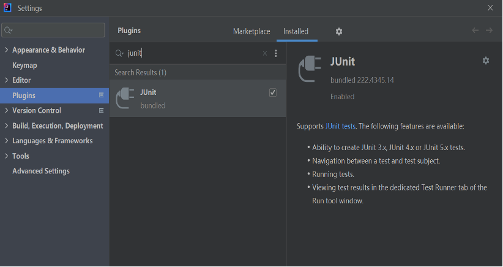

2. Install JUnit jar package
    - Download JUnit jar package https://github.com/junit-team/junit4/wiki/Download-and-Install

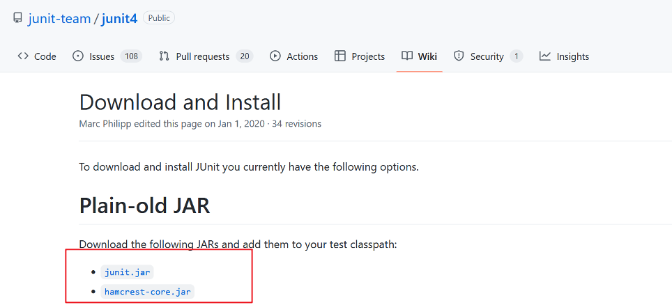
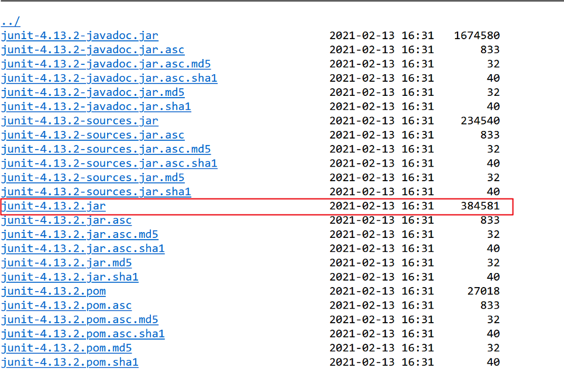

- Add `junit.jar` and `hamcrest-core.jar` to your project path

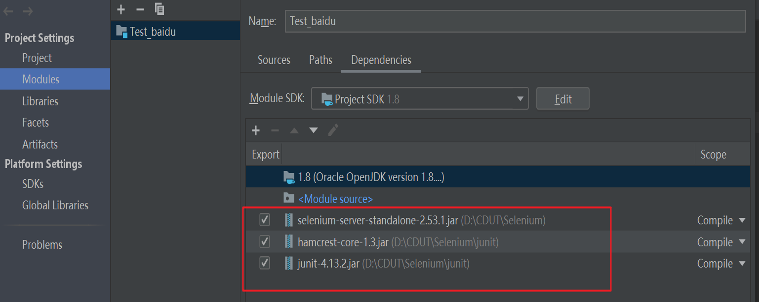

3. Setup testing environment.
    - Create a folder in your file system as your project’s workspace location, say, `/project/Practical7`.
    - Copy the Java program to be tested to the folder in your project workspace. The program that we are going to use for this practical is in the file `Arithmatics.java`
4. Create a new Java project
    - Start IDEA.
    - In the IDEA window, click on the **File** menu, select **New**, then select **Project**. See screen snapshot below.

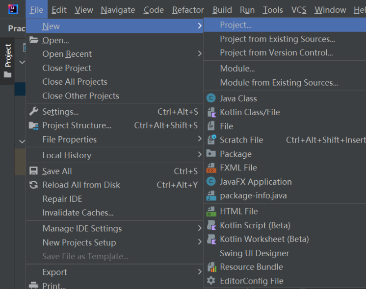

- The following **Create a Java Project** window will display.

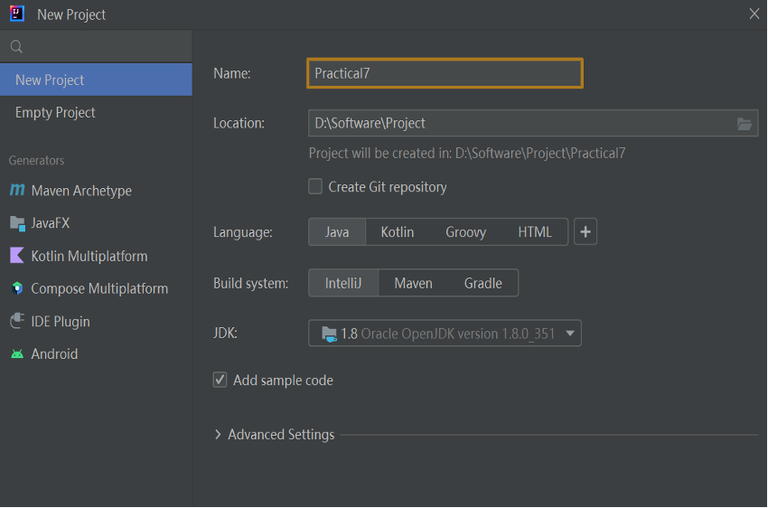

- Enter a project name, say “**Practical7**”.
- Click the **Finish** button; the new project will show in the IDEA package explore list. See screen snapshot below. You should be able to see the Java program file in the package.

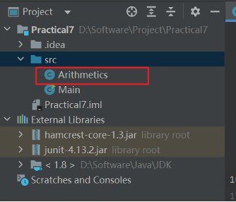

- Double Click on the Arithmetics.java item to load it into the window. See screen snapshot below.

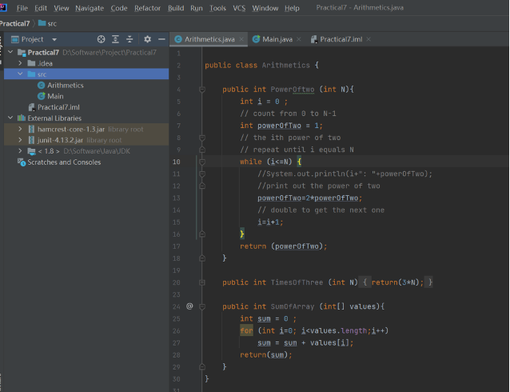

You are now ready to develop your test code in JUnit.

5. Create a JUnit test class.
    - Right click on your code page and select “Generate” and “Test” (See below picture)

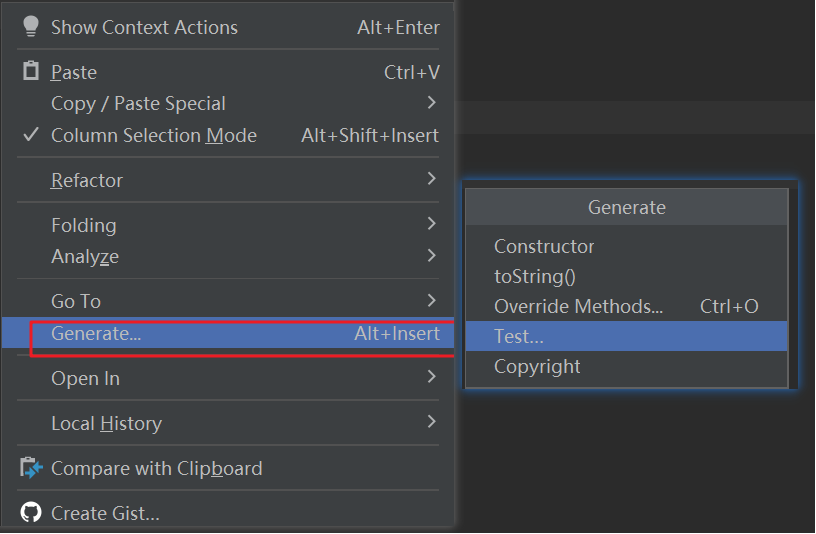

- The following window will pop up.(Note: Please check setup/@Before and so on, see below picture)

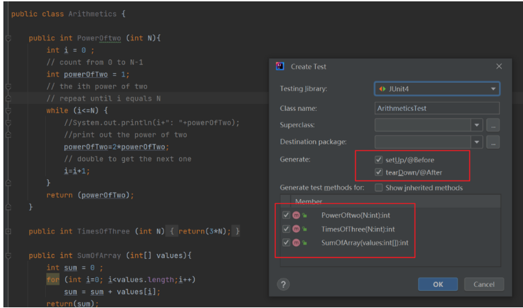

- Generate automatically `ArithmeticsTest` and make sure the class under test is correct,
- A new class will created and included in the package of your project. It will also be loaded to the IDEA window. See the screen snapshot below.

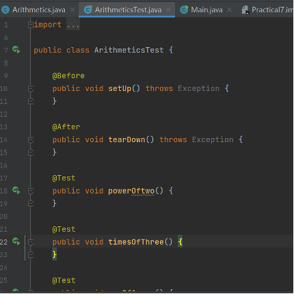

6. Write test case code.
    - We now add code to the `test()` method. Our goal is to test the `SumOfArray` method. The first step is to generate test data. We will generate an ***array of* 10 *elements*** that each element’s ***value is*** **2**. The expected result is therefore **20**. The following is the pseudo code of the test case.
        1. Declare an array variable called `testData` of 10 integers to store the test input data;
        2. Declare a variable `testResult` of integer for store the result;
        3. For each element of the array `testData` do Assign the value of 2
        4. Call method `SumOfArray` with `testData` as the actual parameter and assign the return value to `testResult`;
        5. Check if `testResult` equals to 20, i.e. the expected result.
    - Implement the above pseudo code in Java and enter the code to Eclipse. The following is my attempt. Please do not look at it before you finish your own coding 

## Task 2 Setting-Up of the JUnit and Hamcrest Libraries by Using the Maven Build System

Copy the dependency codes from the official website of JUnit and Hamcrest-core. Specify these dependencies in the project’s `pom.xml` file. See an example in the image below:

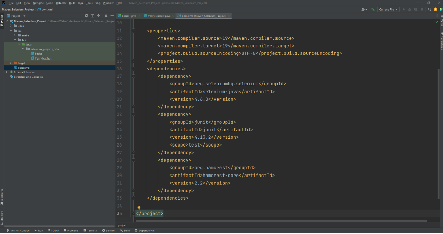

> [!TIP]
> JUnit 需要使用 4.x 版本，“Hamcrest Core” 已弃用，需使用 “Hamcrest” 来代替

```xml title="pom.xml"
<?xml version="1.0" encoding="UTF-8"?>
<project xmlns="http://maven.apache.org/POM/4.0.0"
         xmlns:xsi="http://www.w3.org/2001/XMLSchema-instance"
         xsi:schemaLocation="http://maven.apache.org/POM/4.0.0 http://maven.apache.org/xsd/maven-4.0.0.xsd">
    <modelVersion>4.0.0</modelVersion>

    <groupId>dev.selenium</groupId>
    <artifactId>selenium-examples</artifactId>
    <version>1.0.0</version>

    <properties>
        <surefire.parallel>1</surefire.parallel>
        <maven.compiler.source>17</maven.compiler.source>
        <maven.compiler.target>17</maven.compiler.target>
        <project.build.sourceEncoding>UTF-8</project.build.sourceEncoding>
        <selenium.version>4.52.0</selenium.version>
    </properties>

    <repositories>
        <repository>
            <name>Central Portal Snapshots</name>
            <id>central-portal-snapshots</id>
            <url>https://central.sonatype.com/repository/maven-snapshots/</url>
            <releases>
                <enabled>false</enabled>
            </releases>
            <snapshots>
                <enabled>true</enabled>
            </snapshots>
        </repository>
    </repositories>

    <dependencies>
        <dependency>
            <groupId>org.seleniumhq.selenium</groupId>
            <artifactId>selenium-java</artifactId>
            <version>${selenium.version}</version>
        </dependency>
        <dependency>
            <groupId>org.seleniumhq.selenium</groupId>
            <artifactId>selenium-grid</artifactId>
            <version>${selenium.version}</version>
        </dependency>
        <dependency>
            <groupId>org.junit.jupiter</groupId>
            <artifactId>junit-jupiter-engine</artifactId>
            <version>6.1.3</version>
            <scope>test</scope>
        </dependency>
        <dependency>
            <groupId>com.titusfortner</groupId>
            <artifactId>selenium-logger</artifactId>
            <version>2.4.0</version>
            <scope>test</scope>
        </dependency>
        <!-- Source: https://mvnrepository.com/artifact/junit/junit -->
        <dependency>
            <groupId>junit</groupId>
            <artifactId>junit</artifactId>
            <version>4.13.2</version>
            <scope>test</scope>
        </dependency>
        <!-- Source: https://mvnrepository.com/artifact/org.hamcrest/hamcrest -->
        <dependency>
            <groupId>org.hamcrest</groupId>
            <artifactId>hamcrest</artifactId>
            <version>3.0</version>
            <scope>test</scope>
        </dependency>
    </dependencies>

    <build>
        <plugins>
            <plugin>
                <groupId>org.apache.maven.plugins</groupId>
                <artifactId>maven-surefire-plugin</artifactId>
                <version>3.6.1</version>
                <configuration>
                    <properties>
                        <configurationParameters>
                            junit.jupiter.execution.parallel.enabled = true
                            junit.jupiter.execution.parallel.mode.default = concurrent
                            junit.jupiter.execution.parallel.config.strategy = fixed
                            junit.jupiter.execution.parallel.config.fixed.parallelism = ${surefire.parallel}
                            junit.jupiter.execution.parallel.config.fixed.max-pool-size = ${surefire.parallel}
                        </configurationParameters>
                    </properties>
                    <rerunFailingTestsCount>3</rerunFailingTestsCount>
                </configuration>
            </plugin>
        </plugins>
    </build>
</project>
```

Execute the exported test script. If there are errors, fix them by writing appropriate test scripts to replace the error-prone code.

## Task 3: Use Web Driver in Java to write More Test Scripts

**Key points to note when writing Test Scripts Selenium WebDriver:**

- To start using the WebDriver API, you must import at least these two packages.
    - `org.openqa.selenium.*`
    - `org.openqa.selenium.firefox.FirefoxDriver` <span style="color: red">(Chrome Driver, MSE Driver etc can also be adopted)</span>
- The `get()` method is the equivalent of Selenium IDE’s “open” command.
- Locating elements in WebDriver is done by using the `findElement()` method.
- The following are the available options for locating elements in WebDriver:
    - By.className
    - By.cssSelector
    - By.id
    - By.linkText
    - By.name
    - By.partialLinkText
    - By.tagName
    - By.xpath
- The `By.cssSelector()` **does not** support the “**contains**” feature.
- You can instantiate an element using the `WebElement` interface.
- Clicking on an element is done by using the `click()` method.
- WebDriver provides these useful **get commands**:
    - `get()`
    - `getTitle()`
    - `getPageSource()`
    - `getCurrentUrl()`
    - `getText()`
- WebDriver provides these useful **navigation commands**
    - `navigate().forward()`
    - `navigate().back()`
    - `navigate().to()`
    - `navigate().refresh()`
- The `close()` and `quit()` methods are used to close browser windows. `Close()` is used to close a single window; while `quit()` is used to close all windows associated to the parent window that the WebDriver object was controlling.
- The `switchTo().frame()` and `switchTo().alert()` methods are used to direct WebDriver’s focus onto a frame or alert, respectively.
- **Implicit waits** are used to set the waiting time throughout the program, while **explicit waits** are used only on specific portions.
- You can use the `isEnabled()`, `isDisplayed()`, `isSelected()`, and a combination of `WebDriverWait` and `ExpectedConditions` methods when verifying the state of an element. However, they do not verify if the element does not exists.
- When `isEnabled()`, `isDisplayed()`, or `isSelected()` was called while the element was not existing, WebDriver will throw a `NoSuchElementException`.
- When WebDriverWait and ExpectedConditions methods were called while the element was not existing, WebDriver would throw a `TimeoutException`. 

**Note:**

`driver.get()`: It’s used to go to the particular website, but it doesn’t maintain the browser History and cookies so, we can’t use forward and backward button, if we click on that, page will not get scheduled.

`driver.navigate()`: it’s used to go to the particular website, but it maintains the browser history and cookies, so we can use forward and backward button to navigate between the pages during the coding of Testcase

Source: [chc6072-pract7.docx](https://view.officeapps.live.com/op/view.aspx?src=https%3A%2F%2Fvle.zycdut.net%2Fsites%2Fstudent.zy.cdut.edu.cn%2Ffiles%2Fattachments%2Fchc6072-pract7_4.docx&wdOrigin=BROWSELINK)
