## Today’s Learning Outcomes

1. Basic concepts of SE project management
    - The aspects of project management
    - The means of project management
    - Risk management
    - Types of risks
2. Risk management activities
    - Risk assessment method
3. Project planning
    - Planning activities
    - Project plan models

## 1. Basics of Project Management

- The aspects: what to be managed
- The means: how to manage

### The Aspects

- Resource
    - Human resources
    - Tools (hardware and software)
    - Data 
    - External components
    - External services
- Asset
    - Products
    - Intermediate results 
    - Goals and objectives
- Risk
    - Probability of occurrence
    - Consequences 
- Process
    - Overall model
    - Mechanisms
- Users and market
    - User feedback channels
    - Product ecosystem

> Product management  
> Quality management  
> Configuration management  
> - Change management  
> - Builds and baseline  
> Risk management

### The Means

- **Planning**
    - Schedule (time)
    - Resource allocation
    - Definition of progress and milestones
- **Monitoring**
    - Qualitative
    - Quantitative (metrics)
- **Facilitating**
    - Staff training
    - Subcontracting
    - Purchasing external resources (e.g. open source and COST)
    - Installation of tools
- **Decision making**
    - Organizational structure
    - Responsibility
    - Procedures
    - Mechanisms

## 2. Risk Management

- The cause of risks
- Classification of risks
- Risk management activities
- Risk assessment method

### Risks and Uncertainty

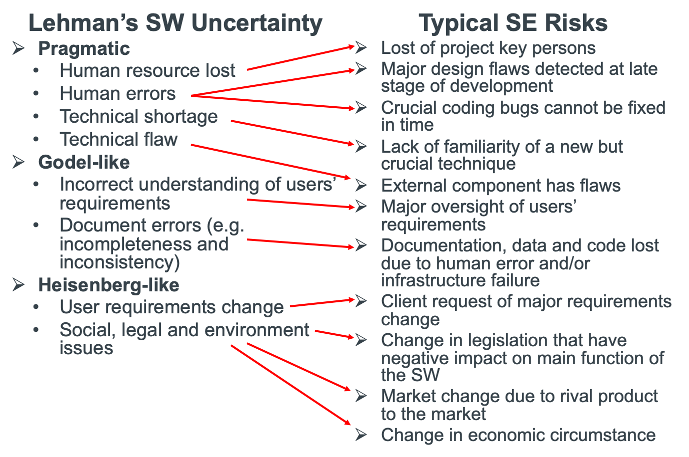

### Classification of SE Risks

- Project risks
    - Risks that affect the project schedule and resources
    - Example: The loss of an experienced designer
- Product risks
    - Risks that affect the quality and/or performance of the software being developed
    - Example: A purchased component fails to perform as expected
- Business risks
    - Risks that affect the organization developing or procuring the software
    - Example: A competitor introduces a new product

> Risk types overlap:  
> - One risk may have impacts on more than one aspects  
> Example:  
> - Requirements change may have impact on both project schedule and product quality

### Risk Management Activities

- Risk identification
    - To identify the possible risks to the project, product and business
- Risk analysis/assessment
    - To assess the likelihood and consequences of identified risks
- Risk planning
    - To address the identified risks (especially the high risky ones) 
        - Avoiding and preventing the occurrence
        - Minimizing the impact
- Risk monitoring 
    - To regularly re-assess the risks and to revise risk plans

### Risk Identification

Systematic search for potential hazard to the project, product and the business
- What-if hazard analysis: 
    - Asking what-if questions for what might happen and what are the consequences
- Failure-mode analysis: 
    - Borrow other project’s and previous projects’ knowledge and experiences as common failure modes of the project
    - Examples of common failure modes:
        - Technology failures: e.g. key technology failed to perform as expected
        - People failures: e.g. loss of key developers
        - Organisational failure: e.g. organisation restructuring 
        - Tool failure: e.g. compiler bugs, code repository crashes, 
        - Requirements issues: e.g. frequent change of user requirements; 
        - Cost estimation failure: e.g. underestimated development cost; 
        - Planning failure: e.g. underestimated the time need to finish a key task

### Risk Assessment Chart

## 3. Project Planning

- Planning activities
- Plan models/documents 

### SE Project Planning Activities

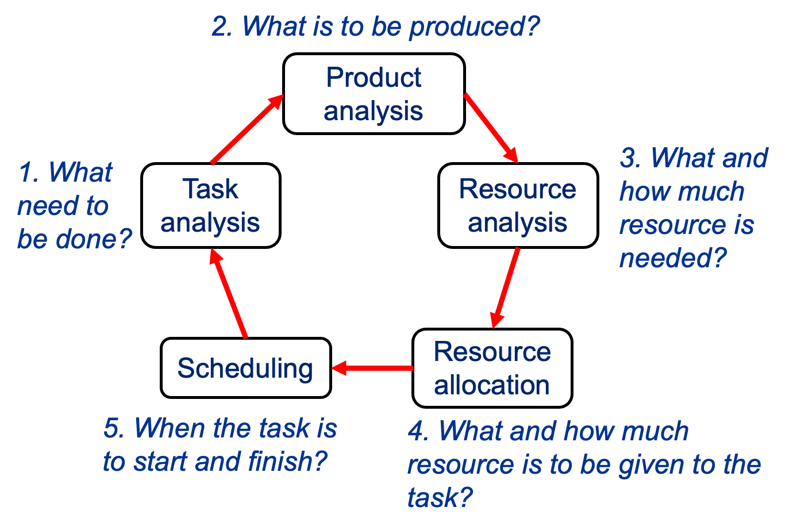

#### SE Project Planning Activities (1)

- Task analysis:
    - To identify the tasks to be performed in the project
    - To decompose each task to sub-tasks of manageable sizes
    - To determine the dependence relationships among tasks/subtasks
- Product analysis
    - To decompose the product (including intermediate products) into components of manageable sizes
    - To determine the interdependence relationships between components

#### SE Project Planning Activities (2)

- Resource analysis
    - To identify the relationships between tasks/activities and product components
    - To understand the technical requirements on each component (e.g. programming for Mac, Oracle database)
    - To determine the required resources for each task (e.g. cost in terms of man-month)
- Resource allocation
    - To allocate resources to each task (e.g. who is doing what)
- Scheduling
    - To determine when a task is to be started
    - To determine when a task is to be finished
    - To calculate when the project is going to finish

### Task Decomposition

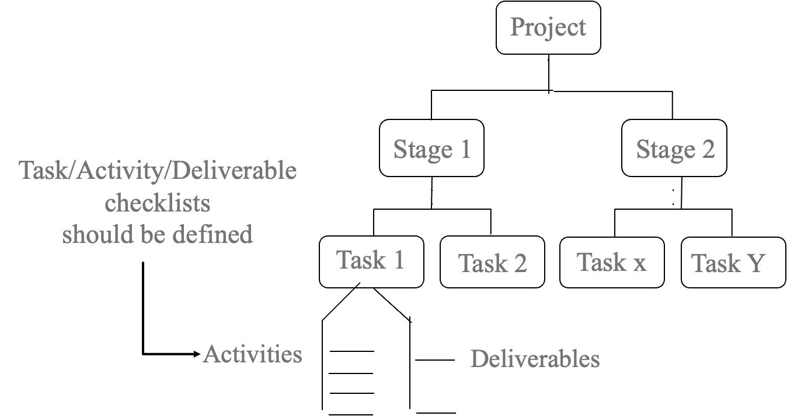

#### Work Breakdown Structure (1)

- A. Development tasks
    1. Requirements analysis
        - Requirements elicitation
        - Requirements definition
        - Modeling of required system
    2. Architectural design
    3. Detailed design
    4. Coding
    5. Integration
    6. Deployment
    7. Acceptance testing

#### Work Breakdown Structure (2)

- B. Quality assurance tasks
    1. Test planning
        - a. Static test plan
            1. Requirements definition formal review
            2. Software model formal review
            3. Architectural design formal review
            4. Code review
        - b. Dynamic test plan
            1. Unit test plan
            2. Integration test plan
            3. Performers test plan
            4. User acceptance test plan 
    2. Test case design
    3. Test data preparation
    4. Testing

#### Work Breakdown Structure (3)

- C. Management tasks
    1. Set up management procedure and mechanism
    2. Set up development team and organizational structure
    3. Set up management infrastructure
        - Set up configuration management platform (GitHub)
        - Set up project communication platform
        - Set up project documentation platform (web portal)
    4. Development of project plan
    5. Monitoring development process
    6. Staff training
    7. Staff recruitment

#### How to decompose a project into tasks

- Each task should be an indivisible units of work for one person
- Rules of thumb
    - Nothing less than a day is a task
    - Anything more than a week is at least two tasks
        - Longer tasks harder to estimate
    - A task is one logical piece 
        - A task should not work on two or more irrelevant products

### Product Decomposition

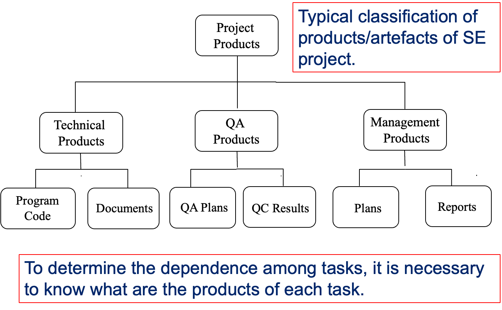

### Relations between Tasks and Products

Need to identify which task/activity contributes to which product

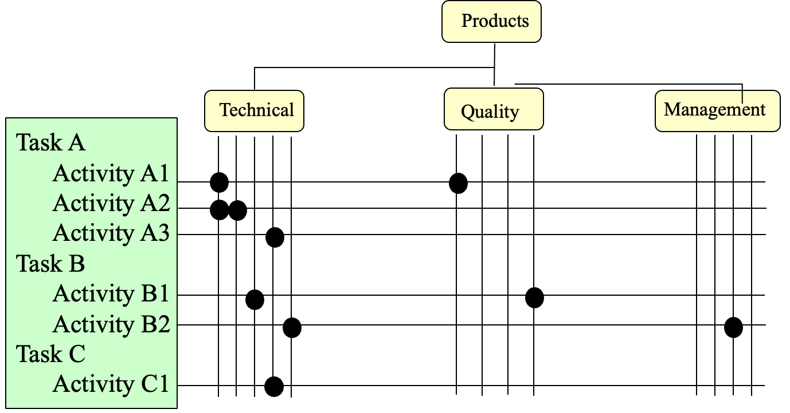

### Identification of Task Dependences

*Task A depends on task B, if and only if task A needs the results of task B.*

### Task Duration Estimates

- Each task requires a duration (time required for the work to complete) to be estimated.  
- Make three estimates for each activity:
    - Optimistic time: the best time possible for completing the activity
    - Pessimistic time: worst possible time
    - Most likely time: the expected time
- Use these three estimates to calculate a weighted (best estimate) mean using the following formula:
 
$$\text{Time} = \frac{\text{Optimistic Time} + 4 \times \text{Most Likely Time} + \text{Pessimistic Time}}{6} $$

### Estimating Task Durations

- Estimate again after assigning tasks to individuals and allocated resources
- Let individuals estimate time for their own tasks
    - They know their own abilities best
    - Genuine commitment to their own promises (sense of responsibility)
- Apply fudge factor 
    - People generally underestimate what is required
    - Allows for the unexpected problems
    - Fudge factor could as large as 2 times
    - Adjust your fudge factor according to the individual

### PERT Chart: Notation

**Arc**: Activity / Task  
**Node**: Event / Milestone

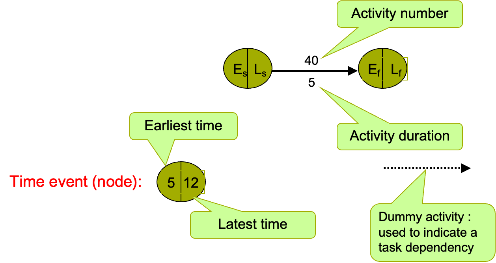

> PERT “Program Evaluation and Review Technique” U.S. Navy, 1957  
> PERT is also called CPM (Critical Path Method)

#### Example: (1) Results of Task Analysis

| ACTIVITY                    | DURATION (Weeks) | DEPENDS ON  |
| --------------------------- | ---------------- | ----------- |
| 10 Architectural Design     | 2                |             |
| 15 Install open source code | 6                |             |
| 20 Test open source code    | 9                | 15          |
| 25 Test infrastructure      | 2                | 20          |
| 30 Install database system  | 3                | 10          |
| 40 Create data files        | 5                | 30          |
| 50 Write operation manual   | 3                | 40          |
| 60 Write Program Specs      | 3                | 10          |
| 70 Construct Programs       | 12               | 60          |
| 80 Integration test         | 5                | 25, 70, 40  |
| 90 Acceptance test          | 2                | 10          |
| 100 User training           | 6                | 90          |
| 110 Handover                | 2                | 100, 80, 50 |

#### Example: (2) Construction of PERT Chart

> Draw a Pert chart network diagram  
> - Activities as arcs (add dummy arcs when necessary)  
> - Milestones/event as nodes  

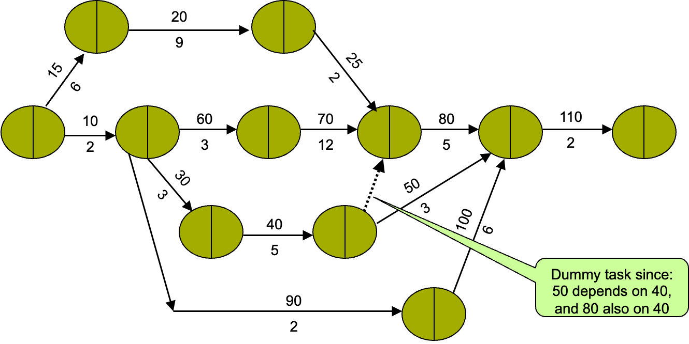

##### Dummy Activity (1)

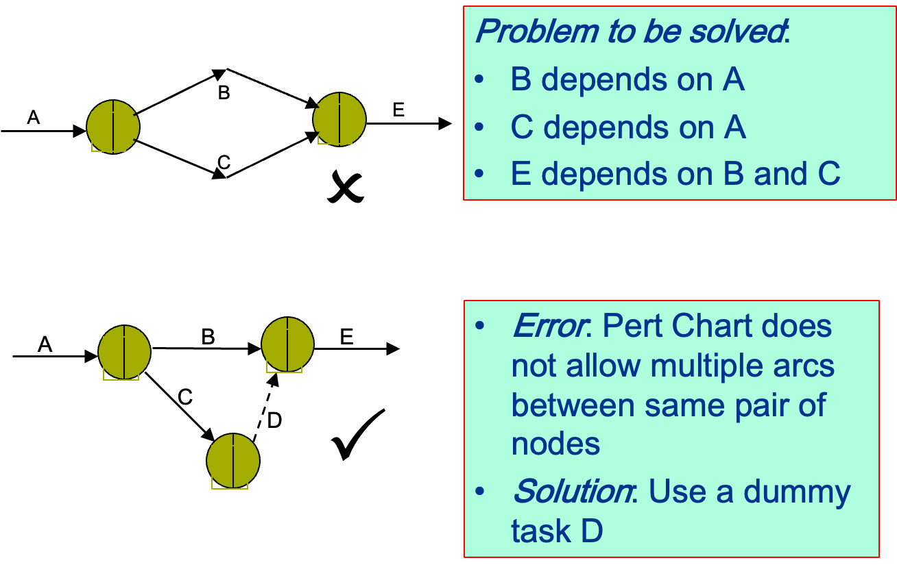

##### Dummy Activity (2)

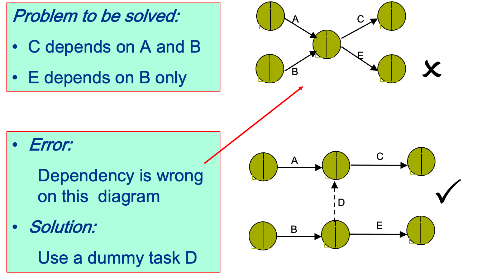

#### Example: (3) Calculation of earliest start times

> Forward pass:  
> - Work from left to right to determine task earliest start times  

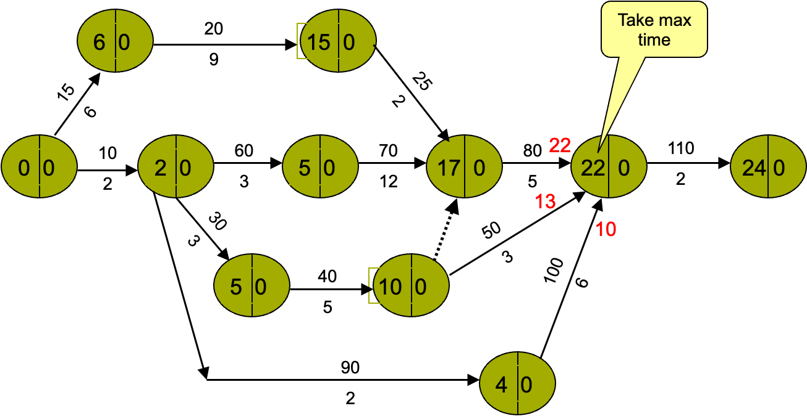

#### Example: (4) Calculation of latest finish times

> Backward pass:  
> - Work from right to left to determine task latest start and finish times  

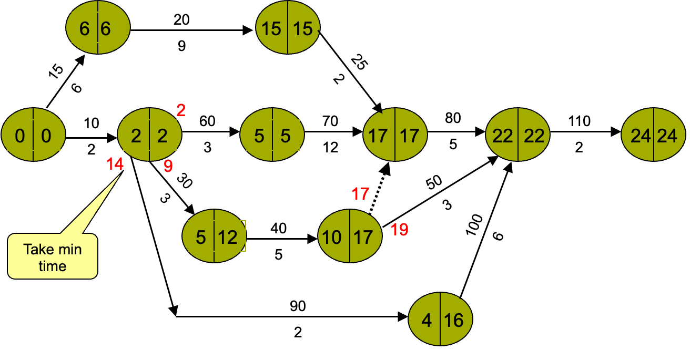

#### Example: (5) Identifying critical path

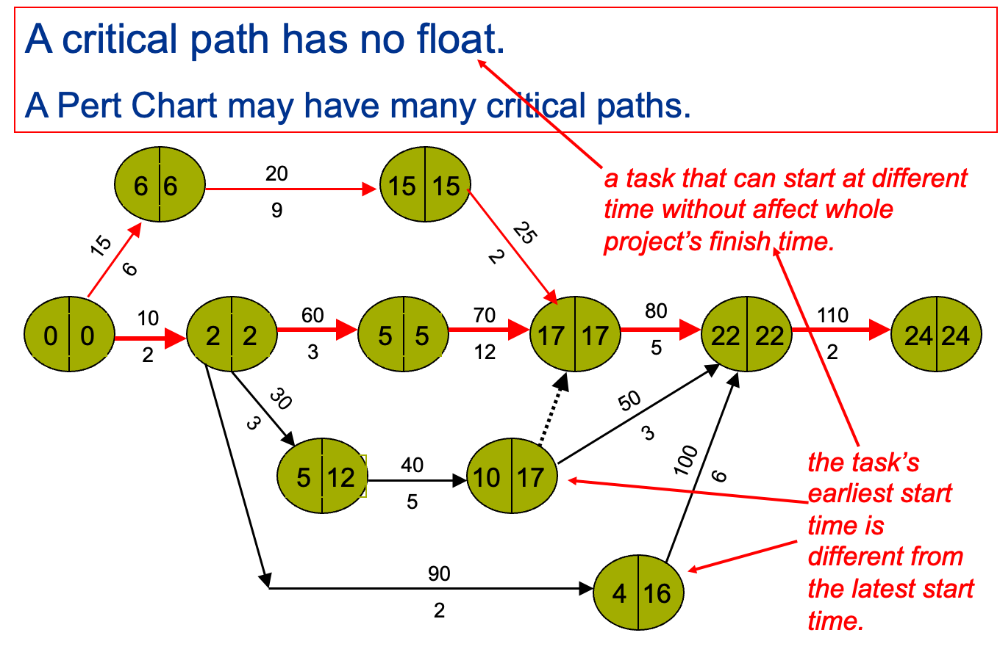

### Gantt chart: Notation

> Gantt, H.L. (1910). "Work, Wages and Profit". [*Engineering Magazine*](https://en.wikipedia.org/wiki/Engineering_Magazine). New York.

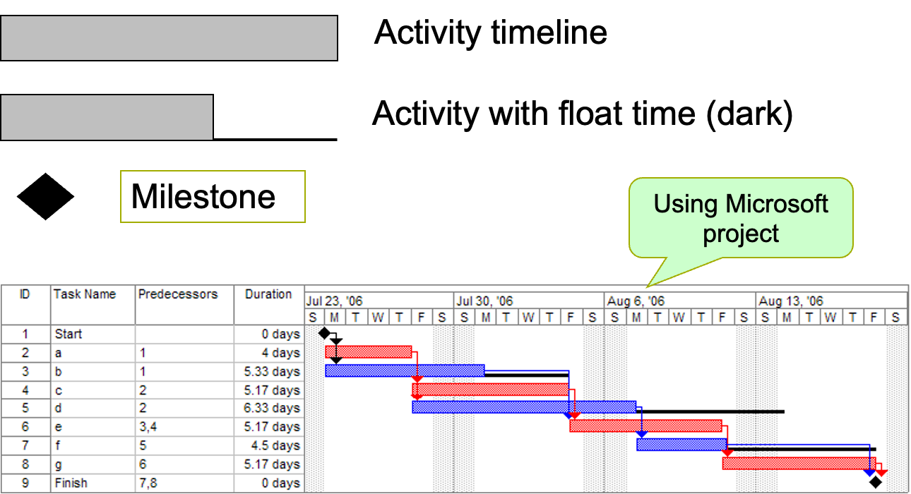

#### Gantt Chart with Summary and Milestones

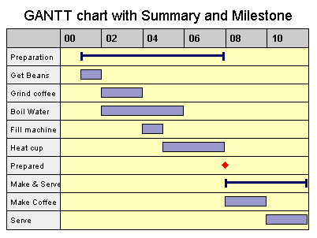

#### Other Uses of Gantt Chart

Staff Workload

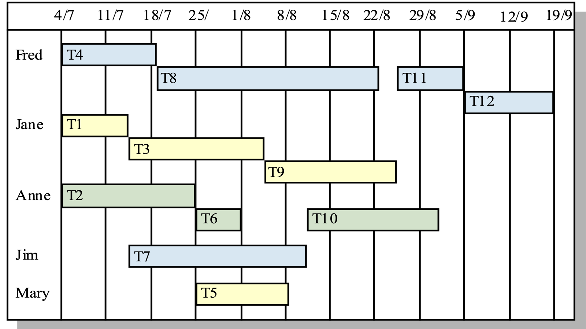

## Summary

- Basics of software project management 
    - The aspects: what to be managed
    - The means: how to manage
- Key techniques of software project management
    - Risk management
        - The notion of risk and types of risks
        - Activities and processes
            - Risk identification, risk planning, risk assessment, risk monitoring, 
    - Project planning 
        - Activities and processes: 
            - Task analysis: identification and decomposition
            - Product analysis: decomposition and relating to tasks
            - Resource analysis: estimation of resource requirements
            - Resource allocation and scheduling:
        - Techniques:
            - Pert chart, Gantt chart

## Further Readings

- Sommerville, I., *Software Engineering*, 9th Eds. 2011, Pearson. 
    - Chapter 22: Project Management
    - Chapter 23: Project planning
    - Chapter 25: Configuration management
- Pressman, R. S., and Ince, D. *Software Engineering: A Practitioner’s Approach*, 5th Eds. McGraw Hill. 
    - Chapter 5: Software Project Planning
    - Chapter 6: Risk Analysis and Management
    - Chapter 7: Project Scheduling and Tracking

Source: 
<a href="/obu/level6/software-engineering/week2/CHC6173-2021-Lecture%202%20-%20Project%20Management.pptx" class="office-preview">
  CHC6173-2021-Lecture 2 - Project Management.pptx
</a>

