## This Week’s Learning Outcomes

*[RE]: Requirement Engineering

Part 1: Basic Concepts of Requirements Engineering
- The importance of RE
- The nature of RE
- The types and aspects of requirements
- The process of RE
Part 2: Requirements Elicitation Techniques
- Main techniques of requirements elicitation
- Understand their strengths and weaknesses, and conditions of uses
Part 3: Requirements Documentation
- Documentation skills and techniques
- Document structures

## Part 1 Basic Concepts of Requirements Engineering

### What is Requirements Engineering

Requirements engineering is about *discovery*, *understanding*, *formulation* [+formulation], *analysis* and *obtaining agreement* on *what* problem should be solved, *why* such a problem needs to be solved [+solved], and *who* should be involved in the responsibility of solving that problem.  
(Lamsweerder, 2010; p3)

[+formulation]: The types of activities involved in RE

[+solved]: The goals of the activities

### Why RE is important

- Good understanding of the requirements is necessary for developing a solid system
- Requirements affect all phases of SD.
- It is cheaper to fix problems if they are found earlier
- RE is "The hardest single part of building a software system”

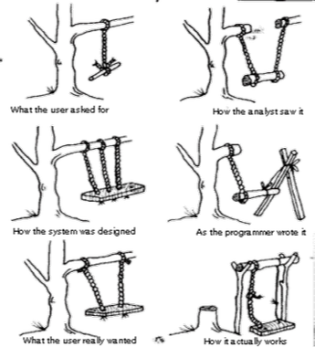

> Frederick P. Brooks, 1987, "No Silver Bullet: essence and accidents of software engineering ", IEEE Computer

### The Nature of RE (1)

- The aim of a project is to improve the world by building some machine expected to solve a specific problem
- RE is concerned with the machine’s effect on the surrounding world.

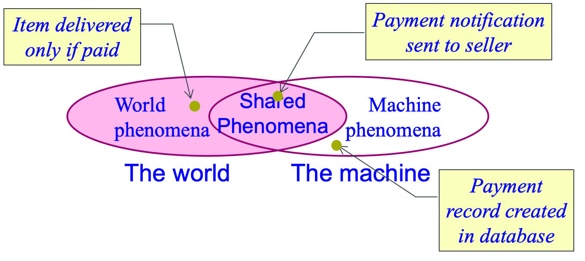

<i>The shared phenomena define the interface through which the machine interacts with the world</i>

### What is software

- Software
    - Software is a system consists of a program and a set of related documents
    - Software is a component of a computer system
    - A computer system is a component of the real world
- Environment
    - There are other components in the system
    - They will generally pertain to the machine’s surrounding world
    - Typical such components include:
        - People or business units in the organization
        - Physical devices, such as sensors, actuators, measurement instruments or communication media
        - Legacy, off-the-shelve or foreign software components

### The Nature of RE (2)

Requirements engineering is concerned with the transfer from the system-as-is to the system-to-be.
- The system-as-is: The system as it exists before the machine is built into it
- The system-to-be: The system as it should be when the machine will be built and operated in it. 

A *system* consists of a set of components interacting with each other to satisfy some global goals. 
- The components in a system can also be a system (i.e. subsystem). 
- While intrinsically composite, a system can be seen as a whole through the global properties emerging from component interaction. 

### Types of Requirements

Functional  
- Defines the functions performed and provided by a system 
    - Interactions between the system and its environment
        - Exchange (input and/or output) of data between the system and its environment
        - Change of system’s internal state

Non-functional
- Describes a restriction or constraint that limits the choices for a system and its development
    - Quality attributes
    - Design constraints
        - Features
        - Compliance to standards
        - Legal requirements, etc. 

#### Functional Requirements

- Functional requirements define the functional **effects** [+effects] that the software-to-be is required to have on its environment
- Examples:
    - “The bibliographic search engine shall provide a list of all library books on a given subject.”
    - “The train control software shall control the acceleration of all the trains in the system.”
    - “The meeting scheduler shall determine schedules that fit the diary constraints of all invited participants.”

[+effects]: They address the WHAT aspects. This implies that there must be interactions between the software-to-be and its environment.

##### Aspects of Functional Requirements

Functions  
- The functions/services that the system should provide
- The actors in the environment to interactions with

Data  
- Output – what information is needed from the system
- Input – what data has to be input to provide output
- Data Storage – what is to be retained

States  
The states of the system before and after the function is used and the intermediate states if any

Interfaces  
The interface with the other components in the system that the function has accessed

Events
- The event that triggers the function
- The events generated by the function
- The event performed after the function

#### Non-functional Requirements

- They define constraints on the way the software-to-be should satisfy its functional requirements or on the way it should be developed. 
- Examples:
    - “The format for submitting bibliographic queries and displaying answers shall be accessible to students who have no computer expertise.”
    - “Acceleration commands shall be sent to every train every 3 seconds.”
    - “The diary constraints of a participant may not be disclosed to any other invited participant.”

##### Taxonomy of Non-Functional Requirements

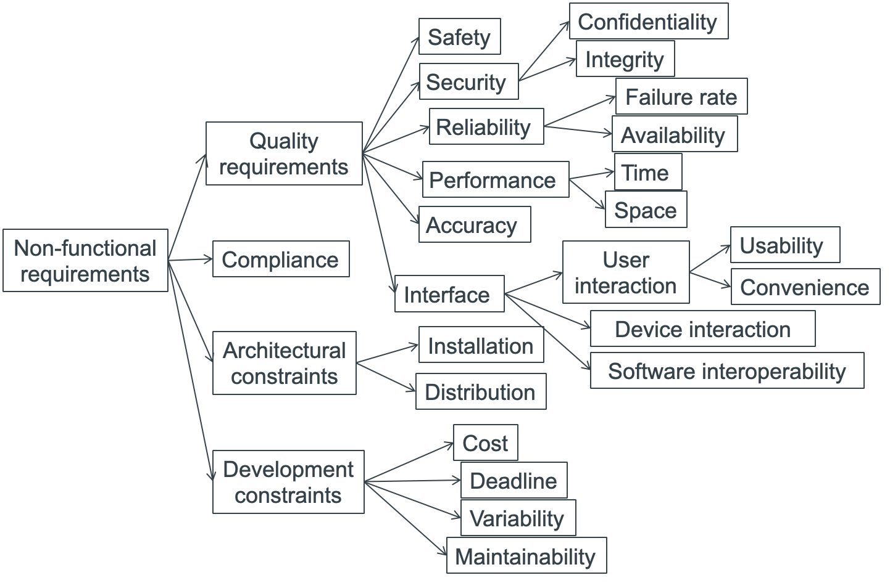

### Aspects of Quality Requirements

**Quality requirements should be specified with**
- How to measure
- What is the target

Examples:
1. An e-Trade financial system developed for stock trading must be efficient in response time that guarantees order execution on stocks within 2 seconds.
2. A missile control system must respond to control signals within 100 milli-seconds. 

| Aspect           | E-Trade Financial | Missile Control |
| ---------------- | ----------------- | --------------- |
| Attribute:       | Response time     | Response time   |
| Measurement unit | Second            | Milli-second    |
| Precision        | 1 decimal         | 1 decimal       |
| Value            | < 2.5             | < 58.5          |

### RE Lifecycle: 1. Actors

- Actors:
    - People involved in the activities
    - Stakeholder:  The roles played by a group of individuals who is affected by the system-to-be, or may influence the way the system-to-be is shaped, or has some responsibility in its acceptance
    - Examples: 
        - strategic decision makers, certification authorities
        - managers of the operational units,
        - domain experts,
        - developers, subcontractors,
        - end-users, customers, operators, etc.

### RE Lifecycle: 2. Process

- An ordered set of activities carried out by the actors
    - Domain understanding
        - Studying the system-as-is within its organizational and technical context
    - Requirements elicitation
        - Discovering candidate requirements and assumptions of the system-to-be
    - Evaluation and agreement
        - Aiming at making informed decisions about the issues raised during the elicitation process
    - Specification and documentation
        - Detailing, structuring and documenting the agreed characteristics of the system-to-be
    - Requirements consolidation
        - Validating specified requirements with stakeholders and verifying them against each other in order to find inconsistency and omissions

#### An iterative Model of RE Process
(Bray 2002, p31)

<i><b>Abbreviations</b></i>:
- CRS: Client Requirements Statements
- HMI: Human-Machine Interface
- PD: Problem Domain

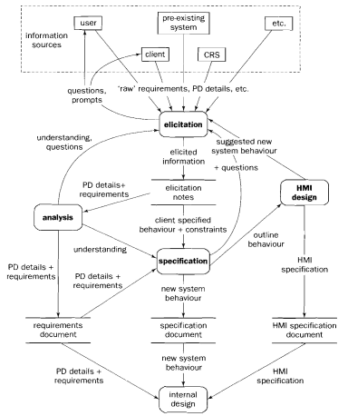

### RE Lifecycle: 3. Products

- Problem statement
    - Initial statement of the problem, its context and its overall objectives
- Requirements definition
    - Document that systematically state the requirements:
        - The problem
        - The organizational and technological context 
        - The objectives
        - The functional requirements
        - The non-functional requirements 
        - The scope of the system and priorities of each requirements, etc. 
- Requirements specification
    - Document of functional requirements in accurate notations, such as in graphic models or formal notations

## Part 2 Requirements Elicitation

### Requirements Elicitation: Definition

Requirements elicitation involves finding all <b>types</b> and all <b>aspects</b> of requirements from all relevant <b>sources</b> at a required <b>level of details</b> for the system to be developed. 

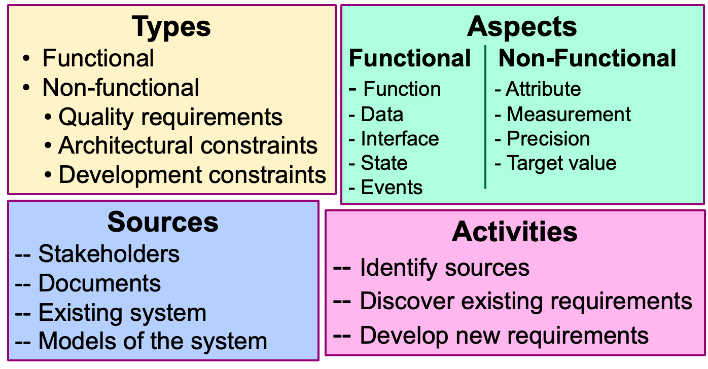

### Elicitation Methods & Techniques

**Main Techniques**  
- Interviews
- Questionnaires
- Workshops
    - Future workshop
    - KJ method
    - Brainstorming
- Observations
- Document reading 

**Assistance Techniques**  
- Prototyping
- Mind mapping
- Elicitation check list
- Focus groups

#### Elicitation Techniques: <b>1. Interviews</b>

- In this technique, the requirements analyst conducts interviews with stakeholders 
    - To discuss the system with the stakeholders 
    - To develop an understanding of their requirements

- **Types of Interviews**
    - **Closed interviews**  Requirements  analyst seeks answers (from stakeholders) to a pre-defined set of questions
    - **Open interviews**  Do not have predefined agenda. Requirements are discussed in an open-ended way (to find out what stakeholders want from the proposed system)

##### Example: Interview Plan

Plan for the first interview with Budget Airline

<table>
  <tr>
    <td colspan="4"><strong>ABC Software: Interview Plan</strong></td>
  </tr>
  <tr>
    <td colspan="4"><strong>Project Reference:</strong> AA/ER/07</td>
  </tr>
  <tr>
    <td colspan="4">
      <strong>Participants:</strong> 
      J. Smith (Budget Airline) 
      C. Chung (Budget Airline) 
      A. Marshal (Analyst)
    </td>
  </tr>
  <tr>
    <td><strong>Date:</strong> 02/10/2013</td>
    <td><strong>Time:</strong> 2&#58;00 PM</td>
    <td><strong>Duration:</strong> 30 minutes</td>
    <td><strong>Place:</strong> Room C212</td>
  </tr>
  <tr>
    <td colspan="4">
      <strong>Purpose of the interview:</strong> 
      Preliminary meeting to identify problems and requirements regarding software system for Budget Airline Flight Booking System.
    </td>
  </tr>
  <tr>
    <td colspan="4">
      <strong>Agenda:</strong> 
      - current problems including booking, checking flight schedule, and any other concerns 
      - current procedures 
      - initial ideas 
      - follow up actions
    </td>
  </tr>
  <tr>
    <td colspan="4">
      <strong>Documents to be brought to interview:</strong> 
      Current Procedures of Flight Booking
    </td>
  </tr>
</table>

##### Interview Questions

- Questions should be properly constructed to enable you to get useful information. 
    - ***Closed questions:***
        - Different response options are provided. The interviewee can choose one or multiple responses. 
        - Useful to confirm certain known information
    - ***Open questions:***
        - No predefined responses are provided to the interviewee. The interviewee can answer the question in his own words. 
        - Useful to find out new information
    - ***Leading questions:*** suggest the answers to the interviewee
        - Often starts with “Don’t you think that …?” “Isn’t it true that …?” 
        - Often lead to bias, thus should be avoided in requirements elicitation

#### Elicitation Techniques: <b>2. Questionnaires</b>

- Requirements elicitation by questionnaires means:
    - Setting a number of questions about the required system and the requirements, 
    - Asking instances of a given target stakeholder to write down their answers to these questions
- It is effective when the required information is:
    - a small amount
    - contents in a well-defined context
    - from a large number of people, especially if widely scattered, to establish a consensus

##### Example: Questionnaire

Budget Airline Flight Booking System – Customer Survey

We are intending to move to a new online flight booking system in a near future. It would be a great help to us if you could spare a few minutes to give us your opinion. Please, answer the question below and return it within 1 week in the enclosed pre-paid envelope.
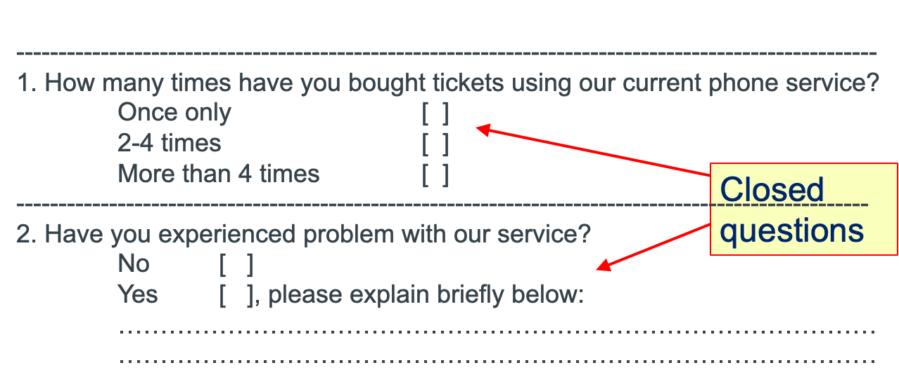
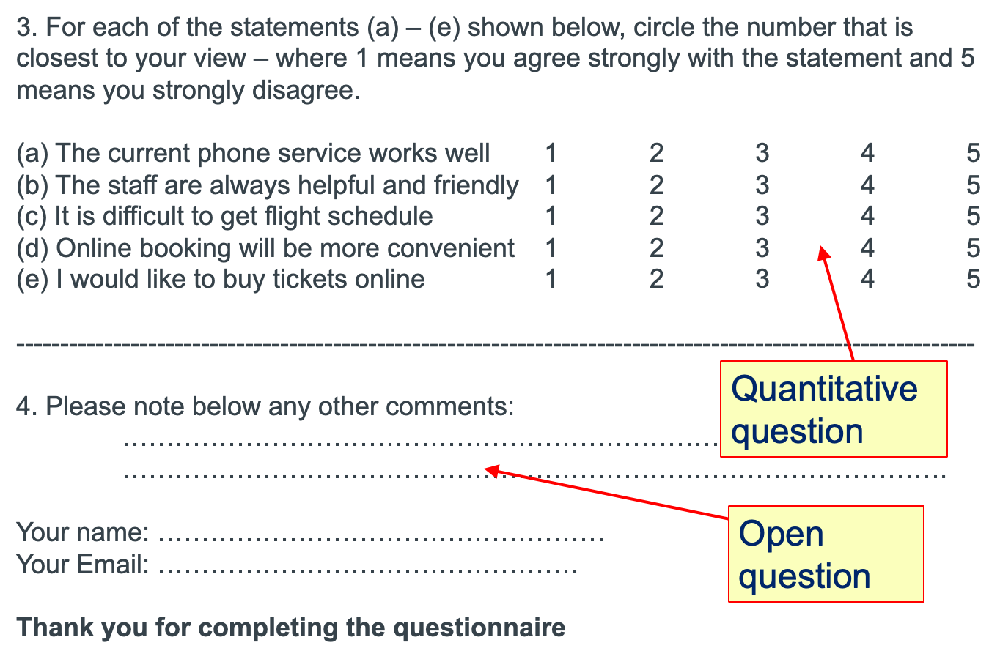

#### Elicitation Techniques: <b>3. Workshops</b>

- In a workshop, a group of stakeholders develop requirements for the system by working together through discussions
- Different forms of workshops
    - Future workshop
    - KJ Method
    - Brainstorming

##### Future Workshops

- Views users as experts in the problem domain and aims to include them as active collaborators in the development process
    - Originated in Scandinavia  
    - Also called Participatory Design 
- It is divided into three stages:
    1. **Critique**: current problems in the current system
    2. **Fantasy**: imagine the perfect future system 
    3. **Implementation**: discuss ways in which the fantasy view may be realized

##### Brainstorming

- It is a creativity technique that aims to generate a large number of new ideas by stimulating discussions with a group of stakeholders in the form of a workshop. 
- Process
    - Presentation of the subject
        - Explain the subject
        - Clarify the goal of the session
        - Set the rules of brainstorming
    - Idea generation
        - Each participant expresses his/her ideas with respect to the subject
        - Minute taker records all ideas and make them visible to all participants

###### Seven Rules of Brainstorming

1. Quantity over quality
2. Free association and visionary thinking encouraged and desired
3. Taking on and combining expressed ideas is encouraged and desired
4. Criticism is forbidden
5. Questions for clarification are allowed
6. Do not abort the brainstorming at the first deadlock Almost every brainstorming session experiences a slack period (30-60 seconds of silence). 
7. The brainstorming comes to a natural end Indicated by increasing frequency and lengths of deadlocks

#### Elicitation Techniques: <b>4. Observation</b>

- Observation is a method of social analysis widely used in a methodology called ‘Ethnography’ 
    - Originated from social sciences and anthropology
    - Is an umbrella qualitative research methodology that relies on immersion into the culture and is designed to explore cultural phenomena  
    - Ways for understanding actual work processes – how people work at workplaces, e.g. organizational practice and culture
- The analyst (ethnographer) spends time with people at work to gain an understanding of actual work practices
    - Establishes a trust relationship with people at work
    - Keeps detailed notes of all work practices
    - Talks to people outside the workplaces to get required information
    - Analyses the information collected and draws conclusions
    - Very useful technique, but time consuming

## Part 3 Requirements Documentation

### Requirements Documentation

- Requirements documentation
    - One of the key engineering activities in RE
    - Aims at documenting important information elicited or developed during RE
- Terminology
    - Documentation: 
        - The activity that produces, archives and manages software artifacts in the engineering process
    - Document:
        - The artifacts produced by documentation and usually written in a natural language

### Roles of Documents in RE (and SE)

- To provides persistent and reliable record of information
- To facilitate communications between stakeholders as common references 
- To serve as a reference and/or contract in the negotiation and agreement of commissioning development tasks
- As the basis for further development, such as design, derivation of operation manual, etc.  
- To preserves expert knowledge
- To help reflection on the problems

### What to Be Documented

**Intermediate results**  
- Brainstorming results
- Different stakeholders’ viewpoints
- Alternative solutions for resolving conflicts
- Information about context
- Deviations from standards, rules and guidelines
- Identified requirements
- Review/walkthrough results
- Scenarios 
- Stakeholder’s wishes, needs, arguments
- Requirements sources
- Context information
- Stakeholders
- Risks

**Problems identified**  
- Errors
- Contradictions 
- Gaps in documented requirements

**Decisions made**  
- Agreement reached on requirements
- Decision regarding conflicts
- Decision rationales
- Priorities on requirements

**Evolution of artifacts**  
- Change requests
- Decision about change requests
- Evolution tracks

**Final results**  
- Requirements definition
- Requirements specification

### Documentation vs Specification

- Specification is a special sub-type of RE documents aiming at providing a definitive and clear document about the system to be developed 
    - Represent the final results, agreed by all stakeholders, especially the client
    - Provide the technical details of the project contract 
    - Serve as the development and acceptance manual
    - Often employ formal/semi-formal notations, such as modeling languages and/or mathematical notations

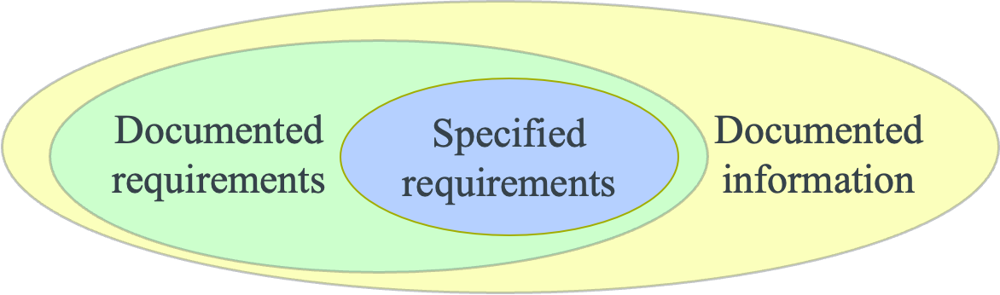

### Quality of Requirements Documents

- Completeness
- Traceability 
- Correctness
- Unambiguity
- Comprehensibility
- Consistency
- Verifiability
- Atomicity

### Common Errors: Intermingled Statements

- Include several requirements in one sentence
- A common problem of using natural language to write requirements document. For instance, 
    - intermingling functional and non-functional requirements in one sentence 
- This easily causes a requirement being overlooked
- Example: Mobile Restaurant Online Booking 
    - Intermingled sentence: 
        - “The system should send discount promotions to registered customers regularly via email”. 
    - Separate functional and non-functional:
    - ***Functional***: 
        - (F1) The system shall **send discount promotions** to registered customers.”
    - ***Non-functional***:  
        - (N1) The discount promotions should be sent ***once every week***. 
        - (N2) The discount promotions should be sent ***by email***. 

### Uses of Natural Languages

- Advantages
    - Expressiveness  It can be used to describe to an arbitrary level of abstraction, precision and accuracy
    - Comprehensibility  It can be relatively easy to comprehend even for users with little training
    - Applicability  It is applicable to all aspects of all types of systems
- Disadvantages
    - Ambiguity  Natural language is inherently ambiguous

### Types of Ambiguity in Natural Language

- ***Lexical ambiguity***:  synonyms, homonyms
- ***Syntactic ambiguity***:  one sentence may have two different ways to parse
- ***Semantic ambiguity***:  a sentence may have two or more meanings in different context  
- ***Referential ambiguity***:  the relation between a word or phrase in a sentence and an expression before or after this word or phrase have more than one possibility
- ***Vagueness of terms***:  a word/phrase is inherently unclear about its meaning 

### Techniques to Avoid Ambiguity

- Syntactic pattern
    - Define a pattern of syntactical structure in which statements are written
    - To avoid syntactical ambiguity
- Controlled language
    - Extends syntactic patterns with semantics of terms 
    - To reduce both syntactic and semantic ambiguity
- Glossary
    - List a collection of technical terms and their meanings
    - To avoid ambiguity of terms

### Syntactic Patterns: 1 \[Rupp 2009\]

A syntactic pattern defines a syntactic structure for writing the statements of requirements in natural language and defines the meanings for each part of the structure. 

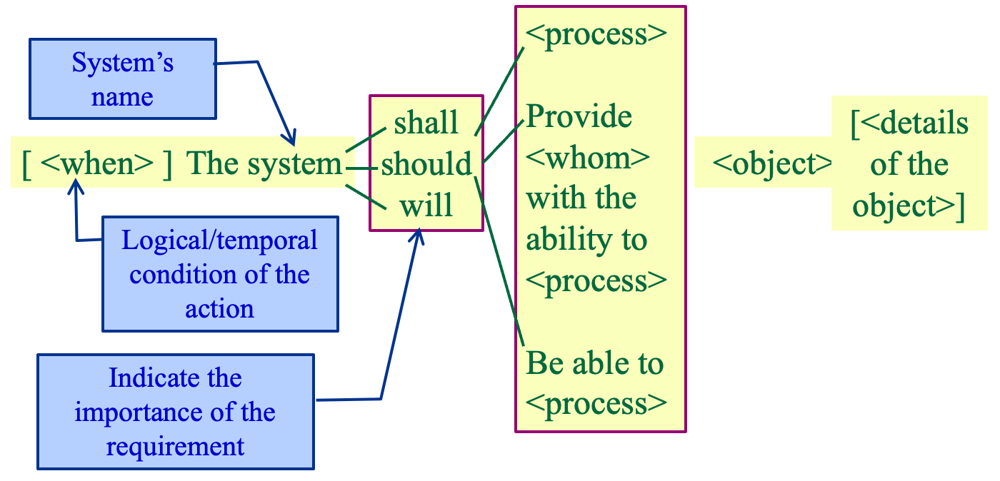

#### Example

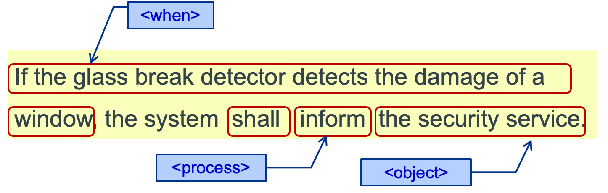

### Syntactic Patterns: 2 \[Zhu et al. 2001\]

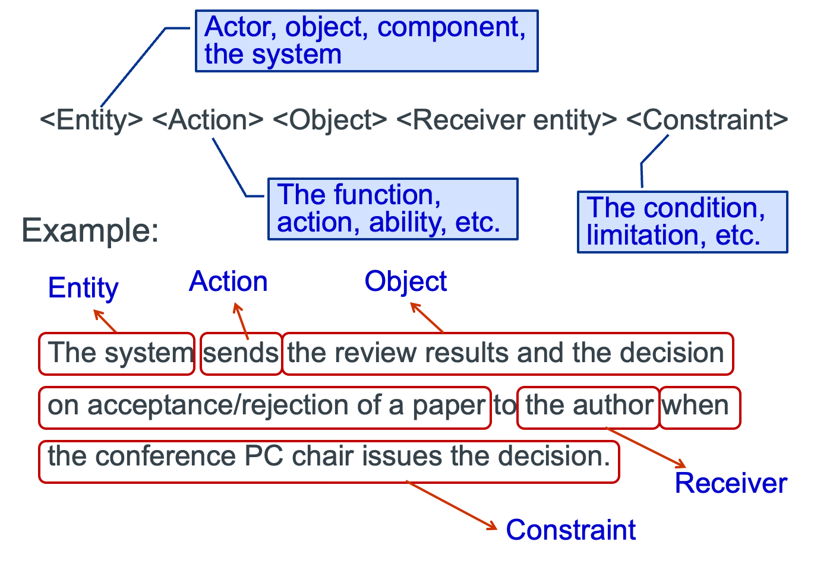

### Controlled Languages

A controlled language is defined for a specific application domain with a restricted natural language grammar (syntax) and a set of terms (including their semantics) to be used to document statements in the domain. 
- Advantages:
    - ***Easy to understand***: they are similar to expressions in natural language
    - ***Less ambiguous***: they have simplified grammar and predefined vocabulary with precise meanings
    - ***More verifiable***: they are easier to check for grammar and semantics errors

### Glossaries

A glossary defines the specific meanings of a collection of technical terms that are part of a language. It may also contain references to related terms as well as examples to explain the defined terms. 
- The definition of a term in a glossary may contain the following parts:
    - The term to be defined
    - The definition text
    - Synonyms
    - The related terms and the relationship (such as generalization, specialization, etc.)
    - Examples/counter-examples

#### Example of Glossary

| Term:          | Route                                                                                               |
| -------------- | --------------------------------------------------------------------------------------------------- |
| Definition:    | The specific instance of a direction from a starting point to a destination                         |
| Synonyms:      | Itinerary                                                                                           |
| Related terms: | Primary route (specialization)                                                                      |
| Example:       | The system should give a link to a map that shows the route from starting point to the destination. |

### Structures of Requirements Document

- Requirements documents should be structured
    - As defined by a company standard
    - Checked as a part of the document quality assurance process
    - In the best way to suit your organisation’s business 
    - May have variants from a single standard for different types of systems
- Industrial wide standards
    - IEEE 1233-1989: for system requirements definition
    - IEEE 830-1998: for software requirements definition

### IEEE Standard 830-1998

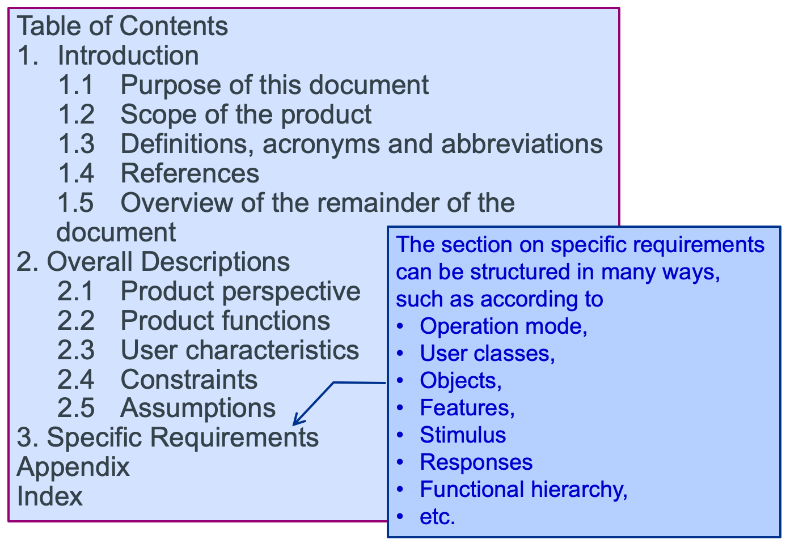

### Structure of Specific Requirements

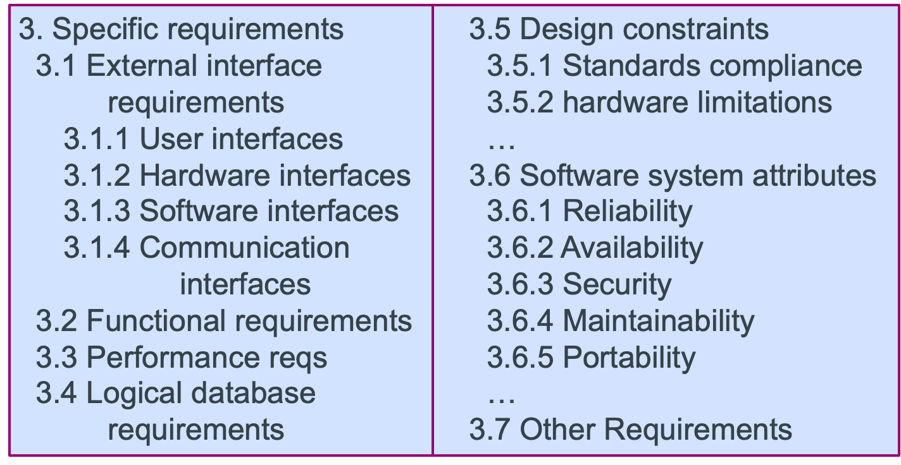

### Mode-Based Functional Requirements

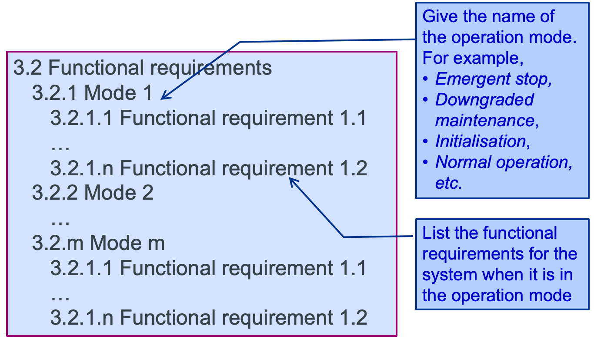

### User-Based Functional Requirements

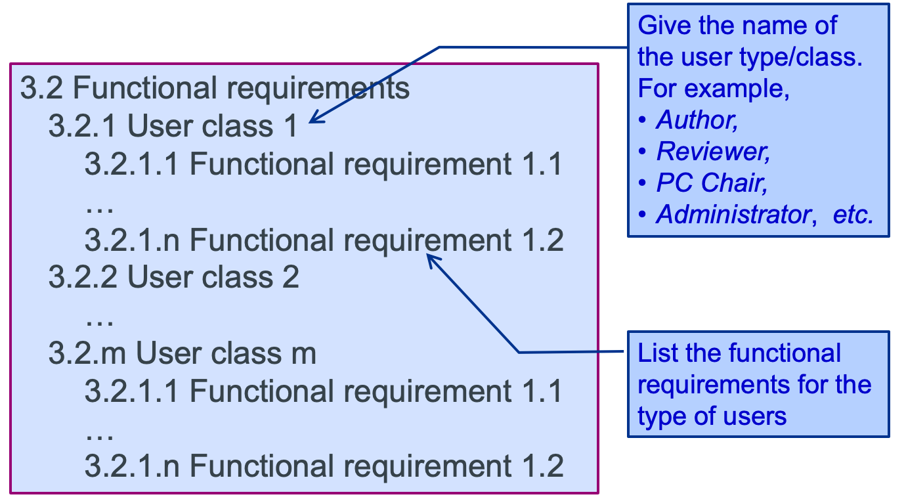

## This Week’s Study Guide

Further Readings
- *Klaus Pohl*, **Requirements Engineering: Fundamentals, Principles and Techniques**, *Springer*, *2010*. (Chapter 16 – 18, pages 293– 348, 21 and 22,  pp391-450)
- *Alan Dennis, Barbara Hayley Wixon and David Tegarden*. **System Analysis and Design with UML: An Object-Oriented Approach**, *(3rd  Edition)*. *Wiley*, *2010*. (Chapter 4. pp110-149)
- *Alex van Lamsweerde*. **Requirements Engineering: From System Goals to UML Models to Software Specifications**. *Wiley*, *2009*. (Chapter 2, pp61-86, Chapter 4, pp120-127)
- *Ian K. Bray*. **An Introduction to Requirements Engineering**. *Addison Wesley*, *2002*. (Chapter 3, pp41-49, Chapter 5, pp135-203)

Source: 
<a href="/obu/level6/software-engineering/week3/CHC6173-Lecture%203%20-%20Requirement%20Engineering.pptx" class="office-preview">
  CHC6173-Lecture 3 - Requirement Engineering.pptx
</a>

