## Learning Outcomes

1. **Principles of Software Modeling**
    - Basics of software modeling
    - Model-driven software development
2. **Software Modelling in UML**
    - Functional Modeling
        - Use Cases and Scenarios
        - Activity Diagram
    - Structural Modeling
        - Class diagram
    - Behavioral modeling
        - Sequence diagram
        - Behavior state machine

## Software Modelling

- What is a model
    - A model is a set of statements that describes a system at a high level of abstraction
- What is a software model
    - A model of software system and its environment
- What is a modeling language
    - A language in which a model is presented
        - to build, describe, and analyse software models 
        - to support the development, operation, maintenance and evolution of software systems

### Software Modelling Languages

- In Jackson structural programming methodology (JSP) 
    - Entity lifecycle diagram
- In structured software development methodology
    - Control flow diagram
    - Entity relationship diagram (also used for modeling Relational Databases) 
    - State transition diagram
- In Object-oriented methodology
    - UML
- In formal methods
    - State chart
    - Petri nets

#### Aspects of Modeling Languages

- **Syntax**: defines what is a valid model
    - Abstract syntax: 
        - What are the valid elements to be included in a model
        - How are the elements to be connected to each other
    - Graphic notation: (concrete syntax) 
        - How to represent the elements and the connections in the model visually (i.e. the graphic notations) 
- **Semantics**: defines the meanings of a valid model
    - What do the elements in a model stand for?
    - What do the connections between the elements stand for?
- **Pragmatics**: guides the uses of the models
    - Heuristic rules on how to use the models to solve certain modeling problems 

## Model-Driven SW Development

- SW models as the key artifacts in software development and evolution
    - Models can be easier to understand (Supports communication)
    - Models can be less ambiguous (Supports communication)
    - Models can be easier for computer to process
- Construction of models as the main objectives in requirements elicitation and specification
    - Requirements are defined by a set of models
    - Consistency and completeness of requirements definition are checked by analysis of models with support of modelling tool
- Design, implementation, testing etc. are considered as transformation and processing of models 
    - Model transformation are supported by automated tools
    - Models can be made executable (e.g. as prototypes)

## Holistic Approach to Modeling

- Modeling SW on all aspects
    - Both the problem and the solution
    - Both internal and external views
    - Both static structure and dynamic behaviour views
    - Both individual and collective views 
    - Both the system itself and its context/environment 
    - Both the system-as-is and the system-to-be
    - At various levels of abstraction and details 
- Modeling SW in whole lifecycle
    - Requirements engineering
    - Design
    - Implementation
    - Integration and Testing
    - Maintenance and evolution

## Multiple-Views Approach to Modeling

- A complicated systems is best modeled by using a number of different models. 
- Each model represents one particular point of view to the system and focus on one particular aspect of the system. 
- These models can be on different levels of abstraction and provide different levels of details. 

> **Consistency problem in multiple-view modeling:**  
> Models of different views and at different levels of abstraction must be consistent so that consistent understanding of the system can be maintained. 

## Types of SW Models (as in UML)

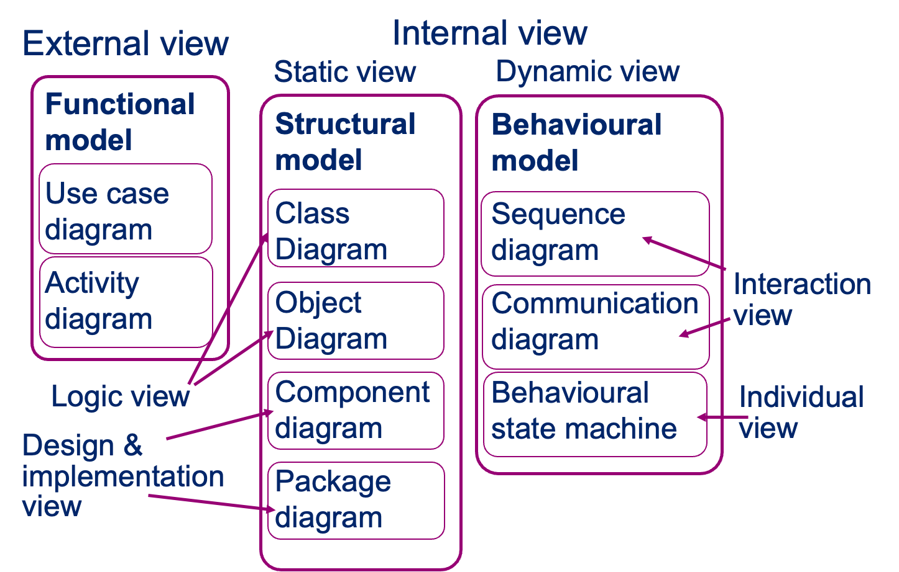

## Use Case and Scenarios Analysis

<h4>The Purposes</h4>

- To identify *all* intended uses of the system-to-be
- To identify *all* situations/scenarios of interactions between the system and the users/environment in each use of the system-to-be
- To *fully* understand the interaction sequences, conditions and the information exchanged, etc. 
- To specify the interactions in a *structured* way so that models can be constructed from the description. 

## What Is A Use Case

A use case is a particular type of uses of the system.  
It invokes a set of functions provided by the system in an event flow.  
A use case has the following characteristics:  
- A specific set of users of the system  
- A specific purpose of using the system  
- A specific context of the usage  

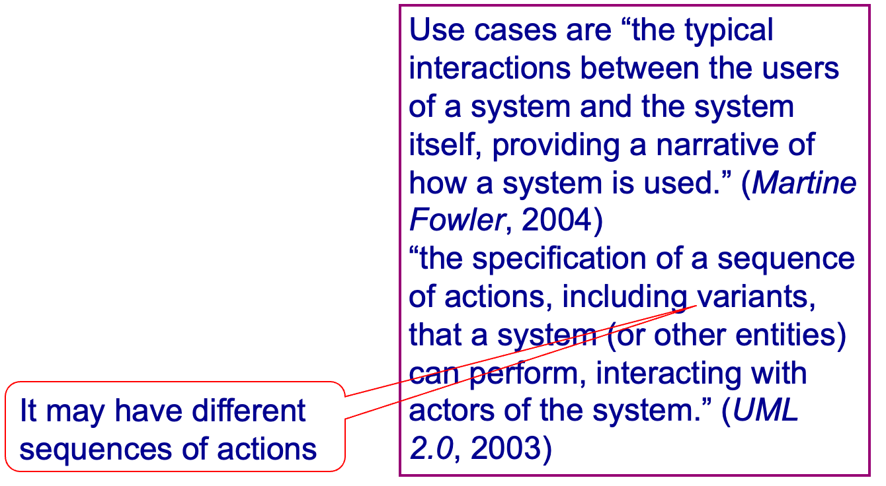

## Description of a Use Case

- Unique name of the use case
    - The identifier of the use case
- Narrative description
    - Describes the use case in a short sentence
- Participating actors
    - Lists the stakeholders/actors involved in use case
- Entry conditions
    - Defines the state of the system and the actors before the use starts
- Exit conditions
    - Gives the state of the system and the actor when the use finishes 
- Flow of events
    - Describes the interactions between the actors and the system: 
        - A normal flow of events
        - Exceptional flows (or subflows) of events
- Special requirements
    - Lists the non-functional requirements associated to the use case

### Use Case Description: Example

<h4 style="color: #00266A">Purchase an Underground Ticket</h4>

- ***Name:***
    - Purchase ticket
- ***Description:***
    - A passenger uses the ATM machine to buy an underground ticket 
- ***Participating actor:***
    - Passenger
- ***Entry condition:***
    - The machine has *N*>0 ticket;  
    - The passenger has *M*>0 amount of money
- ***Exit condition:***
    - The machine has *N*-1 ticket;
    - The passenger has the ticket;
    - The machine holds the money *m* of the ticket’s price;
    - The passenger’s money is *M*-*m*; 
- ***Event flow:***
    1. The passenger selects the number of zones to be traveled
    2. The machine displays the amount m due
    3. The passenger inserts money of the amount m’ >=m
    4. The machine returns change m’-m
    5. The machine issues ticket
- ***Exceptional flows:***
    1. The machine displays a message that it has no changes. 
    2. The machine displays a message that ticket is jam.
- ***Special requirements:***
    - Ticket must be delivered within 5 seconds 

## What Is A Scenario

- An example of events taken from real world experience
    - An outline with details of scenes or an imagined sequence of future events, which may include details of the system context (scenes)
    - Captured and represented as speech or text narratives and may be embellished with still or moving images to illustrate the context
- A future vision of a designed system with sequences of behaviour and possibly contextual description
    - A scenario comes close to a design mock up.
    - Represented by anything from storyboard sketch to animated sequences in a concept demonstrator.
- **A single thread (or pathway) through a system**
    - Formatted text and illustrated pathway in a use case
    - A path in an activity diagram

### Types of Scenarios

- **Concrete scenarios**
    - A sequence of events with every details of data
    - A specific operation of the system
- **Generic scenarios**
    - A sequence of events without detailed data
    - Representation of a set of particular instances of similar operations of the system
- **As-is scenarios**
    - Used in describing a current situation, or system-as-is.
- **Visionary scenarios**
    - Used to describe a future system, i.e. the system-to-be.
- **Evaluation scenarios**
    - Used to check the system in evaluation as acceptance criteria.

### Concrete Scenarios

- A sequence of events with every details of data
- A specific operation of the system 
- Example: 

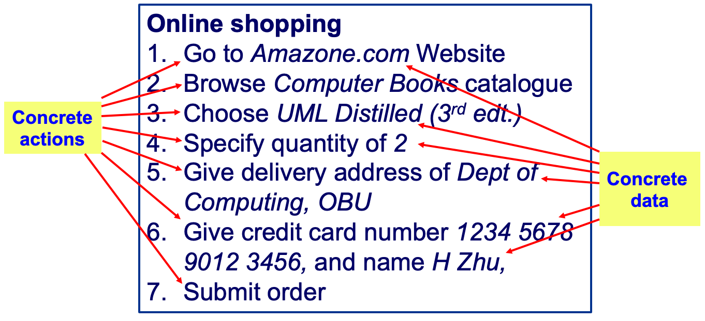

### Generic Scenarios

- A sequence of events without detailed data
- Representation of a set of particular instances of similar operations of the system
- Example:

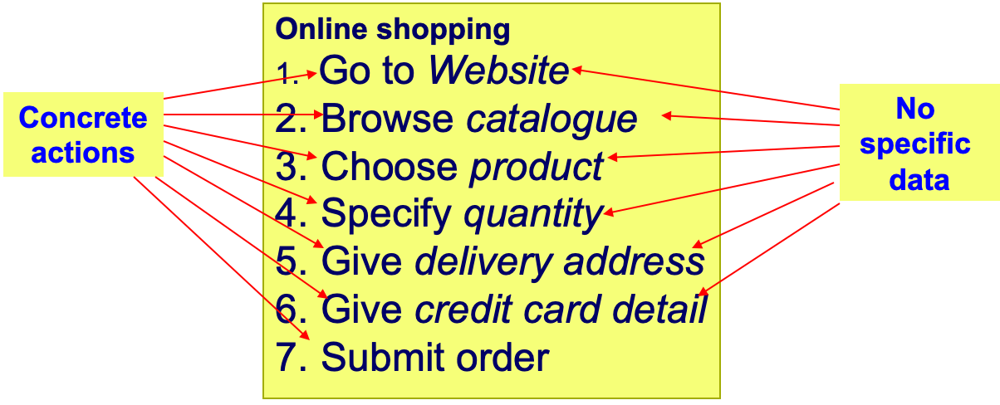

### Format of Scenario Descriptions

<table border="1" cellpadding="6" cellspacing="0">
  <tr>
    <td colspan="2">System/Application: Clinic Management Information System</td>
  </tr>
  <tr>
    <td colspan="2">Use Case: Make appointment at a clinic</td>
  </tr>
  <tr>
    <td colspan="2">Scenario: Successfully booked an appointment</td>
  </tr>
  <tr>
    <td>Actor: Patient</td>
    <td>System</td>
  </tr>
  <tr>
    <td>1) Enters their own name and their preferred doctor’s name</td>
    <td>2) After confirming this is a registered patient, displays days the doctor is in the clinic</td>
  </tr>
  <tr>
    <td>3) Selects date</td>
    <td>4) Displays available appointment</td>
  </tr>
  <tr>
    <td>5) Selects preferred time</td>
    <td>6) Confirms appointment and displays information about parking etc</td>
  </tr>
  <tr>
    <td>7) Confirms acceptance of appointment</td>
    <td></td>
  </tr>
</table>

## UML Use Case Models

- Contains actors, use cases and relationships between them
- Describes the functional operations (or the requirements) of a software system through use cases

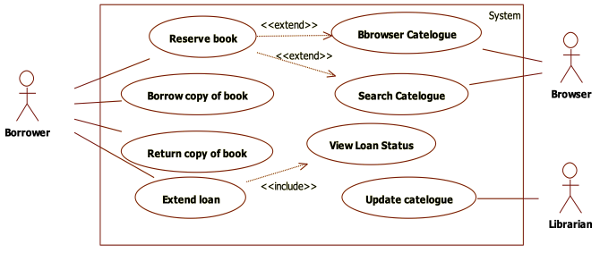

### UML Use Case Diagram Notation

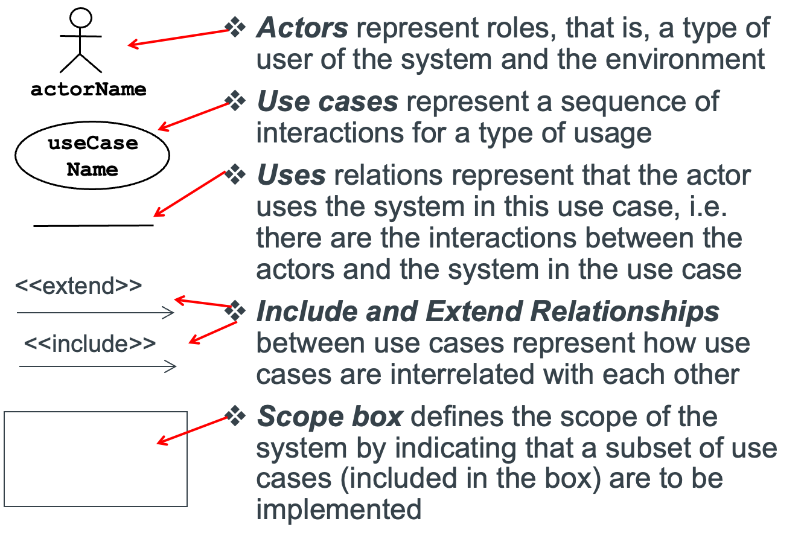

### UML Activity Diagrams

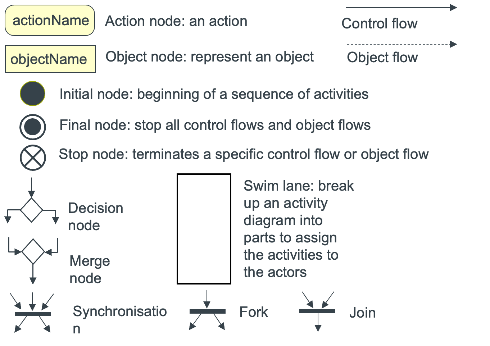

## Concepts of Activity Diagrams

- Action
    - Performed for some specific business reason
    - Can be manual or computerized
    - Named by a verb with a noun, e.g.
        - Make payment arrangement
        - Book an air ticket 
        - Enter delivery address
- Special actions
    - Initial, Final, Stop, Fork, Merge, Synchronisation

## Control Flow and Object Flow

- Control flow
    - Model the path of execution through a business process
    - Can only be attached to action/activity nodes
- Object flow
    - Model flow of object through a business process
    - Show the objects that flow into and out of the actions or activities (i.e. passed between activities)
    - Similar to dataflow in dataflow diagrams
    - Attached to one action/activity node and an object node

### Example: Make an Appointment

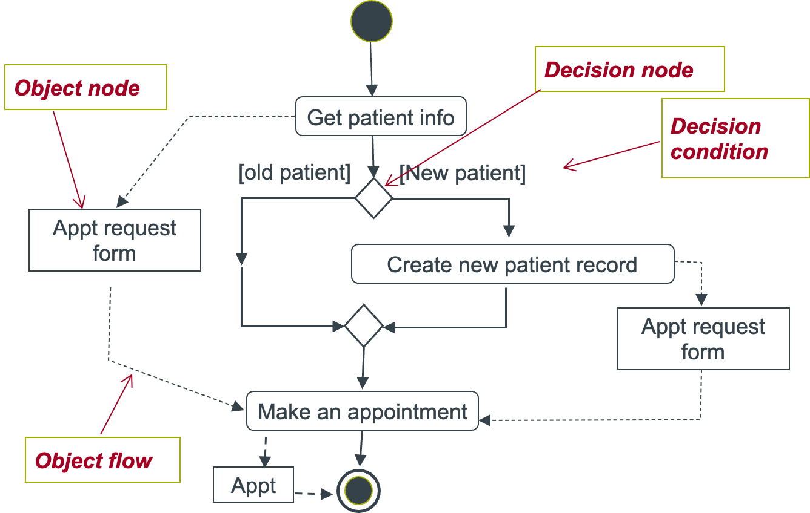

## Swim Lane

- Breaking up an activity diagram into parts by placing actions into the swim lane boxes
- Assigning responsibility to objects or individuals that performs the actions by assign a name of object/individual to each swim lane
- Representing parallel and concurrency of executions
- Modeling a business workflow, 
    - Describing ‘who is doing what’ using swim lanes
    - Describing ‘how they coordinate’ using synchronization bars

### Example: Make a School Lunch Box

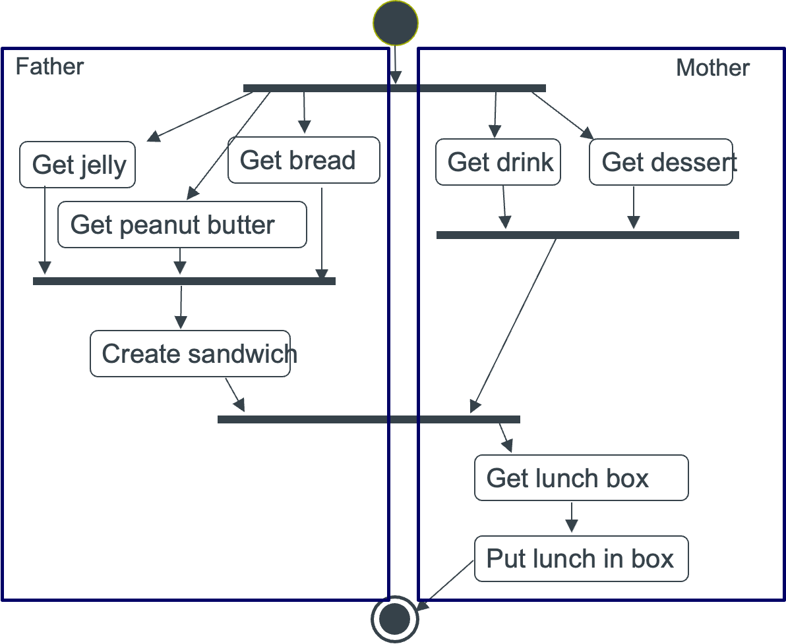

*[OO]: Object-Orientation

## Principles of OO Methodology (1)

- An information system should be structured in such a way that it reflects the structure of the real world system
    - Easier to understand the information system 
        - Metaphor: using the same vocabulary to describe the entities in the information system as the users describes the things, ideas and concepts in the real world
    - Easier to modify the information system
        - Users’ requirements tend to change much more frequently than the structure of their organization and the domain
        - Changes in organization system can be relatively easily reflected in the modification of the information system

## Principles of OO Methodology (2)

- ‘Everything in the world is object’
- The real world can be modeled by objects
- Everything in an information system should be an object in order to satisfy principle 1
- All information systems can be modeled in OO approach

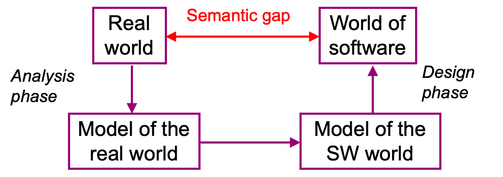

## Object-Orientation

- Object
    - A set of attributes: 
        - The states of real world objects are reflected by the values of the attributes
    - A set of methods:
        - The changes of states are reflected in the collection of methods that changes the states of objects
    - The set of attributes and the set of methods are encapsulated into one computational entity

> Encapsulation:  
> - It means as much as shielding. Each OO object has a shield around it. They can exchange things though, as if they are interconnected through a hatch.
> - Only the operations are visible and the data and the implementation of the operations are hidden in the objects

- Class
    - The similarity between objects is reflected by *classifying* [+classifying] them into the same class. 
    - Objects are *instances* [+instances] of classes
    - Class is the *template* [+template] for a collection of objects that have the same structure, i.e. 
        - the same set of attributes, and 
        - the same set of methods. 

[+classifying]: *Class is called the classifier of objects, similar to data type is the classifier of data.*

[+instances]: *In mainstream OO methodology, objects does not change their membership to the classes.*

[+template]: *Class is an abstract thing that does not actually exist in the system at runtime.*

## Relationships between Classes

- Generalisation
    - Definition: Class A is a ***generalization*** of class B, if every instance of class A is also an instance of class B. 
        - Class A is called a ***super-class*** of B; class B is called a ***subclass*** of A. 
        - We also say that class B is a ***specialization*** of A. 
        - A relationship between classes: the super-class / subclass relationship is also called ***inheritance*** relation. 
            - Class B inherits the attributes and methods of A. 
    - Example:
        - Undergraduate Student is a subclass of Student;
        - Postgraduate Student is a subclass of Student;
        - Student is a subclass of Person; 
        - Lecturer is also a subclass of Person
- Whole-part relationships 
    - Whole-part: Object A is a part of object B
        - A wheel is a part of a car
    - Aggregation: an object consists of several other objects
        - A car consists of 4 wheels, 1 engine, 1 steering wheel, …
    - Key features of whole-part relationship
        - Life-dependence: *E.g. Heart is a part of human body.*
            - Whether a part object can exist without being a part of a whole object
        - Shareability: *E.g. Your money is also mine.*
            - Whether a part object can be a part of more than 1 object
        - Cardinality: (also called multiplicity):
            - How many part objects can be contained in 1 whole object
    - Types of whole-part relations in UML:
        - Aggregate: shareable, but no life-dependence
        - Composite: life-dependent and not shareable

### Read, think then answer

- Check if the whole-part relationships between these classes are aggregate or composite?

| Class 1 | Class 2 | Type of whole-part relationship                |
| ------- | ------- | ---------------------------------------------- |
| Body    | Leg     | Composite                                      |
| House   | Room    | Composite                                      |
| Car     | Engine  | Aggregation                                    |
| Person  | Doctor  | Generalization |

> Generalization is not a whole-part relationship

- Association
    - An object A affects another object B’s state, e.g. object A can directly cause object B to change its state (by invocation of object B’s method). 
        - A doctor operates on a patient
        - Engine drives wheels
        - Steer wheel change the direction of wheels
    - An object A monitors another object B’s state, e.g. object A accesses B’s attributes. 

## UML Class Diagram

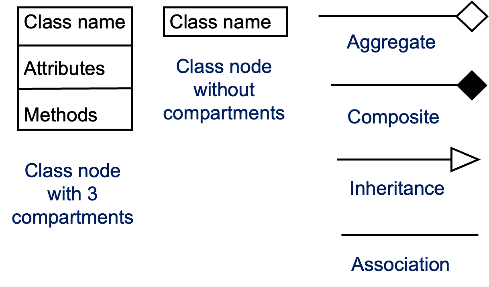
### Example: Inheritance Relation

### Examples: Multiplicity

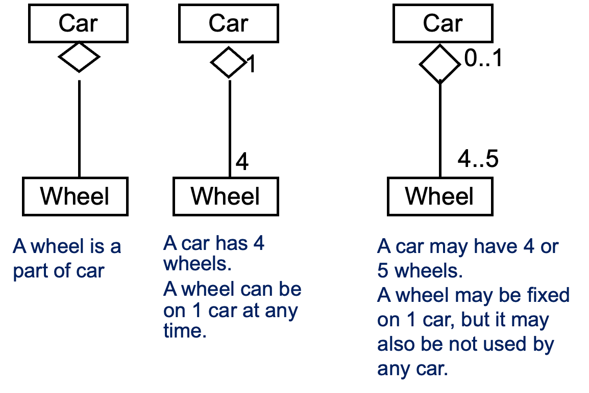

### Example: Hospital

## Attributes and Methods

- **Attributes** (also called properties) 
    - Representation of object’s state
    - Similar to variables in the sense that they can store values
- **Methods**: (also called operations) 
    - Operations that can change the values of the attributes
    - Similar to procedures/functions
- **Visibility**: the level of information hiding to be enforced for the attribute/method
    - Public (+): not hidden from any object; other objects can modify its value;
    - Private (-): hidden from all other objects;
    - Protected (#): hidden from all other classes except its immediate subclasses. 

### Example: Attributes & Methods

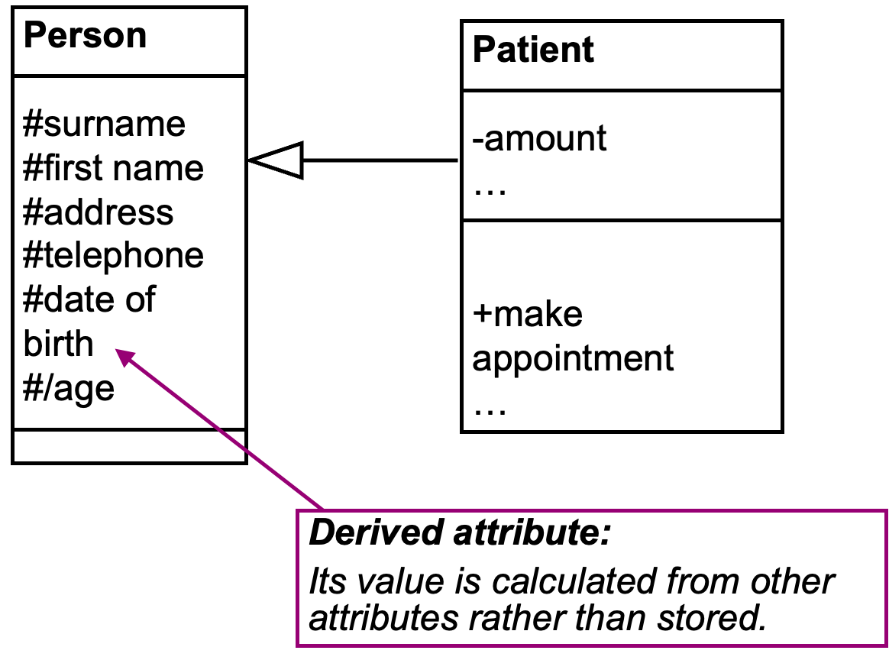

## Behavioral Models

- Behavioral models describe the internal dynamic aspects of an information system that supports the business processes in an organization
- At requirements analysis stage
    - Internal logic of the business processes
    - Without specifying how the system is implemented
- At design and implementation stage
    - Details of the designs of the system, such as
        - the data types of the attributes
        - the operations of the objects

> Behavior model describes the ‘journey between the towns’, i.e. the interactions between the objects to achieve the functions of use cases.

### Two Types of Behavior Models

- Interaction models
    - Describe the **collaboration** between objects and actors in the business process by describing how objects and actors in the system communicate, cooperate and coordinates with each other
    - In UML, they are described by **sequence diagrams** and **communication diagrams**
- Individual models
    - Describe the behavior of individual objects and actors by describing how they change their states and the actions to be taken in each state and the outside condition. 
    - In UML, they are described by state machines associated to classes

#### Example: telephone connection

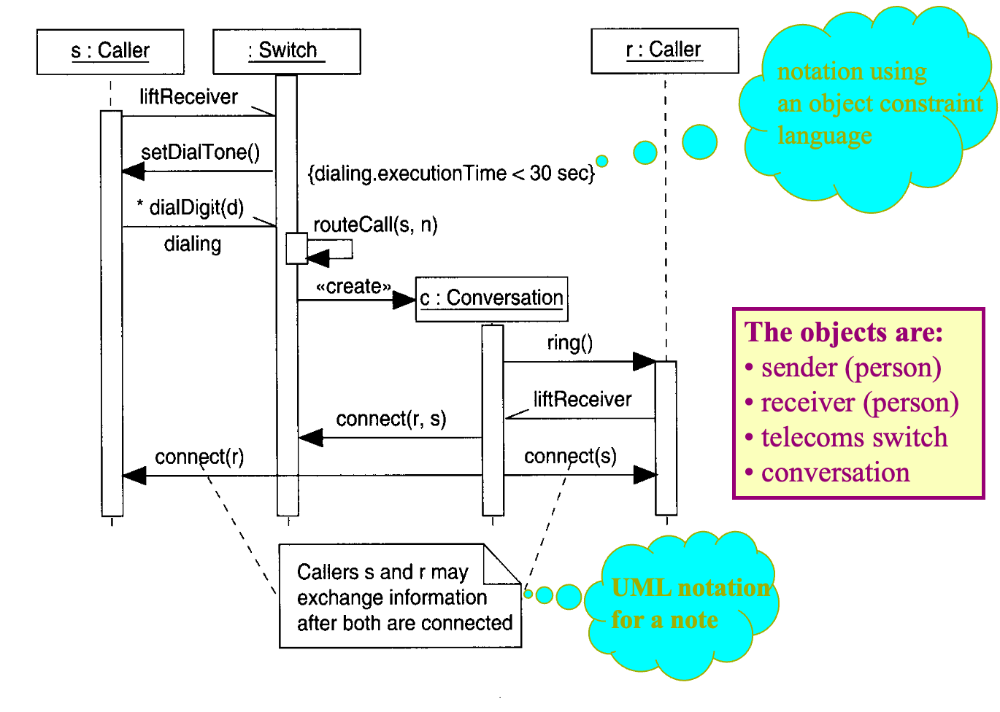

## Elements of Sequence Diagrams

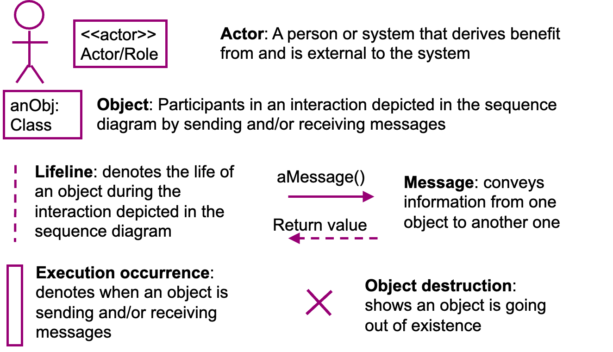

## Message flows

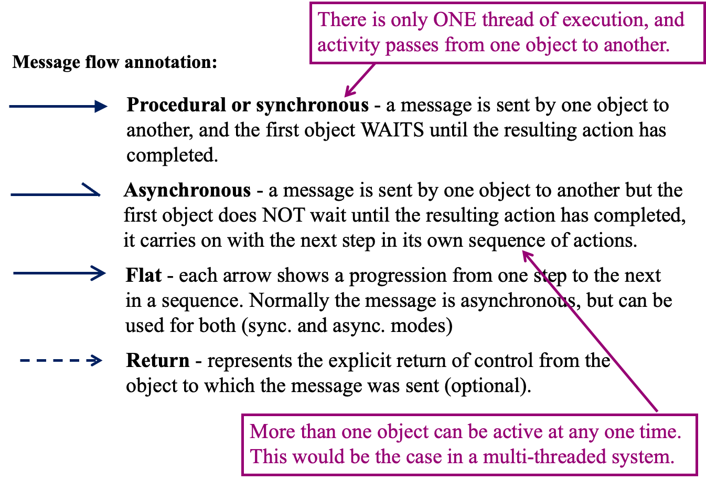

## Generic vs Instance Sequence Diagrams

- For each use case, there may be a *collection* of sequence diagrams that describes the behavior of the system. 
    - One **generic sequence** diagram
        - Shows all possible interactions (i.e. all scenarios) between the objects/actors in a use case
        - May contains conditionals, loops, etc. 
    - A number of **instance sequence** diagrams. 
        - Depicts a single scenario (i.e. one linear sequence of message passing) of the interactions between the objects/actors of the use case.
        - Does not contain any conditionals, loops, etc. 

### Example of Frames

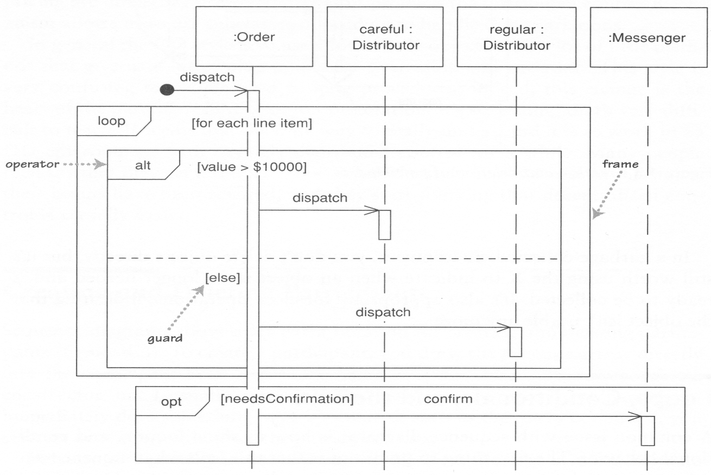

## Common Operators for Interaction Frames

| Operator | Meaning                                                                                                                                                                                      |
| -------- | -------------------------------------------------------------------------------------------------------------------------------------------------------------------------------------------- |
| alt      | Alternative multiple fragments; only the one whose condition is true will execute.                                                                                                           |
| opt      | Optional; the fragment executes only if the supplied condition is true.  Equivalent to an alt with only one trace.                                                                        |
| par      | Parallel; each fragment is run in parallel.                                                                                                                                                  |
| loop     | Loop; the fragment may execute multiple times, and the guard indicates the basis of iteration.                                                                                               |
| region   | Critical region; the fragment can have only one thread executing it at once.                                                                                                                 |
| neg      | Negative; the fragment shows an invalid interaction.                                                                                                                                         |
| ref      | Reference; refers to an interaction defined on another diagram.  The frame is drawn to cover the lifelines involved in the interaction.  You can define parameters and a return value. |
| sd       | Sequence diagram; used to surround an entire sequence diagram, if you wish.                                                                                                                  |

## Behavioral State Machines

- A dynamic model that shows 
    - the different states that a single object passes through during its life 
    - its response to events with changes on its state and the actions. 
- Used for further definition of the behaviour of objects

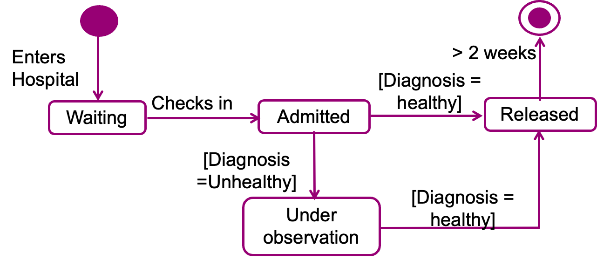

### Basic Concepts of State Machines

- State: 
    - The state of an object is defined by the values of its attributes and its relationships with other objects at a particular point in time. 
    - E.g. a patient can be new, current, or former. 
- Event: 
    - Something that takes place at a certain point in time and changes a value of an attribute. 
    - For example:  
        - A designated condition becoming true
        - The receipt of a call for a method by an object
        - Passage of a designated period of time 
- Transition: 
    - A relationship that represents the movement of an object from one state to another state. 
    - A transition is trigger by an event;
    - A transition may be associated with an action/activity. The action/activity takes place when the state transition happens
    - A transition may have a guard condition, which is a Boolean expression. The transition happens only when the guard condition is true

### Notation of State Machines

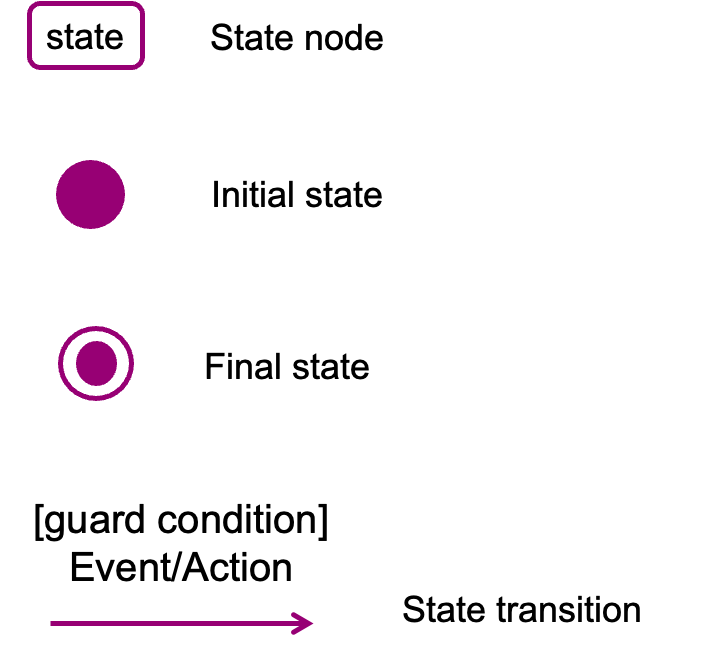

### Internal activities

- Event, guard and activities can be put inside the state box to represent reactions to events without transitions. 

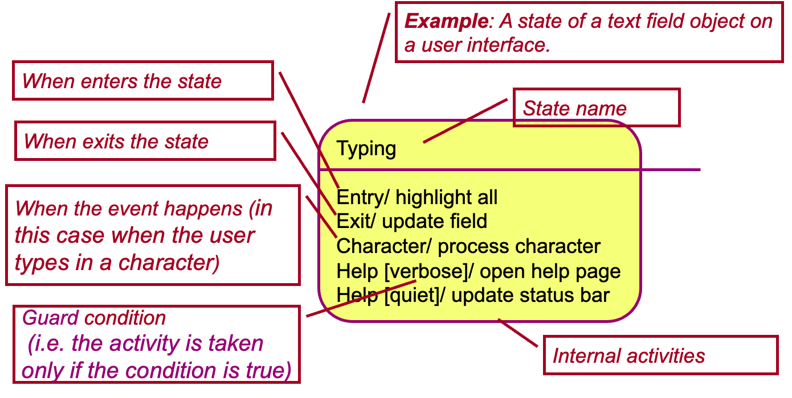

## Activity State

- An activity state is a state in which the object is performing an ongoing activity. It transits the state when the activity terminates. 
- The activity state is represented by the mark “do / activity” in the state. 

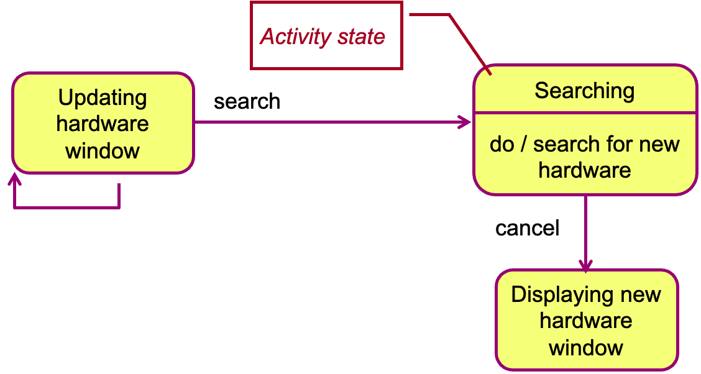

## Superstate

- A *superstate* is a state that inside is a state machine.
- It can be used to express shared behaviors, and to represent behaviors in a hierarchical manner. 

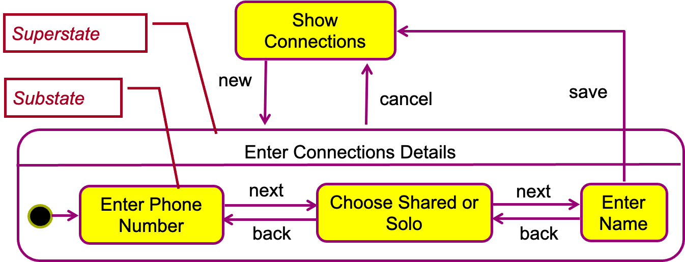

## Concurrent States

- States can be broken into several orthogonal state diagrams that run concurrently. 

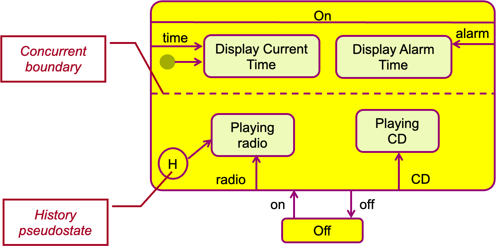

## Guide to Study

- Further Readings
    - Alan Dennis, Barbara Haley Wixom, and David Tegarden, **Systems Analysis and Design with UML: An Object-Oriented Approach**, 3rd Edition, Wiley, 2010 
        - Chapter 6, pp207~237
        - Chapter 7, pp238-268
    - Martin Fowler, **UML Distilled** (3rd Edition), Addison-Wesley, 2004. 
        - Chapter 4: Sequence Diagrams, pp53-64, 
        - Chapter 10: State Machine Diagrams, pp109-116
    - Bhuvan Unhelkar, **Software Engineering with UML**, Taylor & Francis, 2017
    - Kevin Lano, **Model-Driven Software Development with UML and Java**, Cengage Learning Emea, 2009

Source: 
<a href="/obu/level6/software-engineering/week4/CHC6173-2022-Lecture%204%20-%20Software%20Modelling.pptx" class="office-preview">
  CHC6173-2022-Lecture 4 - Software Modelling.pptx
</a>

