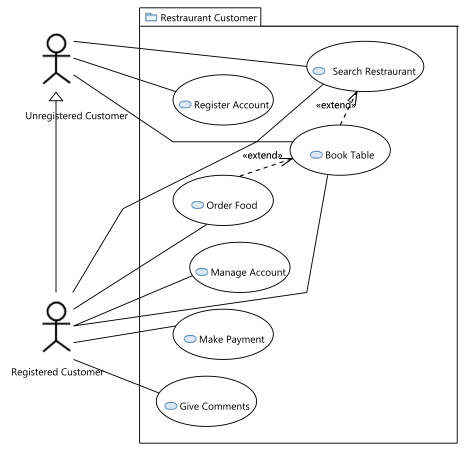
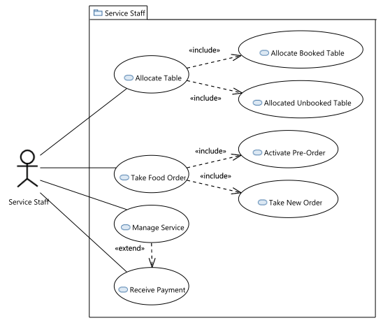
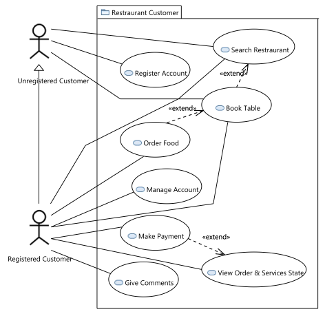
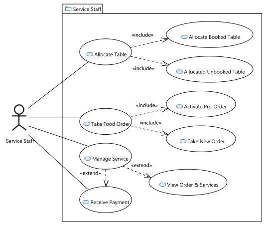
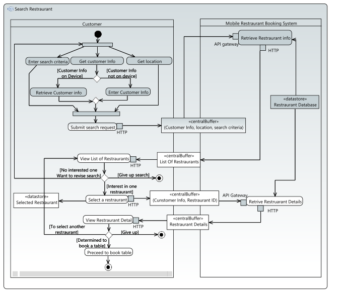

## Outline

- Coursework Briefing
    - Software modelling
        - Use case diagram (Task 1)
        - Activity diagram (Task 1)
        - Class diagram (Task 3)
        - Sequence diagram (Task 3)
- Questions and Answers

## Use Case Modelling

### Use Case Modelling (1)

- Each group member to develop **one** use case diagram for his/her subsystem
- ***Example***: Restaurant Customer App

### Use Case Modelling (2)

- ***Example***: Service Staff App

### Use Case Modelling (3)

- ***Example***: Restaurant Customer App: Version 2

### Use Case Modelling (4)

- Example: Service Staff App: Version2 

## Activity Diagram

- What to do in real software development: 
    - For each use case in the use case diagram, develop one activity diagram 
    - To model the ***interaction between the user and the system***
        - ***Swim lanes:*** one for the user; another for the system
        - ***Object nodes:*** for modelling data passed between system and the user
- What to do for your coursework: 
    - ***To submit one*** activity diagram for ***one*** use cases of your choice 

### Example: Activity Diagram

## Structural Modelling in Class Diagram

- Each member of the group develops a class diagram for one selected component (will be defined in week 6 content) from their architectural design.
- What should be included in the class diagrams?
    - The selected component must be in the architectural model of your subsystem, but not in any other subsystems. 
    - Cover all types of objects 
    - Give all attributes and methods for each class
    - Give all types of relations between classes
    - Give multiplicities to associations and whole-part relationships
    - Name all associations.

## Sequence Diagram

- What to do in real software engineering
    - Each use case or selected component must have a corresponding ***generic sequence diagram*** to model the ***internal behaviour*** of the system when it is used.
        - The classes/objects on the sequence diagram must be classes in the class diagram
        - Messages passed between objects must correspond to methods of the class in the class diagram
        - The sequences of messages from/to outside of the system must be consistent with the activity diagram
- What to do for coursework
    - Each group member uses ***the selected component*** that you have worked on in the structural model
    - To submit ***one*** generic sequence diagram for the selected use case.

## How will coursework be marked

- Marking scheme
    - Team mark: 
        - Architectural design of the whole system: 15 marks
    - Individual mark:
        - Use case model: 10 marks
        - Activity diagram: 10 marks
        - Class diagram: 10 marks
        - Behaviour model (sequence diagram): 10 marks
        - Architectural design of subsystem: 15 marks
        - Software Test: 30 marks
    - Total mark = Team mark + Individual mark, if an individual contributes
- Marking according to the achieved quality of work
    - See the marking scheme for details

## Formative Feedbacks

- Show your draft work to practical tutor 
- Email only for short questions and short answers

Source: 
<a href="/obu/level6/software-engineering/week5/CHC6173-2022-Week%205-%20Consolidation.pptx" class="office-preview">
  CHC6173-2022-Week 5- Consolidation.pptx
</a>

