## This Week’s Learning Outcomes

*[OO]: Object Oriented

- Part 1: General theory of design 
    - To understand the characteristics of design 
        - Problem, Solution, Process, Strategies
    - Principles of software design
- Part 2: Object-oriented design
    - To transform requirements models into OO designs
    - To reuse OO designs: Design patterns
    - To represent OO designs in UML design models
        - Component diagram 
        - Package diagram
        - Deployment diagram

## Part 1  General Theory of Design

### What is design

*Engineering design* is the use of scientific principles and technical information in the creative development of a plan to bring about a man-made product to achieve a prescribed goal with certain pre-specified constraints. 

### Nature of Design: *Wicked, Ill-structured*

Design is regarded as ‘***ill-structured***’ and ‘***wicked***’ on all aspects of design 
- **Formulation of problem**
    - The initial goals are usually vague 
    - Many constraints and criteria are unknown 
    - The context of the problem is often complex and poorly understood. 
- **Solution space**
    - Solutions are often not true or false, but good or bad
    - Often no objective criterion for the evaluation of a solution
    - Often no best solution, even no criteria that can be used as a ‘stopping rule’ 
- **Way of problem solving in design**
    - Resolving a discrepancy or inconsistency may pose another problem in its turn 
    - The formulation of a problem often depends on the way of solving it
    - Many assumptions and uncertainty can be exposed only by proposing solution concepts
    - Many constraints and criteria emerge as a result of evaluating solution proposals 
    - Sub-solutions of the sub-problems can be found to be inter-connected with each other in ways that form a pernicious circular structure to the problem

### Design Process

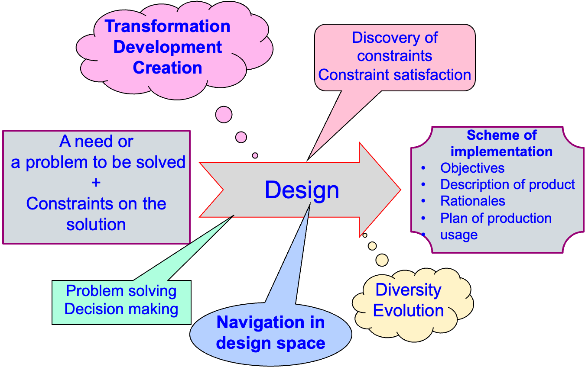

### Design Strategies

- Notion: 
    - A design strategy guides the process of solving design problems and building design models
- Typical strategies:
    - Decomposition – top-down
    - Composition – bottom-up
    - Evolution – trial and error
    - Reuse – reuse of past experiences and knowledge
- Each design strategy can be considered as a ***prescriptive*** design process, which are
    - Guidelines for the creation of designs
    - Ideal processes that usually lead to good designs

### SW Design: Causes of Difficulties

- ***Complexity***. It is an essential property of software.
- ***Conformity***. Software is expected to conform to the standards imposed by other components, such as hardware, or by external bodies, or by existing software.
- ***Changeability***. Software suffers from constant needs of changes.
- ***Invisibility***. Any forms of representations that are used to describe software will lack any form of visual link that can provide an easily grasped relationship between the representation and the system.

> Brooks, F. P. Jr., *No silver bullet: essence and accidents of software engineering*, IEEE Computer, 1987, pp10~19.

### Means of Dealing With Complexity

- Separation of concerns: 
    - ***How***: Identifying a specific design concern and separating it from the rest during design process
    - ***Why***: 
        - The mind cannot easily manipulate many things at the same time (more than about seven things at a time).
        - A complex problem can best be solved by initially devising an intermediate solution expressed in terms of simpler independent problems.
- Abstraction:
    - ***How***: Identifying the most important issues and ignoring the less important details, which are addressed later on within a limited context.
    - ***Why***: Design correctness is unaffected by *movement between equivalent contexts* and by replacement of equivalent components.

### SW Design: Common Errors

- *Incorrectness*. The design does not meet the users’ requirements on its functionality and features.
- *Inconsistency*. Different parts or aspects of the design conflict with each other. Consequently, it does not work.
    - For example, if two design statements make conflicting assumptions about the functionality of a component or the meaning of a data item.
- *Ambiguity*. The design specification may be interpreted in several different ways, or it is not clear enough.
    - Ambiguity causes errors in the implementation of the design due to inconsistent interpretations made in the implementation process.
- *Inferiority*. The design does not address quality requirements adequately.
    - Typically inefficiency and inflexibility, etc. *Inflexibility* causes the designed software to be difficult to change.

### SW Design: Objectives

- *Modularity* - replaceable, self-contained assemblies of elementary parts (<i>structure</i>)
- *Portability* – capable of reuse in different environments (<i>relation to the environment</i>relation to the environment)
- *Modifiability* - facilitate adaptation to changing end-user requirements (<i>relation to evolution</i>)
- *Conceptual Integrity* - exhibit harmony, symmetry and predictability, no surprises for users (<i>internal mechanism</i>)
- *Intellectual Control* - always be under intellectual control (<i>process</i>)

### SW Design: Process and Stages

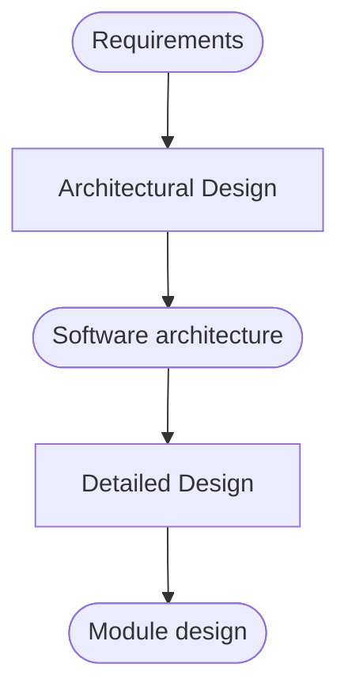

- Architectural design
    - the structure, i.e. the composition of components; 
    - the global control structures; 
    - the protocols for communication, synchronisation, and data access; 
    - the assignment of functionality to components; 
    - physical distribution; 
    - scaling and performance; 
    - the dimensions of evolution; 
    - the selection among design alternatives.
- Detailed design
    - the data structures and the algorithms for each component
    - the details of the user interface, and input/output formats, 
    - the selection of language, libraries and development tools.

## Part 2  Object Oriented SW Design

### OO Design as Transformation

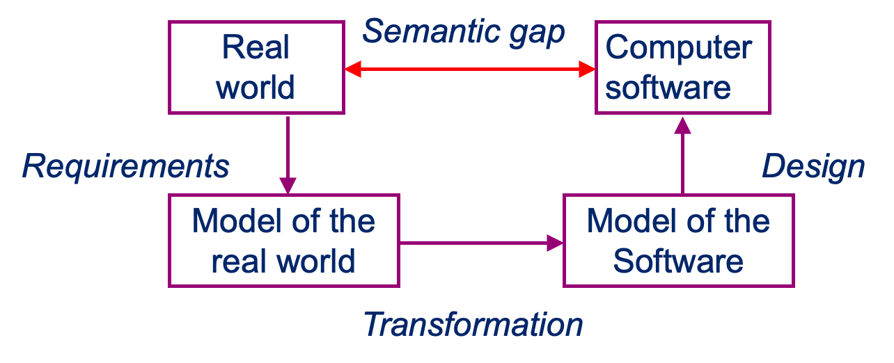

### The Difference between RE and Design Models

| Requirements models                                                                                                                                                                                                                                                                                   | Design models                                                                                                                                                                                                                                                                                                                                                                                                             |
| ----------------------------------------------------------------------------------------------------------------------------------------------------------------------------------------------------------------------------------------------------------------------------------------------------- | ------------------------------------------------------------------------------------------------------------------------------------------------------------------------------------------------------------------------------------------------------------------------------------------------------------------------------------------------------------------------------------------------------------------------- |
| <ul><li>Model of the real world system</li></ul>                                                                                                                                                                                                                                                      | <ul><li>Model of a manmade system</li></ul>                                                                                                                                                                                                                                                                                                                                                                               |
| <ul><li>The logical organisation of the entities</li><ul><li>Without how they are stored, created, or manipulated</li></ul></ul>                                                                                                                                                                      | <ul><li>The implementation and technical aspects of the system</li></ul>                                                                                                                                                                                                                                                                                                                                                  |
| <ul><li>Concerned with <i>WHAT</i>:</li><ul><li>What are the components of the system</li><li>What are the functions of each component</li><li>What are the data passed between components</li><li>Free from any implementation considerations</li><li>Free from technical details</li></ul></ul>  | <ul><li>Concerned with <i>HOW</i>:</li><ul><li>How the objects/classes will be organised into components</li><li>How the data will be stored, retrieved, processed</li><li>How the functions will be implemented</li><li>How to achieve quality requirements:</li><ul><li>the efficiency, scalability and reliability of the system,</li><li>the software reusability, testability, portability, etc.</li></ul></ul></ul> |

### OO Design Patterns

**Design Patterns**: Solutions to recurring design problems and for sharing design expertise in an application-independent fashion
- ***Alexandrian*** form of representation of DPs:
    - Name and Synopsis 
    - Context and Forces (problem statement)
    - Solution 
    - Consequences 
    - Implementation
    - Examples: (known usages of the pattern) 
    - Related patterns: alternative solutions, composition with other patterns
- Catalogues of DPs:
    - Gang of Four catalogue of 23 basic OO design patterns
    - Java design patterns

#### An Example of OO Design Pattern

- Object Adapter DP 

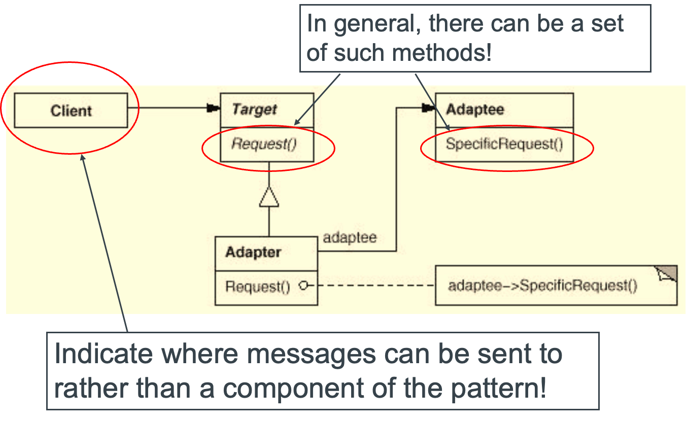

### UML Models for OO Design

- Structural model:
    - Class diagram/object diagram
    - <i>Component diagram</i>
        - *Grouping classes into components*
        - *The interfaces between components*
        - *The connections between components*
    - <i>Package diagram</i>
        - *How classes/components are packaged*
    - <i>Deployment diagram</i>
        - *How components are deployed to hardware nodes*
- Behaviour model:
    - Sequence, communication and state machine diagrams
- Functional model:
    - Use case diagram, Activity diagram

### UML Component Diagrams

- A component diagram depicts
    - How a system is decomposed into a set of components
    - How are these components related to each other
    - How each component is implemented (internal structure, and realization relation)

<b>Example:</b>  
UML component diagram for an online shopping system

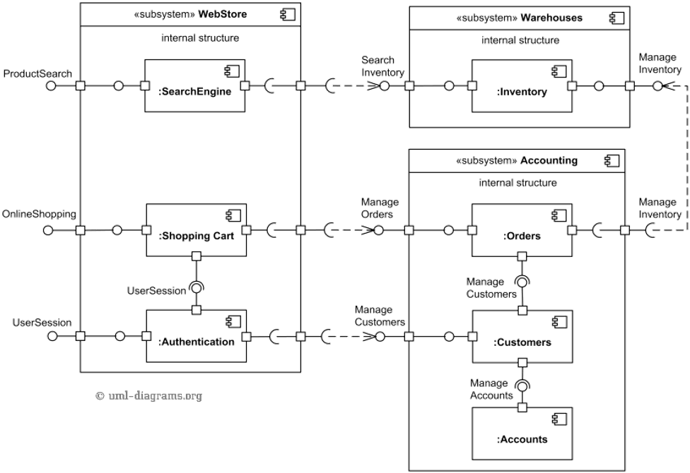

### Basic Concepts of Component Diagrams

- Component:
    - A <u><i>self-contained unit</i></u> that encapsulates the states and behaviors of several classifiers (ie. classes in OO design)
    - A <u><i>modular part</i></u> of a system replaceable [+replaceable] by a component that offers <u><i>equivalent functionality</i></u> based on <u><i>compatibility of its interfaces</i></u>
    - Specifying a formal contract of the services that it provides to its clients and those that it requires from other components or services in the system in terms of its provided and required interfaces. 
    - Examples:
        - Library code
        - Executables 
        - Documents  
        - Databases
        - Files

[+replaceable]: *at design time or run-time*

### Basic Concepts of Component Diagram

- Interfaces: 
    - *Provided interface*: The interface defined by the component; 
    - *Required Interface*: The interface used by the component
    - Usage: They allow for the specification of 
        - ***structural features,*** such as attributes and association ends
        - ***behavioral features,*** such as operations and events. 
    - Implementation: a provided interface may be implemented 
        - By the component directly, or 
        - By its realizing classifiers idirectly (i.e. classes in the component) 
- Ports: 
    - The named sets of provided and required interfaces 
    - Typically (but not always) addressed at run-time

### Component Node

A component node depicts a component with the following information:
- The name of the component
- The provided interfaces
- The required interfaces

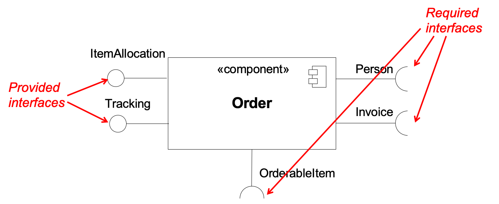

> Lollipop Representation

### Alternative Graphic Notations

- External view (black-box):
    - the interface/ports only

Black box notation showing a list of the provided and required interfaces of a component

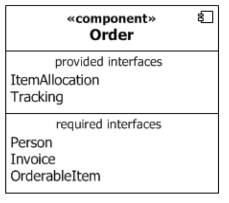

---

- Internal view (white-box):
    - the interfaces
    - the operations and attributes

A white-box notation also list the classes that realizes the component

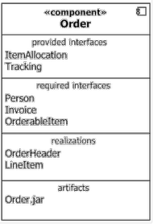

### Uses of Dependence Relations

The ports of a component can also be represented explicitly using the dependence relations to classifiers that depict the provided and required interfaces.

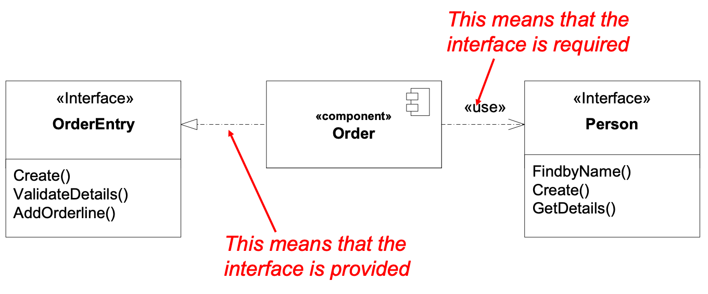

> Arrow goes from components to interface

### Internal Structure of Component

The internal structure of a component can be depicted by a class diagram

<b>Example:</b>  
A nested representation of a complex component

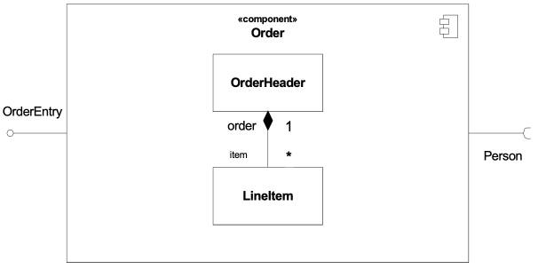

---

### Composition of Components

- A components of a system may be assembled from other components: 
    - As parts in an encompassing component or assembly of components
    - Wiring together their required and provided interfaces

### Wiring Components Together

<b>Example:</b>  
A composite structure of components with connector <b>wiring</b> between provided and required interfaces of parts

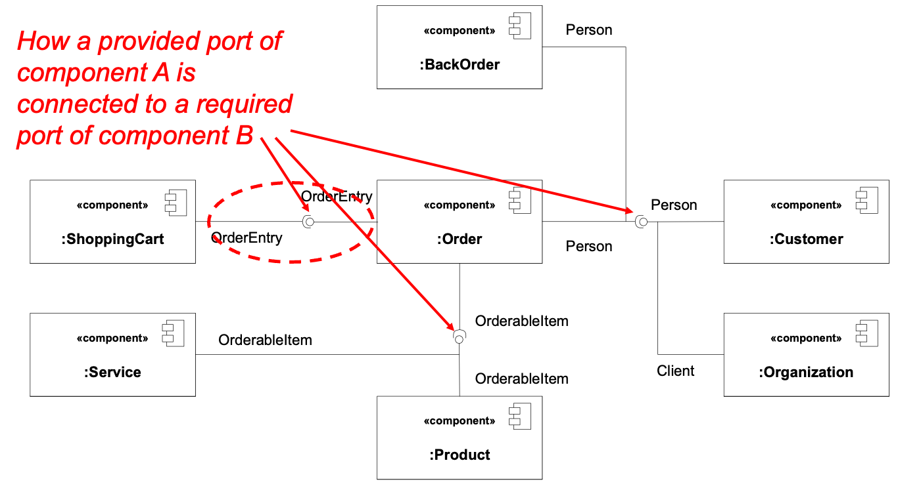

### Components as Parts

<b>Example:</b>  
The internal structure of a component that contains other components <b>as parts</b> of its internal assembly

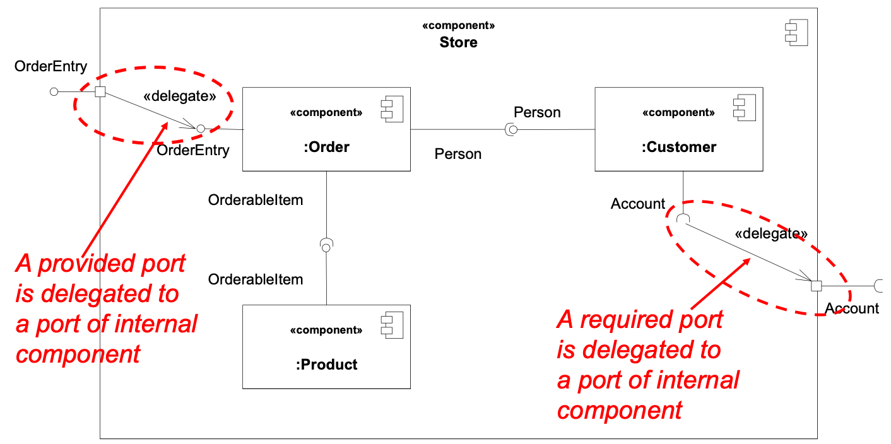

### UML Package Diagrams

- Package 
    - A grouping construct that takes a number of elements of any UML construct (such as class) and group them together into a higher level unit. 
    - A package can also group a number of other packages, thus build a hierarchical structure
    - A package models OO programming concepts such as package in Java and namespace in C++ and .net
    - Each package represents a namespace: 
    - Every class must have a unique name within its owning package
    - Fully qualified name is used to identify a class of a certain package, e.g. `System::Date`
- Dependence relationships
    - An element A depends on element B, if a change to the definition of A may cause changes to B. 
    - Stereo types: <b>access, import, merge</b>, etc. 

### Package Diagram Notations

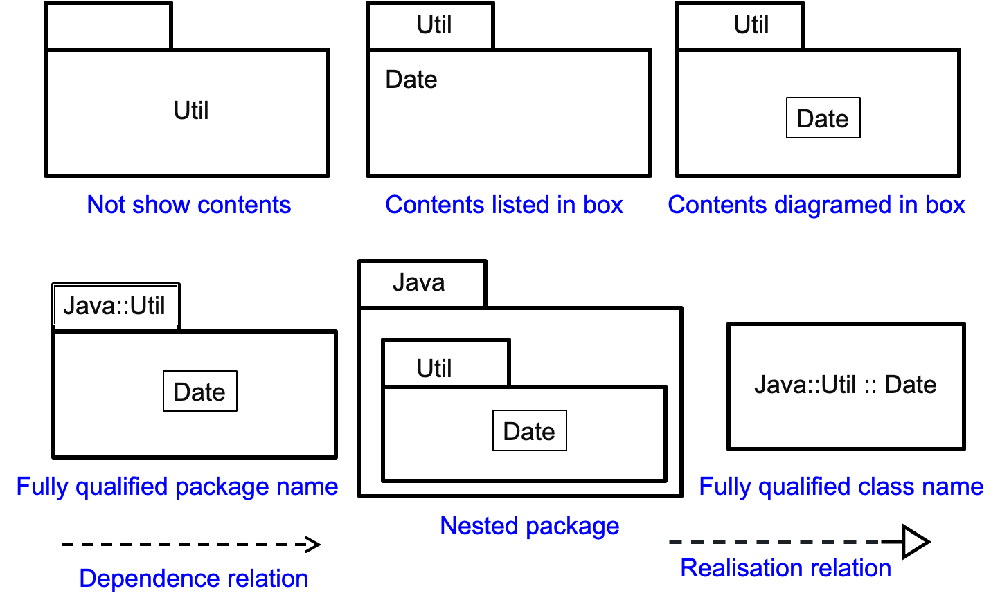

### Example of Package Diagram

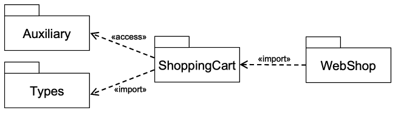

### UML Deployment Diagram: Nodes

- Models the physical deployment of artifacts on nodes. 
- **Nodes:**
- ***Device nodes***: physical computing resources with processing memory and services to execute software, such as typical computers or mobile phones. 
- ***Execution environment nodes*** (EEN): software computing resource that runs within an outer node and which itself provides a service to host and execute other executable software elements.

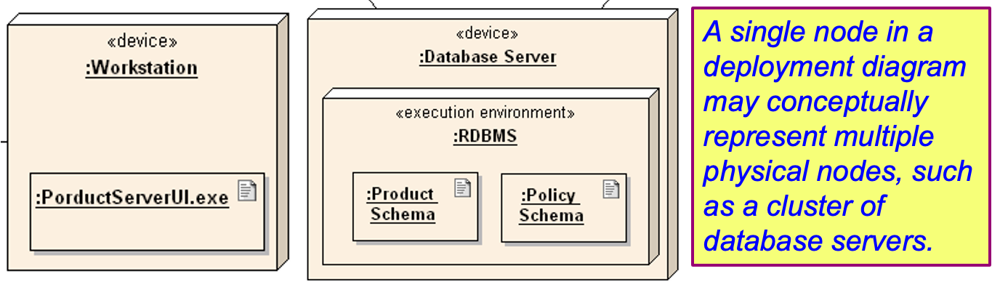

### UML Deployment Diagram: Connections

- ***Connections***: how the different pieces are connected (e.g. JDBC, REST, RMI)

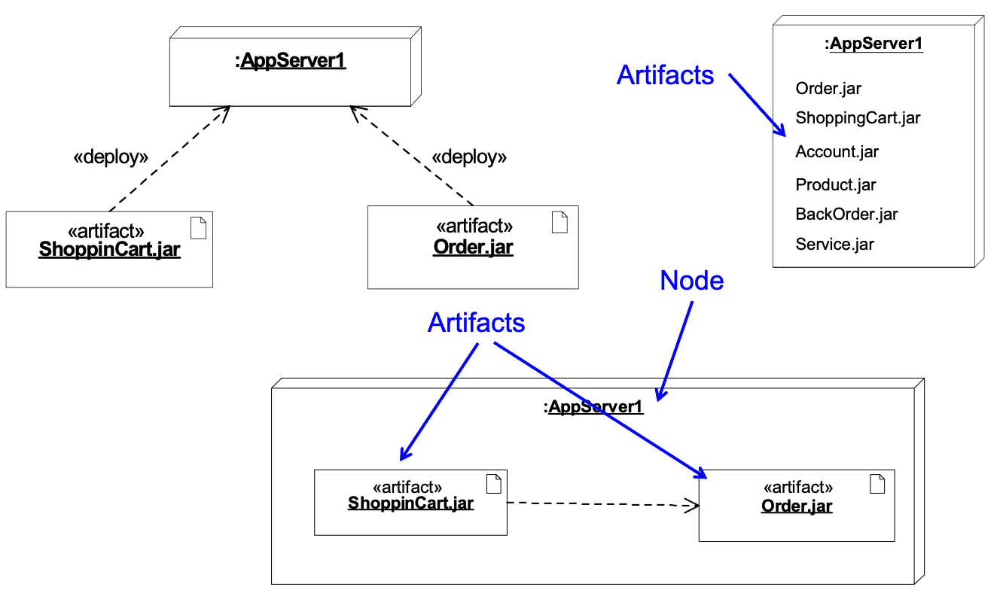

### Example: Web-Based Application

- ***Nodes***: hardware components of the system (e.g., a presentation server, a product server, and a database server, etc.)
- ***Artifacts***: software components run on each node (e.g., product rules, rating rules, etc.)
- ***Connections***: how the different pieces are connected

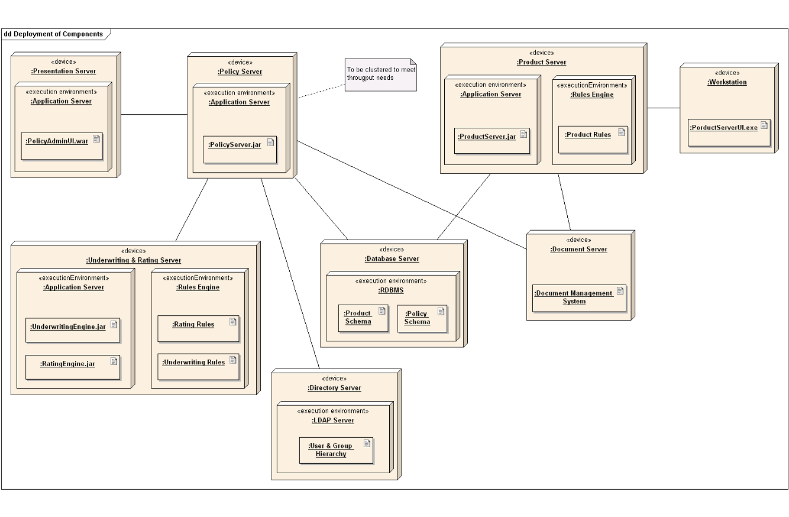

## This Week’s Study Guide

- Further Readings: 
- *Alan Dennis, Barbara Hayley Wixon and David Tegarden.* **System Analysis and Design with UML** (<i>4th Edition</i>). *Wiley, 2013. Chapter 7-10, pp273-472*. 
- *Martin Fowler,* **UML Distilled** *(Third Edition), 2004, Addison-Wesley. (Chapter 7, 8, 13, 14)*
- *Hong Zhu,* **Software Design Methodology - From Principles to Architectural Styles**, Elsevier, 2004. (Chapter 1-3, 8). 
- Mary Shaw, The Role of Design Spaces, IEEE SOFTWARE, Vol. 28, No. 1, JANUARY/FEBRUARY 2012, pp46-50.
- Melta, N. R., Medvidovic, N. and Phadke, S., Towards a taxonomy of software connectors, in *Proc. of ICSE’2000*, IEEE CS, 2000, pp178–187. (optional)

Source: 
<a href="/obu/level6/software-engineering/week6/CHC6173-2022-Lecture%206%20-%20Software%20Design.pptx" class="office-preview">
  CHC6173-2022-Lecture 6 - Software Design.pptx
</a>

