## Today’s Learning Outcomes

- Part 1: Software architecture
    - The notion of software architecture 
    - The roles of software architecture in software design
    - Description of software architecture
- Part 2: Software architectural styles
    - The notion of architectural styles
    - Some typical examples of software architectural styles
    - A catalogue of software architectural styles
- Part 3: Software architectural design
    - Use of appropriate styles for a design problem
    - Combination of styles in one design

## Part 1: The Notion of Software Architecture

### Software Architecture

<div style="width: 100%; overflow-x: auto; font-family: Arial, sans-serif; font-size: 1.0rem; line-height: 1.4;">
  <div style="background-color: #ffff00; border: 3px solid #000; padding: 20px; margin-bottom: 30px;">
    <p style="margin:0; font-weight:500;"><i>‘Abstractly, software architecture involves the description of elements from which systems are built, interactions among those elements, patterns that guide their composition, and constraints on these patterns.’</i></p>
    <p style="text-align:right; margin:15px 0 0 0;">(<i>Shaw and Garlan, 1996</i>)</p>
  </div>
  <div style="color: #00008b; margin-bottom: 20px;">
    <p style="margin:0;">Software architecture is a description of the structure of a software system in terms of <span style="font-weight:bold;">architectural elements</span> and the <span style="font-weight:bold;">interactions</span> between them.</p>
  </div>
  <div style="border: 3px solid #8b4513; padding:15px; text-align:center; font-style:italic; font-size: 1.0rem;">
    Software Architecture = {<span>Components</span>, <span>Connectors</span>}
  </div>
</div>

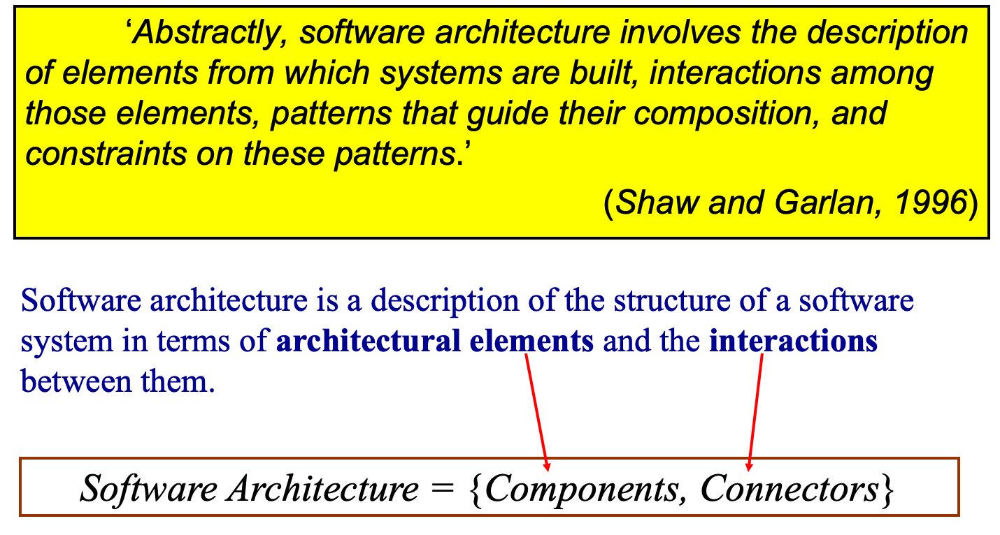

### Component and Connector

- *Components* 
    - A component is a unit of software that performs some function at run-time. 
    - *Examples*: programs, objects, processes, clients, servers, databases 
- *Connectors*
    - A connector is a mechanism that mediates communication, coordination, or cooperation among components. 
    - Connectors describe the interactions among components. 
    - Implementations of connectors are usually distributed over many system components; often do not correspond to discrete elements of the running systems. 
    - *Examples*: shared variable access, procedure calls, remote procedure calls, communication protocols, data streams, transaction streams. 

#### Example 1: Client-Server

```
System simple cs = (
    Component cIient = ( Port send-request; }
    Component server = { Port receive-request; }
    Connector pc = {
        Role caller;
        Role callee;
    }
    Attachment client. send-request to rpc.caller;
    Attachment server. receive-request to rpc. callee;
}
```

#### Example 2: WWW

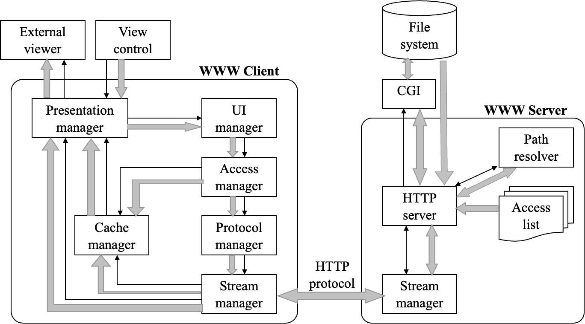

### Common Views of Software Architecture

- ***Logical view***: Captures the logical entities in a software system and how they are interconnected;
- ***Physical view***: Captures the physical (often hardware) entities in a system and how they are interconnected;
- ***Deployment view***: Captures how logical entities are mapped onto physical entities;
- ***Development view***: <br><span style="color: red"><i>A generalization of the implementation view</i></span><br>Captures the developer/programmer's perspective and is concerned with software management. 
- ***Process view***: Captures the dynamic aspects of the system in execution, such as how components communicate and interact, etc.
    - ***Concurrency view***: Captures how concurrency and threading will be managed in a system;
    - ***Behavioural view***: Captures the expected behaviour of (parts of) a system. 

### The 4+1 View Model of Software Architecture

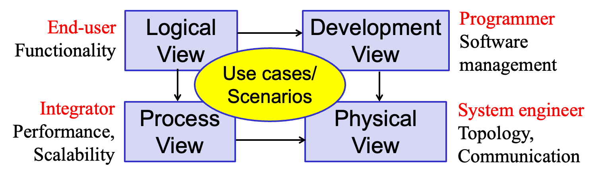

> <span style="color: #3333CC">Kruchten, Philippe (1995, November). <b>Architectural Blueprints — The “4+1” View Model of Software Architecture.</b> IEEE Software 12 (6), pp. 42-50.</span>

### Summary

- Architecture is abstract
    - Software architecture is an representation of a complicated software system at the highest level of abstraction
- Architecture is about structure
    - Software architecture represents a software system in terms of the components together with the interactions among them
    - The details of the components and connectors are hidden and replaced with abstract computational entities that are characterised by a set of properties or architectural models at lower level
- Architecture is purposeful 
    - Software architecture is a model built to achieve certain software engineering purposes
    - There are different architectural models that view the system from different viewpoints according to their specific purpose

### The Importance of Software Architecture

1. Manifestation of early design decisions
    - It defines constraints on implementation
    - It dictates organizational structure
    - It’s the earliest point at which the system can be analysed
        - It inhibits the system's quality attributes
        - It enables predictions on system's quality
        - It makes reasoning about and managing changes easier.
    - It helps with evolutionary prototyping
2. Communication among stakeholders
3. Representation of transferable knowledge of a system

### Representation of Software Architectures

- Software Architecture Description Languages (ADLs)
    - General purpose ADLs: 
        - Darwin \[Magee et al. 1995\]
        - Rapide \[Luckham et al. 1995\]
        - Wright \[Allen and Garlan 1997\]
        - Acme \[Garlan, Monroe and Wile 1997\]
        - ADML \[Spencer 2000\]
        - xADL \[Dashofy, van der Hoek and Taylor 2005\]
    - Domain-Specific and Style-specific ADLs
- Graphical Modelling Languages for SA 
    - SAVN (Software Architecture Visual Notation) \[Bass, Clements and Kazman, 1998\]
    - UML 1.x profiles
    - UML 2.x Component Diagram (see lecture 6)

## Part 2: Software Architectural Styles

### Software Architectural Styles

An architectural style defines a family of systems that are similar in architecture.

- The set of software systems that have certain common architectural features. 
    - Types of components
    - Types of connectors
    - Configuration patterns
    - Mechanisms of dynamic execution

#### Example 1: (A) Audio Transcribing Software

- The system automatically generates text transcriptions from audio data streams of English speech in radio broadcast.

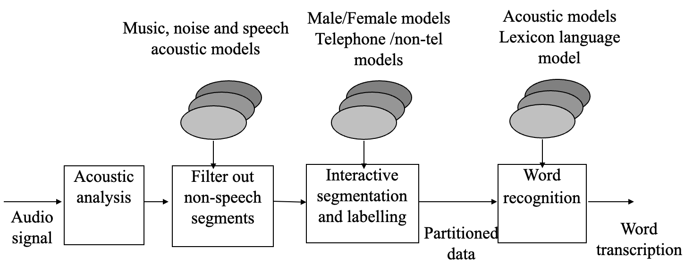

> Pipe and filter

#### Example 1: (B) Data Streams Between the Filters

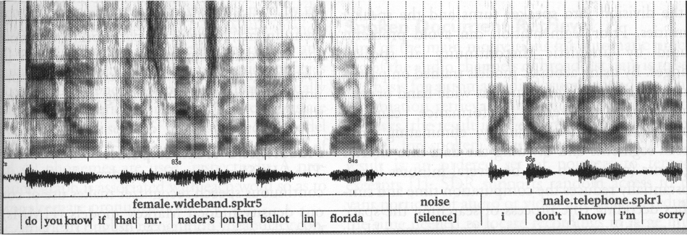
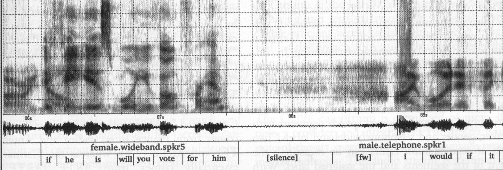

#### Example 1: (C) Representation in UML

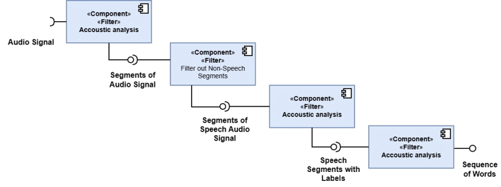

#### Example 2: Processing Online Orders

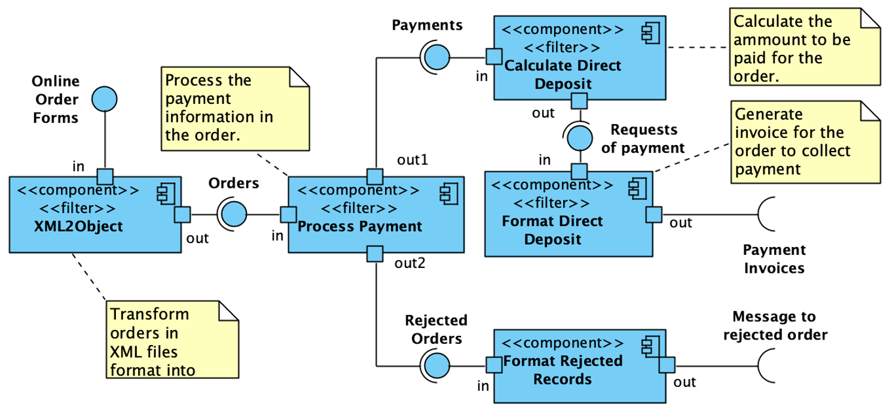

<span style="color: #2D2DB9">An equivalent UML Component Diagram</span>

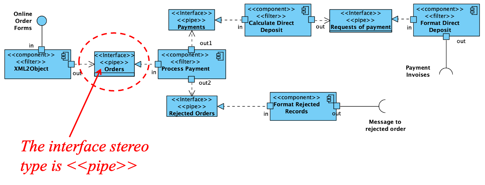

### Pipe-And-Filter Style

- Component: ***Filters***
    - read streams of data on its inputs and produces streams of data on its outputs
    - apply a local transformation to the input streams and compute incrementally
    - Filters must be independent entities 
    - Filters do not know the identity of their upstream and downstream filters
- Connector: ***Pipes***
    - Pipes are conduits for the streams, transmitting outputs of one filter to inputs of another
    - The correctness of the system should not depend on the order in which the filters perform their incremental processing

### A Catalogue of Software Architectural Styles

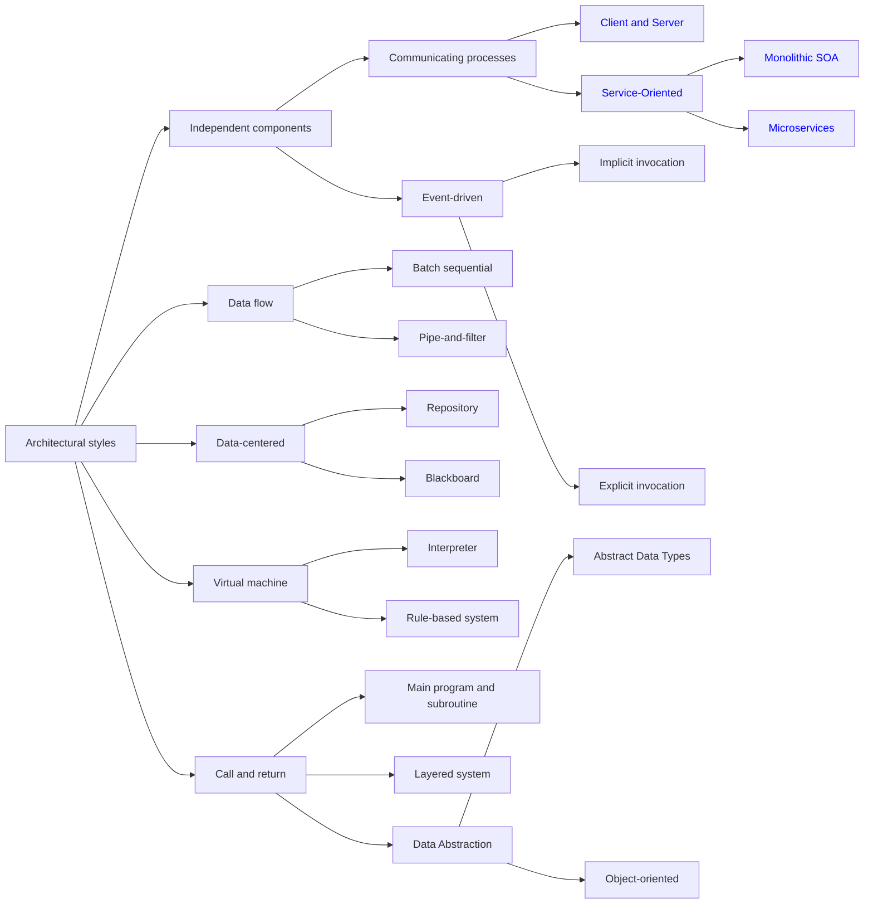

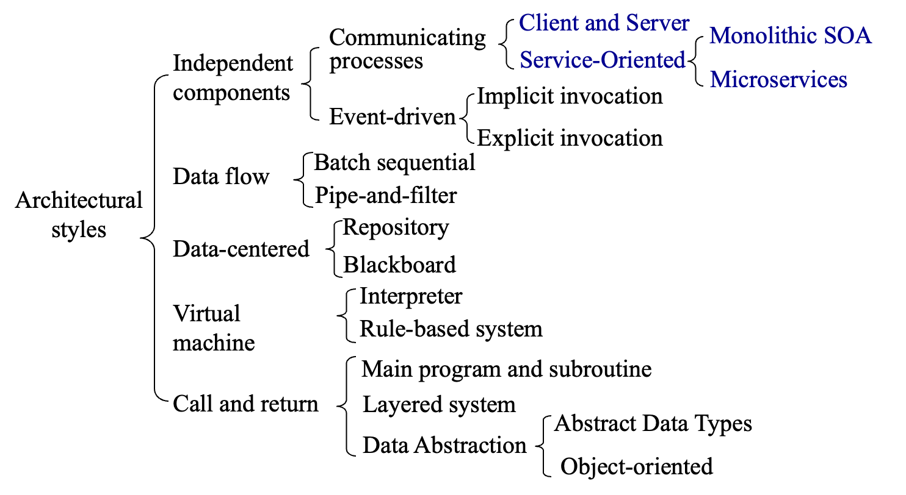

### Call-and-Return Architectures

- Components:
    - Passive code components, e.g.
        - Procedures/functions,
        - Objects
    - Data storage components
- Connectors:
    - Procedure calls/method invocations
- Sub-styles:

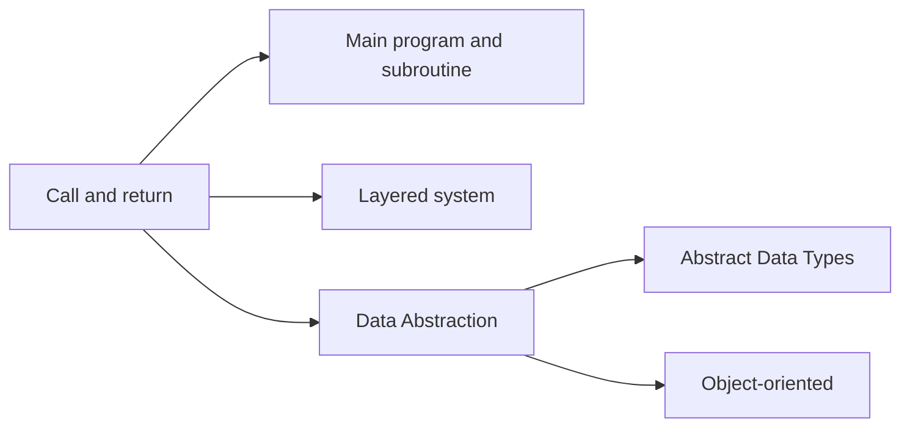


### Main-Program-And-Subroutine Architectures

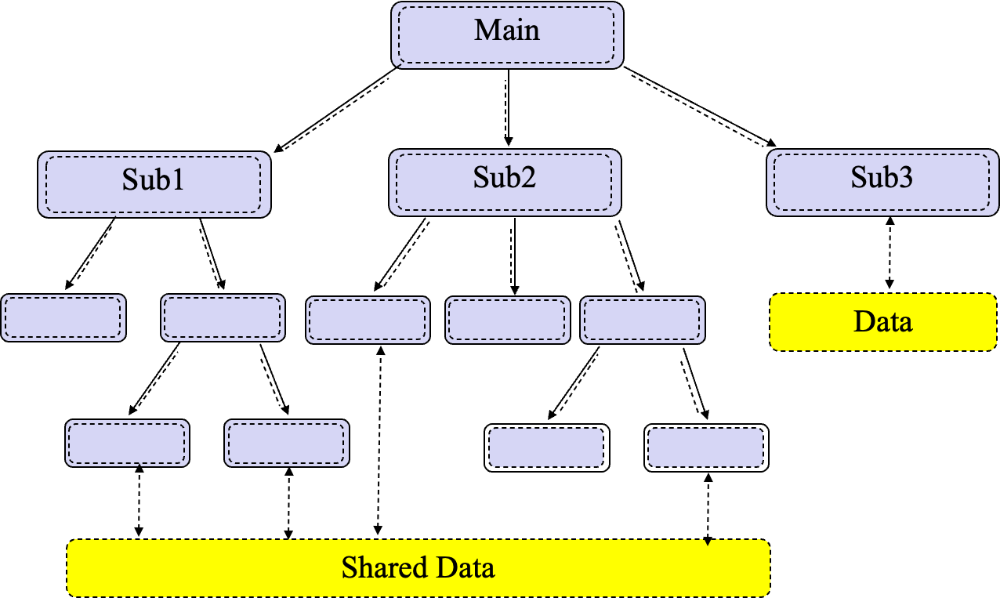

### Data Abstraction

- Components: 
    - Procedures/Functions and data storages are encapsulated into components 
        - Objects (instances of classes) 
        - Abstract data types
- Connectors:
    - Operator (methods) calls

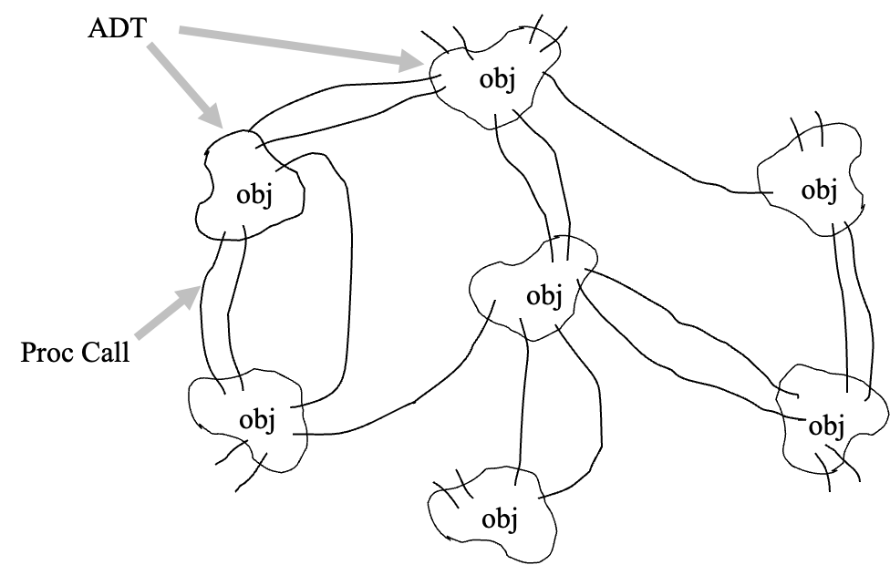

### Layered Systems

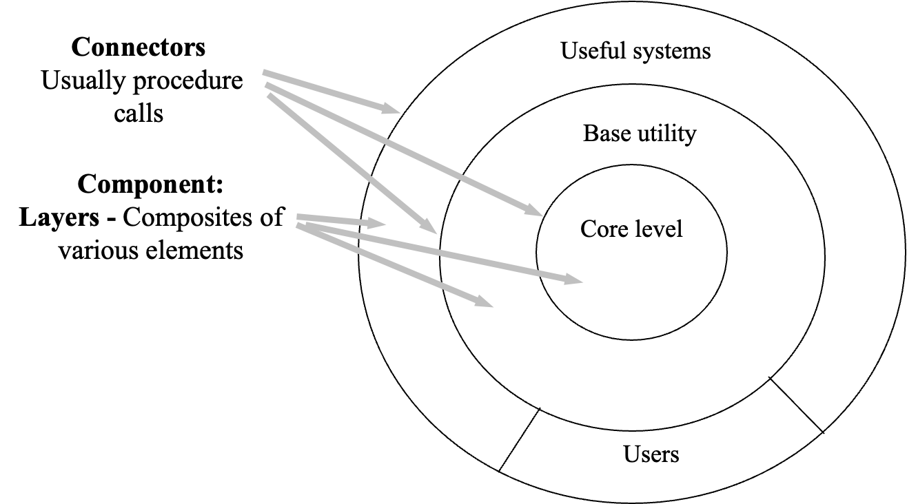

Example:

- Operating systems, Unix
- Communication protocols, TCP/IP

### Data Flow Architectures

<center><h4>Batch Sequential Processing Style</h4></center>

- Components:
    - Called processing steps
    - Independent programs
- Connectors:
    - Data and control passing from step to step

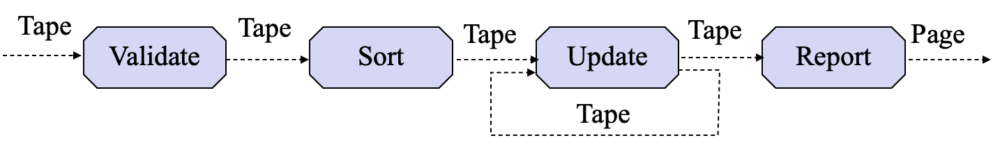

### Data Centred Architectures

- Two types of components:
    - **Data store**(s): the components that store data to be accessed by all other components 
    - **Clients**: computation components that processes the data
- Connectors:
    - Data flows that passes data between the data storage and the processing clients

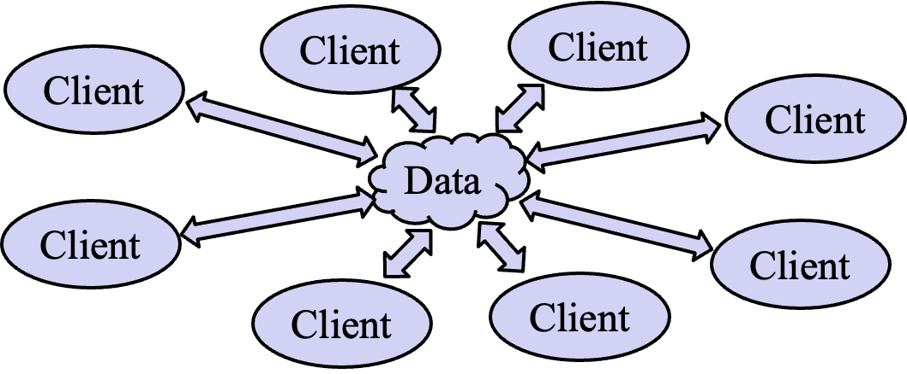

### Repository Architecture

- Components:
    - The data store(s): passive
    - Clients (computation components): active
- Connectors:
    - Data flow (to access the data in the data store(s))

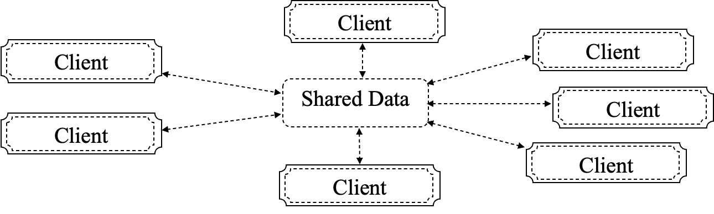

### Blackboard Architectures

- Components:
    - The data store(s): called the blackboard, is an active computation components and contains data
    - Clients: passive computation components
- Connectors:
    - Control and data flow: activated by the data store(s)

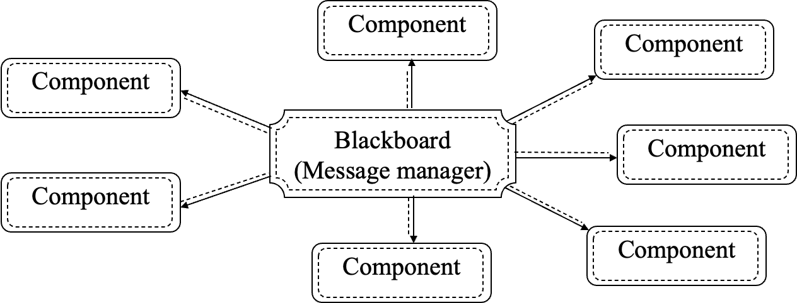

### Virtual Machine Architecture

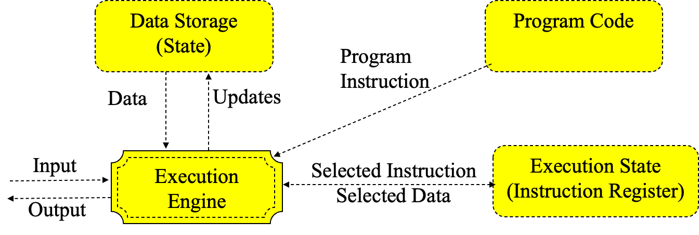

- Advantages: 
    - Portability is the main advantage.
- Example 
    - JVM: the Java language is built to run on top of the Java Virtual Machine, which allows the language to be platform independent. 

### Independent Component Architectures

- Components:
    - A number of processes/threads 
- Connectors:
    - Communicate through messages/events

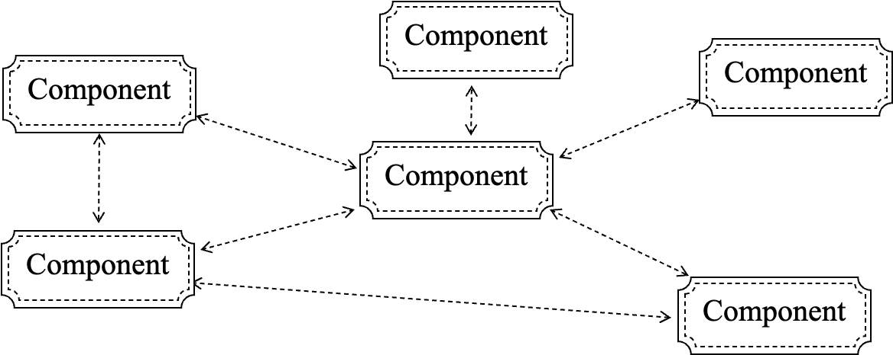

### Communicating Processes

- Components:
    - Processes running on the same machine or distributed on a computer network 
- Connectors:
    - Message communication channels


### Client-Server

- Components:
    - Servers: providing services
    - Clients: requests of services
- Connectors:
    - Clients send service requests to Servers
    - Servers send service responses back to Clients

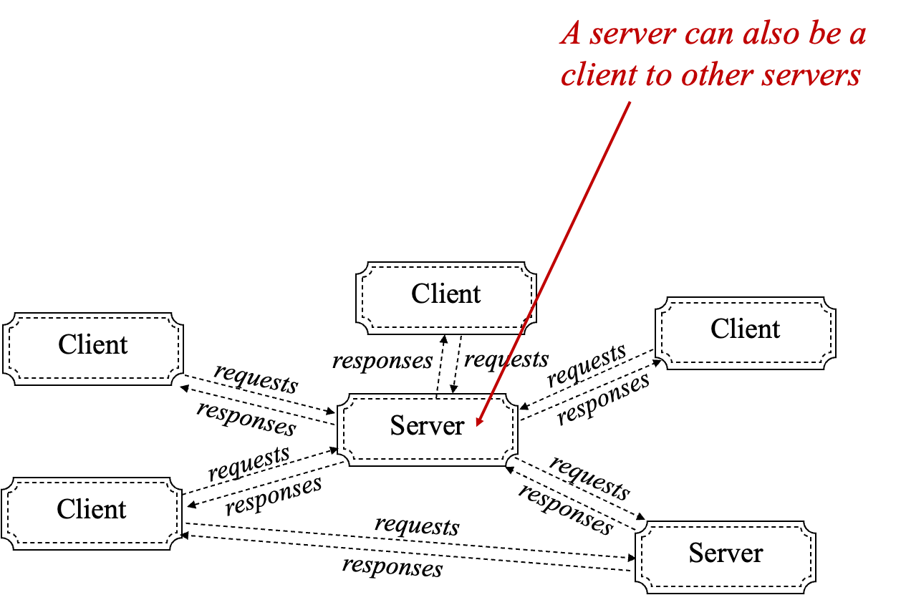

### Service-Oriented Architecture

- **Components:**
    - Services:
        - Autonomous  
            - Independent systems; 
            - Possibly owned by different organisations
        - Interface for program to program interoperation
- **Connectors:**
    - Service requests/responses
        - Messages through Internet
    - Dynamic connections
- **Configuration:**
    - Registry of services 
    - Registry itself is a service
    - Service providers can be dynamically discovered and connected to

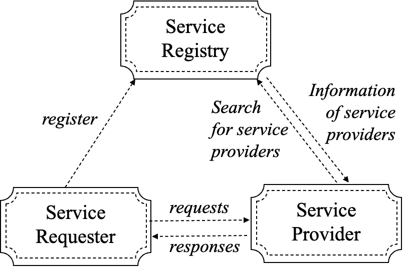

- <span style="color: #002060"><i>Many service requestors and service providers from different vendors;</i></span>
- <span style="color: #002060"><i>Each service is an independent application;</i></span>
- <span style="color: #002060"><i>Service requestors and provider may not known to each other at design time, but discovered at runtime.</i></span>

### Monolithic vs Microservices Architectures

| 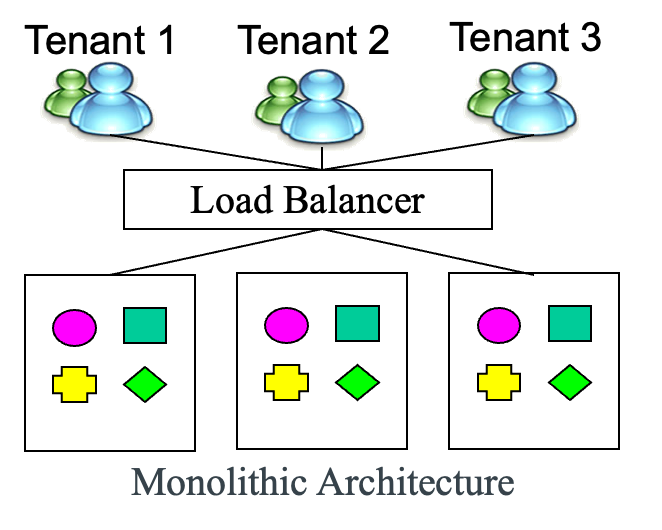                                                                                                                                                                                                                                                                               | 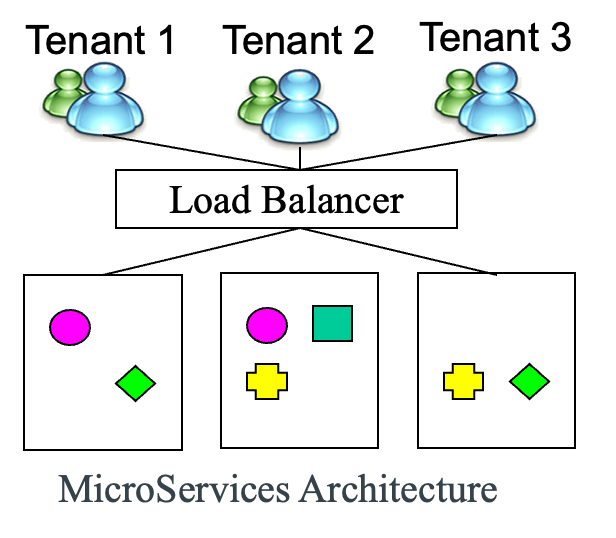                                                                                                                                                                                                                                                                                                           |
| ---------------------------------------------------------------------------------------------------------------------------------------------------------------------------------------------------------------------------------------------------------------------------------------------------------------------- | -------------------------------------------------------------------------------------------------------------------------------------------------------------------------------------------------------------------------------------------------------------------------------------------------------------------------------------------------- |
| <ul style="color: #002060"><li><i>The whole system is a service to its users</i></li><li><i>Inside the system, there may be multiple copies of the software running on a cluster of computers</i></li><li><i>Requests are distributed to different copies through a load balancer to achieve scalability</i></li></ul> | <ul style="color: #002060"><li><i>Inside a service provider, the components are also in service-oriented architecture</i></li><li><i>A component (service in micro scale) has many instances created/terminated at runtime.</i></li><li><i>Requests are distributed to different instances of micro-services through a load balancer</i></li></ul> |

#### Monolithic Architecture

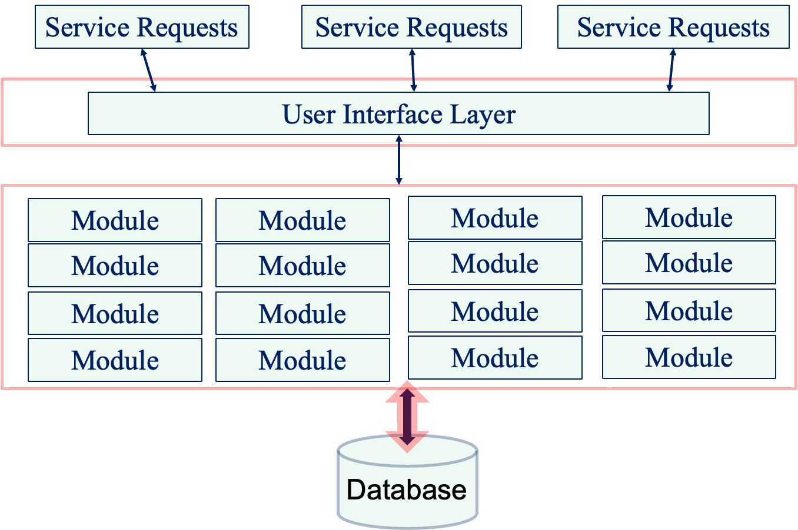

#### Microservices Architecture

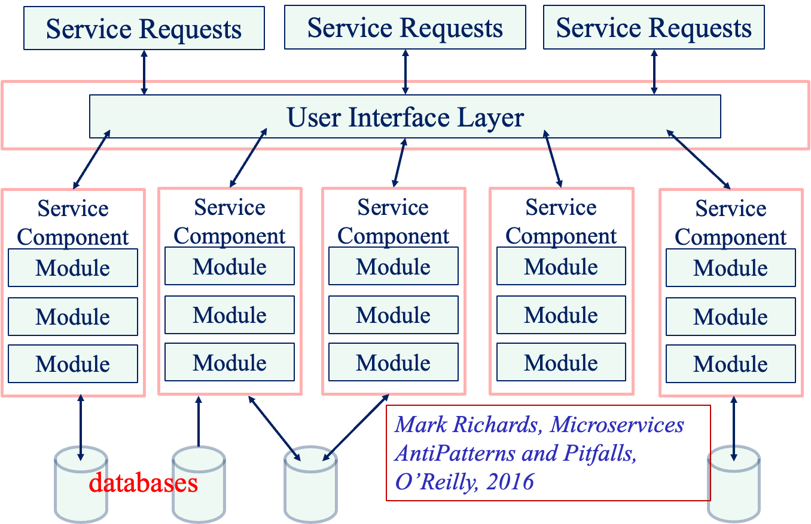

> Databases are also components, not services.

---

- Components: Services 
    - Runs in its own process 
    - Independently deployable
    - Each service is specialised in one function
        - Each service implements one function and only a function 
    - Fine granularity
        - Large in numbers, but small in size 
- Connectors: Service request and response 
    - Through a light weight communication facility
- Configuration: Dynamic, duplicated and distributed 
    - Distributed: A service can be located on any machine in a cluster
    - Duplicate: A service may have multiple copies, if needed
    - Dynamic: A service can be dynamically created and terminated 

## Part 3: Software Architectural Design

### Which architectural style should be used

The selection of software architectural style should take into consideration of two factors:

- The required computation
    - Structural features of the data (e.g. sizes) 
        - Features of the Input and output: e.g. stream data, multimedia, numeric, text, 
        - Features of the data to be stored: e.g. persistent, temporal, etc. 
    - Dynamic features about data processing:
        - Real-time, distributed, mobile, context awareness, location awareness
- Quality requirements
    - The quality requirements that the system must satisfy

#### Example: Pipe-and-Filter

- Applicable computations
    - Input and output data are streams of values.
    - The computation is to transform the continuous streams of data.
        - The transformations are incremental. 
        - One transformation can begin before the previous step has completed. 
- Achievable quality attributes
    - ***Scalability***: capable of processing the input data of unbounded length. 
    - ***Performance***: can respond to the input as soon as an element of the input data is fed into the system before the whole stream of data is obtained. 

### Combinations of Styles

- The design of a software system may need to combine different styles to solve a design problem.
- Heterogeneous style
    - Systems that are not in a single style
- How styles can be combined together:
    - Hierarchically heterogeneous styles
    - Simultaneously heterogeneous styles
    - Locationally heterogeneous styles

### Design of Cloud Native Apps in Microservices

- Break the system into a collection of services of micro-scale
    - Simple responsibility: *Each service realizes one function only*
    - Domain driven design: *Analysis model –> Design model –> Code*
- Where to process data (Services on the cloud vs on devices)
    - Enabling parallel and distributed computation 
    - Reducing communication overhead
- Where to store data (On cloud vs on Device)
    - Reducing communication overhead (local processing vs upload raw data) 
    - Maintaining data consistency (eventual consistency vs ACID transactions) 
- Apply design patterns to further improve quality 
    - Tolerant of failures and lost of communication 
    - Location and replication of data (on cloud vs on client device)
    - Scalability for processing big data through scale out

#### Example: Mobile Restaurant Booking (Customer APP)

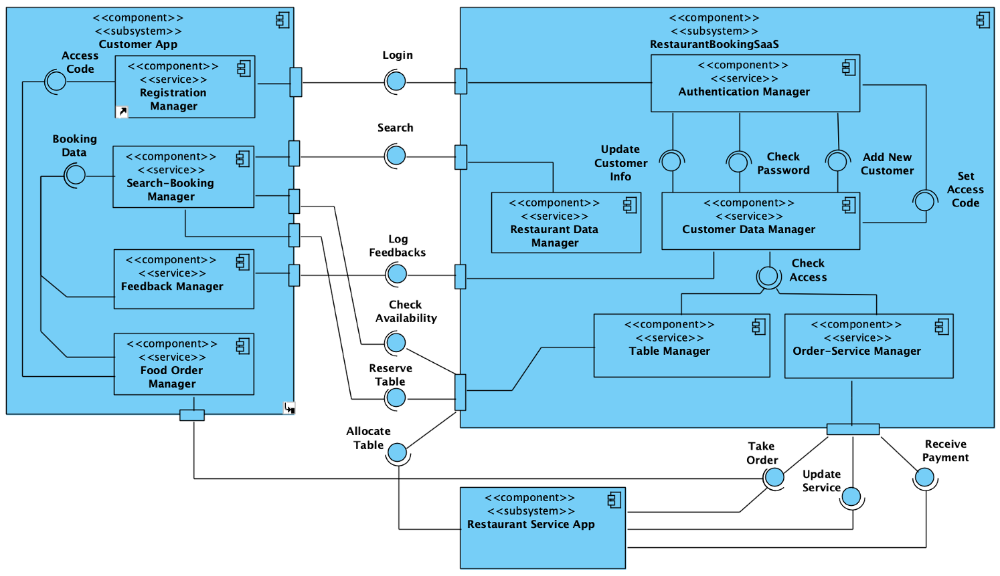

##### Design Patterns of MicroServices: Load Balancer

- When to use: If the workload on the service can be heavy

<span style="color: #2D2DB9"><b>Load Balancer:</b></span>

- <span style="color: #2D2DB9">Distribute service requests to instances of the service</span>
- <span style="color: #2D2DB9">Create new instance(s) when work load is higher than capacity</span>
- <span style="color: #2D2DB9">Terminate instance(s) when work load is below necessary</span>

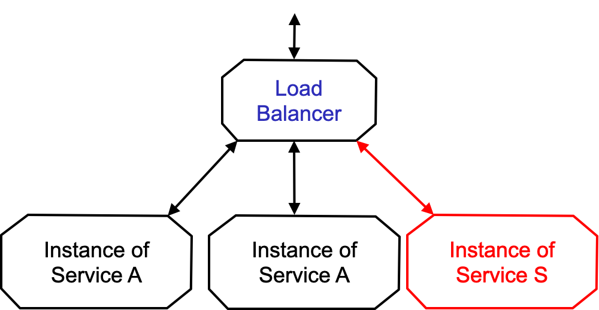

##### Design Patterns of MicroServices: Circuit Breaker

- ***When to use***: if the reliability of the service is important

<span style="color: #2D2DB9"><b>Circuit Breaker:</b></span>

- <span style="color: #2D2DB9">Monitor the performance of the service instances</span>
- <span style="color: #2D2DB9">When an instance fails, it informs the source of requests to stop feed service requests.</span>

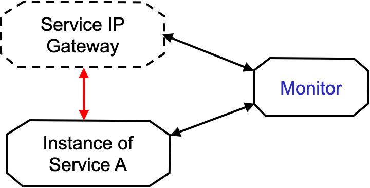

##### Design Patterns of MicroServices: Recovery

- When to use: If the reliability of the service is important

<span style="color: #2D2DB9"><b>Recovery:</b></span>

- <span style="color: #2D2DB9">Monitor the performance of the service instances</span>
- <span style="color: #2D2DB9">When an instance fails, it creates a new instance to replace it</span>

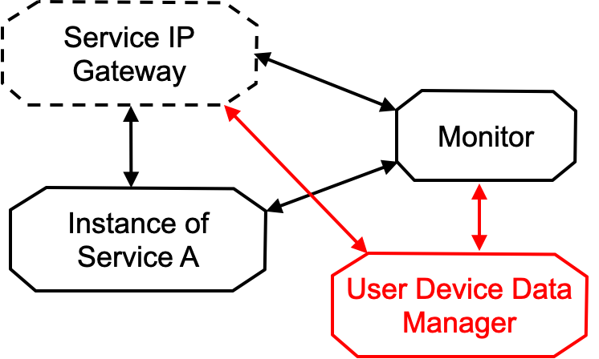

###### How to Monitor Services

- Heartbeat:
    - Each service instance send a signal [+signal] to the monitor periodically
    - If a heartbeat signal is missed for a consecutive number of times (say 3 times), the monitor regards the service instance failed.
    - *Faults can be detected:* service crashed so that no heartbeat will be sent out
- Poke:
    - The monitor sends a message to the service instance and asks it to report its service state
    - The service instance reports back to the monitor
    - *Faults can be detected:* Depends how much details of service instance reports back, e.g. workload information (queue less), resource consumption (memory and CPU usage)
- Watch: (*only applicable to event driven system*)
    - Recording the service requests and responses of the instance

[+signal]: *called **heartbeat** signal*

##### Design Patterns of MicroServices:

Combination of Load Balancer, Circuit Breaker and Recovery

- When to use: If the reliability of the service is important

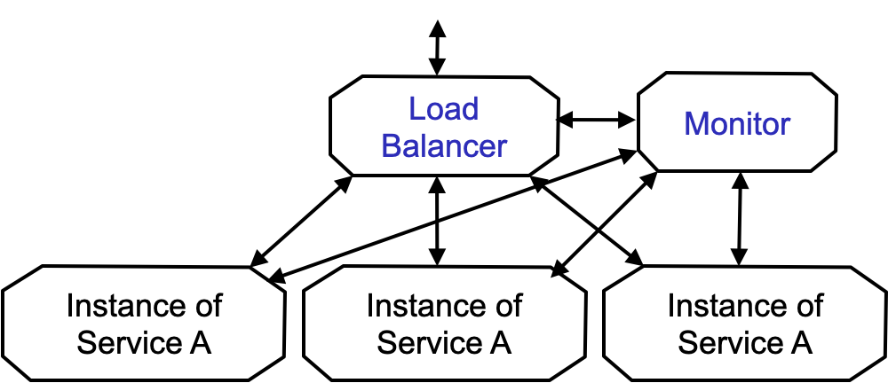

## Study Guide

Further Readings  
\[1\] Zhu, H., Software Design Methodology.  Chapter 4, 5, 6, 7.  
\[2\] Shaw, M. and Garlan, D., Software Architecture: Perspectives on an Emerging Discipline, Prentice Hall, 1996.  Chapter 2, 3.  
\[3\] Bass, L., Clements, P.  and Kazman, R., Software Architecture in Practice, Addison Wesley, 1998. (optional)  
\[4\] Clements, P., et al., Documenting Software Architectures: Views and Beyond, 2nd Edition, Addison Wesley, 2011. (optional)  Page 438-443, Section A.3 Documenting a Component-and-Connector View  

Source:
<a href="/obu/level6/software-engineering/week7/CHC6173-Lecture%207%20-%20Software%20Archiectural%20Design.pptx" class="office-preview">
  CHC6173-Lecture 7 - Software Archiectural Design.pptx
</a>

<script>
document.querySelectorAll("a.office-preview").forEach((link) => {
  const fileUrl = new URL(
    link.getAttribute("href"),
    window.location.href
  ).href;

  const previewUrl = new URL(
    "https://view.officeapps.live.com/op/view.aspx"
  );

  previewUrl.searchParams.set("src", fileUrl);

  link.href = previewUrl.href;
  link.target = "_blank";
  link.rel = "noopener noreferrer";
});
</script>
