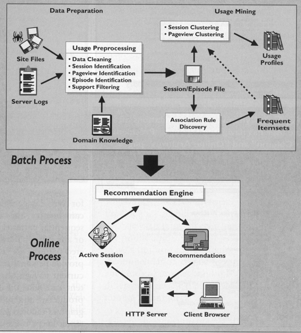

## Introduction

The practical questions are intended to give an exercise on the notion of software architecture and the description of software architecture in the Software Architecture Visual Notation.

## Modelling in UML Component Diagram

The diagram in Figure 1 depicts the structure for usage-based Web personalization software. Represent the architecture using UML component diagram. 

## Architectural Design

Consider the Exercise question of Week 6 Question 3 Merging Lists of Contact Addresses. Using different architectural styles to make as many different designs as possible.

***Hint***: You may try to use the following architectural styles:

- object-oriented or ADT, 
- pipe-and-filter, 
- service-oriented, etc.

## Case Study

Based on the partial architectural design of the Mobile Restaurant Booking System given in the lecture slide, complete the architectural design in the microservices architecture. 

***Hint***: You should approach the design problem through the following steps:

(a) Decompose each subsystem into microservices so that each service only implements one function. The subsystem for the Customer App has been given in the lecture notes on Slide 44 and in the sample answer to Practical 6. You may need to revise the part on the cloud.  
(b) Distribute the microservices to either user’s devises or to the cloud.  
(c) Analyse if the quality requirements are satisfied by the design; if not, apply the design patterns of microservices to improve the quality.  

Source:
<a href="/obu/level6/software-engineering/week7/CHC6173-Practical%207%20-%20Architectural%20Design.docx" class="office-preview">
  CHC6173-Practical 7 - Architectural Design.docx
</a>

